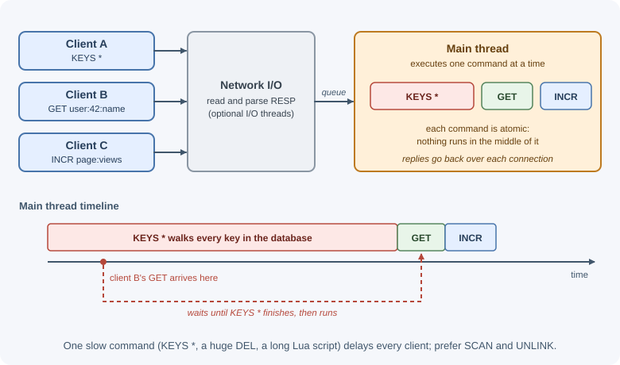

# Redis Fundamentals

Redis is an in-memory data structure server: a separate process that holds
data in RAM and lets clients read and change it with simple commands over a
network connection. Its values are not just strings but lists, hashes, sets,
sorted sets, streams, and more, each with commands designed for it. Backends
use Redis for caching, sessions, counters, rate limits, queues, and
real-time features.

## Why it matters

A typical database query reads from disk, parses SQL or a query document,
and may take several milliseconds. A Redis command usually completes in well
under a millisecond on the server. When the same data is read thousands of
times per second, or when several application instances need to share fast,
temporary state, Redis removes load from the primary database and keeps
response times low.

Redis is also easy to misuse: it is limited by memory, it is not durable by
default in every configuration, and one slow command can stall every client.
Understanding how it works is the basis for the other Redis lessons.

## Real-world usage

- **GitLab** uses Redis for many separate jobs at once. Its development
  guide lists caching, the Sidekiq job queue, shared application state, CI
  trace chunks, a Pub/Sub backend for ActionCable, rate-limiting state, and
  sessions, and notes that GitLab.com runs separate Redis instances rather
  than one shared server
  ([GitLab: Redis guidelines](https://docs.gitlab.com/development/redis/)).
  One fast, shared store serves many features; splitting instances keeps a
  busy cache from hurting queues and sessions.
- **Mastodon** backs home feeds, list feeds, Sidekiq queues, and its
  streaming API with Redis, and also uses it for volatile caching. Its
  scaling guide recommends a separate Redis for the cache, because the other
  data is important to keep
  ([Mastodon: Scaling up your server](https://docs.joinmastodon.org/admin/scaling/)).
- **Stripe** implements its API rate limiters with Redis and keeps a Redis
  cluster that counts in-flight requests for load shedding
  ([Stripe: Scaling your API with rate limiters](https://stripe.com/blog/rate-limiters)).
  Every API server needs the same counters at sub-millisecond speed, which a
  shared in-memory store provides.

Popular tools and providers:

- [Redis Open Source](https://redis.io/docs/latest/) and
  [Valkey](https://valkey.io/), a BSD-licensed fork backed by the Linux
  Foundation.
- [Amazon ElastiCache](https://docs.aws.amazon.com/AmazonElastiCache/latest/dg/WhatIs.html),
  which runs Valkey, Memcached, and Redis OSS engines.
- [Google Cloud Memorystore for Redis](https://cloud.google.com/memorystore/docs/redis/memorystore-for-redis-overview)
  and [Azure Managed Redis](https://learn.microsoft.com/en-us/azure/azure-cache-for-redis/cache-overview)
  (Microsoft is retiring Azure Cache for Redis in its favor).

## How it works

### The client-server model

```text
+--------------+       TCP (port 6379)        +--------------------+
| App instance |  --- SET user:42:name Ada -->|                    |
|  (Node.js)   |  <-------- OK --------------|   Redis server     |
+--------------+                              |                    |
+--------------+                              |  keys -> values    |
| App instance |  --- GET user:42:name ------>|  held in memory    |
|  (Node.js)   |  <-------- "Ada" -----------|                    |
+--------------+                              +--------------------+
```

Redis is a **key-value** store at its core. Every piece of data lives under
a **key** (a string), and the value has a **type**: string, list, hash, set,
sorted set, stream, and others covered in
[data structures](data-structures.md). Each type has its own commands, and
using the wrong command on a key returns a `WRONGTYPE` error.

### Why Redis is fast

1. **Data lives in memory.** Reads and writes do not wait for disk.
2. **Commands run one at a time.** A single main thread executes commands
   sequentially. There are no locks between commands, and every individual
   command is **atomic**: no other command runs in the middle of it.
3. **I/O can use extra threads.** Since Redis 6, optional I/O threads can
   read and write network data in parallel, while command execution stays on
   the main thread. Background threads also handle work such as freeing
   large values and syncing files to disk.
4. **Compact encodings.** Small lists, hashes, sets, and sorted sets are
   stored in memory-efficient formats and switch to larger structures only
   when they grow.
5. **Simple protocol.** The wire protocol is cheap to parse.

The flip side of single-threaded execution: a slow command blocks all
clients. `KEYS *` on millions of keys, deleting a huge value with `DEL`, or
a long Lua script freezes the server until it finishes. Prefer `SCAN` to
`KEYS`, `UNLINK` (asynchronous delete) to `DEL` for big values, and keep
scripts short.



### Keys and naming conventions

Keys are binary-safe strings (up to 512 MB, though they should be short).
Redis has no tables or folders, so teams invent structure with a naming
convention, usually segments separated by colons:

| Key | Meaning |
|-----|---------|
| `user:42` | Hash with user 42's profile |
| `user:42:sessions` | Set of session IDs for user 42 |
| `session:9f3c...` | One session's data |
| `cache:v2:product:17` | Cached product, cache format version 2 |
| `rate:login:203.0.113.5` | Login attempt counter for one IP |

Good keys are readable, predictable, include the object type and ID, and
can include a version so a cache format change does not read old data.

Redis also has numbered logical **databases** (0–15 by default, chosen with
`SELECT`), but Redis Cluster supports only database 0. Separate instances or
key prefixes are the more common way to isolate data.

### Expiration (TTL)

Any key can have a **time to live**. When it expires, Redis deletes it.

| Command | Effect |
|---------|--------|
| `SET key value EX 60` | Set a value that expires in 60 seconds (`PX` for milliseconds) |
| `EXPIRE key 60` | Add or change a TTL on an existing key |
| `EXPIREAT key 1767225600` | Expire at a Unix timestamp |
| `TTL key` | Seconds left: `-1` means no expiry, `-2` means the key does not exist |
| `PTTL key` | Milliseconds left |
| `PERSIST key` | Remove the TTL |

Commands that **replace** a value (such as `SET` without `KEEPTTL`) clear the
TTL. Commands that **modify** a value in place (such as `INCR`, `LPUSH`, or
`HSET`) keep it.

Redis removes expired keys in two ways:

- **Lazy (passive) expiry:** when a client accesses a key, Redis checks
  whether it has expired and deletes it before answering.
- **Active expiry:** a background cycle repeatedly samples keys that have a
  TTL and deletes the expired ones, so keys nobody reads still disappear.

Because active expiry samples rather than scanning everything, an expired
key may occupy memory briefly, but no client will ever read it.


### redis-cli basics

`redis-cli` is the command-line client. Run it with no arguments to connect
to `localhost:6379`, or pass `-h`, `-p`, and `-a`/`--user`, or a URL with
`-u`.

```text
$ redis-cli
127.0.0.1:6379> PING
PONG
127.0.0.1:6379> SET greeting "hello" EX 60
OK
127.0.0.1:6379> GET greeting
"hello"
127.0.0.1:6379> TTL greeting
(integer) 57
127.0.0.1:6379> TYPE greeting
string
127.0.0.1:6379> EXISTS greeting missing
(integer) 1
127.0.0.1:6379> DEL greeting
(integer) 1
127.0.0.1:6379> GET greeting
(nil)
```

Useful commands while learning: `SCAN 0 MATCH user:* COUNT 100` to list keys
safely, `INFO` for server statistics, `MONITOR` to watch every command (only
on a development server, because it slows Redis), and `--latency` to measure
round-trip time.

### RESP, the wire protocol

Clients talk to Redis with **RESP** (REdis Serialization Protocol), a simple
text-prefixed format. `SET key value` is sent as an array of bulk strings:

```text
*3\r\n$3\r\nSET\r\n$3\r\nkey\r\n$5\r\nvalue\r\n
```

and the reply `+OK\r\n` is a simple string. RESP3, introduced in Redis 6
and selected with the `HELLO 3` command, adds richer types such as maps,
doubles, and out-of-band push messages. Client libraries handle the protocol
for you; knowing it exists explains why pipelining many commands is cheap.

### Running Redis locally

The quickest way is the official Docker image:

```text
$ docker run -d --name redis -p 6379:6379 redis
$ docker exec -it redis redis-cli PING
PONG
```

See [Docker](../../07-devops-and-deployment/docker.md). Never expose port
6379 to the internet: require authentication (passwords or ACL users), use
TLS for connections across networks, and keep Redis on a private network.

### Connecting from Node.js

The examples in these Redis lessons use the official **node-redis** client
(`redis` on npm). Its methods mirror Redis commands in camelCase: `GET` is
`get`, `HSET` is `hSet`, `ZADD` is `zAdd`. Option names occasionally change
between major versions of the client, so check its documentation for the
version you install.

### Redis compared with Memcached

| | Redis | Memcached |
|-|-------|-----------|
| Values | Many data types with server-side operations | Strings (bytes) only |
| Persistence | Optional (RDB snapshots, AOF log) | None |
| Replication and failover | Built in (replicas, Sentinel, Cluster) | Not built in |
| Threading | Single-threaded command execution, optional I/O threads | Multi-threaded |
| Extra features | Pub/Sub, streams, Lua scripts, transactions | Minimal by design |
| Typical use | Cache plus shared state, counters, queues | Simple, very large caches |

Memcached remains a good, simple cache; Redis is chosen when you need data
types, persistence, replication, or the other features.

### Redis, its license, and Valkey

Redis was open source under the BSD license for most of its history. In
2024, Redis Ltd. moved new versions (starting with 7.4) to source-available
licenses (RSALv2 and SSPLv1). In response, the Linux Foundation started
**Valkey**, a BSD-licensed fork of the last open-source Redis code (the 7.2
line), which stays command-compatible with Redis for the features they
share. Redis 8 (May 2025) later added the open-source AGPLv3 as a licensing
option. For application code
the commands in these lessons work on both; the choice matters mainly for
companies that redistribute or host the server, and some managed services
(for example Amazon ElastiCache) offer Valkey.

## When to use and when not to use

Use Redis when:

- Several application instances must share fast, temporary state: sessions,
  counters, rate limits, locks, or feature flags.
- The same data is read far more often than it changes and can be rebuilt
  from a database (a cache).
- An operation maps onto a server-side data structure command: a
  leaderboard, a capped feed, a set of unique visitors, a work queue.
- The working data fits comfortably in RAM.

Avoid Redis, or use it only next to another store, when:

- It would be the only copy of business-critical records that need joins,
  ad-hoc queries, or multi-table transactions; use a primary database.
- The dataset is much larger than the memory you can afford.
- You need months of replayable events at high volume; a log-based broker
  such as Kafka fits better (see [Pub/Sub and streams](pub-sub-and-streams.md)).
- One process could keep the data in memory itself, with no sharing needed.

| Need | In-process cache (`Map`) | Memcached | Redis | Primary database |
|------|--------------------------|-----------|-------|------------------|
| Shared across instances | No | Yes | Yes | Yes |
| Data types and server-side operations | Any JS value, local only | Strings only | Many types, atomic commands | Tables or documents, rich queries |
| Survives a restart | No | No | Optional (RDB/AOF) | Yes |
| Replication and failover | No | Not built in | Built in | Built in |
| Typical role | Hottest per-process data | Simple shared cache | Cache plus shared state | System of record |

## Practical examples

### Connect, set, and read with node-redis

```js
import { createClient } from "redis";

const client = createClient({ url: process.env.REDIS_URL }); // redis://host:6379
client.on("error", (err) => console.error("Redis client error", err));
await client.connect();

await client.set("greeting", "hello", { EX: 60 }); // SET greeting hello EX 60
console.log(await client.get("greeting"));           // "hello"
console.log(await client.ttl("greeting"));           // e.g. 60
console.log(await client.get("missing"));            // null

await client.close(); // waits for pending commands, then disconnects
```

`close()` is the node-redis v5+ name; older v4 code calls `quit()`, which
still works but is deprecated. `destroy()` drops the connection immediately.

Always attach an `error` listener: without it, a connection error is an
unhandled event that can crash the process. node-redis reconnects
automatically after network failures.

### One shared client per process

```js
// redis.js: create the client once and import it everywhere.
import { createClient } from "redis";

export const redis = createClient({ url: process.env.REDIS_URL });
redis.on("error", (err) => console.error("Redis error", err));
await redis.connect();
```

Creating a client per request opens a new TCP connection each time and
quickly exhausts the server's connection limit.

### Expiry in action

```text
127.0.0.1:6379> SET otp:42 "839201" EX 300
OK
127.0.0.1:6379> TTL otp:42
(integer) 296
127.0.0.1:6379> PERSIST otp:42
(integer) 1
127.0.0.1:6379> TTL otp:42
(integer) -1
127.0.0.1:6379> EXPIRE otp:42 5
(integer) 1
127.0.0.1:6379> GET otp:42      # six seconds later
(nil)
```

### Iterating keys safely with SCAN

```text
127.0.0.1:6379> SCAN 0 MATCH user:* COUNT 100
1) "1792"           <- cursor for the next call; "0" means finished
2) 1) "user:42"
   2) "user:7"
```

`SCAN` returns a page of keys and a cursor. Repeat with the returned cursor
until it is `0`. It may return a key more than once, so treat results as a
set.

## Best practices

- Use a consistent key naming scheme with an object type, ID, and optional
  version.
- Give temporary data a TTL; unbounded keys eventually fill memory.
- Avoid `KEYS`, `FLUSHALL`, and other blocking or destructive commands in
  production; block them for application users with ACL rules (for example
  `-@dangerous`).
- Keep values small; split very large hashes, lists, or sets.
- Create one client per process and reuse it; handle `error` events.
- Require authentication, use TLS across networks, and never expose Redis
  publicly.
- Set `maxmemory` and an eviction policy appropriate to the workload (see
  [using Redis as a cache](redis-as-a-cache.md)).
- Decide explicitly whether the data must survive restarts (see
  [persistence and high availability](persistence-and-high-availability.md)).

## In production

**Latency spikes and client timeouts.**

- **Detect:** `SLOWLOG GET 10` lists the slowest recent commands; enable the
  latency monitor with `CONFIG SET latency-monitor-threshold 100` and read
  `LATENCY LATEST` or `LATENCY DOCTOR`.
- **Cause:** one slow command blocks every client: `KEYS *`, `DEL` of a huge
  value, `HGETALL` or `SMEMBERS` on a collection with millions of members, or
  a long Lua script.
- **Fix:** use `SCAN` and `UNLINK`, split big keys, fetch only the fields you
  need, and keep scripts short.

**Writes fail or cached data vanishes when memory fills.**

- **Detect:** `INFO memory` shows `used_memory` reaching `maxmemory`;
  `INFO stats` shows `evicted_keys` rising. With `noeviction`, write commands
  start returning out-of-memory errors while reads still work.
- **Cause:** keys without TTLs, big keys, or a backlog that grows faster than
  it drains. Slack's Redis job queue had an outage when Redis reached its
  memory limit and workers could no longer dequeue
  ([Slack engineering](https://slack.engineering/scaling-slacks-job-queue/)).
- **Fix:** add TTLs, choose an eviction policy that fits the data, alert on
  memory well before the limit, and keep caches and queues on separate
  instances.

**New connections are refused.**

- **Detect:** `INFO clients` shows `connected_clients` near `maxclients`
  (10,000 by default); `INFO stats` shows `rejected_connections` increasing.
- **Cause:** a client created per request, or connections that are never
  closed.
- **Fix:** create one client per process and reuse it, and close it on
  shutdown.

**The server becomes very slow or is killed by the operating system.**

- **Detect:** the `Swap` lines in `/proc/<pid>/smaps` for the Redis process
  are non-zero (the check the Redis latency guide recommends);
  `used_memory_rss` smaller than `used_memory` (a `mem_fragmentation_ratio`
  below 1) is another hint; system logs show the process was killed for
  memory.
- **Cause:** `maxmemory` unset or set too close to the machine's RAM, with no
  headroom for snapshots, replication buffers, and client buffers.
- **Fix:** set `maxmemory` well below physical RAM and monitor memory at the
  host level too.

## Important terminology

- **In-memory data store:** A database that keeps its working data in RAM.
- **Key:** The name under which a value is stored.
- **Data type:** The structure of a value (string, hash, list, set, and so
  on).
- **TTL:** Time to live: how long until a key expires.
- **Atomic command:** A command that runs completely without other commands
  interleaving.
- **RESP:** The Redis Serialization Protocol used between clients and server.
- **redis-cli:** The official command-line client.
- **Valkey:** A BSD-licensed, community fork of Redis maintained under the
  Linux Foundation.

## Common mistakes and misconceptions

- **"Redis is only a cache."** It is also used for sessions, queues,
  leaderboards, locks, and streams.
- **"In-memory means my data is never lost" or "always lost."** Durability
  depends on persistence and replication settings.
- **"Single-threaded means slow."** Sequential execution in memory is very
  fast; the risk is slow commands blocking others.
- **Using `KEYS *` in production.** It scans every key and blocks the server.
- **Forgetting TTLs.** Memory fills, and eviction or errors follow.
- **Overwriting a key and expecting the TTL to stay.** `SET` clears it unless
  `KEEPTTL` is used.
- **Opening a connection per request.** This wastes time and connections.

## Revision questions

1. What makes Redis fast, and what is the main risk of its single-threaded
   command execution?
2. How do lazy and active expiry work together?
3. Which commands keep a key's TTL and which clear it?
4. Why is `SCAN` preferred over `KEYS` in production?
5. How does Redis differ from Memcached?
6. Why should an application create one Redis client per process?

## Further learning

- [Redis documentation: Data types](https://redis.io/docs/latest/develop/data-types/)
- [Redis command reference: SET](https://redis.io/docs/latest/commands/set/)
- [Redis command reference: EXPIRE](https://redis.io/docs/latest/commands/expire/)
- [Redis command reference: SCAN](https://redis.io/docs/latest/commands/scan/)
- [Redis serialization protocol specification](https://redis.io/docs/latest/develop/reference/protocol-spec/)
- [node-redis on GitHub](https://github.com/redis/node-redis)
- [Valkey project](https://valkey.io/)
