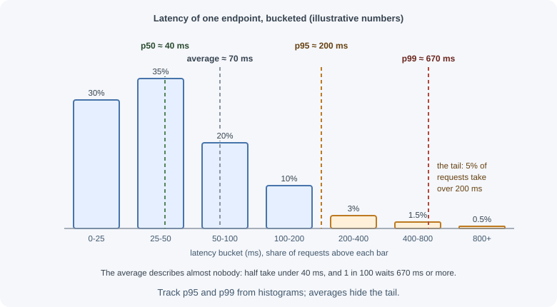

# Performance and Latency

Performance is how quickly a system responds and how much work it can do.
Users feel latency directly: a page that takes three seconds feels broken,
and a checkout that occasionally takes ten seconds loses sales. This page
explains how to measure performance correctly, where time actually goes,
and the techniques that make backends fast.

## Why it matters

- **Speed affects behavior and revenue.** Slow pages are abandoned; slow APIs
  make every client that uses them slow.
- **Averages hide pain.** A service with a 100 ms average can still make one
  user in a hundred wait three seconds, and at scale that is thousands of
  people.
- **Latency and capacity are linked.** Slow requests hold connections,
  memory, and workers longer, so the same hardware serves fewer users.
- **Guessing wastes effort.** Most "optimizations" made without measurement
  speed up code that was never the bottleneck.

## Real-world usage

- **Discord measures the tail.** When Discord moved its message storage from
  Cassandra to ScyllaDB, it reported results as p99 latencies: fetching
  historical messages went from a p99 of 40-125 ms to 15 ms, and inserts from
  5-70 ms to a steady 5 ms. Its data services also use **request
  coalescing**: if many users request the same row at the same time, the
  database is queried once, and consistent-hash routing by channel ID sends
  related requests to the same service instance so coalescing works better
  ([Discord blog](https://discord.com/blog/how-discord-stores-trillions-of-messages)).
- **Google SRE monitors latency distributions.** Google's SRE book recommends
  collecting request counts bucketed by latency (a histogram) rather than
  only averages, to tell a slow average from a slow tail, and lists latency as
  one of the four golden signals
  ([Google SRE book](https://sre.google/sre-book/monitoring-distributed-systems/)).
- **Shopify lowers its timeouts.** Shopify's advice for resilient payment
  systems starts with lowering timeouts, pointing out that Ruby's built-in
  `Net::HTTP` client defaults to 60 seconds for each of connecting, writing,
  and reading, far longer than an online user will wait
  ([Shopify Engineering](https://shopify.engineering/building-resilient-payment-systems)).

**Popular tools and providers:** tracing and metrics with OpenTelemetry,
Prometheus and Grafana, Jaeger, Grafana Tempo, Datadog, and New Relic;
profiling with `node --cpu-prof`, Chrome DevTools, and flame graph tools;
load testing with k6, Gatling, Apache JMeter, and Locust; CDNs such as
Cloudflare, Amazon CloudFront, Fastly, and Akamai.

## How it works

### Latency, throughput, and bandwidth

| Term | Meaning | Unit | Analogy (a highway) |
|---|---|---|---|
| Latency | Time for one operation to complete | ms, µs | How long one car takes to drive from A to B |
| Throughput | Operations completed per unit of time | requests/s, messages/s | How many cars arrive per hour |
| Bandwidth | Maximum data rate a link can carry | Mbit/s, Gbit/s | How many lanes the highway has |

They are related but independent: adding lanes (bandwidth) raises
throughput without making any single car faster. A satellite link can have
high bandwidth and terrible latency.

Two more terms:

- **Response time** is what the client experiences: **queueing time + service
  time** (+ network). Under load, queueing often dominates.
- **Utilization** is the fraction of time a resource is busy. As it
  approaches 100%, queueing time grows sharply. See
  [capacity planning](capacity-planning.md).

### Percentiles and tail latency

A percentile tells you the latency that a given share of requests stays
under:

- **p50 (median):** half the requests are faster than this.
- **p95:** 95% are faster; 1 in 20 is slower.
- **p99:** 99% are faster; 1 in 100 is slower.
- **p99.9:** 1 in 1,000 is slower.

The slow end of the distribution is the **tail**.



Why averages mislead:

```text
100 requests: 98 take 50 ms, 2 take 5,000 ms

Average = (98 x 50 + 2 x 5,000) / 100 = 149 ms   <- looks fine
p50     = 50 ms
p99     = 5,000 ms                                <- 1 in 50 users waits 5 s
```

The average describes no real user. Percentiles describe actual experiences.

Tail latency matters even more than it seems:

- **Heavy users hit the tail most.** A user loading a page that makes 50 API
  calls almost certainly experiences at least one p99 request.
- **Fan-out amplifies the tail.** If one request waits for 100 backend calls
  in parallel, and each call is slow 1% of the time, the chance that *at
  least one* is slow is 1 - 0.99^100, about 63%. The p99 of the parts becomes
  the typical experience of the whole.

Measurement rules:

- **Record latencies in histograms** and compute percentiles from them.
  **Never average percentiles** across servers or time windows; the result is
  meaningless.
- **Measure at the client or load balancer**, not only inside the handler, so
  queueing and network time are included.
- **Track percentiles per endpoint**; a fast health check averaged with a slow
  search hides both.

### Latency numbers every programmer should know

Orders of magnitude matter more than exact values, which vary with hardware.
These approximate figures are adapted from the well-known list popularized
by Jeff Dean and Peter Norvig:

| Operation | Approximate time | Order of magnitude |
|---|---|---|
| L1 cache reference | ~1 ns | nanoseconds |
| Branch mispredict | ~3 ns | nanoseconds |
| L2 cache reference | ~4 ns | nanoseconds |
| Main memory reference | ~100 ns | nanoseconds |
| Compress 1 KB with a fast compressor | ~2 µs | microseconds |
| Send 1 KB over a 1 Gbit/s network | ~10 µs | microseconds |
| Random 4 KB read from an SSD | tens to ~150 µs | microseconds |
| Read 1 MB sequentially from memory | tens to hundreds of µs | microseconds |
| Round trip within one data center | ~500 µs | sub-millisecond |
| Read 1 MB sequentially from an SSD | hundreds of µs to ~2 ms | ~milliseconds |
| Hard disk seek | ~2 to 10 ms | milliseconds |
| Read 1 MB sequentially from a hard disk | several ms | milliseconds |
| Round trip across a continent | tens of ms | tens of milliseconds |
| Round trip between continents (e.g. US to Europe) | ~80 to 150 ms | ~100 milliseconds |

Typical application-level costs (very rough, same region):

| Operation | Typical latency |
|---|---|
| In-process cache or memory lookup | microseconds or less |
| Redis `GET` over the network | well under 1 ms |
| Indexed database query returning a few rows | ~1 to 10 ms |
| Unindexed scan of a large table | hundreds of ms to seconds |
| Call to another internal service | a few ms to tens of ms |
| Call to an external third-party API | tens to hundreds of ms |

Lessons:

- Memory is roughly a thousand times faster than an SSD read and far faster
  than a network round trip. **Avoid unnecessary round trips** above all.
- A request that makes 30 sequential database calls at 2 ms each spends 60 ms
  just waiting on the network, before any query work.
- Physics sets a floor: light in fiber takes tens of milliseconds to cross a
  continent. **Put data and servers near users** (CDNs, regional
  deployments) when that matters.

### Little's law

For a stable system:

```text
L = λ x W

L = average number of requests in the system (concurrency)
λ = average arrival rate (throughput)
W = average time each request spends in the system (latency)
```

Uses:

- **Concurrency needed:** 200 requests/s x 0.25 s = 50 requests in flight
  on average. That tells you how many connections, workers, or threads you
  need.
- **Throughput limit:** a database pool of 20 connections with queries of
  10 ms can support at most 20 / 0.01 = 2,000 queries/s.
- **Why latency hurts capacity:** if latency doubles at the same arrival
  rate, concurrency doubles; you hit pool and memory limits sooner.

And for queues: if arrivals exceed the processing rate for long, the queue
grows without bound; Little's law then tells you the wait grows with it.

### Where time goes in a request


| Phase | Typical causes of slowness |
|---|---|
| DNS, TCP, TLS setup | New connections for each request, distant servers |
| Network transfer | Large payloads, no compression, long distances |
| Load balancer and proxy | Queueing under load, extra hops |
| Waiting for a worker | All workers or the event loop busy (queueing) |
| Application CPU | Heavy JSON serialization, synchronous work blocking the Node.js event loop, inefficient algorithms |
| Database | Missing indexes, N+1 queries, lock contention, large result sets |
| Cache | Low hit rate, cache stampedes |
| Downstream services | Slow dependencies, sequential calls that could be parallel, no timeouts |
| Garbage collection | Large heaps, many short-lived objects |

See [the request lifecycle](../../03-backend-development/backend-concepts/client-server-and-request-lifecycle.md)
and [the Node.js event loop](../../03-backend-development/nodejs/event-loop.md).

### Techniques for lower latency and higher throughput

| Technique | How it helps | Watch out for |
|---|---|---|
| Caching | Serves repeated reads from memory instead of recomputing or querying | Staleness, invalidation, stampedes; see [caching](../caching/cache-fundamentals.md) |
| Batching | One round trip for many items (bulk inserts, `IN` queries, batched API calls) | Larger single requests; partial failures |
| Connection pooling and keep-alive | Skips TCP/TLS setup and database authentication on every call | Pool sizes vs database connection limits |
| Parallelizing independent calls | Total time becomes the slowest call, not the sum | Load on dependencies; error handling |
| Asynchronous processing | Moves slow work (emails, reports) out of the request path | Eventual consistency; see [message queues](../message-queues/messaging-fundamentals.md) |
| Compression | Smaller responses transfer faster | CPU cost; skip tiny or already-compressed data |
| Pagination and field selection | Smaller queries and payloads | Clients needing more requests |
| Indexing | Turns full scans into fast lookups | Slower writes, storage; index what you query |
| CDN and edge caching | Serves static and cacheable content near users | Cache rules for personalized data; see [CDN](../../06-servers-and-infrastructure/cdn.md) |
| Precomputation and denormalization | Store results ready to read (counters, feeds, summaries) | Keeping copies in sync |
| Doing less | Remove unnecessary work, fields, and calls | Requires measuring to find it |

### The N+1 query problem

The most common backend performance bug: one query to load a list, then one
more query **per item**.

```js
// N+1: 1 query for orders + 1 query per order for its customer
const orders = await db.query("SELECT * FROM orders ORDER BY created_at DESC LIMIT 50");
for (const order of orders.rows) {
  const customer = await db.query("SELECT * FROM customers WHERE id = $1", [order.customer_id]);
  order.customer = customer.rows[0]; // 50 extra round trips
}
```

Fixes: a join, or one batched query.

```js
const orders = (await db.query("SELECT * FROM orders ORDER BY created_at DESC LIMIT 50")).rows;
const ids = [...new Set(orders.map((o) => o.customer_id))];
const customers = (await db.query("SELECT * FROM customers WHERE id = ANY($1)", [ids])).rows;
const byId = new Map(customers.map((c) => [c.id, c]));
for (const order of orders) order.customer = byId.get(order.customer_id); // 2 queries total
```

ORMs hide N+1 behind lazy-loaded relations, and GraphQL resolvers create it
naturally (DataLoader fixes it there). Detect it by logging the number of
queries per request.

### Profiling and measuring

1. **Define the goal:** "p99 of `GET /api/feed` under 300 ms at 500 requests/s".
2. **Measure in production-like conditions:** metrics per endpoint (rate,
   errors, duration percentiles), distributed tracing to see time per span,
   and slow query logs.
3. **Find the biggest contributor** with traces and profilers: CPU profiles
   (`node --cpu-prof`, flame graphs), database `EXPLAIN` plans, event loop
   delay, garbage collection metrics.
4. **Change one thing and measure again** under the same load.
5. **Load test** before launches and after big changes. See
   [performance testing](../../09-security-and-testing/performance-testing.md).

Benchmarking pitfalls: measuring without warm-up (cold caches, JIT not
optimized), testing on a laptop with different hardware and data size,
load generators that wait for slow responses before sending the next request
(which hides queueing and understates tail latency), and testing with tiny
datasets where every query is fast.

## When to use and when not to use

Optimize when:

- A measured SLO is missed (for example p99 above target) or is trending
  towards it as traffic grows.
- Latency is costing users or money: abandoned checkouts, timeouts in
  clients, too many servers for the load.
- A profile or trace shows a clear hotspot.

Do not optimize when:

- There is no measurement showing a problem; clarity beats speculative speed.
- The code is not on a hot path (an admin page used twice a day).
- The change trades correctness or consistency for speed without a business
  decision (for example caching data that must be fresh).

| Technique | Use when | Avoid when |
|---|---|---|
| Caching | Reads repeat and slightly stale data is acceptable | Data must be fresh on every read, or the hit rate would be low |
| Batching | Many small operations of the same kind | Each operation needs an immediate individual result |
| Parallel calls | Independent calls on the critical path | Calls depend on each other, or parallelism overloads a dependency |
| Asynchronous processing | Work is not needed for the response | The user needs the result now |
| Denormalization / precomputation | Expensive reads dominate and writes are rarer | Data changes constantly and keeping copies in sync is costly |
| CDN | Static or public cacheable content, global users | Personalized or sensitive responses |
| More hardware | The bottleneck is resource saturation and the code is reasonable | The bottleneck is an N+1 pattern, lock contention, or a missing index |

## Practical examples

### Timing middleware with percentiles

```js
import express from "express";

const app = express();
const samples = new Map(); // route -> recent durations (ms); use a real metrics library in production

app.use((req, res, next) => {
  const start = process.hrtime.bigint();
  res.on("finish", () => {
    const ms = Number(process.hrtime.bigint() - start) / 1e6;
    const key = `${req.method} ${req.route?.path ?? req.path}`;
    const list = samples.get(key) ?? [];
    list.push(ms);
    if (list.length > 10_000) list.shift(); // keep a bounded window
    samples.set(key, list);
  });
  next();
});

function percentile(values, p) {
  const sorted = [...values].sort((a, b) => a - b);
  const index = Math.min(sorted.length - 1, Math.ceil((p / 100) * sorted.length) - 1);
  return sorted[Math.max(0, index)];
}

app.get("/internal/latency", (req, res) => {
  const report = {};
  for (const [route, values] of samples) {
    report[route] = {
      count: values.length,
      p50: percentile(values, 50).toFixed(1),
      p95: percentile(values, 95).toFixed(1),
      p99: percentile(values, 99).toFixed(1),
    };
  }
  res.json(report);
});
```

Production systems export histograms to a metrics system (Prometheus,
OpenTelemetry) instead; see
[logging and monitoring](../../03-backend-development/backend-concepts/logging-and-monitoring.md).

### Parallel instead of sequential

```js
// Sequential: ~120 ms + ~80 ms + ~60 ms = ~260 ms
async function loadDashboardSequential(id) {
  const user = await getUser(id);
  const orders = await getOrders(id);
  const recommendations = await getRecommendations(id);
  return { user, orders, recommendations };
}

// Parallel: ~120 ms (the slowest call), because the calls are independent
async function loadDashboard(id) {
  const [user, orders, recommendations] = await Promise.all([
    getUser(id),
    getOrders(id),
    getRecommendations(id),
  ]);
  return { user, orders, recommendations };
}
```

Use `Promise.allSettled` when a failed optional call (recommendations)
should not fail the whole response.

### Exposing timings with Server-Timing

```js
app.get("/api/feed", async (req, res) => {
  const t0 = performance.now();
  const posts = await loadPosts(req.user.id);
  const t1 = performance.now();
  const enriched = await attachAuthors(posts);
  const t2 = performance.now();

  // Shows up in the browser DevTools Network panel under "Timing"
  res.set("Server-Timing", `db;dur=${(t1 - t0).toFixed(1)}, enrich;dur=${(t2 - t1).toFixed(1)}`);
  res.json(enriched);
});
```

## Best practices

- **Set latency targets as percentiles** per endpoint (p95, p99), not
  averages.
- **Measure before optimizing**, and re-measure after each change.
- **Eliminate round trips first:** N+1 queries, sequential calls,
  unnecessary hops.
- **Index for your actual queries** and check `EXPLAIN` plans.
- **Pool and reuse connections.**
- **Move slow work off the request path.**
- **Cache deliberately**, with clear invalidation.
- **Keep payloads small** with pagination, field selection, and compression.
- **Never block the Node.js event loop** with heavy synchronous work.
- **Set timeouts** so slow dependencies cannot drag every request down.

## In production

- **p99 spikes while p50 stays flat.** *Detect:* latency histograms per
  endpoint show the tail moving and the median not. *Cause:* something that
  affects a minority of requests: garbage collection pauses, lock contention,
  one slow replica or dependency, large outlier payloads. *Fix:* use traces to
  find what slow requests have in common, add timeouts, and fix the specific
  dependency or query.
- **Every endpoint slows down at once.** *Detect:* the Node.js event-loop delay
  metric (`perf_hooks.monitorEventLoopDelay`) jumps together with latency on
  unrelated routes. *Cause:* synchronous CPU work (huge `JSON.parse`, sync
  crypto, a pathological regex) blocking the event loop. *Fix:* move heavy work
  to worker threads or background jobs, stream large payloads; see
  [worker threads and cluster](../../03-backend-development/nodejs/worker-threads-child-processes-and-cluster.md).
- **Database load doubles after a release with flat traffic.** *Detect:*
  queries-per-request (or total database QPS) rises sharply right after a
  deploy. *Cause:* a new N+1 query pattern, often a lazy-loaded relation in an
  ORM. *Fix:* batch or join, and add a test or metric that fails when query
  counts per request jump.
- **Latency jumps under load with idle CPUs.** *Detect:* errors such as
  "timeout acquiring connection" from the pool; time spent waiting for a
  connection rises. *Cause:* a pool too small for throughput x query time
  (Little's law), slow queries holding connections, or connections not
  released in an error path. *Fix:* size pools from measured numbers, fix slow
  queries, and release connections in `finally` blocks.
- **Periodic database spikes.** *Detect:* database load spikes at regular
  intervals that match a cache TTL. *Cause:* many hot keys expiring at once
  (cache stampede). *Fix:* add jitter to TTLs and coalesce concurrent misses
  for the same key; see
  [caching](../caching/cache-fundamentals.md).
- **Latency spikes after every deployment.** *Detect:* p99 rises for a few
  minutes after each rollout. *Cause:* cold caches, JIT warm-up, and new
  connection pools on fresh instances. *Fix:* warm up instances before they
  receive full traffic (readiness checks, gradual rollout), and pre-fill
  critical caches.

## Important terminology

- **Latency:** time to complete one operation.
- **Throughput:** operations completed per unit of time.
- **Bandwidth:** maximum data rate of a link.
- **Response time:** latency as experienced by the client, including
  queueing.
- **Percentile (p50, p95, p99):** the latency below which that share of
  requests falls.
- **Tail latency:** the slowest requests in the distribution.
- **Little's law:** concurrency = throughput x latency.
- **N+1 queries:** one query for a list plus one per item.
- **Profiling:** measuring where a program spends time or memory.
- **Flame graph:** a visualization of CPU time by call stack.
- **Histogram:** counts of values in ranges, used to compute percentiles.

## Common mistakes and misconceptions

- **Reporting average latency** and missing the users stuck in the tail.
- **Averaging percentiles** from several servers.
- **Optimizing code** when the time is spent waiting on the database or the
  network.
- **Measuring only inside the handler**, missing queueing and network time.
- **"More bandwidth fixes latency."** Round trips and distance often
  dominate.
- **Benchmarks on tiny datasets** or cold caches that do not resemble
  production.
- **Fixing N+1 with a cache** instead of fixing the query pattern.
- **Running CPU-heavy work on the event loop**, slowing every request in the
  process.

## Revision questions

1. Define latency, throughput, and bandwidth, and give an example where
   bandwidth is high but latency is poor.
2. Why are percentiles better than averages? Why must you not average them?
3. A request fans out to 50 services, each slow 1% of the time. Roughly how
   often is the whole request slow?
4. Using Little's law, how many concurrent requests does a service handle at
   400 requests/s with 150 ms average latency?
5. Explain the N+1 query problem and two ways to fix it.
6. Which latencies differ by roughly a factor of a thousand: memory access,
   SSD read, or same-data-center round trip?

## Further learning

- **Google SRE book:** [Monitoring Distributed Systems](https://sre.google/sre-book/monitoring-distributed-systems/),
  including why to monitor latency distributions.
- **AWS Builders' Library:** [Using load shedding to avoid overload](https://aws.amazon.com/builders-library/using-load-shedding-to-avoid-overload/).
- **AWS Well-Architected:** [Performance Efficiency Pillar](https://docs.aws.amazon.com/wellarchitected/latest/performance-efficiency-pillar/welcome.html).
- **Node.js:** [Performance measurement APIs (perf_hooks)](https://nodejs.org/api/perf_hooks.html).
- **MDN:** [Server-Timing header](https://developer.mozilla.org/en-US/docs/Web/HTTP/Headers/Server-Timing).
- **Related:** [capacity planning](capacity-planning.md) and
  [performance testing](../../09-security-and-testing/performance-testing.md).
