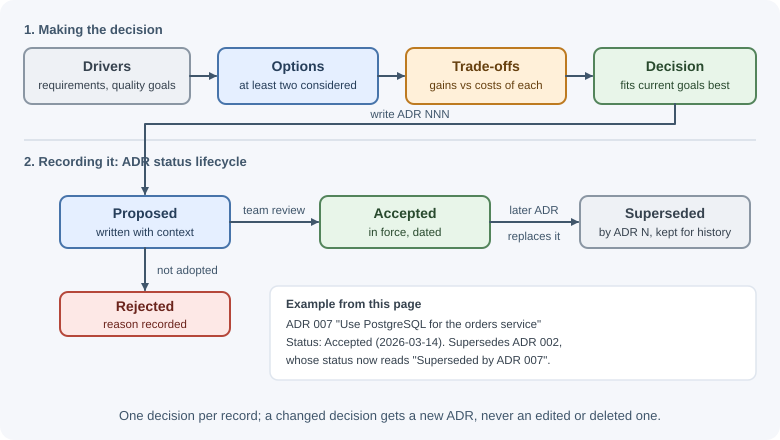

# Architecture Fundamentals

Software architecture is the set of significant decisions about how a system
is structured: its main parts, their responsibilities, how they communicate,
and the constraints they follow. A useful working definition is "the
decisions that are expensive to change later." This page explains what
architecture covers, how quality goals drive it, and how teams record and
communicate architectural decisions.

## Why it matters

Code-level choices—a variable name, a loop—are cheap to change. Architectural
choices—one deployable or twenty, which database, synchronous calls or
events—shape every later feature and are costly to reverse. Good
architecture lets a system meet its goals for speed, reliability, security,
and cost, and lets the team keep changing it safely. Poor architecture shows
up as slow delivery, fragile releases, and outages that are hard to diagnose.

## Real-world usage

- **Spotify — recording decisions as ADRs.** Spotify's engineering blog
  describes teams, such as its Creator team, that document significant
  decisions as architecture decision records, capturing the context and the
  consequences of each one
  ([Spotify Engineering](https://engineering.atspotify.com/2020/04/when-should-i-write-an-architecture-decision-record)).
- **UK Government Digital Service — ADRs as a standard.** The GDS Way tells
  government teams to record decisions that affect a service's architecture,
  and defines an ADR lifecycle of Proposed, Accepted, and Superseded
  ([The GDS Way](https://gds-way.digital.cabinet-office.gov.uk/standards/architecture-decisions.html)).
- **Amazon — shaping teams to fit the architecture.** Amazon explains that
  changing its technology was not enough: it also restructured teams into
  small "two-pizza teams" to take advantage of a microservices architecture,
  which is Conway's law applied on purpose
  ([AWS Executive Insights](https://aws.amazon.com/executive-insights/content/amazon-two-pizza-team/)).

Popular tools:

- [Structurizr](https://structurizr.com/): "models as code" for C4 diagrams.
- [adr-tools](https://github.com/npryce/adr-tools): command-line tools for
  creating and superseding ADRs.
- [dependency-cruiser](https://github.com/sverweij/dependency-cruiser):
  validates JavaScript and TypeScript dependency rules in CI, a ready-made
  fitness function.
- Review frameworks: the [AWS Well-Architected Framework](https://docs.aws.amazon.com/wellarchitected/latest/framework/welcome.html)
  and the [Azure Architecture Center](https://learn.microsoft.com/en-us/azure/architecture/guide/architecture-styles/).

## How it works

### What counts as architecture

Architecture is less about drawing boxes than about deciding:

- **Structure:** which components exist and what each is responsible for.
- **Communication:** how components talk (in-process calls, HTTP, gRPC,
  messages) and what contracts they share.
- **Data ownership:** which component owns which data, and how others read
  it.
- **Deployment:** what runs where, and what can be released independently.
- **Constraints and principles:** rules everyone follows, such as "services
  never share database tables" or "all external calls have timeouts."

A decision is architectural when it is **significant** (it affects quality
attributes or many parts of the system) and **hard to change**.

### Quality attributes

Functional requirements describe *what* the system does ("users can place
orders"). **Quality attributes**, also called non-functional requirements,
describe *how well* it does it. Architecture is mostly driven by quality
attributes, because many different structures can deliver the same features.

| Attribute | Question it answers | How it is measured |
|-----------|---------------------|--------------------|
| **Performance** | How fast does it respond? | Latency percentiles (p50, p95, p99), throughput (requests per second) |
| **Scalability** | Can it handle more load by adding resources? | Throughput and latency as load and instances grow |
| **Availability** | Is it up when users need it? | Uptime percentage (for example, 99.9% ≈ 8.8 hours of downtime per year) |
| **Reliability** | Does it work correctly and recover from faults? | Error rate, mean time between failures, mean time to recovery (MTTR) |
| **Security** | Is it protected against misuse? | Vulnerabilities found, time to patch, audit results, access reviews |
| **Maintainability** | How easily can it be changed? | Lead time for changes, change failure rate, time to onboard a developer |
| **Testability** | How easily can behavior be verified? | Test speed, ability to test parts in isolation, coverage of critical paths |
| **Observability** | Can we understand what it is doing in production? | Time to detect and diagnose incidents; quality of logs, metrics, and traces |
| **Cost** | What does it cost to build and run? | Infrastructure cost per month or per request, engineering effort |

Vague goals such as "it must be fast" are not useful. Turn them into
measurable statements, often called **quality attribute scenarios**:

```text
 Under normal load (500 requests/s), 99% of "place order" requests
 complete within 300 ms, measured at the load balancer.
```

### Trade-offs

Quality attributes compete. Every architectural decision improves some
attributes at the expense of others:

| Decision | Gains | Costs |
|----------|-------|-------|
| Split into microservices | Independent deploys and scaling, team autonomy | Network failures, distributed data, operational complexity |
| Add a cache | Performance, lower database load | Stale data, invalidation complexity, another system to run |
| Replicate across regions | Availability, lower latency for distant users | Cost, consistency challenges |
| Strong consistency everywhere | Simpler reasoning about data | Latency and availability during failures |
| Add abstraction layers | Testability, swappable infrastructure | More code and indirection |

The architect's job is to choose the trade-offs that best fit the
**current** goals and constraints, and to make them explicit. There is no
universally "best" architecture.

### Architecture styles at a glance

| Style | Core idea | Fits when |
|-------|-----------|-----------|
| **Layered (n-tier)** | Code organized in horizontal layers: presentation, business logic, data access | Most business applications; a clear default |
| **Modular monolith** | One deployable split into strongly separated modules | Small to medium teams wanting clear boundaries without distributed complexity |
| **Microservices** | Many small, independently deployable services, each owning its data | Large organizations with many teams and well-understood domains |
| **Event-driven** | Components communicate by publishing and reacting to events | Workflows with many independent reactions, integration between systems |
| **Serverless** | Functions run on demand by a cloud platform | Spiky or event-triggered workloads, small teams avoiding server management |
| **Hexagonal / clean** | Business logic at the center, infrastructure behind interfaces | Complex domains that need testability and replaceable infrastructure |
| **Pipes and filters** | Data flows through a chain of independent processing steps | Data processing, ETL, media pipelines |

Styles combine: a modular monolith can use hexagonal architecture inside
each module and publish events to other systems. The following pages cover
them in depth: [monoliths and microservices](monolith-modular-monolith-microservices.md),
[layered, hexagonal, and clean architecture](layered-hexagonal-and-clean-architecture.md),
[event-driven architecture](event-driven-architecture.md), and
[serverless architecture](serverless-architecture.md).

### Conway's law

> "Organizations which design systems … are constrained to produce designs
> which are copies of the communication structures of these organizations."
> — Melvin Conway

In practice, system boundaries tend to mirror team boundaries. Conway's own
example: eight people were to build a COBOL and an ALGOL compiler; five were
assigned to COBOL and three to ALGOL, and the COBOL compiler ran in five
phases while the ALGOL compiler ran in three. If two teams must coordinate on
every change to a shared module, that module becomes a bottleneck.

Teams use this deliberately with the **inverse Conway maneuver**: shape teams
around the architecture you want. If you want independent services for
payments and catalog, give each one a team that owns it end to end.

### Architecture decision records (ADRs)

Decisions are easily forgotten, and new team members repeat old debates. An
**architecture decision record** is a short document, stored with the code,
that captures one significant decision and why it was made.

```markdown
# ADR 007: Use PostgreSQL for the orders service

## Status
Accepted (2026-03-14). Supersedes ADR 002.

## Context
Orders need multi-row transactions (order + items + payment intent) and
reporting queries with joins. The team already runs PostgreSQL for billing.
Write volume is ~200 orders/minute at peak.

## Decision
Store orders in PostgreSQL 16 using a managed service, with one schema
owned by the orders service.

## Consequences
+ ACID transactions across order tables; mature tooling; team familiarity.
- Schema migrations must be planned; no flexible per-document schema.
- Other services must use the orders API, not the tables directly.
```

Key properties of good ADRs:

- **One decision per record**, numbered and never deleted.
- Record the **context** and the **alternatives considered**, not just the
  outcome.
- When a decision changes, write a new ADR that **supersedes** the old one.
- Keep them in the repository (for example, `docs/adr/`) so they are
  reviewed like code.



### Evolutionary architecture and fitness functions

Requirements change, so architecture must evolve. **Evolutionary
architecture** means designing for incremental, guided change rather than a
big up-front plan. A **fitness function** is an automated check that protects
an architectural characteristic as the code changes, for example:

- A test that fails if a module imports another module's internal files.
- A CI performance test that fails if p95 latency exceeds a budget.
- A dependency check that blocks packages with known critical
  vulnerabilities.

Fitness functions turn architectural rules from documents people forget into
checks that run on every change.

### Communicating architecture: the C4 model

Architecture diagrams often fail because they mix levels of detail. The
**C4 model** defines four zoom levels:

| Level | Shows | Audience |
|-------|-------|----------|
| **1. System context** | Your system as one box, its users, and the external systems it talks to | Everyone, including non-technical people |
| **2. Container** | The deployable/runnable parts: web app, API, database, queue, mobile app | Technical people inside and outside the team |
| **3. Component** | The main components inside one container and their responsibilities | Developers and architects |
| **4. Code** | Classes or modules for one component | Developers (usually generated, rarely drawn) |


Label every arrow with what flows and how (protocol, sync or async). A
diagram without labels hides the decisions that matter.

## When to use and when not to use

The practices on this page cost time, so match their weight to the stakes.

Use them fully when:

- Several teams change the same system, so decisions must be shared and
  remembered.
- A decision is expensive to reverse: a database, a deployment model, a
  public API, a split into services.
- Quality targets are explicit (an SLA, a latency budget, a compliance
  rule) and must be designed for rather than hoped for.
- Newcomers keep asking "why is it built this way?"

Keep them light when:

- You are building a prototype or a short-lived internal tool.
- The decision is easy to undo, such as a library choice behind an adapter.
- One small team owns everything and talks daily; a short README note may
  be enough.

| Practice | Worth it when | Keep it light or skip when |
|----------|---------------|----------------------------|
| Quality attribute scenarios | Performance, availability, or cost targets exist | No real load or users yet |
| ADRs | Decisions are significant and debated | The choice is trivial or easily reversed |
| C4 diagrams | People outside the team must understand the system | A diagram would only restate one file |
| C4 level 3 and 4 | A container is complex and changes slowly | Code changes quickly; generate instead of drawing |
| Fitness functions | A rule has been broken before, or matters a lot | The rule is still being discovered |

## Practical examples

### Turning goals into decisions

Suppose a course platform has these requirements:

- 20,000 students, peaks of 300 requests per second during exams.
- Quiz submissions must never be lost.
- A team of six developers.
- Monthly infrastructure budget is limited.

Reasonable decisions and their rationale:

| Decision | Driven by |
|----------|-----------|
| Modular monolith with modules for accounts, courses, quizzes, and progress | Six developers; clear boundaries without microservice operations |
| Two or more stateless app instances behind a load balancer | Availability and peak load |
| Quiz submissions written to the database in a transaction before responding | "Never lost" reliability requirement |
| Cache course catalog pages | Read-heavy traffic at exam peaks |
| Background queue for certificate PDF generation | Keep request latency low; slow CPU work off the request path |
| Structured logs, metrics, and alerts from day one | Observability to meet the availability target |

Each decision is recorded as an ADR with its context and trade-offs.

### A fitness function in a test

```js
// test/architecture.test.js — run with: node --test
import { test } from "node:test";
import assert from "node:assert/strict";
import { readFile, readdir } from "node:fs/promises";
import path from "node:path";

const MODULES_DIR = path.resolve("src/modules");

test("modules import each other only through their public index.js", async () => {
  for (const moduleName of await readdir(MODULES_DIR)) {
    const files = await readdir(path.join(MODULES_DIR, moduleName), { recursive: true });
    for (const file of files.filter((f) => f.endsWith(".js"))) {
      const source = await readFile(path.join(MODULES_DIR, moduleName, file), "utf8");
      // Simplified: assumes each module's files sit at its root folder.
      // Forbid deep imports such as "../billing/internal/tax.js"
      const deepImport = source.match(/from "\.\.\/(?!\.)([\w-]+)\/(?!index\.js")/);
      assert.equal(deepImport, null, `${moduleName}/${file} reaches into another module`);
    }
  }
});
```

Dedicated tools (dependency-cruiser, ESLint import rules) do this more
thoroughly, but the idea is the same: architecture rules enforced in CI.

## Best practices

- Start from measurable quality attribute scenarios, not technology
  preferences.
- Prefer the simplest architecture that meets current goals; keep options
  open for likely changes.
- Make trade-offs explicit and record significant decisions as ADRs.
- Align team boundaries with system boundaries.
- Enforce important rules with automated fitness functions.
- Draw diagrams at one C4 level at a time and label every relationship.
- Revisit decisions when constraints change; architecture is never "done."

## In production

- **Decision amnesia.** *Symptom:* the same debate returns every few
  months, or a decision is reversed and then reinstated. *Detect:* review
  threads that ask "why do we do it this way?" with no answer. *Cause:* the
  reasoning lived in someone's head or a chat thread. *Fix:* write ADRs for
  current decisions, including the ones made long ago.
- **Architecture drift.** *Symptom:* modules import each other's internals
  and every change touches many folders. *Detect:* a dependency graph (for
  example from dependency-cruiser) shows cycles and cross-module edges that
  grow release by release. *Cause:* the rules were documented but not
  enforced. *Fix:* turn the rules into fitness functions that fail CI.
- **A quality target missed at peak.** *Symptom:* p99 latency or error rate
  breaks during a busy period that nobody load-tested. *Detect:* latency
  percentiles and saturation on dashboards. *Cause:* "fast enough" was never
  written as a measurable scenario. *Fix:* write the scenario, load-test
  against it, and design for it.
- **Team and system boundaries do not match.** *Symptom:* small features
  need several teams and coordinated releases. *Detect:* lead time grows
  and many pull requests span repositories owned by different teams.
  *Cause:* Conway's law working against you. *Fix:* realign ownership so
  each team owns a whole capability, or move the boundary.
- **Stale diagrams during an incident.** *Symptom:* on-call engineers find
  the diagram shows components that no longer exist. *Detect:* the diagram
  disagrees with what is deployed. *Cause:* hand-drawn diagrams nobody
  updates. *Fix:* keep levels 1 and 2 small, store diagrams as code next to
  the system, and review them with the changes that affect them.

## Important terminology

- **Software architecture:** The significant, hard-to-change decisions about
  a system's structure and behavior.
- **Quality attribute (non-functional requirement):** A measurable property
  such as availability, latency, or maintainability.
- **Trade-off:** Gaining one property at the expense of another.
- **Architecture style:** A named, reusable way of structuring systems, such
  as layered or microservices.
- **Conway's law:** Systems mirror the communication structure of the
  organizations that build them.
- **ADR (architecture decision record):** A short document recording one
  decision, its context, and its consequences.
- **Fitness function:** An automated check that protects an architectural
  characteristic.
- **C4 model:** A set of four diagram levels—context, container, component,
  code—for describing architecture.

## Common mistakes and misconceptions

- **"Architecture is the diagram."** Diagrams communicate decisions; the
  decisions and their reasons are the architecture.
- **Choosing a style because large companies use it.** Their constraints are
  not yours.
- **Ignoring non-functional requirements** until production load reveals
  them.
- **Designing everything up front** instead of deferring decisions that can
  wait.
- **Not recording why a decision was made**, so it is later reversed for the
  wrong reasons.
- **"There is a best architecture."** There are only trade-offs that fit
  or do not fit your situation.

## Revision questions

1. What makes a decision "architectural"?
2. Name six quality attributes and how you would measure each.
3. Give an example of a trade-off between two quality attributes.
4. What is Conway's law, and how can a company use it deliberately?
5. What sections does an ADR contain, and why keep ADRs in the repository?
6. What are the four levels of the C4 model, and who is each for?

## Further learning

- [Martin Fowler: Software architecture guide](https://martinfowler.com/architecture/)
- [Martin Fowler: Conway's law](https://martinfowler.com/bliki/ConwaysLaw.html)
- [The C4 model for visualising software architecture](https://c4model.com/)
- [Architecture decision records (adr.github.io)](https://adr.github.io/)
- [Azure Architecture Center: Architecture styles](https://learn.microsoft.com/en-us/azure/architecture/guide/architecture-styles/)
- [AWS Well-Architected Framework](https://docs.aws.amazon.com/wellarchitected/latest/framework/welcome.html)
- [Monoliths, modular monoliths, and microservices](monolith-modular-monolith-microservices.md)
