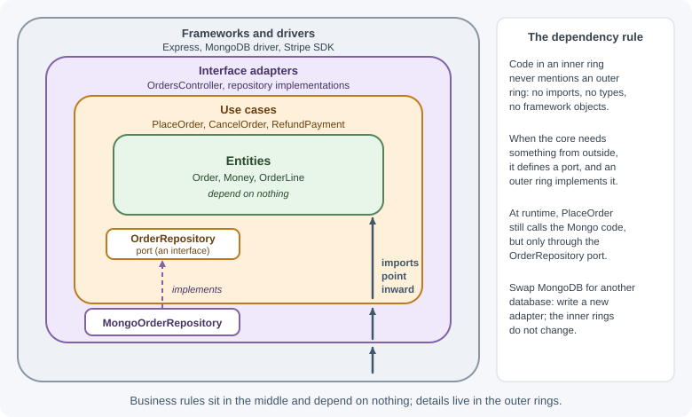

# Layered, Hexagonal, and Clean Architecture

These three styles describe how to organize code **inside** one application
or service. Layered architecture stacks code in horizontal layers. Hexagonal
architecture (ports and adapters) puts business logic at the center and
connects the outside world through interfaces. Onion and clean architecture
refine the same idea with one strict rule: dependencies point inward, toward
the business logic.

## Why it matters

In many backends, business rules end up scattered across route handlers,
database queries, and framework callbacks. Changing the database, testing a
rule without a running server, or reusing logic from a queue consumer then
becomes painful. These styles keep the most valuable and longest-lived
code—the business rules—independent of frameworks and infrastructure, which
change more often. They also make fast, reliable unit tests possible.

## Real-world usage

- **Netflix — swapping a data source in hours.** Netflix's Studio Workflows
  team built a new app with hexagonal architecture because its data would
  move from a monolith to new microservices. When the monolith hit a read
  limit, the team moved one entity's reads from a JSON API to a GraphQL data
  source within 2 hours, crediting the hexagonal design for keeping
  persistence details out of the business logic
  ([Netflix TechBlog](https://netflixtechblog.com/ready-for-changes-with-hexagonal-architecture-b315ec967749)).
- **Uber — layering rules across services.** Uber's Domain-Oriented
  Microservice Architecture applies the layered idea at the scale of
  services: "Layers only depend on the layers under them," which Uber uses
  to reason about blast radius and dependencies
  ([Uber Engineering](https://www.uber.com/blog/microservice-architecture/)).

Popular tools: [dependency-cruiser](https://github.com/sverweij/dependency-cruiser)
to fail CI when a layer imports the wrong way, and frameworks with built-in
dependency injection (such as NestJS) that make adapters easy to swap.

## How it works

### Layered architecture

The classic structure divides an application into layers, each with one
kind of responsibility:

```text
 ┌──────────────────────────────┐
 │ Presentation / API layer     │  HTTP routes, controllers, request/response
 ├──────────────────────────────┤
 │ Business (service) layer     │  use cases, business rules, workflows
 ├──────────────────────────────┤
 │ Data access layer            │  repositories, queries, ORM models
 ├──────────────────────────────┤
 │ Database                     │
 └──────────────────────────────┘
        dependencies point DOWN
```

Rules:

- A layer may call only the layer directly below it (in a **strict**
  layering) or any layer below (in a **relaxed** layering).
- Lower layers know nothing about higher ones: a repository never builds an
  HTTP response.

This is the structure most Express projects use (routes → controllers →
services → repositories); see
[structuring an Express project](../../03-backend-development/express/project-structure.md).

Strengths: simple, familiar, and a big improvement over putting everything in
route handlers.

Weakness: the business layer still **depends on** the data access layer. Its
code imports a Mongo or SQL repository directly, so business rules are tied
to the database technology and hard to test without one.

### Hexagonal architecture (ports and adapters)

Alistair Cockburn's hexagonal architecture removes that dependency. The
application core (business logic) sits in the middle and defines **ports**:
interfaces describing what it needs and what it offers. **Adapters** outside
the core implement those ports for specific technologies.


- **Inbound (driving) ports** are the use cases the application offers,
  such as `placeOrder`. **Driving adapters** translate external input into
  calls on them: an HTTP controller, a CLI, a message consumer, a test.
- **Outbound (driven) ports** are interfaces the core needs, such as
  `OrderRepository` or `PaymentGateway`. **Driven adapters** implement them:
  a MongoDB repository, a Stripe client, an in-memory fake.

The core depends only on its own port definitions, never on Express,
MongoDB, or Stripe. Swapping MongoDB for PostgreSQL means writing a new
adapter; the core does not change.

### Onion and clean architecture

Jeffrey Palermo's **onion architecture** and Robert C. Martin's **clean
architecture** express the same idea as concentric circles:



| Circle | Contains | Depends on |
|--------|----------|------------|
| **Entities** | Core business objects and rules that would exist even without software (an order must have at least one line) | Nothing |
| **Use cases** | Application-specific workflows that orchestrate entities (place an order: validate, price, save, notify) | Entities, and port interfaces it defines |
| **Interface adapters** | Convert data between use cases and the outside: controllers, repository implementations, mappers | Use cases, entities |
| **Frameworks and drivers** | Express, database drivers, external SDKs, configuration | Everything inside |

**The dependency rule**: code in an inner circle must not mention anything in
an outer circle—no imports, no types, no framework objects. When an inner
circle needs something from outside (saving data), it defines an interface
(a port) and an outer circle implements it. This is the **dependency
inversion principle** applied to architecture (see
[design principles](design-principles.md)).

### How the three relate

| Style | Core idea | Dependency direction |
|-------|-----------|----------------------|
| Layered | Horizontal layers by responsibility | Down toward the database |
| Hexagonal | Core with ports; adapters on all sides | Adapters → core |
| Onion / clean | Concentric rings; entities in the center | Outer rings → inner rings |


Hexagonal, onion, and clean architecture are variations of one idea; the
names and number of rings differ, the dependency rule does not.

## When to use and when not to use

Ports, adapters, and mappers add files and indirection. They pay off when:

- Business rules are substantial and change often.
- Several entry points (HTTP, queue consumers, scheduled jobs) share the same
  use cases.
- Infrastructure is likely to change, or you need fast tests of complex
  logic.

They are overkill for a thin CRUD API that mostly moves data between HTTP and
a database with few rules. A sensible approach is to start with simple
layering and introduce ports where a real need appears—for example, around
an external payment provider you want to fake in tests.

| Situation | Logic in route handlers | Layered | Hexagonal / clean |
|-----------|-------------------------|---------|-------------------|
| Prototype or tiny CRUD API | Acceptable | Good fit | Overkill |
| Typical business app | Becomes a tangle | Good default | Good fit |
| Complex, changing rules | Poor fit | Rules tied to the database | Best fit |
| Many entry points (HTTP, queue, cron) | Duplicated logic | Workable | Best fit |
| Database or provider likely to change | Painful | Painful | Write one new adapter |
| Fast tests without infrastructure | Hard | Hard | Easy with in-memory adapters |

## Practical examples

The example below implements "place an order" with ports and adapters in an
Express application.

### Folder layout

```text
src/
├── domain/
│   └── order.js                 ← entity and business rules (no imports from outside)
├── application/
│   ├── ports.js                 ← port definitions (documentation of the contracts)
│   └── place-order.js           ← use case
├── adapters/
│   ├── http/orders.routes.js    ← driving adapter (Express)
│   ├── persistence/
│   │   ├── mongo-order-repository.js      ← driven adapter
│   │   └── in-memory-order-repository.js  ← driven adapter for tests
└── main.js                      ← composition root: wires adapters to the core
```

### Domain entity

```js
// src/domain/order.js — pure business rules, no framework or database code
export class DomainError extends Error {} // a broken business rule, not a bug

export function createOrder({ id, customerId, lines, createdAt }) {
  if (lines.length === 0) {
    throw new DomainError("An order needs at least one line");
  }
  for (const line of lines) {
    if (!Number.isInteger(line.quantity) || line.quantity <= 0) {
      throw new DomainError("Quantity must be a positive integer");
    }
  }
  const totalCents = lines.reduce((sum, l) => sum + l.unitPriceCents * l.quantity, 0);
  return { id, customerId, lines, totalCents, status: "PLACED", createdAt };
}
```

### The port

JavaScript has no `interface` keyword, so a port is a documented contract.
JSDoc (or TypeScript) makes it explicit:

```js
// src/application/ports.js
/**
 * Outbound port: how the application stores orders.
 * @typedef {object} OrderRepository
 * @property {(order: object) => Promise<void>} save
 * @property {(id: string) => Promise<object | null>} findById
 */
export {};
```

### The use case

```js
// src/application/place-order.js
import { createOrder } from "../domain/order.js";

// Dependencies arrive as parameters: the use case never imports an adapter.
export function makePlaceOrder({ orderRepository, generateId, now }) {
  return async function placeOrder({ customerId, lines }) {
    const order = createOrder({ id: generateId(), customerId, lines, createdAt: now() });
    await orderRepository.save(order);
    return order;
  };
}
```

### Two driven adapters for the same port

```js
// src/adapters/persistence/mongo-order-repository.js
export function makeMongoOrderRepository(db) {
  const collection = db.collection("orders");
  return {
    async save(order) {
      const { id, ...rest } = order;
      await collection.replaceOne({ _id: id }, rest, { upsert: true });
    },
    async findById(id) {
      const doc = await collection.findOne({ _id: id });
      if (!doc) return null;
      const { _id, ...rest } = doc;
      return { id: _id, ...rest }; // map database shape back to the domain shape
    },
  };
}
```

```js
// src/adapters/persistence/in-memory-order-repository.js
export function makeInMemoryOrderRepository() {
  const orders = new Map();
  return {
    async save(order) {
      orders.set(order.id, structuredClone(order));
    },
    async findById(id) {
      return orders.has(id) ? structuredClone(orders.get(id)) : null;
    },
  };
}
```

### The driving adapter (Express)

```js
// src/adapters/http/orders.routes.js
import { Router } from "express";
import { DomainError } from "../../domain/order.js";

export function makeOrdersRouter({ placeOrder }) {
  const router = Router();

  router.post("/orders", async (req, res) => {
    // Translate HTTP → use case input, and use case output → HTTP.
    try {
      const order = await placeOrder({ customerId: req.user.id, lines: req.body?.lines ?? [] });
      res.status(201).location(`/orders/${order.id}`).json(order);
    } catch (error) {
      if (error instanceof DomainError) {
        return res.status(400).json({ error: error.message }); // rule broken: client's fault
      }
      throw error; // anything else is a bug: the error handler answers 500
    }
  });

  return router;
}
```

### The composition root

```js
// src/main.js — the only place that knows about every concrete adapter
import express from "express";
import { randomUUID } from "node:crypto";
import { MongoClient } from "mongodb";
import { makePlaceOrder } from "./application/place-order.js";
import { makeMongoOrderRepository } from "./adapters/persistence/mongo-order-repository.js";
import { makeOrdersRouter } from "./adapters/http/orders.routes.js";

const client = await MongoClient.connect(process.env.MONGODB_URI);
const orderRepository = makeMongoOrderRepository(client.db());

const placeOrder = makePlaceOrder({
  orderRepository,
  generateId: randomUUID,
  now: () => new Date(),
});

const app = express();
app.use(express.json());
app.use(makeOrdersRouter({ placeOrder }));
app.listen(3000);
```

### Testing the core without a database or server

```js
// test/place-order.test.js — run with: node --test
import { test } from "node:test";
import assert from "node:assert/strict";
import { makePlaceOrder } from "../src/application/place-order.js";
import { makeInMemoryOrderRepository } from "../src/adapters/persistence/in-memory-order-repository.js";

test("places an order and stores it", async () => {
  const orderRepository = makeInMemoryOrderRepository();
  const placeOrder = makePlaceOrder({
    orderRepository,
    generateId: () => "order-1",
    now: () => new Date("2026-01-01T00:00:00Z"),
  });

  const order = await placeOrder({
    customerId: "c-7",
    lines: [{ productId: "p-1", quantity: 2, unitPriceCents: 1500 }],
  });

  assert.equal(order.totalCents, 3000);
  assert.deepEqual(await orderRepository.findById("order-1"), order);
});

test("rejects an empty order", async () => {
  const placeOrder = makePlaceOrder({
    orderRepository: makeInMemoryOrderRepository(),
    generateId: () => "x",
    now: () => new Date(),
  });
  await assert.rejects(placeOrder({ customerId: "c-7", lines: [] }), /at least one line/);
});
```

These tests run in milliseconds, need no database, and stay valid even if
the persistence technology changes.

### Testing benefits

| Test type | Uses | Speed | Confidence in |
|-----------|------|-------|---------------|
| Entity unit tests | Pure functions | Fastest | Business rules |
| Use case tests | In-memory adapters | Fast | Workflows |
| Adapter integration tests | Real database/SDK in a test environment | Slower | That each adapter honors its port |
| End-to-end tests | Whole app | Slowest | Wiring and configuration |

Most tests can be fast use case and entity tests; fewer, focused tests cover
each adapter.

## Best practices

- Keep business rules free of framework, HTTP, and database objects.
- Let inner code define the interfaces it needs; implement them outside.
- Wire concrete implementations in one composition root.
- Map between persistence models and domain objects at the adapter
  boundary.
- Write most tests against the core with in-memory adapters, and a few
  integration tests per adapter.
- Match the amount of structure to the complexity of the domain.

## In production

- **Business-rule failures reported as server errors.** *Symptom:* 5xx
  alerts fire when clients send invalid orders. *Detect:* error logs show
  domain messages such as "An order needs at least one line" with status
  500. *Cause:* the driving adapter never translates domain errors.
  *Fix:* throw a typed `DomainError` from the core and map it to 400 in the
  adapter, as the Express adapter above does.
- **Persistence leaking into the API.** *Symptom:* responses contain `_id`,
  ORM metadata, or columns clients should not see. *Detect:* contract tests
  or API diffs show database field names. *Cause:* use cases return
  database documents. *Fix:* map to domain objects at the repository
  adapter and to response shapes at the HTTP adapter.
- **The fake adapter lies.** *Symptom:* tests pass, but production fails,
  for example a save that does not overwrite or a lookup that returns the
  wrong shape. *Detect:* failures appear only in staging or production.
  *Cause:* the in-memory adapter behaves differently from the real one.
  *Fix:* run the same port contract tests against both adapters.
- **The dependency rule quietly breaks.** *Symptom:* the domain imports a
  framework, logger, or SDK, and unit tests start needing real
  infrastructure. *Detect:* a dependency check shows edges from `domain/`
  to `adapters/` or `node_modules`. *Cause:* a convenient direct import
  under deadline pressure. *Fix:* inject what the core needs and enforce
  the rule in CI.
- **Ceremony without benefit.** *Symptom:* adding one field to a simple
  CRUD endpoint touches five files. *Detect:* lead time for trivial changes
  grows. *Cause:* full ports and adapters around code with no real rules.
  *Fix:* collapse layers for thin CRUD and keep ports where they pay off.

## Important terminology

- **Layer:** A horizontal grouping of code with one kind of responsibility.
- **Port:** An interface that defines how the application core interacts
  with the outside.
- **Adapter:** An implementation that connects a port to a specific
  technology.
- **Driving (primary) adapter:** An adapter that calls into the application,
  such as an HTTP controller.
- **Driven (secondary) adapter:** An adapter the application calls, such as a
  repository.
- **Dependency rule:** Source code dependencies must point toward the core.
- **Entity:** A core business object with identity and rules.
- **Use case:** An application-specific workflow.
- **Composition root:** The single place where concrete dependencies are
  created and connected.

## Common mistakes and misconceptions

- **Passing `req` and `res` into services**, tying business logic to
  Express.
- **Returning database documents or ORM models from use cases**, leaking
  persistence details everywhere.
- **Creating interfaces for everything** in a simple CRUD app.
- **"Clean architecture means many folders."** It means correct dependency
  direction; folders are secondary.
- **Letting the domain import a logger, config, or SDK directly** instead of
  receiving what it needs.
- **Thinking hexagonal architecture requires microservices.** It organizes
  code within any deployable.

## Revision questions

1. What weakness of layered architecture does hexagonal architecture fix?
2. Explain ports, driving adapters, and driven adapters with an example of
   each.
3. State the dependency rule and how dependency inversion makes it possible.
4. Why do these styles make business logic easier to test?
5. What is a composition root, and why should there be only one?
6. When would ports and adapters be over-engineering?

## Further learning

- [Alistair Cockburn: Hexagonal architecture](https://alistair.cockburn.us/hexagonal-architecture/)
- [Robert C. Martin: The clean architecture](https://blog.cleancoder.com/uncle-bob/2012/08/13/the-clean-architecture.html)
- [Martin Fowler: Presentation domain data layering](https://martinfowler.com/bliki/PresentationDomainDataLayering.html)
- [Azure Architecture Center: N-tier architecture style](https://learn.microsoft.com/en-us/azure/architecture/guide/architecture-styles/n-tier)
- [Design patterns for backends](design-patterns-for-backends.md)
