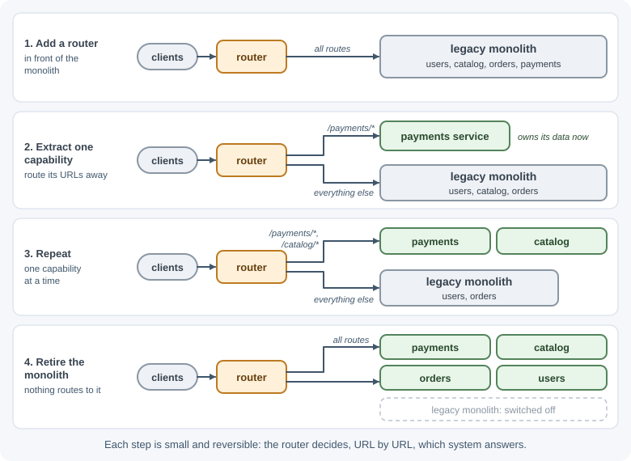

# Monoliths, Modular Monoliths, and Microservices

One of the first architectural decisions is how many deployable units a
system has. A **monolith** is one application deployed as a single unit. A
**modular monolith** is still one deployable but is divided into strongly
separated modules. **Microservices** split the system into many small
services that are deployed and scaled independently and own their own data.

## Why it matters

This choice affects nearly everything: how teams work together, how releases
happen, how data stays consistent, how failures spread, and how much
operational work is needed. Many teams have adopted microservices too early
and spent their time on infrastructure instead of features; others have let
a monolith decay into a tangle no one can change safely. Understanding the
real costs of each option lets you pick the one that fits your team and
domain today, and evolve later.

## Real-world usage

- **Shopify — a modular monolith instead of microservices.** Shopify
  describes one of the largest Ruby on Rails codebases, worked on by more
  than a thousand developers. Rather than split it into services, it chose
  to keep one codebase and enforce boundaries between components
  ([Shopify Engineering](https://shopify.engineering/deconstructing-monolith-designing-software-maximizes-developer-productivity)).
  It later built Packwerk, a tool that statically checks references between
  components
  ([Shopify Engineering](https://shopify.engineering/shopify-monolith)).
- **Segment — from microservices back to a monolith.** Segment's
  per-destination microservices grew to over 140 services. Its velocity
  dropped, defects rose, and three full-time engineers spent most of their
  time keeping the system alive, so it consolidated the services into a
  single service
  ([Segment blog](https://segment.com/blog/goodbye-microservices/)).
- **Netflix — from a monolith to hundreds of microservices.** After a major
  database corruption in 2008 stopped DVD shipments for three days, Netflix
  rebuilt its technology for the cloud, migrating "from a monolithic app to
  hundreds of micro-services," and finished the migration in early 2016
  ([Netflix](https://about.netflix.com/en/news/completing-the-netflix-cloud-migration)).
- **Uber — grouping microservices into domains.** With around 2,200
  critical microservices, Uber felt the complexity first hand and introduced
  Domain-Oriented Microservice Architecture, classifying the services into
  70 domains with a single entry point each
  ([Uber Engineering](https://www.uber.com/blog/microservice-architecture/)).

Popular tools:

- Boundary checking inside one codebase: Packwerk (Ruby) and
  [dependency-cruiser](https://github.com/sverweij/dependency-cruiser)
  (JavaScript and TypeScript).
- Running many services: containers with an orchestrator such as Kubernetes,
  plus centralized logs, metrics, and distributed tracing.

## How it works

### The monolith

A monolith contains all features—users, catalog, orders, payments—in one
codebase that builds into one deployable artifact and usually uses one
database.

```text
 ┌─────────────────────── one process / one deploy ───────────────────────┐
 │  users   catalog   orders   payments   notifications   (function calls)│
 └─────────────────────────────────┬──────────────────────────────────────┘
                                   ▼
                           [ one database ]
```

Advantages:

- **Simple to develop, test, and debug**: one repository, one process, one
  debugger session, stack traces that cover the whole request.
- **Simple to deploy and operate**: one build, one pipeline, one set of
  dashboards.
- **Fast in-process calls** with no network failures between features.
- **Easy transactions**: one database transaction can update orders and
  inventory together.
- **Easy refactoring** across feature boundaries.

Disadvantages as it grows:

- Without discipline, boundaries erode into a **"big ball of mud"** where
  everything depends on everything.
- Every change requires redeploying the whole application; a bug in one
  feature can take everything down.
- Build and test times grow; many teams coordinating on one codebase slow
  each other down.
- Scaling is all-or-nothing: you scale the whole app even if only search is
  busy.
- Technology choices are shared; upgrading a framework affects everyone.

A monolith is **not** inherently bad or unscalable. Run several stateless
instances behind a load balancer and it scales horizontally; many large
products run on well-structured monoliths.

### The modular monolith

A modular monolith keeps the single deployable but divides the code into
**modules with enforced boundaries**, usually aligned with business
capabilities (see [domain-driven design](domain-driven-design.md)):

```text
 ┌──────────────────────────── one deploy ─────────────────────────────┐
 │ ┌─────────┐  public API   ┌─────────┐  public API   ┌──────────┐    │
 │ │ catalog │◄──────────────│ orders  │──────────────►│ payments │    │
 │ │ internal│               │ internal│               │ internal │    │
 │ └────┬────┘               └────┬────┘               └────┬─────┘    │
 └──────┼─────────────────────────┼─────────────────────────┼──────────┘
        ▼                         ▼                         ▼
   catalog tables            orders tables            payments tables
   (same database, separate schemas; no cross-module table access)
```

Rules that make it work:

- Each module exposes a **small public interface** (functions or events);
  everything else is internal.
- Modules **never read or write another module's tables**; they call its
  public API.
- Dependencies between modules are explicit and checked automatically (for
  example, lint rules or architecture tests).
- Modules communicate with in-process calls or in-process events.

You keep the operational simplicity of a monolith while gaining most of the
design benefits of services. If one module later needs independent scaling
or deployment, it already has a clean boundary to extract.

### Microservices

Microservices split the system into services that:

- Are **independently deployable**: each has its own pipeline and release
  schedule.
- Are organized around **business capabilities** (orders, payments,
  shipping), not technical layers.
- **Own their data**: each service has its own database or schema that no
  other service accesses directly.
- Communicate over the network with HTTP/gRPC calls or messages.
- Are usually owned end to end by one team.

```text
              [ API gateway ]
       ┌───────────┼─────────────┐
       ▼           ▼             ▼
  [ catalog ]  [ orders ] ──event──► [ queue ] ──► [ shipping ]
       │           │                                   │
   catalog DB   orders DB                          shipping DB
```

Benefits:

- Teams deploy independently, without coordinating releases.
- Services scale independently according to their own load.
- A failure can be contained to one service if callers handle it well.
- Each service can choose the technology that fits it.
- Smaller codebases are easier for one team to understand.

### The real costs of microservices

These costs are often underestimated:

| Cost | What it means in practice |
|------|---------------------------|
| **Network failures** | Every call can time out, fail, or be slow. You need timeouts, retries, circuit breakers, and idempotency (see [timeouts, retries, and idempotency](../../03-backend-development/backend-concepts/timeouts-retries-and-idempotency.md)). |
| **Distributed data** | No transactions across services. Consistency becomes eventual and requires patterns such as sagas and the outbox (see [microservices patterns](microservices-patterns.md)). Reports that join data across services need extra work. |
| **Operational overhead** | Many pipelines, deployments, configurations, secrets, and runtime versions to maintain; usually containers and an orchestrator. |
| **Observability** | One user request crosses many services; you need centralized logs, metrics, and **distributed tracing** to debug it. |
| **Testing** | Integration tests across services are harder; contract testing becomes necessary. |
| **Latency** | Network hops add milliseconds that in-process calls do not. |
| **Versioning** | Changing a service's API requires backward compatibility for its callers. |

Martin Fowler calls this the **microservice premium**: microservices bring
complexity of their own, which adds to a project's cost and risk. His
guideline is not to consider microservices unless a system is too complex
to manage as a monolith.

A **distributed monolith** is the worst case: services that must be deployed
together, share a database, or call each other synchronously in long chains.
It has all the costs of microservices and none of the benefits.

### Database per service

Giving each service its own data store is what makes services independent:

- Schema changes stay inside one service.
- A slow query in one service cannot lock another's tables.
- Each service can use the store that fits (relational, document, search
  index).

The cost: queries that span services need API composition (call several
services and combine), a read model built from events, or a data warehouse.
Services must never "just read" another service's tables—doing so silently
couples them again.


### How to choose

| Factor | Points toward a (modular) monolith | Points toward microservices |
|--------|-----------------------------------|-----------------------------|
| Team size | One or a few teams | Many teams that need to release independently |
| Domain understanding | New product, boundaries still changing | Stable, well-understood domain boundaries |
| Scaling needs | Uniform load, or scaling the whole app is affordable | Parts with very different load or resource profiles |
| Operational maturity | Limited DevOps capacity | Mature CI/CD, containers, monitoring, and on-call |
| Consistency needs | Many operations need strong, multi-entity transactions | Boundaries where eventual consistency is acceptable |

A widely recommended path is **monolith first**: start with a well-modularized
monolith, learn where the real boundaries are, and extract services only
when a concrete need appears (team scaling, independent scaling, isolation).
Drawing service boundaries in a domain you don't yet understand usually
produces the wrong boundaries, which are expensive to move across a network.

### Migrating with the strangler fig pattern

The **strangler fig pattern** (named after a vine that gradually grows
around a tree) replaces a legacy system incrementally instead of rewriting it
all at once:



Each step is small, reversible, and delivers value. Big-bang rewrites, by
contrast, often take far longer than planned while the old system keeps
changing.

When extracting a service, migrate its **data** too: the new service must
become the owner, often with a period of synchronization from the old
database.

## When to use and when not to use

Use a **monolith or modular monolith** when:

- One team, or a few teams that talk daily, build the product.
- The domain is new and its boundaries are still moving.
- Many operations need transactions across several entities.
- You lack mature CI/CD, monitoring, and on-call practices for many
  services.

Use **microservices** when:

- Many teams need to release independently without coordinating.
- Parts of the system have very different load, scaling, or technology
  needs.
- Domain boundaries are stable and well understood.
- You can afford the platform work: pipelines, tracing, service discovery,
  and contract testing.

Avoid microservices when the main goal is "cleaner code"; a modular
monolith gives you that without the network. Avoid a plain, unstructured
monolith when more than one team works in it; add enforced modules first.

| Situation | Monolith | Modular monolith | Microservices |
|-----------|----------|------------------|---------------|
| New product, one small team | Good fit | Good fit | Too early |
| Several teams in one codebase | Boundaries erode | Good fit | Possible, costly |
| Many teams needing independent releases | Poor fit | Strained | Good fit |
| One part needs 10× the compute of the rest | Scale everything | Scale everything | Scale just that service |
| Strong cross-entity transactions | Easy | Easy | Needs sagas |
| Limited DevOps capacity | Good fit | Good fit | Poor fit |

## Practical examples

### A module's public interface in a modular monolith

```text
src/modules/
├── catalog/
│   ├── index.js            ← public API: the only file other modules import
│   ├── catalog.service.js
│   └── catalog.repository.js
└── orders/
    ├── index.js
    ├── orders.service.js
    └── orders.repository.js
```

```js
// src/modules/catalog/index.js — the module's contract
import { catalogService } from "./catalog.service.js";

export async function getProductPrice(productId) {
  const product = await catalogService.findById(productId);
  return product ? { productId, price: product.price, currency: product.currency } : null;
}
```

```js
// src/modules/orders/orders.service.js
import { getProductPrice } from "../catalog/index.js"; // allowed: public API
// import { catalogRepository } from "../catalog/catalog.repository.js"; ← forbidden

export async function addItem(order, productId, quantity) {
  const price = await getProductPrice(productId);
  if (!price) throw new Error("Unknown product");
  order.items.push({ productId, quantity, unitPrice: price.price });
}
```

If catalog later becomes a separate service, only `catalog/index.js` changes:
its functions call the catalog service over HTTP instead of in-process.

### Comparison

| Aspect | Monolith | Modular monolith | Microservices |
|--------|----------|------------------|---------------|
| Deployables | 1 | 1 | Many |
| Boundaries | Often informal | Enforced modules | Network + separate data |
| Communication | Function calls | Function calls via public APIs, in-process events | HTTP/gRPC, messaging |
| Data | Shared database | One database, schema per module | Database per service |
| Transactions | Easy | Easy within a module; possible across | Local only; sagas across services |
| Independent deploys | No | No | Yes |
| Independent scaling | No (scale whole app) | No (scale whole app) | Yes |
| Operational complexity | Low | Low | High |
| Debugging | Easy | Easy | Needs distributed tracing |
| Best for | Small apps, prototypes | Most products and teams | Large organizations, clear domains |

## Best practices

- Start with a modular monolith unless you have a clear, present reason for
  microservices.
- Draw boundaries around business capabilities, not technical layers.
- Enforce module boundaries automatically; informal boundaries erode.
- Never share database tables between modules or services.
- Before extracting a service, ensure you have CI/CD, centralized logging,
  metrics, tracing, and on-call practices.
- Migrate incrementally with the strangler fig pattern; avoid big-bang
  rewrites.
- Watch for distributed-monolith symptoms: lock-step deploys, shared
  databases, long synchronous call chains.

## In production

- **Distributed monolith.** *Symptom:* a change to one service needs
  coordinated releases of several others. *Detect:* release notes and
  deploy logs show services always shipping together; contract changes
  break callers. *Cause:* boundaries cut across a business capability, or
  services share tables. *Fix:* merge services that always change together,
  give each its own data, and make API changes backward compatible.
- **Chatty services and slow pages.** *Symptom:* p99 latency climbs as
  features are added. *Detect:* distributed traces show one request fanning
  out into dozens of sequential calls. *Cause:* fine-grained services, or a
  loop that calls another service per item. *Fix:* batch endpoints, move
  data closer to where it is used, or merge the services.
- **Cascading failure.** *Symptom:* one slow dependency takes down
  unrelated features. *Detect:* thread or connection pools saturate and
  error rates rise across many services at once. *Cause:* synchronous calls
  without timeouts or circuit breakers. *Fix:* timeouts, circuit breakers,
  bulkheads, and asynchronous messaging where an immediate answer is not
  needed.
- **A shared database couples everything again.** *Symptom:* a schema
  change in one service breaks another. *Detect:* database logs show
  several services' credentials querying the same tables. *Cause:* reading
  another service's tables as a shortcut. *Fix:* give each table one owning
  service; others use its API or events.
- **Module boundaries erode in the monolith.** *Symptom:* "small" changes
  touch many modules and tests get slow. *Detect:* boundary checks (for
  example Packwerk or dependency-cruiser) report a growing number of
  violations. *Cause:* boundaries were a convention, not a rule. *Fix:*
  make violations fail CI and pay down the existing list.

## Important terminology

- **Monolith:** An application built and deployed as a single unit.
- **Modular monolith:** A single deployable divided into modules with
  enforced boundaries.
- **Microservice:** A small, independently deployable service that owns its
  data and a business capability.
- **Business capability:** Something the business does, such as billing or
  shipping, used to draw boundaries.
- **Database per service:** Each service owns its data store exclusively.
- **Distributed monolith:** Services that are separately deployed but
  tightly coupled, combining the downsides of both styles.
- **Strangler fig pattern:** Incrementally replacing a system by routing
  features to new components.
- **Microservice premium:** The extra cost and risk that microservices'
  own complexity adds; worth paying only for systems too complex to manage
  as a monolith.

## Common mistakes and misconceptions

- **"Monoliths don't scale."** Stateless monolith instances scale
  horizontally well; the limits are usually organizational.
- **"Microservices are more modern, so better."** They solve organizational
  scaling problems at a high technical cost.
- **Splitting by technical layer** (a "database service," a "validation
  service"), creating chatty, coupled services.
- **Sharing a database between services**, which recreates the coupling
  microservices were meant to remove.
- **Making services too small** ("nanoservices"), so every feature touches
  many services.
- **Big-bang rewrites** of a working monolith.

## Revision questions

1. What are three advantages of a monolith that are often overlooked?
2. What rules make a modular monolith different from an ordinary monolith?
3. List four costs of microservices and explain one in detail.
4. Why is "database per service" important, and what problem does it
   create?
5. What is a distributed monolith, and what are its symptoms?
6. How does the strangler fig pattern reduce migration risk?

## Further learning

- [Martin Fowler: Microservices](https://martinfowler.com/articles/microservices.html)
- [Martin Fowler: Monolith first](https://martinfowler.com/bliki/MonolithFirst.html)
- [Martin Fowler: Microservice trade-offs](https://martinfowler.com/articles/microservice-trade-offs.html)
- [Martin Fowler: Strangler fig application](https://martinfowler.com/bliki/StranglerFigApplication.html)
- [microservices.io: Microservice architecture pattern](https://microservices.io/patterns/microservices.html)
- [microservices.io: Database per service](https://microservices.io/patterns/data/database-per-service.html)
- [Azure Architecture Center: Strangler fig pattern](https://learn.microsoft.com/en-us/azure/architecture/patterns/strangler-fig)
