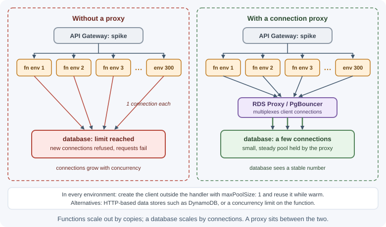

# Serverless Architecture

Serverless architecture builds applications from managed cloud services and
short-lived functions that the provider runs on demand. You write a function,
connect it to a trigger—an HTTP request, a file upload, a queue message—and
the platform starts, scales, and stops the compute for you. You pay for what
runs rather than for idle servers. There are still servers; you just do not
manage them.

## Why it matters

Serverless can remove most infrastructure work: no operating systems to
patch, no capacity planning, automatic scaling from zero to thousands of
concurrent executions, and very low cost for spiky or low-traffic workloads.
It also brings constraints that change how you design: cold starts, execution
time limits, statelessness, connection management, and dependence on one
cloud provider. Understanding them lets you decide where serverless fits and
where containers or servers are a better choice.

## Real-world usage

- **BBC — rendering its website with Lambda.** When the BBC rebuilt its
  website for the cloud, around half of the site came to be rendered
  serverlessly with AWS Lambda, because managing virtual machines or
  containers securely and reliably was expensive
  ([BBC Product & Technology](https://medium.com/bbc-product-technology/moving-bbc-online-to-the-cloud-afdfb7c072ff)).
- **CreditorWatch — lessons from 2 billion executions.** The Australian
  credit bureau's engineering blog reports that, at that scale, records were
  processed out of order and a failed batch was retried as a whole, which
  made idempotency essential
  ([CreditorWatch on Medium](https://medium.com/creditorwatch/aws-lambda-facts-you-wish-to-know-before-processing-2-billion-lambda-executions-2021-78fe77183c80)).
- **Superbet — sports modelling on Lambda.** Superbet's engineering team
  wrote that it had used AWS Lambda for sports modelling for over three
  years and expected to extend that use
  ([Superbet Engineering](https://dev.to/superbet/serverless-at-superbet-7em)).

Popular providers: AWS Lambda, Azure Functions, Google Cloud Run functions,
and Cloudflare Workers; managed building blocks such as API gateways,
queues, object storage, and serverless databases; Amazon RDS Proxy or
PgBouncer for connection pooling.

## How it works

### Two meanings of "serverless"

- **Functions as a service (FaaS):** you deploy individual functions that
  run in response to events. Examples: AWS Lambda, Azure Functions, Google
  Cloud Run functions, Cloudflare Workers.
- **Serverless managed services (backend as a service, BaaS):** databases,
  queues, storage, and authentication that scale automatically and bill by
  usage, such as Amazon DynamoDB, S3, SQS, Cognito, or Firebase.

A serverless architecture typically combines both: functions glue managed
services together.

### The FaaS execution model

Using AWS Lambda as the reference example:


- An **execution environment** is an isolated micro-VM or sandbox running
  your function's runtime (for example, Node.js).
- With Lambda's default compute type, each environment processes **one
  request at a time**. If ten requests arrive at once, Lambda runs ten
  environments in parallel—this is how it scales. (Lambda Managed Instances,
  a newer option that runs on EC2 instances, lets one environment handle
  several invocations at once, so code there must be safe for concurrency.)
- Code **outside** the handler (module scope) runs once per environment
  during initialization and is reused by later invocations in that
  environment. Code **inside** the handler runs on every invocation.
- Idle environments are eventually shut down. You cannot control when.

### Triggers

Functions are invoked by events from many sources:

| Trigger | Example use |
|---------|-------------|
| HTTP (API Gateway, function URLs) | REST or webhook endpoints |
| Object storage events (S3) | Create thumbnails when an image is uploaded |
| Queues (SQS) | Process orders or emails in batches |
| Pub/sub notifications (SNS, EventBridge) | React to domain events |
| Schedules (EventBridge Scheduler/cron) | Nightly reports and cleanup |
| Database streams (DynamoDB Streams) | Update search indexes on data changes |

Invocations can be **synchronous** (the caller waits, as with HTTP) or
**asynchronous** (the event is queued and the platform retries failures).
Because asynchronous and queue-based invocations can be retried, handlers
must be **idempotent**.

### Cold starts

A **cold start** is the extra latency when no warm environment is available
and the platform must create one: allocate the sandbox, load your code, start
the runtime, and run initialization code. It ranges from tens of
milliseconds to seconds, depending on runtime, package size, memory, and what
your initialization does (for example, connecting to a database).

Cold starts happen on first traffic, after idle periods, and whenever
traffic rises faster than existing environments can absorb. Ways to reduce
their impact:

- Keep deployment packages small; bundle and tree-shake dependencies.
- Do expensive setup lazily or once in module scope, not on every request.
- Allocate more memory (Lambda allocates CPU in proportion to memory, which
  also speeds initialization).
- Use **provisioned concurrency** (pre-initialized environments, billed even
  when idle) for latency-sensitive endpoints.
- Accept them for asynchronous work, where an extra second rarely matters.

### Statelessness

You cannot rely on anything staying in memory or on local disk between
invocations: the next request may run in a different environment, and any
environment may disappear. Keep state in external services—databases,
caches, object storage. In-memory data may be reused as an **optimization**
(a warm cache of configuration), never as the source of truth.

### Limits

Every platform imposes limits. For AWS Lambda, important ones include:

| Limit | AWS Lambda (check current quotas) | Design impact |
|-------|-----------------------------------|---------------|
| Maximum execution time | 15 minutes (900 seconds) | Long jobs must be split, chunked, or moved to containers or workflow services |
| Memory | 128 MB to 10,240 MB (CPU scales with memory; about one vCPU at 1,769 MB) | Choose memory for both RAM and CPU needs |
| Synchronous request/response payload | 6 MB each way (streamed responses can be larger) | Upload large files directly to object storage with presigned URLs |
| Concurrency | An account-level regional quota (default 1,000, can be raised) | One noisy function can starve others; set reserved concurrency |
| Temporary disk (`/tmp`) | 512 MB by default, configurable up to 10,240 MB | Not durable; cleared when the environment ends |

Quotas change over time, so verify them in the provider's documentation
before designing around a number.

### Pricing model

FaaS is usually billed by:

- **Number of invocations**, and
- **Duration × memory** (for Lambda, GB-seconds, billed in 1 ms increments).

There is no charge while nothing runs. This is very cheap for spiky or
low-volume workloads and for event processing. For steady, high-throughput
traffic, an always-on container or server can be cheaper, because you pay a
premium per unit of compute for on-demand elasticity. Also count the cost of
managed services around the functions (API gateway requests, queues, logs).

### Database connections

Traditional databases expect a modest number of long-lived connections. With
serverless, hundreds of concurrent environments may each open their own
connections and exhaust the database's limit.

Mitigations:

- **Create clients outside the handler** so warm invocations reuse
  connections.
- **Keep per-environment pools tiny** (often one connection).
- **Use a connection proxy or pooler**, such as Amazon RDS Proxy or
  PgBouncer, which multiplexes many client connections onto few database
  connections.
- **Use HTTP-based or serverless-friendly data stores** (DynamoDB, Data
  APIs, serverless database offerings) designed for this access pattern.
- **Limit function concurrency** to protect the database.



### Vendor lock-in

Serverless applications depend heavily on provider-specific triggers,
services, permissions, and deployment tooling. Moving to another cloud often
means rewriting integration code and infrastructure definitions. Reduce the
impact by keeping business logic in plain modules separate from the handler
(see [hexagonal architecture](layered-hexagonal-and-clean-architecture.md))
and by using infrastructure-as-code. Accept some lock-in consciously when the
productivity gain is worth it.

## When to use and when not to use

Good fits:

- Event processing: file uploads, queue consumers, webhooks, stream
  processing.
- Spiky or unpredictable traffic, and workloads that are idle most of the
  time.
- Scheduled jobs and automation.
- APIs for new products where traffic is unknown and the team is small.
- Glue code between managed services.

Poor fits:

- Long-running or CPU-heavy jobs exceeding time limits.
- Latency-critical APIs that cannot tolerate cold starts (unless you pay for
  provisioned concurrency).
- Steady, high-volume traffic where always-on compute is cheaper.
- Applications needing persistent connections in the same process, such as
  a WebSocket server holding sockets (managed WebSocket gateways exist, but
  the model differs).
- Workloads that need special hardware, OS access, or full control of the
  runtime.

### Containers versus serverless functions

| Aspect | Containers (ECS, Kubernetes, Cloud Run) | Serverless functions (Lambda) |
|--------|----------------------------------------|-------------------------------|
| Unit of deployment | Container image with a long-running server | Function code and handler |
| Scaling | Autoscaling rules; scale to zero only on some platforms | Automatic per request, scales to zero |
| Startup | Seconds to start new containers; warm instances serve many requests | Cold starts per new environment |
| Execution time | Unlimited | Limited (15 minutes on Lambda) |
| Concurrency per instance | Many requests per process | One request per environment (Lambda default compute type) |
| Billing | Provisioned capacity (or per-request on serverless container platforms) | Per invocation and duration |
| Operations | Images, orchestration, scaling configuration | Minimal infrastructure, more cloud configuration |
| Portability | High (standard images) | Lower (provider-specific triggers and services) |
| Local development | Run the same image locally | Emulators or deploy-to-test |

Serverless container platforms blur the line by running containers with
request-based scaling and billing.

## Practical examples

### An HTTP handler on AWS Lambda (Node.js)

```js
// handler.js — invoked through an API Gateway HTTP API
import { MongoClient } from "mongodb";

// Module scope: runs once per execution environment and is reused while warm.
const client = new MongoClient(process.env.MONGODB_URI, { maxPoolSize: 1 });
const clientReady = client.connect();

export const handler = async (event) => {
  const id = event.pathParameters?.id;
  if (!id) {
    return { statusCode: 400, body: JSON.stringify({ error: "id is required" }) };
  }

  await clientReady; // reuse the connection on warm invocations
  const product = await client.db().collection("products").findOne({ _id: id });

  if (!product) {
    return { statusCode: 404, body: JSON.stringify({ error: "Not found" }) };
  }
  return {
    statusCode: 200,
    headers: { "Content-Type": "application/json" },
    body: JSON.stringify(product),
  };
};
```

### Processing a queue batch idempotently

```js
// Invoked by SQS with a batch of messages; reports which ones failed
export const handler = async (event) => {
  const batchItemFailures = [];

  for (const record of event.Records) {
    try {
      const message = JSON.parse(record.body);
      if (await processedMessages.has(message.id)) continue; // duplicate: already done
      await sendReceiptEmail(message);
      await processedMessages.add(message.id); // mark done only after the work succeeded
    } catch (error) {
      console.error("Failed to process message", record.messageId, error);
      batchItemFailures.push({ itemIdentifier: record.messageId }); // retry only this one
    }
  }

  return { batchItemFailures }; // requires partial batch responses to be enabled
};
```

### A serverless image pipeline

```text
 client ──presigned URL──► [ S3 uploads bucket ]
                                 │ ObjectCreated event
                                 ▼
                         [ resize function ] ──► [ S3 thumbnails bucket ] ──► CDN
                                 │
                                 └──► [ DynamoDB: image metadata ]
```

No servers to run, nothing billed while no images are uploaded, and the
pipeline scales automatically with upload volume.

## Best practices

- Keep handlers thin; put business logic in plain modules you can test
  without the cloud.
- Initialize clients and configuration in module scope; reuse them across
  warm invocations.
- Make every handler idempotent; assume retries and duplicate events.
- Set timeouts on downstream calls shorter than the function's own timeout.
- Protect databases with connection proxies, tiny pools, and concurrency
  limits.
- Keep deployment packages small to reduce cold starts.
- Use dead-letter queues or failure destinations for events that keep
  failing.
- Monitor cost, duration, errors, throttles, and cold starts; set budgets and
  alerts.
- Define all infrastructure as code.

## In production

- **Cold-start latency spikes.** *Symptom:* p99 latency jumps after deploys,
  idle periods, or sudden traffic. *Detect:* the `Init Duration` field in
  Lambda's `REPORT` log lines appears on the slow requests. *Cause:* new
  environments loading a large bundle or doing heavy initialization.
  *Fix:* smaller bundles, lighter init, more memory, or provisioned
  concurrency for latency-sensitive endpoints.
- **Throttling.** *Symptom:* requests fail with throttling errors during a
  spike. *Detect:* the `Throttles` metric rises while concurrency sits at a
  limit. *Cause:* the account or function concurrency limit is reached, or
  another function used it up. *Fix:* reserved concurrency for critical
  functions, a quota increase, and a queue in front of bursty work.
- **Database connections exhausted.** *Symptom:* "too many connections"
  errors as traffic grows. *Detect:* database connections track function
  concurrency. *Cause:* every environment opens its own connections.
  *Fix:* clients in module scope, a pool size of one, a connection proxy,
  and a concurrency limit.
- **A failed batch retried as a whole.** *Symptom:* duplicate side effects
  and repeated errors for the same queue messages. *Detect:* the same
  message IDs processed several times. *Cause:* one bad record fails the
  whole batch. *Fix:* partial batch responses, idempotent processing, and a
  dead-letter queue for messages that never succeed.
- **Lost work from early "done" marks.** *Symptom:* some customers never
  get an email after a provider outage. *Detect:* messages marked processed
  with no matching email sent. *Cause:* recording a message as processed
  before the side effect succeeded, so retries skip it. *Fix:* mark it done
  only after the work succeeds, as the queue handler above does.
- **Runaway recursion and cost.** *Symptom:* invocations and the bill climb
  with no matching user traffic. *Detect:* a function's invocations grow
  exponentially, often a function writing to the same queue or bucket that
  triggers it. *Fix:* separate input and output locations, and rely on
  Lambda's recursive loop detection only as a backstop: it stops a chain
  after about 16 invocations, and only for supported services.

## Important terminology

- **Serverless:** Running applications on managed infrastructure you do not
  provision or operate.
- **FaaS (functions as a service):** Running individual functions on demand
  in response to events.
- **BaaS (backend as a service):** Managed backend services such as
  databases and authentication.
- **Trigger:** The event source that invokes a function.
- **Execution environment:** The isolated sandbox that runs a function
  instance.
- **Cold start / warm start:** Invocation that must create a new environment
  / reuses an existing one.
- **Provisioned concurrency:** Pre-initialized environments kept ready to
  avoid cold starts.
- **Reserved concurrency:** A cap (and guarantee) on concurrent executions
  for one function.
- **Connection proxy:** A service that pools database connections for many
  short-lived clients.
- **Vendor lock-in:** Dependence on one provider's proprietary services.

## Common mistakes and misconceptions

- **"Serverless means no servers."** It means no servers that you manage.
- **"Serverless is always cheaper."** It is cheap for spiky or low traffic
  and can be expensive for steady, high throughput.
- **Opening a new database connection in every invocation**, exhausting the
  database.
- **Storing state in memory or `/tmp`** and expecting it to persist.
- **Non-idempotent handlers** that double-process retried events.
- **Huge deployment packages** that make cold starts slow.
- **Functions calling functions synchronously in chains**, multiplying cost,
  latency, and failure points.

## Revision questions

1. What is the difference between FaaS and BaaS?
2. Explain the lifecycle of a Lambda execution environment and what runs at
   initialization versus per invocation.
3. What causes cold starts, and how can you reduce them?
4. Why can serverless functions overwhelm a relational database, and what
   are three mitigations?
5. Name three workloads that suit serverless and three that do not.
6. Compare containers and serverless functions on scaling, time limits, and
   cost.

## Further learning

- [AWS Lambda Developer Guide: What is AWS Lambda?](https://docs.aws.amazon.com/lambda/latest/dg/welcome.html)
- [AWS Lambda: Understanding the execution environment lifecycle](https://docs.aws.amazon.com/lambda/latest/dg/lambda-runtime-environment.html)
- [AWS Lambda: Quotas](https://docs.aws.amazon.com/lambda/latest/dg/gettingstarted-limits.html)
- [AWS Lambda: Best practices](https://docs.aws.amazon.com/lambda/latest/dg/best-practices.html)
- [AWS Lambda pricing](https://aws.amazon.com/lambda/pricing/)
- [Martin Fowler (Mike Roberts): Serverless architectures](https://martinfowler.com/articles/serverless.html)
- [Azure Functions overview](https://learn.microsoft.com/en-us/azure/azure-functions/functions-overview)
