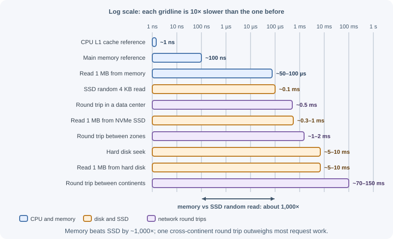
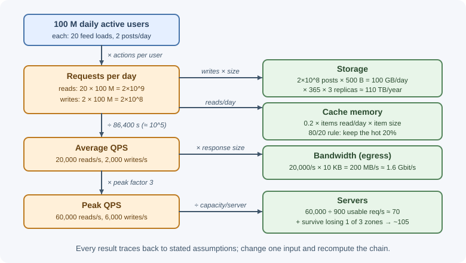

# Back-of-the-Envelope Estimation

Back-of-the-envelope estimation is quick, rough arithmetic that tells you
the **order of magnitude** of a system's load: requests per second, storage
per year, bandwidth, memory for caching, and number of servers. The answers
are not precise, and they do not need to be — the difference between 50
requests per second and 50,000 decides the design, while the difference
between 50,000 and 60,000 usually does not.

## Why it matters

Without numbers, design decisions are guesses. Estimation answers questions
like:

- Will one database handle the write rate, or do we need sharding?
- Does the hot data fit in memory, so a cache is cheap and effective?
- How much will storage cost in three years?
- Can this run on a handful of servers, or does it need hundreds?

It also exposes requirements nobody stated: a "small" feature that stores
every event forever may need petabytes. In interviews, estimation shows you
can reason about scale; at work, it prevents both over- and under-building.

## Real-world usage

- **Google SRE** turns reliability into numbers: services set availability
  targets and manage unreliability through **error budgets**
  ([Embracing Risk](https://sre.google/sre-book/embracing-risk/)); the SRE
  book includes an availability table translating nines into allowed
  downtime.
- **Google's Auxon** is "a powerful tool developed within SRE to automate
  capacity planning"; teams moved to **intent-based capacity planning** —
  "specify the requirements, not the implementation"
  ([Software Engineering in SRE](https://sre.google/sre-book/software-engineering-in-sre/)).
- **Amazon** validates capacity assumptions with tests: "At Amazon we spend a
  great deal of time load testing our services," including past the point
  where they break
  ([Using load shedding to avoid overload](https://aws.amazon.com/builders-library/using-load-shedding-to-avoid-overload/)).
- **Discord** hit a size threshold that estimation predicts: message volume
  grew from 40 million to over 120 million per day within months, and at 100
  million stored messages "the data and the index could no longer fit in
  RAM," making latencies unpredictable
  ([How Discord Stores Billions of Messages](https://discord.com/blog/how-discord-stores-billions-of-messages)).

## How it works

### Powers of two and storage units

| Power | Exact value | Approximate | Unit |
|---|---|---|---|
| 2^10 | 1,024 | 1 thousand (10^3) | 1 KB |
| 2^20 | 1,048,576 | 1 million (10^6) | 1 MB |
| 2^30 | 1,073,741,824 | 1 billion (10^9) | 1 GB |
| 2^40 | ~1.1 × 10^12 | 1 trillion (10^12) | 1 TB |
| 2^50 | ~1.13 × 10^15 | 1 quadrillion (10^15) | 1 PB |

For estimates, treat 1 KB as 1,000 bytes and so on. (Strictly, the binary
units are KiB, MiB, GiB; the difference is under 13% even at the petabyte
level and rarely matters for an estimate.)

### Typical data sizes

| Item | Approximate size |
|---|---|
| ASCII character | 1 byte (UTF-8 non-ASCII characters: 2–4 bytes) |
| 32-bit / 64-bit integer | 4 / 8 bytes |
| Timestamp | 8 bytes |
| UUID | 16 bytes binary, 36 characters as text |
| A short text post with metadata | ~0.5–1 KB |
| A JSON API response (list page) | ~5–50 KB |
| A compressed photo from a phone | ~0.5–3 MB |
| One minute of compressed HD video | ~10–100 MB (depends on bitrate) |

Remember overhead: indexes, replication, and storage engine overhead can
easily double or triple raw data size.

### Approximate latency numbers

These are rough orders of magnitude; real values depend on hardware,
network, and load.



| Operation | Approximate time |
|---|---|
| CPU L1 cache reference | ~1 ns |
| Main memory reference | ~100 ns |
| Read 1 MB sequentially from memory | ~50–100 µs |
| Random 4 KB read from an SSD | ~0.1 ms |
| Read 1 MB sequentially from an NVMe SSD | ~0.3–1 ms |
| Network round trip within a data center | ~0.5 ms |
| Round trip between availability zones in one region | Single-digit ms |
| Hard disk seek | ~5–10 ms |
| Read 1 MB sequentially from a hard disk | ~5–10 ms |
| Round trip between continents | ~70–150 ms |

AWS, for example, describes its availability zones as close enough for
synchronous replication "with single-digit millisecond latency"
([AWS Fault Isolation Boundaries](https://docs.aws.amazon.com/whitepapers/latest/aws-fault-isolation-boundaries/availability-zones.html)).

What to take away:

- Memory is roughly 1,000× faster than SSD random access, which is why
  caches work.
- Network round trips dominate: ten sequential calls inside a data center
  cost ~5 ms before any work is done; one cross-continent call costs more
  than an entire well-built request.
- Avoid cross-region calls in the request path; batch and parallelize calls.

### Availability nines

| Availability | Downtime per year | Downtime per 30-day month |
|---|---|---|
| 99% ("two nines") | ~3.65 days | ~7.2 hours |
| 99.9% | ~8.76 hours | ~43 minutes |
| 99.95% | ~4.4 hours | ~22 minutes |
| 99.99% | ~53 minutes | ~4.3 minutes |
| 99.999% | ~5.3 minutes | ~26 seconds |

Composing components:

- **In series** (the request needs all of them): multiply availabilities.
  An app at 99.9% that depends on a database at 99.9% is at most
  0.999 × 0.999 ≈ 99.8%.
- **In parallel** (any one of N redundant copies is enough):
  `1 − (1 − a)^N`. Two independent 99% replicas give
  1 − 0.01² = 99.99% — if their failures really are independent.

### Time conversions

| Period | Seconds | Rounded |
|---|---|---|
| 1 day | 86,400 | ~10^5 (100,000) |
| 1 month (30 days) | 2,592,000 | ~2.5 × 10^6 |
| 1 year | 31,536,000 | ~3 × 10^7 |

Using 10^5 for a day underestimates per-second rates by about 14%; that is
acceptable for an estimate, and you can say so.

### Requests per second from daily active users

```text
average QPS = daily active users × actions per user per day ÷ 86,400
peak QPS    = average QPS × peak factor (commonly 2–3×; more for spiky events)
```

Estimate reads and writes separately; their ratio (for example, 100:1 for a
URL shortener, 1:1 for chat) shapes the design. Traffic is rarely flat —
daily cycles, time zones, and events like sales or sports finals create
peaks.

### Storage

```text
storage per day = new records per day × size per record
storage total   = storage per day × retention days × replication factor
                  (+ overhead for indexes, typically ×1.2–2)
```

Separate small structured data (rows in a database) from large blobs (images,
video in object storage) — they are stored, priced, and scaled differently.

### Bandwidth

```text
egress (out) = read QPS × average response size
ingress (in) = write QPS × average request size
```

Convert bytes per second to bits per second (× 8) when comparing with
network link speeds. Large media egress is usually served from a CDN, so the
origin carries only a fraction.

### Cache memory sizing (80/20 rule)

Access is usually skewed: a small fraction of items receives most requests.
A common rule of thumb is that **about 20% of items serve about 80% of
reads**, so caching the hottest 20% of a day's read set captures most of the
benefit.

```text
cache memory ≈ 0.2 × (unique items read per day) × size per item
```

If you only know requests per day, using requests in place of unique items
gives an upper bound (many requests repeat the same items). Compare the
result with the memory of one cache node to decide how many nodes you need.

### Estimating server count

```text
servers = peak QPS ÷ (QPS one server handles at acceptable latency × target utilization)
```

- Get per-server capacity from load tests, not guesses — it varies by orders
  of magnitude between a cached lookup and a heavy report.
- Target utilization of ~50–70% leaves headroom for spikes and garbage
  collection.
- Add redundancy: if you spread across three availability zones and must
  survive losing one, the remaining two must carry the full peak.

Order-of-magnitude reference points (measure your own): a single Redis
instance can serve on the order of 100,000 simple operations per second; a
well-indexed relational database on one server typically handles thousands
to tens of thousands of simple queries per second; an application instance
handles hundreds to a few thousand typical API requests per second.

### Rounding rules

- Round inputs to one or two significant figures (86,400 → 100,000; 3.65 →
  4).
- Work in powers of ten: 2 × 10^8 ÷ 10^5 = 2 × 10^3.
- Keep units on every number and convert explicitly (bytes ↔ bits,
  seconds ↔ days).
- State each assumption out loud so others can correct it.
- Sanity-check results against things you know ("20 TB per day is a lot of
  disks — does that match a photo app with 10 million uploads?").

## When to use and when not to use

**Use estimation when:**

- Choosing between architectures before any code exists.
- Deciding whether a component (cache, shard, queue, CDN) is needed at all.
- Planning capacity and cost for a launch or the next year.
- Sanity-checking a vendor's claims or a teammate's proposal.
- In interviews, to justify each design decision.

**Do not rely on estimates when:**

- Real measurements exist — production metrics beat assumptions.
- You need final capacity numbers — confirm with load tests.
- Tuning latency-critical paths — profile and measure instead.
- Calculating exact bills or contractual commitments — use real usage data.

| Question | Estimate or measure? |
|---|---|
| "Will one database handle next year's writes?" | Estimate first, then track real growth |
| "How many instances do we need at launch?" | Estimate, then load test |
| "What is the p99 latency of this endpoint?" | Measure |
| "Does the working set fit in cache memory?" | Estimate, then check hit rate in production |
| "What will storage cost in 3 years?" | Estimate early; revise from actual growth |

## Practical examples

### Example 1: Social posts — QPS, storage, and bandwidth



**Assumptions:** 100 million daily active users (DAU). Each user posts 2
times per day and loads their feed 20 times per day. A post is 300 bytes of
text plus 200 bytes of metadata. A feed page returns 20 posts. Peak is 3×
average. 10% of posts include a 500 KB image.

**Write QPS:**

```text
posts/day  = 100 M × 2         = 200 M = 2 × 10^8
avg writes = 2 × 10^8 ÷ 10^5   = 2,000 /s     (exact: ~2,300 /s)
peak       = 2,000 × 3         ≈ 6,000 /s
```

**Read QPS:**

```text
feed loads/day = 100 M × 20        = 2 × 10^9
avg reads      = 2 × 10^9 ÷ 10^5   = 20,000 /s   (exact: ~23,000 /s)
peak           = 20,000 × 3        ≈ 60,000 /s
read:write ratio ≈ 10:1
```

**Text storage:**

```text
per day   = 2 × 10^8 posts × 500 B = 10^11 B = 100 GB/day
per year  = 100 GB × 365          ≈ 36.5 TB/year
with 3 replicas                    ≈ 110 TB/year
```

**Image storage:**

```text
images/day = 10% × 200 M = 20 M
per day    = 20 M × 500 KB = 10 TB/day
per year   = 10 TB × 365   ≈ 3.65 PB/year  → object storage + CDN
```

**Feed bandwidth (text only, average):**

```text
response = 20 posts × 500 B = 10 KB
egress   = 20,000 /s × 10 KB = 200 MB/s ≈ 1.6 Gbit/s
```

**Conclusions:** text data grows modestly but reads are heavy — feeds
should be cached or precomputed. Images dominate storage and must live in
object storage behind a CDN. Writes at ~6,000/s peak are within reach of a
sharded database or a write-optimized store.

### Example 2: URL shortener — cache sizing

**Assumptions:** 100 million new short URLs per month; 100 redirects per
URL created (read:write = 100:1); each mapping record is ~500 bytes; keep
records for 5 years.

```text
writes/s  = 10^8 ÷ (2.5 × 10^6 s/month)    ≈ 40 /s
reads/s   = 40 × 100                       ≈ 4,000 /s   (peak ×3 ≈ 12,000 /s)

storage   = 10^8 × 500 B = 50 GB/month → 600 GB/year → 3 TB over 5 years
```

**Cache:**

```text
reads/day     = 4,000 /s × 86,400 s ≈ 3.5 × 10^8
cache (80/20) = 0.2 × 3.5 × 10^8 × 500 B ≈ 35 GB  (upper bound)
```

**Conclusions:** 35 GB fits comfortably in a small cache cluster (or one
large node with a replica). Total storage of a few terabytes over five years
is modest; the challenge is read throughput and low latency, which caching
solves. See the [URL shortener case study](case-study-url-shortener.md).

### Example 3: How many application servers?

**Assumptions:** peak of 60,000 requests per second (from example 1). A load
test shows one instance serves 1,500 requests per second within the latency
target. We run at 60% target utilization, across 3 availability zones, and
must survive losing one zone.

```text
usable capacity per instance = 1,500 × 0.6 = 900 req/s
instances for peak            = 60,000 ÷ 900 ≈ 67 → round to 70

survive one zone of three: the other two zones must carry 100% of peak
total instances = 70 ÷ (2/3) = 105 → 35 per zone
```

**Conclusions:** about 105 instances at peak; autoscaling can run fewer at
night. The estimate is only as good as the per-instance figure — that number
must come from a load test (see
[performance testing](../../09-security-and-testing/performance-testing.md)).

## Best practices

- State every assumption explicitly and keep it adjustable.
- Estimate reads and writes separately; note the ratio.
- Always compute peak as well as average.
- Separate structured data from blobs; include replication and index
  overhead.
- Keep units on every number; convert bytes and bits carefully.
- Round aggressively; aim for the right order of magnitude.
- Sanity-check results against known systems or hardware limits.
- Replace estimates with measurements (load tests, production metrics) as
  soon as they exist.

## In production

- **Capacity runs out early.** *Symptom:* latency climbs and requests are
  throttled months before the planned upgrade. *Detect:* utilization and
  saturation dashboards with alerts at ~70%. *Cause:* the peak factor or
  growth rate was underestimated. *Fix:* forecast from real metrics, keep
  headroom, and autoscale where possible.
- **The cache does not help.** *Symptom:* database load stays high after
  adding a cache. *Detect:* low cache hit-rate metric. *Cause:* the working
  set is larger than estimated, or access is less skewed than the 80/20
  assumption. *Fix:* size from the measured working set; cache only hot
  data.
- **Storage fills faster than planned.** *Symptom:* disk-space alerts or a
  storage bill spike. *Detect:* storage growth trend per day. *Cause:*
  replication, indexes, logs, and backups were left out of the estimate.
  *Fix:* include overhead factors; set retention and lifecycle policies.
- **Network saturation.** *Symptom:* packet drops and timeouts during peaks.
  *Detect:* network throughput metrics near link limits. *Cause:* a bits
  versus bytes mistake (8×) or media served from the origin. *Fix:* recompute
  in consistent units; move media to a CDN.
- **Load test numbers do not match production.** *Symptom:* production
  saturates at half the tested throughput. *Detect:* compare per-instance
  throughput in production with test results. *Cause:* the test used a warm
  cache, a tiny dataset, or an unrealistic request mix. *Fix:* test with
  production-like data volumes and traffic mixes.

## Important terminology

- **Order of magnitude:** a factor of ten; estimation aims to get this right.
- **DAU / MAU:** daily / monthly active users.
- **QPS / RPS:** queries / requests per second.
- **Peak factor:** the ratio of peak load to average load.
- **Read:write ratio:** how many reads occur per write.
- **Replication factor:** the number of copies of each piece of data.
- **Egress / ingress:** data leaving / entering the system.
- **Working set:** the data actively accessed in a period.
- **80/20 rule (Pareto principle):** a small share of items receives most of
  the accesses.
- **Headroom:** spare capacity kept for spikes and failures.
- **Nines:** shorthand for availability percentages (99.9% = three nines).

## Common mistakes and misconceptions

- **Spending minutes on precise arithmetic.** Precision is not the goal.
- **Forgetting peak traffic**, sizing for the average.
- **Mixing bits and bytes**, which is an 8× error.
- **Forgetting replication and indexes** in storage estimates.
- **Treating blobs and metadata together**, which hides where storage goes.
- **Guessing per-server capacity** and then trusting the server count.
- **Assuming redundant components fail independently**, when they share a
  power supply, region, or software bug.
- **Not stating assumptions**, so nobody can correct them.

## Revision questions

1. Convert 10 million requests per day to average requests per second, and
   estimate the peak with a 3× factor.
2. How much downtime per month does 99.95% availability allow?
3. Two services, each 99.9% available, are called in series. What is the
   best combined availability?
4. Estimate yearly storage for 50 million 2 KB records per day with 3
   replicas.
5. Explain the 80/20 rule for cache sizing and why using total requests
   gives an upper bound.
6. Why should per-server capacity come from a load test rather than a guess?

## Further learning

- [AWS Well-Architected Framework: Reliability pillar](https://docs.aws.amazon.com/wellarchitected/latest/reliability-pillar/welcome.html)
- [Google SRE book: Embracing risk](https://sre.google/sre-book/embracing-risk/)
- [Google SRE book: Availability table](https://sre.google/sre-book/availability-table/)
- [Redis: Benchmarks](https://redis.io/docs/latest/operate/oss_and_stack/management/optimization/benchmarks/)
- Related notes: [The system design process](system-design-process.md),
  [Building blocks](building-blocks.md),
  [System design overview](../system-design.md)
