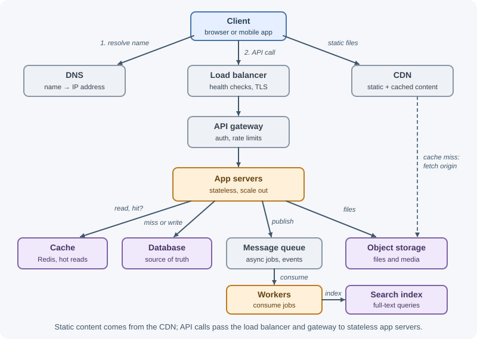
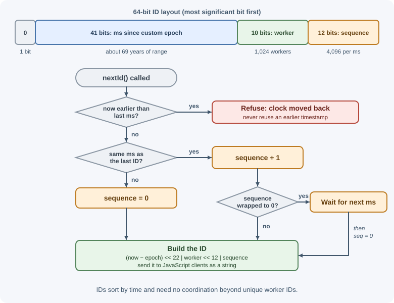
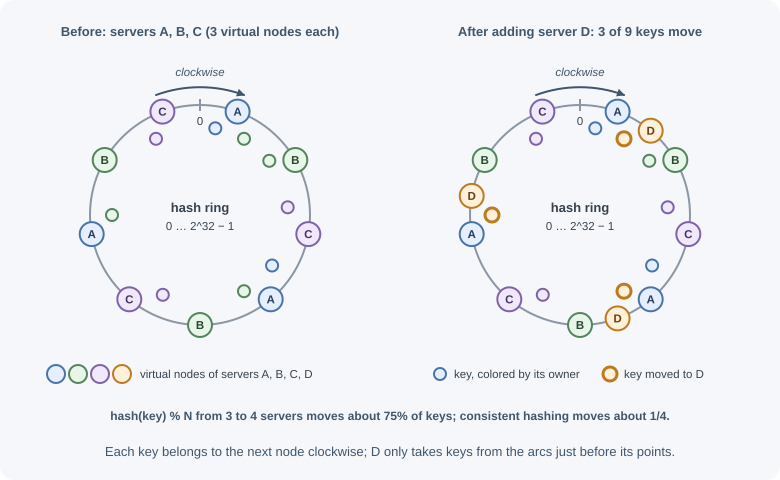

# System Design Building Blocks

Most large systems are assembled from the same set of components: DNS, CDNs,
load balancers, gateways, stateless application servers, caches, databases,
object storage, queues, search indexes, rate limiters, ID generators, and
partitioning schemes such as consistent hashing. Knowing what each block
does, what problem it solves, and what it costs lets you assemble a design
from requirements instead of from habit.

## Why it matters

In a design discussion, every box on the diagram must earn its place. A
cache added "for performance" without a read-heavy workload only adds
staleness and a failure mode. A queue added "for scalability" without a slow
or bursty task only adds latency. Understanding each block's purpose and
trade-offs lets you justify it — or leave it out.

## Real-world usage

- **Twitter's Snowflake** generated unique IDs without coordination because
  Twitter needed to "keep our ids under 64bits": 41 bits of time with a
  custom epoch (69 years), a 10-bit machine ID (up to 1,024 machines), and a
  12-bit sequence that rolls over every 4,096 IDs per machine
  ([Snowflake README](https://github.com/twitter-archive/snowflake/tree/snowflake-2010)).
- **Amazon's Dynamo** partitions data with consistent hashing and, instead of
  one point per node, assigns each node "multiple points in the ring" using
  **virtual nodes**
  ([Amazon's Dynamo](https://www.allthingsdistributed.com/2007/10/amazons_dynamo.html)).
- **Netflix Open Connect** is Netflix's program for delivering its content
  efficiently: Netflix partners with over a thousand ISPs, embedding Open
  Connect Appliances in their networks to localize traffic — a CDN pushed
  as close to viewers as possible
  ([Netflix Open Connect](https://openconnect.netflix.com/en/)).
- **Slack** maps each channel to a stateful, in-memory Channel Server using
  consistent hashing; at peak, about 16 million channels are served per host
  ([Real-time Messaging](https://slack.engineering/real-time-messaging/)).

## How it works

The typical request path through the blocks looks like this:



### DNS

DNS translates names like `api.example.com` into IP addresses. Managed DNS
can also route users to the nearest or healthiest region (latency-based,
geolocation, weighted, and failover routing). Answers are cached for their
TTL, so changes are not instant — keep TTLs short on records you may need to
fail over. See [DNS](../../01-networking-and-protocols/dns.md) and
[domains and DNS configuration](../../06-servers-and-infrastructure/domains-and-dns-configuration.md).

### CDN

A content delivery network caches content at edge locations close to users:
static assets, images, video, and cacheable public API responses. It cuts
latency, terminates TLS near the user, reduces origin load and egress cost,
and absorbs spikes. Behavior is controlled with headers such as
`Cache-Control`. See [CDN](../../06-servers-and-infrastructure/cdn.md) and
[HTTP and CDN caching](../caching/http-and-cdn-caching.md).

### Load balancer

A load balancer spreads requests across servers, runs health checks, and
stops sending traffic to unhealthy instances.

- **Layer 4 (transport):** balances TCP/UDP connections by IP and port; very
  fast; does not inspect HTTP.
- **Layer 7 (application):** understands HTTP; routes by path, host, or
  header, terminates TLS, adds headers like `X-Forwarded-For`.
- **Algorithms:** round robin, least connections, weighted, hash-based
  (for affinity).

Load balancers are themselves made redundant. See
[load balancing](../../06-servers-and-infrastructure/load-balancing.md).

### Reverse proxy and API gateway

A **reverse proxy** sits in front of application servers and forwards
requests to them, commonly handling TLS termination, compression, static
files, request buffering, caching, and basic rate limiting (Nginx, HAProxy,
Envoy). A layer 7 load balancer is a reverse proxy that also balances. See
[reverse proxy](../../06-servers-and-infrastructure/reverse-proxy.md).

An **API gateway** is a specialized entry point for APIs with many backend
services: routing to services, token validation, per-key rate limits and
quotas, request transformation, versioning, and usage analytics. Use it when
several services or external developers need one consistent front door; for a
single application, a load balancer plus middleware may be enough.

### Stateless application servers

Application servers run the business logic. Keeping them **stateless** — no
sessions or uploaded files in local memory or disk — means any instance can
serve any request, so instances can be added, removed, and replaced freely.
State goes to shared stores. See
[stateless services and autoscaling](../scalability/stateless-services-and-autoscaling.md).

### Cache

A cache keeps copies of frequently read data in fast storage (usually
memory) to cut latency and database load. Use it for read-heavy data that
tolerates some staleness. Key decisions: what to cache, the strategy
(cache-aside, read-through, write-through), invalidation, and behavior when
the cache fails. See [cache fundamentals](../caching/cache-fundamentals.md),
[caching strategies](../caching/caching-strategies.md), and
[cache failure modes](../caching/cache-failure-modes.md).

### Databases: SQL and NoSQL

| | Relational (SQL) | NoSQL (document, key-value, wide-column, graph) |
|---|---|---|
| Data model | Tables with fixed schema and relationships | Flexible documents, key-value pairs, column families, or graphs |
| Queries | Rich SQL, joins, aggregations | Optimized for specific access patterns; joins limited |
| Transactions | Strong ACID transactions across rows and tables | Varies; many support single-item atomicity, some multi-item transactions |
| Scaling | Vertical first; read replicas; sharding is harder | Many designed for horizontal partitioning from the start |
| Good for | Related business data, payments, inventory | Huge-scale key lookups, flexible schemas, event data |

Choose from access patterns and consistency needs; many systems use both. See
[database fundamentals](../../04-databases/database-fundamentals.md) and
[database scaling](../scalability/database-scaling.md).

### Object storage

Object storage (Amazon S3, Google Cloud Storage, Azure Blob Storage, and
S3-compatible services) stores large binary objects — images, video,
backups, exports — durably and cheaply, addressed by bucket and key. Keep the
bytes there and metadata in a database; deliver through a CDN and use
presigned URLs for direct uploads and private downloads. See
[file storage and uploads](../../03-backend-development/backend-concepts/file-storage-and-uploads.md).

### Message queue

A message queue (or log) decouples producers from consumers: the producer
writes a message and continues; consumers process it at their own pace. Use
it for slow or unreliable work, to absorb bursts, to fan events out to
several consumers, and to connect services loosely (RabbitMQ, Kafka, Amazon
SQS/SNS). Design for at-least-once delivery with idempotent consumers. See
[messaging fundamentals](../message-queues/messaging-fundamentals.md) and
[delivery guarantees](../message-queues/delivery-guarantees.md).

### Search index

Databases are poor at full-text search with typo tolerance and relevance
ranking. A search engine builds an **inverted index**: a map from each term to
the documents containing it.

```text
Documents:  1: "fresh coffee beans"   2: "coffee shop downtown"   3: "fresh bread"

Inverted index:
  beans → [1]    bread → [3]       coffee → [1, 2]
  fresh → [1, 3] downtown → [2]    shop → [2]

Query "fresh coffee" → score [1, 3] and [1, 2] → document 1 ranks first
```

Analyzers tokenize and normalize text (lowercase, stemming); results are
ranked by relevance (for example, BM25). Elasticsearch and OpenSearch are
common choices. The database stays the source of truth; the index is updated
asynchronously, so search can lag slightly behind writes.

### Rate limiter

A rate limiter caps how many requests a client can make in a time window,
protecting against abuse, brute force, and overload. It usually sits at the
API gateway or in middleware, with counters in a shared store such as Redis.
See [rate limiting and throttling](../../03-backend-development/backend-concepts/rate-limiting-and-throttling.md)
and the [distributed rate limiter case study](case-study-rate-limiter.md).

### Unique ID generation

Distributed systems need IDs that are unique across many servers, without a
single database sequence becoming a bottleneck.

| Approach | Size | Sortable by time | Coordination | Notes |
|---|---|---|---|---|
| Database auto-increment | 64-bit | Yes | Single sequence (bottleneck, SPOF) | Simple; reveals counts; hard across shards |
| UUID v4 | 128-bit | No | None | 122 random bits; random inserts fragment B-tree indexes |
| UUID v7 | 128-bit | Yes (millisecond) | None | Unix-time prefix + random bits (RFC 9562); index-friendly |
| Snowflake-style | 64-bit | Yes (roughly) | Unique worker IDs | Compact; fits in a `BIGINT` |
| ID ranges from a service | 64-bit | Roughly | Allocate blocks (e.g. 1,000 at a time) | Simple; used for counters like URL codes |

**Snowflake-style IDs** (introduced at Twitter) pack a timestamp, a machine
ID, and a sequence number into 64 bits:



They sort by creation time and are generated locally once each machine has
a unique ID. Watch for the clock moving backwards (refuse or wait) and for
sequence exhaustion within one millisecond (wait for the next). Time-ordered
IDs keep index inserts near the end of the index, but they reveal creation
time — never rely on IDs being unguessable for access control.

### Consistent hashing

To spread keys across N cache or database nodes, the naive approach is
`node = hash(key) % N`. When N changes, most keys map to a different node
(going from N to N + 1 nodes moves about N/(N + 1) of them — 75% for 3 → 4)
— a massive reshuffle that empties caches and moves most data.

**Consistent hashing** places both nodes and keys on a hash ring (for
example, 0 to 2^32 − 1). A key belongs to the first node found moving
clockwise from the key's position.



On average, adding or removing a node moves only about 1/N of the keys.

**Virtual nodes** fix two problems with one point per node: uneven
distribution (some nodes get large arcs) and heterogeneous capacity. Each
physical node is placed at many points (for example, 100–200). Load evens
out, a removed node's keys spread across many nodes instead of one neighbor,
and bigger machines can be given more virtual nodes.

Consistent hashing is used in distributed caches, Dynamo-style key-value
stores, Cassandra, and load balancers that need affinity. Redis Cluster uses
a related idea: 16,384 fixed **hash slots** assigned to nodes. See
[database scaling](../scalability/database-scaling.md).

## When to use and when not to use

**Use a block when its problem is real:** a CDN when many users fetch the
same content; a cache when reads dominate and staleness is acceptable; a
queue when work is slow, bursty, or unreliable; a search index when users
need full-text search; sharding or consistent hashing when one node cannot
hold the data or load.

**Leave it out when:** the load fits on simpler infrastructure (one database
with replicas handles a lot); the data must always be fresh (no cache); the
caller needs the result immediately (no queue); simple `LIKE` or prefix
queries are enough (no search cluster yet); you have no operational capacity
to run it.

| Choice | Prefer the first when… | Prefer the second when… |
|---|---|---|
| Queue vs direct call | The caller does not need the result now; work is slow, bursty, or retried; several consumers react | The caller needs the answer to respond; latency matters; the work is fast and reliable |
| SQL vs NoSQL | Related data, transactions, ad hoc queries, moderate scale | Simple key-based access at very large scale, flexible schema, horizontal partitioning from day one |
| CDN vs origin only | Static or media content, global users, cacheable public responses | Personalized or private responses that cannot be cached, a single-region internal tool |
| Cache vs no cache | High read:write ratio, tolerable staleness, measured database pressure | Data must be exactly current, low traffic, or poor hit rate expected |
| API gateway vs load balancer only | Many services or external developers, per-key quotas | One application with its own auth middleware |
| Snowflake/UUID v7 vs auto-increment | Many writers across shards or regions | One database, simplicity matters, IDs not exposed |

## Practical examples

### A Snowflake-style ID generator

```js
// 41-bit timestamp | 10-bit worker ID | 12-bit sequence, as a BigInt
const EPOCH = 1735689600000n; // 2025-01-01T00:00:00Z, a custom epoch

export function createIdGenerator(workerId) {
  let lastMs = -1n;
  let sequence = 0n;

  return function nextId() {
    let now = BigInt(Date.now());
    if (now < lastMs) throw new Error("Clock moved backwards; refusing to generate IDs");

    if (now === lastMs) {
      sequence = (sequence + 1n) & 4095n; // 12 bits
      if (sequence === 0n) {
        // Sequence exhausted for this millisecond: wait for the next one
        while (now <= lastMs) now = BigInt(Date.now());
      }
    } else {
      sequence = 0n;
    }
    lastMs = now;

    return ((now - EPOCH) << 22n) | (BigInt(workerId) << 12n) | sequence;
  };
}

const nextId = createIdGenerator(7); // workerId must be unique, 0–1023
console.log(nextId().toString());    // a large integer, printed as a string
```

Send such IDs to JavaScript clients as **strings** — they exceed
`Number.MAX_SAFE_INTEGER` (2^53 − 1), so as JSON numbers many of them lose
precision and change value.

### A consistent hash ring with virtual nodes

```js
import { createHash } from "node:crypto";

const hash32 = (value) => createHash("md5").update(value).digest().readUInt32BE(0);

// Place each physical node at many virtual positions, sorted around the ring
export function buildRing(nodes, virtualNodes = 150) {
  return nodes
    .flatMap((node) =>
      Array.from({ length: virtualNodes }, (_, i) => ({ position: hash32(`${node}#${i}`), node }))
    )
    .sort((a, b) => a.position - b.position);
}

// A key belongs to the first virtual node clockwise (use binary search at scale)
export function getNode(ring, key) {
  const position = hash32(key);
  return (ring.find((entry) => entry.position >= position) ?? ring[0]).node;
}

const ring = buildRing(["cache-a", "cache-b", "cache-c"]);
console.log(getNode(ring, "user:42")); // "cache-a" (MD5 is deterministic, so always the same node)
```

## Best practices

- Add a block only when a requirement or estimate justifies it.
- Keep application servers stateless; put state in shared, replicated stores.
- Remove single points of failure: redundancy across availability zones.
- Put a CDN in front of static and media content.
- Treat caches and search indexes as derived data, not the source of truth.
- Use queues for slow, unreliable, or bursty work; make consumers idempotent.
- Prefer time-ordered IDs (UUID v7, Snowflake-style) for keys at scale.
- Use consistent hashing (with virtual nodes) or hash slots when nodes change.

## In production

- **Cache stampede.** *Symptom:* database CPU spikes after a deploy or at
  regular intervals. *Detect:* cache hit rate drops while database load
  jumps. *Cause:* a cold cache or many keys expiring at once. *Fix:* jittered
  TTLs, request coalescing, and cache warm-up (see
  [cache failure modes](../caching/cache-failure-modes.md)).
- **Hot shard.** *Symptom:* one database or cache node is saturated while
  others idle. *Detect:* per-node CPU and request metrics. *Cause:* a skewed
  key (a celebrity, a viral item, a timestamp shard key). *Fix:* a better
  partition key, splitting hot keys, local caching, more virtual nodes.
- **Queue backlog.** *Symptom:* jobs finish later and later. *Detect:* queue
  depth and age-of-oldest-message alarms. *Cause:* consumers slower than
  producers, or a poison message retried forever. *Fix:* scale consumers,
  cap retries, send failures to a dead-letter queue.
- **Slow DNS failover.** *Symptom:* traffic keeps reaching a failed region
  for many minutes. *Detect:* synthetic checks per region. *Cause:* long DNS
  TTLs and clients caching answers. *Fix:* shorter TTLs on failover records,
  health-checked routing, and load balancer–level failover.
- **Health checks that lie.** *Symptom:* errors from instances the load
  balancer still considers healthy — or all instances removed at once.
  *Detect:* 5xx rates at the load balancer versus instance health. *Cause:* a
  check that ignores the app's real state, or one that fails when a shared
  dependency blips. *Fix:* separate liveness and readiness checks.
- **ID generator clock problems.** *Symptom:* ID generation errors or
  duplicate-key failures. *Detect:* error logs from the generator. *Cause:*
  the clock stepped backwards, or two workers share an ID. *Fix:* time sync
  that slews rather than steps, refusing to issue IDs while the clock is
  behind, and enforced unique worker IDs.

## Important terminology

- **Layer 4 / layer 7 load balancing:** balancing by connection (IP, port) /
  by HTTP content (path, host, headers).
- **Stateless service:** a service that keeps no client state locally.
- **Inverted index:** a map from terms to the documents that contain them.
- **Snowflake ID:** a 64-bit, time-ordered ID combining timestamp, machine ID,
  and sequence.
- **UUID v4 / v7:** random / time-ordered 128-bit unique identifiers.
- **Consistent hashing:** partitioning where adding or removing a node moves
  only a small share of keys.
- **Virtual node:** one of many ring positions assigned to a physical node.
- **Hash slot:** one of a fixed number of key partitions assigned to nodes.

## Common mistakes and misconceptions

- **Adding every block to every design.** Each adds cost, latency, and
  failure modes.
- **Storing sessions or files on app servers**, blocking horizontal scaling.
- **Using `hash(key) % N`** for nodes that change, causing massive
  reshuffles.
- **Random UUID v4 primary keys on huge tables** without considering index
  fragmentation.
- **Sending 64-bit IDs as JSON numbers** to JavaScript clients.
- **Forgetting that load balancers and gateways need redundancy too.**
- **"NoSQL scales, SQL doesn't."** Both scale with the right design; choose by
  access patterns and consistency needs.

## Revision questions

1. What is the difference between a load balancer, a reverse proxy, and an
   API gateway?
2. Why should application servers be stateless?
3. How does an inverted index answer a full-text query?
4. Compare auto-increment IDs, UUID v4, UUID v7, and Snowflake-style IDs.
5. Why does `hash(key) % N` cause problems when N changes, and how does
   consistent hashing fix it?
6. What two problems do virtual nodes solve?

## Further learning

- [Amazon Dynamo paper (2007)](https://www.allthingsdistributed.com/files/amazon-dynamo-sosp2007.pdf)
- [RFC 9562: Universally Unique IDentifiers (UUIDs)](https://www.rfc-editor.org/rfc/rfc9562)
- [Redis Cluster specification: hash slots](https://redis.io/docs/latest/operate/oss_and_stack/reference/cluster-spec/)
- [AWS: Elastic Load Balancing documentation](https://docs.aws.amazon.com/elasticloadbalancing/)
- [Azure Architecture Center: API gateways](https://learn.microsoft.com/en-us/azure/architecture/microservices/design/gateway)
- [OpenSearch documentation](https://opensearch.org/docs/latest/)
- Related notes: [The system design process](system-design-process.md),
  [Back-of-the-envelope estimation](back-of-the-envelope-estimation.md),
  [System design overview](../system-design.md)
