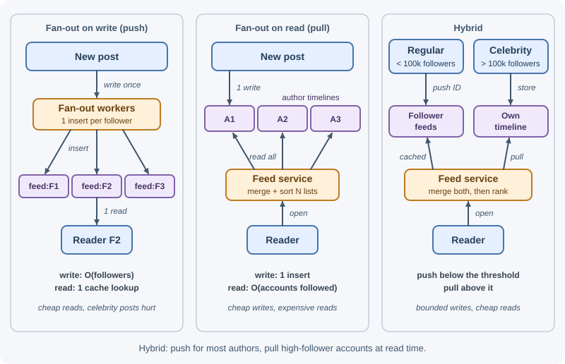

# Case Study: News Feed

A news feed shows each user a stream of recent posts from the accounts they
follow, like the home timeline of a social network. The central problem is
that a single post must appear in many feeds, and a single feed draws from
many authors. Deciding when to do that work — when a post is written, when a
feed is read, or a mix — shapes the whole design, especially for accounts
with millions of followers.

## Requirements

### Functional

- Users create posts with text and optional images.
- Users follow and unfollow other users.
- The home feed shows posts from followed accounts, newest or ranked first.
- Infinite scroll: load more posts as the user scrolls.
- Each post shows its author, media, and like/comment counts.
- New posts appear in followers' feeds within seconds.

### Non-functional

- **Scale:** 300 million monthly users, 100 million daily active users.
- **Latency:** feed load under ~300 ms at p99.
- **Availability:** feed reads 99.99%; posting 99.9%.
- **Consistency:** eventual — a few seconds before a post reaches followers is
  fine; authors must see their own post immediately.
- **Skewed graph:** most users have hundreds of followers; some have tens of
  millions.

## Capacity estimates

Assumptions: 100 M DAU; 10 feed loads per user per day; 10% of DAU post once
per day; average 200 followers per poster; 1 KB per post record; 30% of posts
include a 1 MB image; peak = 3×; ~70 bytes per feed entry in a Redis sorted
set (ID + score + overhead).

```text
Posts:          100 M × 10%          = 10 M /day   → ~100 /s   peak ~300 /s
Feed reads:     100 M × 10           = 1 B /day    → ~10,000 /s  peak ~30,000 /s

Fan-out on write (average):
                10 M posts × 200 followers = 2 B feed inserts/day
                                            → ~20,000 /s  peak ~60,000 /s
One celebrity post with 50 M followers      → 50 M inserts for one post (!)

Post storage:   10 M × 1 KB          = 10 GB/day   ≈ 3.65 TB/year
Media:          3 M images × 1 MB    = 3 TB/day    → object storage + CDN

Feed cache (active users only, 200 entries each):
                100 M × 200 × 70 B   ≈ 1.4 TB      → sharded Redis cluster
Follow graph:   300 M × 200 follows  = 6 × 10^10 edges, stored in both
                directions (followers and following)
```

Conclusions: reads outnumber posts ~100:1, which favors precomputing feeds
at write time — except for very high-follower accounts, whose fan-out would
be enormous. Feeds should store post IDs, not post bodies.

## API design

```text
POST /v1/posts
{ "text": "Sunset over the bay", "mediaKeys": ["m_8f3a"] }
→ 201 { "id": "1290481234567892992", "createdAt": "2026-11-07T18:02:11Z" }

GET /v1/feed?limit=20
GET /v1/feed?limit=20&cursor=eyJiZWZvcmUiOiIxMjkwNDgxMjM0NTY3ODkyOTkyIn0
→ 200
{ "items": [
    { "postId": "1290481234567892992",
      "author": { "id": "u_42", "handle": "maya", "avatarUrl": "https://cdn..." },
      "text": "Sunset over the bay",
      "media": [ { "url": "https://cdn.example.com/m_8f3a_1080.webp", "width": 1080, "height": 720 } ],
      "likeCount": 31, "commentCount": 4,
      "createdAt": "2026-11-07T18:02:11Z" } ],
  "nextCursor": "eyJiZWZvcmUiOiIxMjkwNDgxMTk5ODc2NTQzMjEwIn0" }

POST   /v1/users/{id}/follow     → 204
DELETE /v1/users/{id}/follow     → 204
GET    /v1/users/{id}/posts?cursor=...   → author's own timeline
```

Post IDs are returned as strings because 64-bit IDs exceed JavaScript's safe
integer range. The cursor is opaque to clients. See
[API design best practices](../../03-backend-development/backend-concepts/api-design-best-practices.md).

## Data model

**`users`** — `id` (PK), `handle` (unique), `name`, `avatarKey`,
`followerCount`, `followingCount`.

**`posts`** — `postId` (PK; Snowflake-style, time-ordered), `authorId`,
`text`, `mediaKeys`, `createdAt`, `deletedAt`. Index `(authorId, postId
DESC)` serves each author's timeline — used by fan-out on read.

**Follow graph** — stored twice, one table per access direction:

| Table | Partition key | Sort key | Used for |
|---|---|---|---|
| `followers` | `followeeId` | `followerId` | Fan-out on write: "who should receive this post?" |
| `following` | `followerId` | `followeeId` | Fan-out on read: "whose posts do I pull?" |

A wide-column or key-value store handles billions of edges partitioned this
way; a graph database is not required for one-hop lookups.

**Home feeds (precomputed)** — Redis sorted set per user:

```text
feed:{userId}  → members: postId, score: createdAt in milliseconds
                 trimmed to the newest ~200–500 entries
```

The score is the creation time, not the 64-bit post ID itself: sorted-set
scores are double-precision floats, which represent integers exactly only up
to 2^53, so large Snowflake IDs would lose precision and misorder.

**Post cache** — `post:{postId}` → serialized post, for fast batched
hydration. **Counters** (likes, comments) are kept in a separate counter
service/cache and merged in at read time.

## High-level design


**Write path:** the post service stores the post and returns immediately;
the `PostCreated` event lets fan-out workers asynchronously add the post ID
to each follower's precomputed feed. The author's own feed is updated
synchronously so they see their post at once.

**Read path:** the feed service reads post IDs from the user's precomputed
feed, merges recent posts from any high-follower accounts the user follows,
ranks the candidates, hydrates the top ones in batch, filters out deleted or
blocked content, and returns a page with a cursor.

## Deep dives

### 1. Fan-out on write, fan-out on read, and the hybrid



| | Fan-out on write (push) | Fan-out on read (pull) |
|---|---|---|
| When work happens | When a post is created: insert its ID into every follower's feed | When a feed is read: fetch recent posts from every followed account and merge |
| Read cost | Very low (one sorted-set read) | High (N author timelines per read, merge, sort) |
| Write cost | Proportional to follower count | Minimal |
| Freshness | Seconds of fan-out delay | Always current |
| Problem case | Celebrities: 50 M inserts per post; wasted work for inactive followers | Users following thousands of accounts; heavy reads at 30,000/s |

**Hybrid (chosen):**

- **Normal accounts** (below a threshold, for example 100,000 followers):
  fan out on write.
- **High-follower accounts** (above the threshold): do **not** fan out.
  At read time, the feed service pulls their recent posts (from the cached
  author timeline) for users who follow them and merges them in. Each
  celebrity's recent posts are read by millions of users, so their timelines
  stay hot in cache.
- **Inactive users** (no visit in, say, 30 days) are skipped during fan-out.
  When they return, their feed is rebuilt on demand by pulling, then kept
  warm by push again.

This bounds the write amplification while keeping reads cheap for the
common case.

### 2. The feed cache

- Store **post IDs only** (with a score), not post bodies. A post edit or
  like count change then never requires updating millions of feed entries;
  hydration fetches current data.
- Trim each feed to the newest ~200–500 entries (`ZADD` then
  `ZREMRANGEBYRANK`); older history is served by pulling if anyone scrolls
  that far.
- **Hydration** fetches posts with one batched read (`MGET` on the post
  cache, falling back to the posts DB for misses), plus authors and
  counters, in parallel.
- **Cache miss** (evicted or new user): rebuild by pulling from followed
  authors' timelines — expensive, so rate-limit rebuilds and keep feeds for
  active users in memory. Persisting feeds to a wide-column store is an
  option if rebuilds become too costly.
- Sizing: ~1.4 TB for active users, sharded by `userId` across a Redis
  cluster with replicas. See
  [Redis as a cache](../redis/redis-as-a-cache.md) and
  [cache failure modes](../caching/cache-failure-modes.md).

### 3. Ranking basics

A chronological feed sorts by time. A ranked feed tries to show the most
relevant posts first, in stages:

1. **Candidate generation:** IDs from the precomputed feed + celebrity pulls
   (a few hundred candidates).
2. **Feature lookup:** recency, the user's affinity with the author (past
   interactions), engagement so far (likes, comments, shares), content type,
   whether the user has already seen it.
3. **Scoring:** a weighted formula or a machine-learning model predicting
   engagement. A simple illustrative formula combines engagement, affinity,
   and time decay:

   ```text
   score = (1 + likes + 2 × comments) × affinity(user, author) / (ageHours + 2)^1.5
   ```

4. **Re-ranking:** diversity rules (avoid five posts in a row from one
   author), boosting fresh posts, removing already-seen ones.

Ranking must fit the latency budget: keep candidate sets small, precompute
features, and cache affinity scores.

### 4. Cursor pagination

Offset pagination (`?page=3`) breaks when new posts arrive at the top: items
shift down, so the user sees duplicates or misses posts.

- **Chronological feeds:** the cursor holds the score (timestamp) and post ID
  of the last item seen. The next page is "the 20 newest entries at or below
  that timestamp," skipping entries already returned that share the same
  millisecond:

  ```text
  ZRANGE feed:{userId} 1793815331000 -inf BYSCORE REV LIMIT 0 21
  → drop items up to and including the cursor's post ID, return 20
  ```

  (`ZRANGE ... BYSCORE REV` needs Redis 6.2+; older versions use
  `ZREVRANGEBYSCORE`.)

- **Ranked feeds:** rankings change between requests, so a cursor on score
  is unstable. Rank once when the user opens the feed, store the ordered list
  of IDs as a short-lived **feed session** (for example, in Redis for 30
  minutes), and page through that snapshot. Newer posts surface through a
  "New posts" prompt that starts a fresh session.

Cursors are encoded (for example, base64 JSON) so clients treat them as
opaque and the server can change their contents.

### 5. Media and the CDN

Images are uploaded directly to object storage with presigned URLs, then a
background job creates resized variants (thumbnail, 480 px, 1080 px) in
modern formats. Feed responses contain **CDN URLs**, never bytes. Variant
URLs are immutable (a new upload gets a new key), so the CDN can cache them
for a long time. Clients request the size that fits the screen. See
[CDN](../../06-servers-and-infrastructure/cdn.md) and
[file storage and uploads](../../03-backend-development/backend-concepts/file-storage-and-uploads.md).

### 6. Consistency expectations

- **Eventual consistency is acceptable:** followers may see a post a few
  seconds after it is created; counts may lag slightly.
- **Read-your-writes for authors:** write to the author's own feed
  synchronously (or merge their latest posts on read) so they never wonder
  whether posting worked.
- **Deletes:** mark the post deleted in the posts DB and cache; hydration
  drops deleted posts. Removing the ID from millions of feeds happens lazily
  or not at all — it simply never renders.
- **Unfollow:** filter the unfollowed author at read time immediately; clean
  their entries out of the feed asynchronously.
- **Follow:** asynchronously backfill the new followee's recent posts into
  the follower's feed.
- **Privacy changes and blocks** are enforced at read time (filtering),
  because cached feeds may contain stale entries.

See [consistency and the CAP theorem](../scalability/consistency-and-cap-theorem.md).

## Bottlenecks and trade-offs

- **What fails first:** fan-out workers during spikes (a burst of posts from
  popular-but-below-threshold accounts) — the queue backs up and feeds lag.
  Scale workers on queue depth; tune the celebrity threshold; prioritize
  fan-out to recently active users first.
- **Redis memory:** feed caches dominate memory; keep only active users and
  short feeds, store IDs only.
- **Hot posts:** a viral post's cache key is read by millions; use local
  in-process caches on feed servers and cache replicas.
- **Ranking latency:** model scoring is the most expensive step; bound the
  candidate count and precompute features.
- **Alternatives considered:** pure pull (simple writes, but too expensive
  at 30,000 feed reads per second for users following hundreds of accounts);
  pure push (celebrity posts cause tens of millions of writes); storing full
  posts in feeds (fast reads, but edits, deletes, and counts become massive
  update fan-outs).
- **Trade-off accepted:** feeds are eventually consistent and slightly stale
  in exchange for fast, cheap reads.

## Real-world references

- **Facebook's Multifeed** assembles News Feed when it is requested.
  **Aggregators** are the "query engine
  that accepts user queries and retrieves News Feed info from backend
  storage," doing aggregation, ranking, and filtering; **leaf** servers form
  a distributed storage layer that indexes the most recent News Feed actions
  in memory (about 20 leaves make one full replica); **tailers** feed user
  actions into the leaves. Separating aggregators (CPU-heavy) from leaves
  (memory-heavy) let each scale independently and gave a reported 40%
  efficiency improvement
  ([Serving Facebook Multifeed](https://engineering.fb.com/2015/03/10/production-engineering/serving-facebook-multifeed-efficiency-performance-gains-through-redesign/)).
  This is a fan-out-on-read design, made fast by keeping recent activity in
  memory — the opposite end of the trade-off from precomputed feeds.

## In production

- **Followers see posts late.** *Symptom:* new posts take minutes to appear.
  *Detect:* fan-out lag metric (time from post to fan-out complete) and
  queue depth. *Cause:* a burst from popular accounts just under the
  celebrity threshold. *Fix:* autoscale fan-out workers on queue depth,
  lower the threshold, fan out to recently active users first.
- **Feed cache evictions.** *Symptom:* slow feeds and expensive rebuilds.
  *Detect:* Redis memory usage and evicted-keys metrics, rebuild rate.
  *Cause:* feeds for too many users or too many entries per feed. *Fix:* trim
  feeds, cache only active users, add shards.
- **Viral post overloads one shard.** *Symptom:* one cache node saturated.
  *Detect:* per-node CPU and top-key reports. *Cause:* millions of
  hydrations of the same post. *Fix:* in-process caching of hot posts and
  cache replicas.
- **Ranking blows the latency budget.** *Symptom:* feed p99 above target.
  *Detect:* distributed traces showing time per stage. *Cause:* too many
  candidates or slow feature lookups. *Fix:* cap candidates, precompute and
  cache features.
- **Deleted posts still visible.** *Symptom:* reports of removed content in
  feeds. *Detect:* user reports, audit of deleted IDs served. *Cause:* stale
  post cache entries. *Fix:* invalidate the post cache on delete and check
  deletion status during hydration.

## Revision questions

1. Compare fan-out on write and fan-out on read. Which would you use for an
   account with 50 million followers, and why?
2. How does the hybrid approach combine both, and what decides the
   threshold?
3. Why should the feed cache store post IDs rather than full posts?
4. Why does offset pagination fail for feeds, and how do cursors and feed
   sessions fix it?
5. How does the design give authors read-your-writes consistency while
   followers see eventual consistency?
6. How are deletes and unfollows handled without rewriting millions of feeds?

## Further learning

- [Redis: Sorted sets](https://redis.io/docs/latest/develop/data-types/sorted-sets/)
- [Redis: ZRANGE command](https://redis.io/docs/latest/commands/zrange/)
- [Martin Fowler: Event-driven architecture](https://martinfowler.com/articles/201701-event-driven.html)
- [AWS Builders' Library: Caching challenges and strategies](https://aws.amazon.com/builders-library/caching-challenges-and-strategies/)
- Related notes: [Building blocks](building-blocks.md),
  [Case study: chat application](case-study-chat-application.md),
  [Common Redis use cases](../redis/common-use-cases.md)
