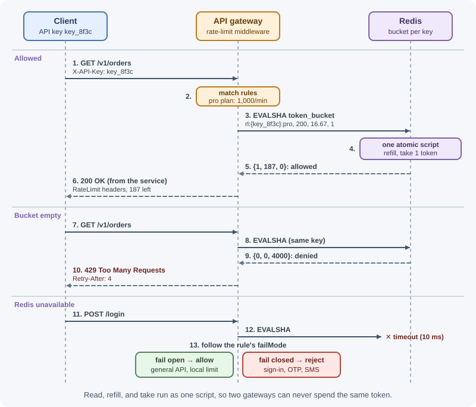

# Case Study: Distributed Rate Limiter

A rate limiter decides, for every incoming request, whether the client is
still within its allowance — for example, 1,000 requests per minute for a
paid API key, or 5 sign-in attempts per 15 minutes per account. In a
distributed system with dozens of gateway or service instances, the hard
parts are keeping counts accurate across instances, adding almost no
latency, and staying safe when the limiter's own storage fails.

## Requirements

### Functional

- Limit requests per **client key**: API key, user ID, or IP address.
- Support **multiple rules** per request: per plan tier (free, pro,
  enterprise), per endpoint (stricter limits on `POST /login` or
  `/v1/exports`), and global per-client limits.
- Allow short **bursts** while enforcing an average rate.
- Reject over-limit requests with `429 Too Many Requests`, `Retry-After`,
  and rate-limit headers; tell allowed requests how much quota remains.
- Change rules and per-customer overrides **without a redeploy**.
- A **shadow (dry-run) mode** to test new rules by logging would-be
  rejections.

### Non-functional

- **Low latency:** adds under ~2 ms at p99 to each request.
- **Accurate enough:** consistent counts across all instances; small
  over-admission during failures is tolerable, systematic multiplication of
  limits is not.
- **Highly available:** a limiter failure must not take the API down.
- **Scalable:** handle the platform's peak request rate.
- **Observable:** metrics on allowed and rejected requests per rule and
  client.

## Capacity estimates

Assumptions: 1 million requests per second at peak across the API platform;
on average 2 rules evaluated per request; 50 million distinct client keys
per day; ~100 bytes of state per (rule, client) key in Redis, including
overhead.

```text
Checks per second   = 1,000,000 req/s × 2 rules  = 2,000,000 rule checks/s
With one Lua call per request (rules colocated, see deep dive 4)
                    → ~1,000,000 Redis script calls/s

Redis throughput: a script call costs more than a plain GET; assume a
conservative ~50,000–100,000 script calls/s per shard (measure!)
                    → ~10–20 primary shards, each with a replica

Memory = 50 M clients × 2 rules × 100 B = 10 GB  (+ replicas)

Latency budget: same-zone Redis round trip ≈ 0.3–0.5 ms → fits in 2 ms
```

Conclusions: memory is small; throughput and latency drive the design. The
counter store must be sharded, and each request should need **one** round
trip.

## API design

The limiter runs **inside the API gateway** (or as a shared middleware
library); there is no extra network hop to a separate service. Its internal
interface:

```text
check(request) → { allowed: boolean,
                   rule: "pro-api-default",
                   limit: 1000, remaining: 412,
                   resetSeconds: 23, retryAfterSeconds: 0 }
```

**Rule management API** (internal, admin-only):

```text
PUT /v1/rate-limit-rules/pro-api-default
{ "match": { "pathPrefix": "/v1/", "plan": "pro" },
  "key": "apiKey",
  "algorithm": "token_bucket",
  "capacity": 200,            (burst size)
  "refillPerSecond": 16.67,   (≈ 1,000 per minute)
  "mode": "enforce" }         ("shadow" logs only)

200 OK { "id": "pro-api-default", "version": 7 }
```

**What clients see:**

```text
HTTP/1.1 200 OK
RateLimit-Policy: "default";q=1000;w=60
RateLimit: "default";r=412;t=23

HTTP/1.1 429 Too Many Requests
Retry-After: 4
RateLimit-Policy: "default";q=1000;w=60
RateLimit: "default";r=0;t=4
Content-Type: application/problem+json

{ "type": "https://api.example.com/problems/rate-limited",
  "title": "Too many requests", "status": 429,
  "detail": "Limit of 1000 requests per minute exceeded for this API key.",
  "retryAfterSeconds": 4 }
```

`RateLimit-Policy` and `RateLimit` follow the IETF rate-limit header fields
draft; the exact syntax has changed between drafts, so many APIs still also
send the older `X-RateLimit-Limit`, `X-RateLimit-Remaining`, and
`X-RateLimit-Reset`. `Retry-After` is standard (RFC 9110). See
[HTTP headers](../../03-backend-development/backend-concepts/http-headers.md).

## Data model

**Rules** (source of truth in a database or config repository; cached in
every gateway's memory):

| Field | Example | Notes |
|---|---|---|
| `id` | `pro-api-default` | Unique |
| `match` | path prefix, method, plan tier | Most specific rule wins |
| `key` | `apiKey`, `userId`, `ip`, `ip+email` | What is counted |
| `algorithm` | `token_bucket`, `sliding_window` | |
| `capacity` / `refillPerSecond` | 200 / 16.67 | Token bucket parameters |
| `limit` / `windowSeconds` | 5 / 900 | Window algorithm parameters |
| `mode` | `enforce`, `shadow` | Shadow logs instead of blocking |
| `failMode` | `open`, `closed` | Behavior when Redis is unavailable |
| `version` | 7 | Gateways reload on change |

**Per-client overrides:** `(clientKey, ruleId) → custom limits` for
negotiated enterprise contracts.

**Counter state (Redis):**

```text
key:   rl:{api_key_8f3c}:pro-api-default        (hash)
value: { tokens: "187.4", ts: "1793812345123" } (tokens left, last refill ms)
TTL:   time to refill the bucket completely (state disappears when idle)
```

The `{api_key_8f3c}` part is a Redis Cluster **hash tag**: only the text in
braces is hashed, so all of one client's rule keys land in the same slot and
can be updated by one script.

## High-level design


**Request path:**

1. The gateway authenticates the request and determines the client key —
   API key or user ID from the verified credentials; for anonymous traffic,
   the client IP, correctly derived behind proxies (see
   [rate limiting and throttling](../../03-backend-development/backend-concepts/rate-limiting-and-throttling.md)).
2. It matches the request against cached rules (path, method, plan).
3. It runs **one atomic Lua script** in Redis covering all matching rules.
4. If any enforced rule denies, it returns `429` with headers. Otherwise it
   forwards the request with the remaining-quota headers.
5. It records metrics; shadow-mode denials are logged but not enforced.

**Rule update path:** an admin updates a rule → the rules DB increments the
version → a change event (pub/sub) tells gateways to reload; gateways also
poll periodically as a fallback.

## Deep dives

### 1. Choosing the algorithm

| Rule type | Algorithm | Why |
|---|---|---|
| General API limits per key | Token bucket | Allows bursts, enforces average, cheap state (2 numbers) |
| Simple per-minute/hour quotas | Sliding window counter | Smooths boundary bursts with two counters |
| Sign-in / OTP attempts | Sliding window log or small fixed window | Exactness matters more than memory at low limits |
| Monthly plan quotas | Usage counters aggregated asynchronously | Billing-style accuracy, not per-request blocking |

Algorithm details (fixed window, sliding log, sliding counter, token bucket,
leaky bucket) are explained in
[rate limiting and throttling](../../03-backend-development/backend-concepts/rate-limiting-and-throttling.md).
This design uses the token bucket for most rules.

### 2. Atomicity with Redis and Lua



A naive implementation reads the count, decides in the gateway, and writes
back. Two gateway instances handling the same client at the same moment
both read `tokens = 1`, both allow, both write `0` — the limit is exceeded.

```text
Gateway A: GET → 1 token ─┐
Gateway B: GET → 1 token ─┤  both see 1
Gateway A: allow, SET 0  ─┤
Gateway B: allow, SET 0  ─┘  two requests allowed with one token
```

Redis executes a **Lua script atomically** — no other command runs in
between — so read, compute, and write happen as one step. The script also
uses Redis's own clock (`TIME`), avoiding clock differences between gateway
machines.

```lua
-- KEYS[1]: bucket key   ARGV: capacity, refill tokens/second, cost
local capacity = tonumber(ARGV[1])
local rate     = tonumber(ARGV[2])
local cost     = tonumber(ARGV[3])

local t   = redis.call("TIME")                       -- { seconds, microseconds }
local now = tonumber(t[1]) * 1000 + math.floor(tonumber(t[2]) / 1000)

local state  = redis.call("HMGET", KEYS[1], "tokens", "ts")
local tokens = tonumber(state[1]) or capacity
local last   = tonumber(state[2]) or now

-- refill for the time elapsed since the last request, up to capacity
tokens = math.min(capacity, tokens + math.max(0, now - last) * rate / 1000)

local allowed, retryAfterMs = 0, 0
if tokens >= cost then
  tokens = tokens - cost
  allowed = 1
else
  retryAfterMs = math.ceil((cost - tokens) / rate * 1000)
end

redis.call("HSET", KEYS[1], "tokens", tokens, "ts", now)
redis.call("PEXPIRE", KEYS[1], math.ceil(capacity / rate * 1000) + 1000)

return { allowed, math.floor(tokens), retryAfterMs }
```

Calling it from Node.js with ioredis:

```js
import Redis from "ioredis";
import { readFileSync } from "node:fs";

const redis = new Redis.Cluster([{ host: process.env.REDIS_HOST, port: 6379 }]);

// Registers the script once; ioredis uses EVALSHA and reloads it if needed
redis.defineCommand("tokenBucket", {
  numberOfKeys: 1,
  lua: readFileSync(new URL("./token-bucket.lua", import.meta.url), "utf8"),
});

export async function checkTokenBucket(clientKey, rule) {
  const key = `rl:{${clientKey}}:${rule.id}`;
  const [allowed, remaining, retryAfterMs] = await redis.tokenBucket(
    key, rule.capacity, rule.refillPerSecond, 1
  );
  return { allowed: allowed === 1, remaining, retryAfterMs };
}
```

The script is shown for a single rule to keep it readable. The production
version takes several keys (one per matching rule, all sharing the client's
hash tag), checks every bucket first, and only deducts tokens if all of them
allow the request.

### 3. Placement: gateway, service, or sidecar

| Placement | Pros | Cons |
|---|---|---|
| Edge (CDN / WAF) | Stops volumetric attacks before your network | Coarse rules; little business context |
| API gateway | One place for all services; per-key and per-plan limits; consistent headers | Gateway must know identities and plans |
| Service middleware | Business context (per action, per tenant, cost-based limits) | Each service must integrate; risk of inconsistency |
| Sidecar / central service (e.g. Envoy global rate limit service) | Language-agnostic; central policy | Extra hop or extra component to run |

**Choice:** volumetric protection at the edge; per-key and per-plan limits
at the **API gateway** using the shared Redis cluster; action-specific limits
(sign-in attempts, SMS sends, exports) in the owning **service**, using the
same library and Redis so behavior is consistent.

### 4. Multiple rules, races, and accuracy

- **One round trip for all rules:** using the hash tag, all keys for a
  client are in one slot, so a single script can check every matching rule
  and only consume tokens if **all** allow — avoiding wasted tokens when one
  rule passes and another fails.
- **Rule keys for different clients** spread across shards evenly.
- **Huge single tenants** (a hot key doing 100,000 requests/s) overload one
  shard. Split such a bucket into N sub-buckets (`rl:{key:0}` …
  `rl:{key:7}`), each with 1/N of the rate, and pick one at random per
  request; accuracy drops slightly, throughput scales.
- **Local pre-allocation** for very high volumes: each gateway takes a small
  batch of tokens from Redis and spends them locally, returning to Redis only
  when its batch runs out. This cuts Redis calls dramatically at the cost of
  brief over- or under-admission.
- Precision is "good enough" by design: rate limiting protects capacity and
  fairness; it is not a billing ledger.

### 5. Multi-region

A single global counter would add a cross-region round trip (70–150 ms) to
every request — unacceptable. Options:

| Approach | Behavior | Trade-off |
|---|---|---|
| Independent per-region limits | Each region enforces the full limit | A client spreading traffic across regions can get N× the limit |
| Split the limit across regions | Each region enforces limit ÷ N (or weighted by traffic) | Clients concentrated in one region are limited early |
| Local enforcement + async sync | Each region counts locally and periodically shares usage with others | Near-global accuracy with small overshoot; more complexity |

**Choice:** enforce locally in each region against a regional Redis
cluster, with limits weighted by each client's usual traffic split; aggregate
usage asynchronously for long-window quotas (daily, monthly), where a few
seconds of delay do not matter. Most clients are served from one region, so
overshoot is rare and small.

### 6. Fail-open versus fail-closed

If Redis is slow or unavailable, the gateway must still decide.

- Call Redis with a **tight timeout** (for example, 5–10 ms) and wrap it in a
  **circuit breaker** so a sick Redis does not add latency to every request.
- **Fail open** (allow) for general API limits: availability of the product
  matters more than strict limiting for a few minutes. Fall back to a
  **coarse in-memory limit per gateway instance** (limit ÷ number of
  instances) so a total limiter outage is not unlimited.
- **Fail closed** (deny) for security- and cost-sensitive rules — sign-in,
  OTP verification, SMS sending — where unlimited attempts would enable
  brute force or run up bills.
- Alert immediately on fallback mode; record it in metrics.

The per-rule `failMode` field captures this decision.

## Bottlenecks and trade-offs

- **What fails first:** Redis throughput or a hot shard as traffic grows.
  Mitigations: more shards, hash-tag colocation (one call per request),
  sub-bucket splitting for giant tenants, local token pre-allocation.
- **Latency:** every request pays one Redis round trip; keep Redis in the
  same zone or region and pipelines short.
- **Accuracy versus cost:** exact global counting is expensive; this design
  accepts small overshoot in failures and across regions.
- **Availability:** fail-open with local fallback protects uptime;
  fail-closed protects sensitive actions.
- **Alternatives considered:** in-memory counters per instance (rejected:
  limits multiply with instance count and change during autoscaling);
  sticky routing of each client to one gateway (rejected: fragile during
  scaling and failures); a managed gateway's built-in throttling (good for
  simple per-key limits, but less flexible for custom rules and shared use
  inside services).
- **Operational risk:** a bad rule can block legitimate traffic — mitigated
  by shadow mode, rule versioning, and quick rollback.

## Real-world references

- **Stripe** describes four kinds of limiters: a request rate limiter, a
  concurrent requests limiter ("you can only have 20 API requests in progress
  at the same time"), a fleet usage load shedder that reserves part of the
  fleet for critical requests (using a Redis cluster to count requests of
  each type), and a worker utilization load shedder. Stripe uses the token
  bucket algorithm, added the ability to briefly burst above limits for
  events like flash sales, and recommends dark-launching each limiter to
  watch what it would block before enforcing it
  ([Scaling your API with rate limiters](https://stripe.com/blog/rate-limiters)).
- **Cloudflare** built rate limiting for millions of domains under a
  constraint: its counters lived in memcached, which offered only `GET`,
  `SET`, and `INCR`. It used a **sliding window approximation** based on the
  previous and current counters, created an isolated counting system inside
  each point of presence to cut latency, and reported that on 400 million
  requests from 270,000 sources only 0.003% were wrongly allowed or limited
  ([How we built rate limiting capable of scaling to millions of domains](https://blog.cloudflare.com/counting-things-a-lot-of-different-things/)).
- **GitHub** documents its limits publicly: personal requests count toward a
  primary limit of 5,000 requests per hour, every response carries
  `x-ratelimit-limit`, `x-ratelimit-remaining`, `x-ratelimit-used`, and
  `x-ratelimit-reset` headers, and secondary rate limits — including no more
  than 100 concurrent requests — exist "to prevent abuse and keep the API
  available for all users"
  ([Rate limits for the REST API](https://docs.github.com/en/rest/using-the-rest-api/rate-limits-for-the-rest-api)).

## In production

- **Limits multiply after scaling out.** *Symptom:* clients exceed their
  quota by a factor that tracks the instance count. *Detect:* per-client
  request totals above configured limits. *Cause:* counters kept in each
  instance's memory. *Fix:* move counters to the shared Redis store.
- **Everyone limited at once.** *Symptom:* a sudden wave of `429`s for
  unrelated customers. *Detect:* 429 metrics grouped by key show one key
  (the load balancer's IP). *Cause:* the client IP is read wrongly behind
  proxies. *Fix:* configure trusted proxies correctly; key authenticated
  traffic by API key or user.
- **Redis latency slows every request.** *Symptom:* gateway p99 latency rises
  in step with Redis latency. *Detect:* Redis latency and slow-log metrics,
  gateway traces. *Cause:* an overloaded shard or a slow script. *Fix:* tight
  timeouts, a circuit breaker with local fallback limits, more shards.
- **One tenant overloads a shard.** *Symptom:* one Redis node near 100% CPU.
  *Detect:* per-node CPU and top keys. *Cause:* a giant customer's single
  bucket key. *Fix:* split the bucket into sub-keys or use local token
  pre-allocation.
- **A bad rule blocks real users.** *Symptom:* 429 spike right after a
  configuration change. *Detect:* 429 rate per rule with deploy markers.
  *Cause:* a rule matched more traffic than intended. *Fix:* shadow mode
  first, versioned rules, instant rollback.

## Revision questions

1. Why does a read-then-write implementation of a rate limiter over-admit
   requests, and how does a Lua script fix it?
2. Why does the script use Redis's `TIME` instead of the gateway's clock?
3. How do Redis Cluster hash tags let one script check several rules for the
   same client?
4. Compare enforcing limits at the edge, the API gateway, and inside
   services.
5. What are the options for rate limiting across regions, and what does each
   sacrifice?
6. Which rules should fail open and which should fail closed when Redis is
   unavailable? Why?

## Further learning

- [Redis: Scripting with Lua](https://redis.io/docs/latest/develop/programmability/eval-intro/)
- [Redis Cluster specification: hash tags](https://redis.io/docs/latest/operate/oss_and_stack/reference/cluster-spec/)
- [RFC 6585: 429 Too Many Requests](https://www.rfc-editor.org/rfc/rfc6585)
- [Envoy: Global rate limiting](https://www.envoyproxy.io/docs/envoy/latest/intro/arch_overview/other_features/global_rate_limiting)
- [AWS Builders' Library: Fairness in multi-tenant systems](https://aws.amazon.com/builders-library/fairness-in-multi-tenant-systems/)
- Related notes: [Rate limiting and throttling](../../03-backend-development/backend-concepts/rate-limiting-and-throttling.md),
  [Transactions, pipelining, and Lua](../redis/transactions-pipelining-and-lua.md),
  [Building blocks](building-blocks.md)
