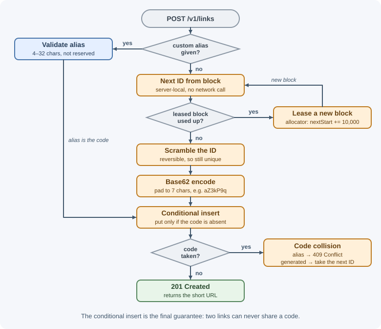

# Case Study: URL Shortener

A URL shortener turns a long URL into a short one, such as
`https://sho.rt/aZ3kP9q`, and redirects visitors to the original. It looks
trivial, but at scale it exercises many core design skills: unique ID
generation, read-heavy caching, choosing redirect semantics, analytics
without slowing the hot path, and abuse prevention.

## Requirements

### Functional

- Create a short link for a long URL; return the short code and URL.
- Visiting a short link redirects to the original URL.
- Optional **custom alias** (`sho.rt/spring-sale`).
- Optional **expiration** date; expired links stop redirecting.
- Owners can see **click analytics** (total clicks, clicks per day,
  referrers, countries).
- Owners can disable or delete their links.

### Non-functional

- **Scale:** 100 million new links per month; 100 redirects per link
  created (read:write ≈ 100:1).
- **Latency:** redirect handled in under ~50 ms at p99 on the server side.
- **Availability:** redirects 99.99%; link creation 99.9% is acceptable.
- **Durability:** a created link must never be lost or point somewhere else.
- **Uniqueness:** two links must never share a code.
- **Analytics** may lag by a few minutes (eventual consistency).
- **Safety:** prevent the service from being used to spread phishing or
  malware; codes should not be trivially enumerable.

## Capacity estimates

Assumptions: 100 M links/month, 100:1 read:write, peak = 3× average, 500
bytes per link record, 5-year retention, 200 bytes per click event.

```text
Writes:   10^8 / (2.5 × 10^6 s per month)  ≈ 40 /s     peak ≈ 120 /s
Reads:    40 × 100                          ≈ 4,000 /s  peak ≈ 12,000 /s

Links over 5 years: 100 M × 12 × 5          = 6 × 10^9 links
Link storage:       6 × 10^9 × 500 B        = 3 TB  (× 3 replicas ≈ 9 TB)

Code space (base62):
  6 characters: 62^6 ≈ 5.7 × 10^10   (enough, but ~10% full after 5 years)
  7 characters: 62^7 ≈ 3.5 × 10^12   (very roomy) → use 7

Cache (80/20 of a day's reads):
  4,000 /s × 86,400 ≈ 3.5 × 10^8 reads/day
  0.2 × 3.5 × 10^8 × 500 B ≈ 35 GB (upper bound)

Click events: 4,000 /s × 200 B = 800 KB/s ≈ 70 GB/day raw
```

Conclusions: modest write rate and total size; the challenges are read
throughput, low redirect latency, high availability, and collision-free code
generation. Raw analytics data grows fastest and should be aggregated.

## API design

All management endpoints require authentication (API key or session) and are
rate limited. See
[REST APIs](../../03-backend-development/backend-concepts/rest-apis.md).

**Create a link**

```text
POST /v1/links
Authorization: Bearer <token>
Idempotency-Key: 5d1c...           (optional; safe retries)
Content-Type: application/json

{ "longUrl": "https://example.com/blog/2026/11/very-long-article?utm_source=x",
  "customAlias": "spring-sale",     (optional)
  "expiresAt": "2027-01-01T00:00:00Z" }  (optional)

201 Created
Location: /v1/links/spring-sale
{ "code": "spring-sale",
  "shortUrl": "https://sho.rt/spring-sale",
  "longUrl": "https://example.com/blog/2026/11/very-long-article?utm_source=x",
  "expiresAt": "2027-01-01T00:00:00Z" }

400 Bad Request   invalid or unsafe URL, invalid alias format
409 Conflict      alias already taken
429 Too Many Requests
```

**Redirect**

```text
GET /aZ3kP9q

302 Found
Location: https://example.com/blog/2026/11/very-long-article?utm_source=x
Cache-Control: private, max-age=60

404 Not Found   unknown code
410 Gone        expired or disabled link
```

**Analytics**

```text
GET /v1/links/aZ3kP9q/stats?from=2026-11-01&to=2026-11-07

200 OK
{ "code": "aZ3kP9q", "totalClicks": 18234,
  "byDay": [ { "date": "2026-11-01", "clicks": 2410 }, ... ],
  "topReferrers": [ { "referrer": "news.example", "clicks": 5120 } ],
  "topCountries": [ { "country": "US", "clicks": 9012 } ] }
```

**Disable / delete**

```text
DELETE /v1/links/aZ3kP9q   → 204 No Content
```

## Data model

**`links`** — the hot, key-value table. Every redirect is a lookup by
`code`.

| Field | Type | Notes |
|---|---|---|
| `code` | string (≤ 32) | **Primary / partition key** |
| `longUrl` | string (≤ ~2,048) | Destination |
| `ownerId` | string | Creator |
| `createdAt` | timestamp | |
| `expiresAt` | timestamp, nullable | Checked on every redirect |
| `status` | enum | `active`, `disabled` |
| `isCustom` | boolean | Custom alias or generated |

Indexes:

- Primary key on `code` (unique; enforces no collisions).
- Secondary index on `(ownerId, createdAt)` for "list my links."

Storage choice: the access pattern is a single-key lookup at high volume,
which suits a horizontally partitioned key-value or wide-column store
(DynamoDB, Cassandra) partitioned by `code`. A relational database with read
replicas would also handle these numbers comfortably, especially behind a
cache; the key-value store is chosen for simple horizontal scaling and
built-in TTL support.

**`id_blocks`** — the ID range allocator's state (one row, or a coordination
service): `{ name: "links", nextStart: 1203000000 }`.

**Analytics:**

- `click_events` — an append-only stream (Kafka topic): `code`, timestamp,
  referrer, country (derived from IP, then discard the IP), user agent class.
- `link_stats_daily` — aggregated per `(code, date)`: clicks, top referrers,
  countries, approximate unique visitors. Stored in an analytics or columnar
  store, queried by the stats endpoint.

## High-level design


The redirect service and the link API are separate deployments: the redirect
path is the critical, high-volume one and is scaled and protected
independently.

**Write path (create link):**

1. Authenticate, rate limit, and validate the URL (scheme `http`/`https`
   only, length limit, not pointing to the shortener itself).
2. Check the URL against malware and phishing lists.
3. If a custom alias is given, validate its format and reserved words;
   otherwise generate a code (see deep dive 1).
4. **Conditional insert** (`put if not exists` on `code`). On conflict:
   return `409` for an alias, or generate another code.
5. Return `201` with the short URL.

**Read path (redirect):**

1. Look up `code` in a small in-process LRU cache, then Redis, then the
   links store.
2. If missing → `404` (and cache the miss briefly). If expired or disabled →
   `410`.
3. Populate caches on a miss, with a TTL no later than `expiresAt`.
4. Respond `302` with `Location`.
5. Emit a click event to a local buffer that is flushed to Kafka
   asynchronously — the redirect never waits for analytics.

## Deep dives

### 1. Generating short codes



Codes use **base62** (`0–9`, `a–z`, `A–Z`): URL-safe without escaping and
dense (7 characters ≈ 3.5 trillion values).

```js
const ALPHABET = "0123456789abcdefghijklmnopqrstuvwxyzABCDEFGHIJKLMNOPQRSTUVWXYZ";

// Encode a non-negative BigInt as base62, left-padded to a fixed length
export function toBase62(value, length = 7) {
  let result = "";
  let n = value;
  do {
    result = ALPHABET[Number(n % 62n)] + result;
    n /= 62n;
  } while (n > 0n);
  return result.padStart(length, "0");
}

toBase62(125n);           // "0000021"
toBase62(3521614606207n); // "ZZZZZZZ" (62^7 − 1, the largest 7-character code)
```

Three ways to choose the number to encode:

**a) Hash the long URL.** Take SHA-256 (or MD5) of the URL, use the first
41 bits (62^7 ≈ 2^41.7, so 41 bits always fit in 7 characters), and encode
them.

- The same URL always produces the same code (built-in deduplication — but
  two users shortening the same URL then share analytics and settings, which
  is usually undesirable; add the owner ID to the hash input).
- **Collisions** are possible when truncating a hash: different URLs can
  produce the same prefix. You must check, and on collision append a salt or
  counter and rehash — extra reads on the write path.

**b) Counter with ID-range allocation.** A global counter guarantees
uniqueness without collision checks, but a single counter incremented on
every write is a bottleneck and single point of failure. Instead, each API
server **leases a block** of IDs (for example, 10,000 at a time) from the
allocator by atomically advancing `nextStart`, then hands them out from
memory.

- No collisions, no extra lookups; the allocator is contacted once per
  10,000 links.
- If a server crashes, the rest of its block is skipped — gaps are harmless.
- Sequential IDs produce **guessable** codes (`...aZ3kP9q`, `...aZ3kP9r`),
  letting anyone enumerate links. Scramble the ID with a reversible
  (bijective) transform before encoding — for example, multiply by a large
  constant that has no common factor with 62^7, modulo 62^7, or apply a small
  Feistel cipher. This is obfuscation, not security: links are public
  capabilities, so private content must not rely on code secrecy.

**c) Random codes.** Pick 7 random base62 characters and conditionally
insert; retry on conflict. With 6 billion codes in a space of 3.5 trillion,
a new random code collides with probability ≈ 6 × 10^9 / 3.5 × 10^12 ≈
0.17%, so retries are rare and cheap. Codes are naturally unguessable.

**Choice:** ID-range allocation with scrambling for predictable,
collision-free generation (option b), or random codes with conditional
insert (option c) if simplicity is preferred. Either way, the **conditional
insert on the primary key** is the final guarantee of uniqueness — it also
protects against a generated code matching an existing custom alias.

### 2. 301 versus 302 and analytics

| | `301 Moved Permanently` | `302 Found` (or `307`) |
|---|---|---|
| Browser behavior | Cacheable by default (RFC 9110 calls 301 "heuristically cacheable"), and browsers often keep it for a long time; later clicks may skip the server | Not cached unless `Cache-Control` or `Expires` allows it, so clicks reach the server unless you set a max-age |
| Analytics | Undercounts repeat visits | Every click is seen, apart from repeats within any max-age you allow |
| Changing or disabling a link | Visitors with a cached 301 keep going to the old target | Takes effect immediately |
| Server load | Lower | Higher (mitigated by caching) |

Because analytics, disabling abusive links, and editable destinations are
requirements, this design uses **302** with a short `Cache-Control` max-age.
(`301`/`308` suit links that are truly permanent and where analytics do not
matter.) If a CDN caches redirects at the edge, analytics must come from CDN
logs instead.

Analytics never block the redirect: the handler appends an event to an
in-memory buffer flushed to Kafka every few hundred milliseconds. A stream
processor aggregates per code and day; unique visitors can be approximated
with HyperLogLog. If Kafka is down, events are buffered briefly and then
dropped — losing some analytics is acceptable; failing redirects is not.

### 3. Read-heavy caching

- **Cache-aside** in Redis: `link:{code}` → `{ longUrl, expiresAt, status }`
  with a TTL (for example, 24 hours, never beyond `expiresAt`); ~35 GB fits a
  small cluster. See [caching strategies](../caching/caching-strategies.md).
- **In-process LRU** of a few thousand entries per redirect server absorbs
  **viral links** (hot keys) without hitting Redis at all.
- **Negative caching:** cache "not found" for 30–60 seconds so bots scanning
  random codes do not hammer the database.
- **Invalidation:** on disable or delete, delete the Redis key; the short
  in-process TTL bounds staleness elsewhere. See
  [invalidation and expiration](../caching/invalidation-and-expiration.md).
- **Stampede protection:** when a hot key expires, let one request reload it
  (request coalescing) while others wait briefly. See
  [cache failure modes](../caching/cache-failure-modes.md).
- If Redis fails, redirect servers fall back to the links store, which must
  be provisioned for the extra load (or shed load gracefully).

### 4. Custom aliases and expiration

**Aliases:** validate length (for example, 4–32), characters
(`[A-Za-z0-9-_]`), and a reserved list (`api`, `admin`, `login`, `help`,
offensive terms). Insert with the same conditional write; conflicts return
`409`. Aliases and generated codes share one namespace, which the primary key
protects.

**Expiration:**

- Check `expiresAt` on every redirect; return `410 Gone` once expired.
- Never cache a link past its expiry.
- Remove expired rows with the store's TTL feature (DynamoDB TTL, MongoDB TTL
  indexes) or a nightly batch job.
- **Do not recycle** expired codes for new links: old copies of the short URL
  remain in emails and documents and would silently point to someone else's
  content.

### 5. Abuse prevention

- **Rate limit** creation per account, API key, and IP; require sign-up or a
  CAPTCHA for anonymous creation. See
  [rate limiting](../../03-backend-development/backend-concepts/rate-limiting-and-throttling.md).
- **Check destinations** against malware and phishing lists (such as Google
  Safe Browsing) at creation and re-check periodically, since a domain can
  turn malicious later.
- Allow only `http` and `https` (no `javascript:` or `data:` URLs); block
  redirects to the shortener's own domain and to other shorteners to prevent
  loops and chains.
- **Disable** reported or flagged links quickly (status → `disabled`, cache
  invalidated); optionally show a warning interstitial page.
- Non-enumerable codes (deep dive 1) stop easy scraping of all links.
- Provide an abuse reporting endpoint and audit trail.

## Bottlenecks and trade-offs

- **What fails first:** the links store under read load if the cache is cold
  or down. Mitigation: layered caches, provisioning for cache-miss load,
  and load shedding.
- **Hot keys:** a viral link concentrates traffic on one cache shard and one
  partition; in-process caching and short CDN caching spread it.
- **Availability of redirects:** the redirect path depends only on its own
  servers, the cache, and the links store (replicated across zones).
  Analytics, the ID allocator, and URL checking are off the redirect path.
- **ID allocator:** an outage only stops creation after servers use up their
  leased blocks; run it on a replicated store.
- **Multi-region:** replicate the links store to each region (global tables
  or read replicas) so redirects are served locally; creation can write to
  one home region, with region-prefixed ID ranges if multiple regions write.
  New links may take a moment to appear in other regions — acceptable here.
- **Alternatives considered:** hashing (rejected: collision handling and
  shared-code semantics); 301 redirects (rejected: lose analytics and
  control); a single relational database (viable at this size, but sharding
  later is harder than with a partitioned key-value store).
- **Trade-off accepted:** 302 increases server traffic compared with 301, in
  exchange for accurate analytics and the ability to disable links.

## Real-world references

- **Google's goo.gl** shows why link permanence is a core requirement. In
  2018 Google stopped new link creation for most users but promised that
  "all existing links will continue to redirect to the intended destination"
  ([Transitioning Google URL Shortener to Firebase Dynamic Links](https://developers.googleblog.com/en/transitioning-google-url-shortener-to-firebase-dynamic-links/)).
  In 2024 it announced that goo.gl links would stop working after August 25,
  2025, first showing an interstitial warning page on a growing share of
  links; in August 2025 it revised the plan to preserve actively used links,
  noting they "are embedded in countless documents, videos, posts and more"
  ([Google URL Shortener links will no longer be available](https://developers.googleblog.com/en/google-url-shortener-links-will-no-longer-be-available/)).
  Lesson: short links outlive products, so plan for long-term redirect
  availability and never recycle codes.
- **Twitter's Snowflake** is a well-known example of the ID-generation side
  of this design: unique 64-bit, roughly time-ordered IDs generated without
  central coordination, from a timestamp, a machine ID, and a sequence
  ([Snowflake README](https://github.com/twitter-archive/snowflake/tree/snowflake-2010)).
  Encoding such IDs in base62 is one way to produce short codes.

## In production

- **A viral link slows redirects.** *Symptom:* p99 redirect latency jumps
  while one code dominates traffic. *Detect:* per-key request counts, one
  Redis shard's CPU rising. *Cause:* a hot key concentrated on one cache shard
  and one database partition. *Fix:* in-process LRU caches on redirect
  servers and short CDN caching of the redirect.
- **Bots scanning codes.** *Symptom:* database read load rises with a surge
  of `404` responses. *Detect:* 404 rate per client and overall. *Cause:*
  scanners guessing codes, each a cache miss. *Fix:* negative caching,
  per-IP rate limits, non-sequential codes.
- **The domain gets flagged for phishing.** *Symptom:* browsers or email
  providers warn about or block all your short links. *Detect:* abuse
  reports, safe-browsing status checks, sudden drops in click-through.
  *Cause:* attackers using the service to hide malicious destinations.
  *Fix:* scan destinations at creation and periodically, disable links fast,
  rate-limit anonymous creation.
- **Link creation fails.** *Symptom:* `5xx` on create while redirects work.
  *Detect:* error rate on the create endpoint, allocator errors. *Cause:* the
  ID allocator is unavailable and servers have used up their leased blocks.
  *Fix:* larger blocks, a replicated allocator store, alerts on low remaining
  block capacity.
- **Stale analytics.** *Symptom:* owners see click counts hours behind.
  *Detect:* Kafka consumer lag. *Cause:* the aggregator cannot keep up with
  click events. *Fix:* scale consumers; redirects remain unaffected because
  analytics are off the hot path.

## Revision questions

1. Why are 7 base62 characters enough for this system, and how did you
   calculate it?
2. Compare hashing, counter ranges, and random codes for generating short
   codes. How is uniqueness ultimately guaranteed?
3. Why does this design use 302 instead of 301, and what does it cost?
4. How do in-process caching, Redis, and negative caching each protect the
   database?
5. Why should expired codes not be reused?
6. Which components are on the redirect path, and why were analytics kept
   off it?

## Further learning

- [MDN: 301 Moved Permanently](https://developer.mozilla.org/en-US/docs/Web/HTTP/Status/301)
- [MDN: 302 Found](https://developer.mozilla.org/en-US/docs/Web/HTTP/Status/302)
- [RFC 9110: Redirection 3xx](https://www.rfc-editor.org/rfc/rfc9110#name-redirection-3xx)
- [Google Safe Browsing](https://developers.google.com/safe-browsing)
- [Amazon DynamoDB: Time to Live (TTL)](https://docs.aws.amazon.com/amazondynamodb/latest/developerguide/TTL.html)
- [Redis: Client-side caching](https://redis.io/docs/latest/develop/reference/client-side-caching/)
- Related notes: [Building blocks](building-blocks.md),
  [Back-of-the-envelope estimation](back-of-the-envelope-estimation.md),
  [Common Redis use cases](../redis/common-use-cases.md)
