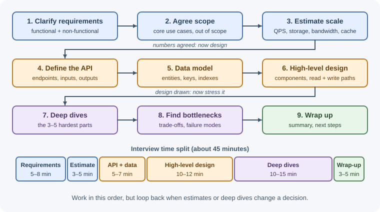
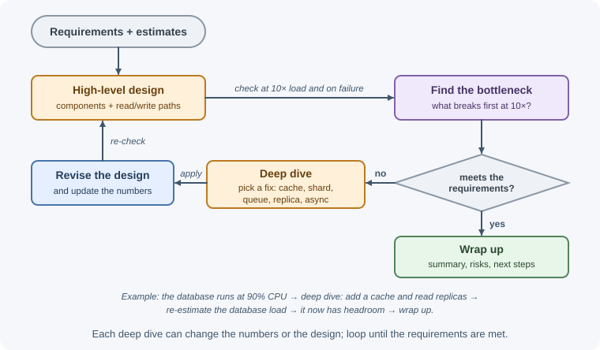

# The System Design Process

System design turns a vague goal — "build a URL shortener," "add
notifications" — into a concrete plan: which components exist, how data
flows between them, how they store data, and how the system behaves under
load and failure. A repeatable process keeps the design grounded in
requirements instead of favorite technologies, and it works the same way for
a real project at work and for a 45-minute interview.

## Why it matters

Most expensive design mistakes come from skipping steps, not from choosing
the wrong database:

- Building for millions of users when the product has hundreds, adding
  queues, caches, and services that only add failure modes.
- Building for hundreds when the product will have millions, and discovering
  the bottleneck in production.
- Designing a strongly consistent system when users would accept a few
  seconds of delay — or the reverse, for payments.
- Agreeing on components before anyone agreed on what the system must do.

A structured process makes requirements, assumptions, and trade-offs
explicit, so teammates (or interviewers) can challenge them early, when
changes are cheap.

## Real-world usage

- **Amazon Web Services** publishes the
  [Well-Architected Framework](https://docs.aws.amazon.com/wellarchitected/latest/framework/welcome.html),
  which it describes as helping you "understand the pros and cons of
  decisions you make while building systems on AWS" — a structured set of
  review questions for designing reliable, secure, efficient,
  cost-effective, and sustainable systems.
- **Google SRE** created a dedicated team of "Launch Coordination Engineers"
  and curated a "launch checklist" of common questions to ask about a launch,
  to enable a rapid pace of change without compromising stability
  ([Reliable Product Launches at Scale](https://sre.google/sre-book/reliable-product-launches/)).
- **Microsoft** offers the
  [Azure Well-Architected Framework](https://learn.microsoft.com/en-us/azure/well-architected/):
  "quality-driven tenets, architectural decision points, and review tools,"
  including an assessment tool teams run against their workloads.
- **Discord**, before replacing its message database, first analyzed its
  read/write patterns — reads were "extremely random" and the read/write
  ratio was about 50/50 — and chose Cassandra to fit those requirements
  ([How Discord Stores Billions of Messages](https://discord.com/blog/how-discord-stores-billions-of-messages)).

## How it works

The process has nine steps. In practice you loop back — a capacity estimate
may change the data model — but working through them in order keeps the
discussion organized.



### Step 1: Clarify requirements

**Functional requirements** describe what users and systems can do:

- "Users can create a short link for a long URL."
- "Visiting the short link redirects to the original URL."
- "Users can see click counts for their links."

**Non-functional requirements** describe how well the system must do it:

| Quality | Example question | Example answer |
|---|---|---|
| Scale | How many users, requests, records? | 100 M new links/month, 10:1 read/write |
| Latency | How fast must key operations be? | Redirect p99 under 50 ms |
| Availability | How much downtime is acceptable? | 99.99% for redirects |
| Consistency | Can readers see stale data? | A new link may take a second to work everywhere |
| Durability | Can we ever lose data? | Never lose a created link |
| Security / privacy | Who can see what? Regulations? | Only owners see analytics |
| Cost | Budget constraints? | Minimize storage costs |

Ask questions instead of assuming. "Is this read-heavy or write-heavy?",
"Global users or one region?", "Do we need real-time updates?" The answers
change the design.

### Step 2: Agree scope

You cannot design everything in detail. Agree on the **core use cases** to
focus on and list what is **out of scope** (for example, "authentication and
billing are handled by existing services"). Writing the scope down prevents
spending half the time on a side feature.

### Step 3: Estimate scale

Rough numbers decide whether you need one database or a sharded cluster, a
cache or not, one region or several. Estimate:

- Requests per second (average and peak) for reads and writes.
- Storage per day and over the retention period.
- Bandwidth in and out.
- Memory needed for caching hot data.

Round aggressively; the goal is the right **order of magnitude**. See
[back-of-the-envelope estimation](back-of-the-envelope-estimation.md).

### Step 4: Define the API

Write the main endpoints or operations with inputs and outputs. This pins
down exactly what the system does and exposes edge cases (pagination,
idempotency, errors).

```text
POST /v1/links          { "url": "...", "alias"?: "...", "expiresAt"?: "..." }
                        → 201 { "code": "aZ3kP9q", "shortUrl": "..." }
GET  /{code}            → 302 Location: <original url>
GET  /v1/links/{code}/stats → 200 { "clicks": 1234, ... }
```

Use [REST](../../03-backend-development/backend-concepts/rest-apis.md)
conventions unless there is a reason not to; mention
[API design practices](../../03-backend-development/backend-concepts/api-design-best-practices.md)
such as cursor pagination and idempotency keys where they matter.

### Step 5: Define the data model

List the main entities, their key fields, how they are accessed, and which
indexes support those accesses. Access patterns drive the choice of
database: key-value lookups at huge scale suit a NoSQL store; relational
data with transactions suits SQL. Note the partition (shard) key early if
you expect to shard.

### Step 6: High-level design

Draw the main components and the paths a request takes: clients, DNS,
CDN, load balancer, application services, caches, databases, queues, object
storage. Walk through the **main write path** and the **main read path**
end to end. Keep it simple first — a design that clearly works at the
required scale beats an impressive diagram.

The standard components are described in
[building blocks](building-blocks.md).

### Step 7: Deep dives

Pick the three to five hardest parts and go deep: how short codes are
generated without collisions, how messages are routed between WebSocket
servers, how a feed is built for a user who follows celebrities. These are
where the real design decisions are, and where interviewers look for depth.

### Step 8: Bottlenecks and trade-offs



Ask "what breaks first?" as load grows 10× and when each component fails:

- Single points of failure: one database, one region, one queue.
- Hot spots: a celebrity's post, a viral link, a hot shard key.
- Consistency trade-offs: caching and replication introduce staleness.
- Cost: storing every event forever, over-provisioned capacity.

For each decision, state the alternative and why you chose this one.
"I chose fan-out on write because reads outnumber writes 100:1, at the cost
of slower posting for accounts with millions of followers, which I handle
with a hybrid approach."

### Step 9: Wrap up

Summarize the design in a few sentences, restate how it meets the
requirements, and list what you would do next: monitoring and alerting,
load testing, security review, features deferred from scope.

### Time allocation in a 45-minute interview

| Phase | Minutes | Output |
|---|---|---|
| Requirements and scope | 5–8 | Functional and non-functional list, out-of-scope list |
| Estimation | 3–5 | QPS, storage, bandwidth, cache size |
| API and data model | 5–7 | Main endpoints, entities, keys |
| High-level design | 10–12 | Diagram, read and write paths |
| Deep dives | 10–15 | Two or three hard problems solved in detail |
| Bottlenecks, trade-offs, wrap-up | 3–5 | Failure modes, scaling plan, summary |

Watch the clock: running out of time before the deep dives is the most common
interview failure. In a real project, these phases become documents — a
requirements doc, a design doc with alternatives, and review meetings.

### Communicating trade-offs

Good system design communication sounds like this:

- **State assumptions:** "I'll assume 10 million daily active users, mostly in
  one region. If it's global, I'd add regional read replicas."
- **Offer options:** "We could generate codes by hashing or with a counter.
  Hashing needs collision checks; a counter needs coordination. I'll use
  pre-allocated ID ranges because..."
- **Tie decisions to requirements:** "Because redirects need 99.99%
  availability, the redirect path only depends on the cache and a replicated
  key-value store, not the analytics pipeline."
- **Admit uncertainty:** "I'm not sure of the exact write throughput of that
  database; I'd load test it before committing."
- **Think aloud and check in:** "Does this level of detail work, or should I
  go deeper on storage?"

### Design documents in real projects

At work, the same steps produce a design document, typically with: context
and goals, non-goals, requirements, proposed design, alternatives
considered (and why rejected), data model and APIs, rollout and migration
plan, monitoring, security and privacy review, and open questions. Reviews
catch problems while they are still cheap to fix.

## When to use and when not to use

**Use the full process when:**

- Building a new system or service, or redesigning an existing one.
- Making decisions that are hard to reverse: the data model, the storage
  engine, a public API, a large data migration.
- The work spans several teams or services.
- The stakes are high: payments, personal data, availability commitments.
- Preparing for or sitting a system design interview.

**Use a lighter version, or skip it, when:**

- The change is small and reversible (a bug fix, a feature behind a flag in
  an existing service).
- You are building a throwaway prototype to learn — still write down the
  assumptions you are testing.
- You are repeating a well-understood pattern your team already documented —
  reuse the existing design.

| Situation | Appropriate depth |
|---|---|
| Bug fix or small feature in an existing service | Code review only |
| New endpoint that stores new data | Short design note: API, data model, risks |
| New service, new datastore, or major refactor | Full design document and review |
| Irreversible or high-risk change (migration, payments, public API) | Full document, alternatives, rollout and rollback plan, load test |
| Interview | Full process, time-boxed to the session |

## Practical examples

### Mini example: "Design a pastebin" in outline

**1. Requirements.** Users paste text and get a link; anyone with the link
can read it; optional expiry. Non-functional: 1 million new pastes/day,
reads 10× writes, pastes up to 1 MB, available and fast to read, durable
until expiry.

**2. Scope.** In: create, read, expiry. Out: accounts, editing, search.

**3. Estimates.**

```text
writes: 1,000,000 / 86,400 s ≈ 12/s average, ~25/s peak (×2)
reads:  ×10 → ~120/s average, ~250/s peak
storage: average paste 10 KB × 1 M/day = 10 GB/day ≈ 3.6 TB/year
```

**4. API.**

```text
POST /v1/pastes { "content": "...", "expiresIn": "7d" } → 201 { "id": "x7Kp2Qa" }
GET  /v1/pastes/{id}                                    → 200 { "content": "..." }
```

**5. Data model.** Metadata table: `id` (primary key), `storageKey`,
`createdAt`, `expiresAt`, `size`. Content stored in object storage because
pastes can be large and metadata stays small.

**6. High-level design.**

```text
Client ─► Load balancer ─► Paste service ─┬─► Metadata DB (id → key, expiry)
                                          ├─► Object storage (content)
                                          └─► Cache (hot pastes)
```

Write path: generate ID, upload content, insert metadata, return ID.
Read path: check cache, else read metadata and content, cache it, return.

**7. Deep dives.** ID generation (random base62 with collision check vs
counter ranges); serving popular pastes via a CDN; deleting expired pastes
with a scheduled job plus storage lifecycle rules.

**8. Trade-offs.** Object storage adds a second read but keeps the database
small; cache misses on rarely read pastes are acceptable. The single
metadata database is fine at 250 reads/s; add replicas before sharding.

**9. Wrap-up.** Summarize, then mention monitoring (read latency, cache hit
rate) and abuse prevention (rate limits, malware/phishing checks).

## Best practices

- Spend real time on requirements; ask about scale, latency, consistency, and
  failure tolerance.
- Write scope and assumptions down so they can be challenged.
- Estimate before choosing components; let numbers justify complexity.
- Define the API and data model before drawing boxes.
- Walk through read and write paths end to end, including failures.
- Go deep on the hardest problems rather than shallow on everything.
- Name alternatives and explain each trade-off in terms of requirements.
- Start simple and show how the design evolves at 10× and 100× load.
- Include observability, security, and operations, not just the happy path.

## In production

Process gaps show up later as production problems:

- **Launch-day overload.** *Symptom:* latency and errors climb as traffic
  arrives. *Detect:* latency, error-rate, and saturation alerts. *Cause:*
  capacity sized for average load, no load test. *Fix:* estimate peaks, load
  test to the breaking point, roll out gradually behind a flag.
- **A missed non-functional requirement.** *Symptom:* users see stale data
  right after saving, or a report times out. *Detect:* support tickets and
  bug reports rather than alerts. *Cause:* consistency or latency
  expectations were never written down. *Fix:* make non-functional
  requirements an explicit, reviewed section of every design.
- **A hidden single point of failure.** *Symptom:* one component's outage
  takes everything down. *Detect:* an incident and its postmortem. *Cause:*
  the review only covered the happy path. *Fix:* add a "what if X fails?"
  pass for every component; rehearse with failure drills.
- **Cost surprise.** *Symptom:* the cloud bill jumps months after launch.
  *Detect:* budget alerts and cost dashboards. *Cause:* storage, egress, or
  retention never estimated. *Fix:* include cost in estimates; set retention
  and lifecycle rules from day one.
- **Design drift.** *Symptom:* the design doc no longer matches the system,
  and new engineers make wrong assumptions. *Detect:* confusion during
  onboarding and incidents. *Fix:* record later decisions as short
  architecture decision records and keep the main doc current.

## Important terminology

- **Functional requirement:** behavior the system must provide.
- **Non-functional requirement:** a quality target or constraint (latency,
  availability, consistency, cost).
- **Scope:** the agreed set of features the design covers.
- **Access pattern:** how data is read and written (by key, by range, by
  search).
- **Read path / write path:** the sequence of components a read or write
  passes through.
- **Single point of failure (SPOF):** a component whose failure stops the
  system.
- **Hot spot:** a key, shard, or server receiving disproportionate load.
- **Trade-off:** choosing one quality at the cost of another.
- **Design document:** a written proposal describing the design and its
  alternatives.

## Common mistakes and misconceptions

- **Jumping straight to components** ("Kafka, Redis, Kubernetes") before
  requirements.
- **Treating system design as picking fashionable tools.** It is about
  meeting requirements with the simplest workable design.
- **Over-engineering** for scale nobody asked for.
- **Ignoring non-functional requirements**, which drive most decisions.
- **No numbers**, so nothing justifies caching or sharding.
- **Only the happy path**, with no discussion of failures or hot spots.
- **Silent thinking** in interviews; the interviewer cannot evaluate what
  they cannot hear.
- **Running out of time** before the deep dives.

## Revision questions

1. What is the difference between functional and non-functional
   requirements? Give three examples of each for a chat app.
2. Why should estimation come before the high-level design?
3. Why define the API and data model before drawing the architecture?
4. How would you divide a 45-minute interview across the nine steps?
5. What does a good trade-off statement contain?
6. What sections belong in a design document for a real project?

## Further learning

- [AWS Well-Architected Framework](https://docs.aws.amazon.com/wellarchitected/latest/framework/welcome.html)
- [Azure Architecture Center](https://learn.microsoft.com/en-us/azure/architecture/)
- [Google SRE book](https://sre.google/sre-book/table-of-contents/)
- [Martin Fowler: Software Architecture Guide](https://martinfowler.com/architecture/)
- Related notes: [Back-of-the-envelope estimation](back-of-the-envelope-estimation.md),
  [Building blocks](building-blocks.md),
  [System design overview](../system-design.md)
