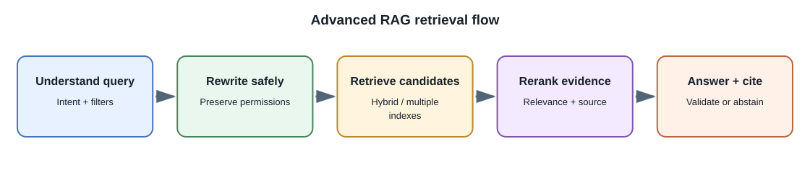
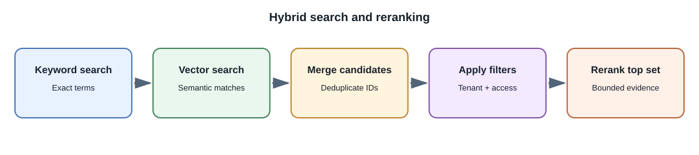

# Advanced RAG Design

## Introduction

Basic retrieval-augmented generation (RAG) retrieves text chunks and adds
them to a model request. A production system needs more: good indexing,
query understanding, permission filters, relevance ranking, citation
validation, and measurements that reveal whether failures came from
retrieval or generation.





## Improve retrieval step by step

1. **Parse the request:** identify the question, language, filters, and
   likely data source.
2. **Rewrite or expand the query:** create search terms or subquestions
   that retain the user's intent. Treat generated rewrites as suggestions,
   not authorization.
3. **Retrieve candidates:** use vector similarity, keyword search, metadata
   filters, or a hybrid combination.
4. **Rerank candidates:** use a cross-encoder or another ranking method to
   reorder a smaller candidate set by relevance.
5. **Assemble evidence:** deduplicate, keep source references, and fit
   selected passages into the context budget.
6. **Generate and validate:** answer from evidence, check citation targets,
   and abstain or ask for clarification when evidence is weak.

## Retrieval approaches

| Approach | Useful when | Limitations |
|---|---|---|
| Keyword / BM25 | Exact terms, identifiers, product codes, and rare names matter | May miss paraphrases or semantically related language |
| Dense vector search | Meaning matters more than exact wording | Can miss exact identifiers and may retrieve conceptually similar but wrong passages |
| Hybrid search | Both exact terms and paraphrase are important | Requires tuning, merging, and measuring multiple result lists |
| Metadata filtering | Tenant, date, product, or document type should constrain candidates | Incorrect metadata or filter logic can hide valid evidence or leak data |
| Reranking | Candidate retrieval is broad and relevance order needs refinement | Adds compute and latency; cannot recover a source never retrieved |
| Graph retrieval | Relationships across entities or documents matter | Graph extraction and maintenance can be expensive and imperfect |

### Merging keyword and vector results

Keyword and vector scores are on different scales, so adding them directly
lets one list dominate. **Reciprocal rank fusion (RRF)** uses only the rank
of each document in each list: a document scores `1 / (k + rank)` per list,
summed across lists, with `k = 60` in the
[original paper](https://plg.uwaterloo.ca/~gvcormac/cormacksigir09-rrf.pdf)
(Cormack, Clarke, and Büttcher, SIGIR 2009). Documents that rank well in
both lists rise to the top.

```ts
// src/rag/rrf.ts: merge ranked lists from keyword and vector search with reciprocal rank fusion
export type Ranked = { id: string }[];

export function reciprocalRankFusion(lists: Ranked[], k = 60, limit = 5): { id: string; score: number }[] {
  const scores = new Map<string, number>();
  for (const list of lists) {
    list.forEach((hit, index) => {
      // rank is 1-based; a document missing from a list simply gets nothing from it
      scores.set(hit.id, (scores.get(hit.id) ?? 0) + 1 / (k + index + 1));
    });
  }
  return [...scores.entries()]
    .map(([id, score]) => ({ id, score }))
    .sort((a, b) => b.score - a.score || a.id.localeCompare(b.id))
    .slice(0, limit);
}
```

For a TaskFlow question about the 1.9 release, keyword search returned
`runbook-TF-1024`, `release-notes-1.9`, `faq-billing` and vector search
returned `release-notes-1.9`, `meeting-2026-11-03`, `runbook-TF-1024`.
Fusing them gives this output:

```text
release-notes-1.9    0.0325
runbook-TF-1024      0.0323
meeting-2026-11-03   0.0161
faq-billing          0.0159
```

Apply permission filters before fusion, inside each search, so a document
the user may not read never enters either list. Many search engines and
vector databases offer RRF natively; the mechanics of each index are in
[hybrid search and reranking](embeddings-and-vector-search/hybrid-search-and-reranking.md).

## Advanced patterns

- **Query decomposition:** break a multi-part question into subqueries and
  combine evidence. Preserve which source supports each part.
- **Parent-child retrieval:** index small chunks for matching but return
  a larger parent section for context.
- **Contextual metadata:** add titles, section names, timestamps, or
  structured fields so chunks retain meaning outside their original file.
  Anthropic's [Contextual Retrieval](https://www.anthropic.com/news/contextual-retrieval)
  (September 2024) prepends a short, model-written description of where
  each chunk sits in its document before embedding and BM25 indexing. In
  its tests this cut the top-20 retrieval failure rate by 35% with
  contextual embeddings alone, by 49% when combined with contextual BM25,
  and by 67% after adding reranking. The extra indexing calls cost more,
  so measure the gain on your own documents.
- **Knowledge graphs:** represent entities and relations explicitly for
  multi-hop questions. Validate extraction and graph freshness.
- **Agentic retrieval:** let a bounded controller issue another search when
  evidence is insufficient. Set a step budget and keep permissions in
  trusted application logic.

## Evaluate retrieval separately from generation

Create questions with expected source documents and user permissions.
Measure whether relevant sources appear in the candidate set, whether
reranking improves ordering, whether generated claims are supported, and
whether citations point to the exact visible source. Include adversarial
queries, no-answer cases, changed documents, and cross-tenant tests.

| Stage | Metric | What a drop tells you |
|---|---|---|
| Candidate retrieval | Recall@k: share of questions whose expected source is in the top k | Indexing, chunking, query rewriting, or filters lost the evidence |
| Reranking | MRR or nDCG@k: how high the first relevant source ranks | The reranker or fusion settings order evidence badly |
| Generation | Faithfulness: share of answer claims supported by the given passages | The prompt, context packing, or model ignores the evidence |
| Citations | Citation precision: share of citations that point to a passage that supports the claim | Citation mapping or answer post-processing is wrong |

Run retrieval metrics on every index or chunking change, because they need
no model call and are cheap. Run generation metrics on a fixed question set
before prompt or model changes. The full method is in
[evaluating and debugging RAG](retrieval-augmented-generation/evaluating-and-debugging-rag.md).

## Common misconceptions

- A sophisticated vector database does not guarantee relevant search.
- Reranking cannot fix a missing candidate.
- More retrieved chunks can add noise and consume useful context.
- Query rewriting must not broaden the user's data permissions.
- Citations are only useful when they resolve to the supporting source.

## Related lessons

- [Embeddings and Vector Search](embeddings-and-vector-search.md):
  [embedding models and dimensions](embeddings-and-vector-search/embedding-models-and-dimensions.md),
  [vector databases and indexes](embeddings-and-vector-search/vector-databases-and-indexes.md),
  and [hybrid search and reranking](embeddings-and-vector-search/hybrid-search-and-reranking.md)
- [Retrieval-Augmented Generation](retrieval-augmented-generation.md):
  [building a RAG pipeline](retrieval-augmented-generation/building-a-rag-pipeline.md),
  [document ingestion and chunking](retrieval-augmented-generation/document-ingestion-and-chunking.md),
  and [evaluating and debugging RAG](retrieval-augmented-generation/evaluating-and-debugging-rag.md)
- [Evaluation and Monitoring](evaluation-and-monitoring.md)

## Further learning

- [BEIR: Benchmarking Information Retrieval](https://github.com/beir-cellar/beir)
- [Sentence Transformers: Cross-Encoder Reranking](https://www.sbert.net/examples/cross_encoder/applications/README.html)
- [Reciprocal Rank Fusion outperforms Condorcet and individual rank learning methods (SIGIR 2009)](https://plg.uwaterloo.ca/~gvcormac/cormacksigir09-rrf.pdf)
- [Anthropic: Introducing Contextual Retrieval](https://www.anthropic.com/news/contextual-retrieval)
