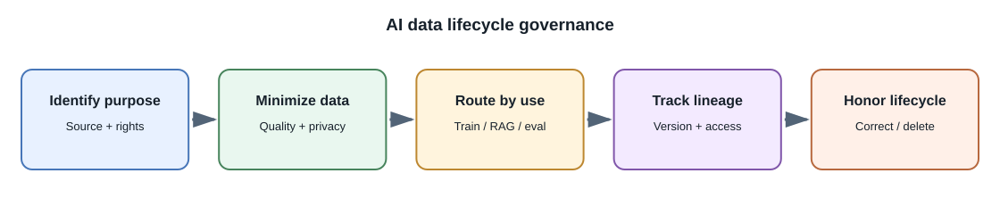
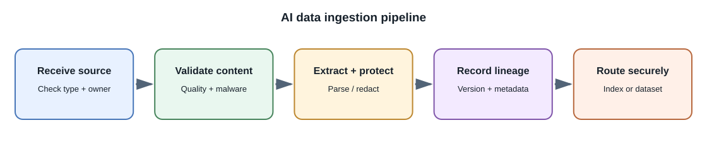

# AI Data Preparation and Governance

## Introduction

AI quality and safety depend on the data used to train, evaluate, retrieve,
or operate a system. **Data governance** defines who may collect, access,
transform, retain, and share data, and under what purpose and controls.
Data that is technically available is not automatically suitable or
permitted for an AI use.



## Distinguish data purposes

| Data purpose | How it is used | Important controls |
|---|---|---|
| Training data | Adjusts model parameters | Rights, consent, provenance, representativeness, contamination and retention |
| Fine-tuning examples | Teaches a pretrained model a narrower behavior | Quality, data minimization, split hygiene, licenses and held-out examples |
| Retrieval corpus | Supplies current evidence at inference time | Access-control metadata, freshness, source references, deletion propagation |
| Evaluation set | Measures behavior and regressions | Representativeness, leakage prevention, controlled access and versioning |
| Production telemetry | Diagnoses service quality | Minimize sensitive content, define retention, access and purpose |

Do not silently reuse user prompts as training data. Set clear product
policies, obtain required permissions, and make data use understandable.



## Prepare data carefully

1. **Establish source and purpose:** record owner, origin, permitted use,
   collection date, and deletion or expiry conditions.
2. **Validate and normalize:** check file types, encoding, duplicate
   records, malformed fields, and extraction quality.
3. **Minimize and protect:** remove unnecessary personal data; apply
   redaction, encryption, or controlled-access storage where appropriate.
4. **Label and review:** use clear labeling guidance, measure reviewer
   agreement, and resolve ambiguous examples.
5. **Split and version:** keep train, validation, and test sets separate;
   avoid near-duplicate leakage and use time-aware or user-aware splits
   when appropriate.
6. **Track lineage:** record transformations, dataset versions, and the
   model or index built from them.
7. **Honor change requests:** propagate correction, access revocation, and
   deletion to derived stores according to product and legal requirements.

### A first preparation pass in code

TaskFlow wants to train a small intent classifier on assistant requests
(create task, reschedule, billing, question). This script normalizes
whitespace, redacts email addresses and phone numbers, drops exact
duplicates, and splits by user, so no user's requests appear in both train
and test:

```python
# prepare_dataset.py: redact contact details, drop duplicates, and split by user so no user spans two splits
import hashlib
import re

EMAIL = re.compile(r"[\w.+-]+@[\w-]+(?:\.[\w-]+)+")
PHONE = re.compile(r"(?<!\w)\+?\d(?:[ ()-]?\d){8,14}(?!\w)")  # 9-15 digits, so dates survive


def redact(text: str) -> str:
    return PHONE.sub("[PHONE]", EMAIL.sub("[EMAIL]", text))


def split_for(user_id: str, test_percent: int = 20) -> str:
    # A stable hash of the user, not of the row, keeps every row of one user in the same split
    bucket = int(hashlib.sha256(user_id.encode()).hexdigest(), 16) % 100
    return "test" if bucket < test_percent else "train"


def prepare(rows: list[dict]) -> dict[str, list[dict]]:
    seen, out = set(), {"train": [], "test": []}
    for row in rows:
        text = redact(" ".join(row["text"].split()))  # normalize whitespace, then redact
        key = hashlib.sha256(text.lower().encode()).hexdigest()
        if key in seen:  # exact duplicate after normalization
            continue
        seen.add(key)
        out[split_for(row["user_id"])].append({**row, "text": text})
    return out


rows = [
    {"user_id": "u1", "text": "Move the demo to Friday, mail ana@example.com", "label": "reschedule"},
    {"user_id": "u1", "text": "Move the demo  to Friday, mail ana@example.com", "label": "reschedule"},
    {"user_id": "u2", "text": "Call +1 555 010 0199 about the invoice", "label": "billing"},
    {"user_id": "u3", "text": "Add a task: renew the TLS certificate by 2026-11-20", "label": "create_task"},
    {"user_id": "u4", "text": "Which tasks are overdue this week?", "label": "query"},
]
result = prepare(rows)
for split, items in result.items():
    print(split, [(r["user_id"], r["text"]) for r in items])
```

```text
train [('u2', 'Call [PHONE] about the invoice'), ('u3', 'Add a task: renew the TLS certificate by 2026-11-20'), ('u4', 'Which tasks are overdue this week?')]
test [('u1', 'Move the demo to Friday, mail [EMAIL]')]
```

The duplicate request from `u1` was dropped, the contact details were
replaced, and the date survived because the phone pattern needs at least
nine digits. Regular expressions are a first pass, not anonymization: names,
addresses, and free-text identifiers need a dedicated PII detector and
human review, and near-duplicates need fuzzy matching. Record the script
version and the input dataset version with the output, so a later model can
be traced back to exactly this data.

## Synthetic data

Synthetic examples can expand test cases or protect some details, but they
can also reproduce bias, errors, or private information from their source
model. Label synthetic data, review quality, and do not assume generated
examples are representative or legally unrestricted.

## A real-world example: auditing a public dataset

Even widely used public datasets need provenance checks. LAION-5B, a
web-scale set of billions of image-text links used to train image models, was
withdrawn in December 2023 after a Stanford Internet Observatory report
found links to suspected child sexual abuse material. LAION worked with the
Internet Watch Foundation, the Canadian Centre for Child Protection, and the
Stanford Internet Observatory, removed 2,236 links that matched their hash
lists, and released Re-LAION-5B on August 30, 2024; it also removed links
containing children's private information reported by Human Rights Watch
([LAION announcement](https://laion.ai/blog/relaion-5b/)). The lessons for
any team: record where data came from, check it against safety and privacy
lists before training, and be able to rebuild derived datasets and models
when a source is withdrawn.

## Data for RAG

For retrieval, preserve source IDs, headings, timestamps, tenant and
permission metadata through parsing, chunking, embedding, indexing, caching,
and citations. Deleting a source should trigger re-indexing or removal of
derived chunks according to the retention policy. Search filters must be
enforced by trusted backend code. The pipeline is covered in
[document ingestion and chunking](retrieval-augmented-generation/document-ingestion-and-chunking.md);
retention and deletion rules for prompts, logs, and personal data are in
[privacy, PII, and data retention](security-privacy-and-responsible-ai/privacy-pii-and-data-retention.md).
Evaluation sets have their own rules in
[building evaluation sets](evaluation-and-monitoring/building-evaluation-sets.md),
and dataset versions should be tracked like code, as shown in
[experiment tracking and a model registry](mlops-and-model-lifecycle/experiment-tracking-and-model-registry.md).

## Common misconceptions

- Publicly reachable data is not automatically licensed for training.
- Removing names alone does not guarantee effective anonymization.
- A large dataset can still be biased, duplicated, stale, or mislabeled.
- Synthetic data does not automatically remove privacy or quality risk.
- Evaluation data should not be repeatedly tuned against until it becomes
  part of the development feedback loop.

## Further learning

- [NIST Privacy Framework](https://www.nist.gov/privacy-framework)
- [NIST AI Risk Management Framework](https://www.nist.gov/itl/ai-risk-management-framework)
- [Google Responsible AI practices](https://ai.google/responsibility/responsible-ai-practices/)
- [Datasheets for Datasets (Gebru et al.)](https://arxiv.org/abs/1803.09010)
- [AI regulation and governance](security-privacy-and-responsible-ai/ai-regulation-and-governance.md)
