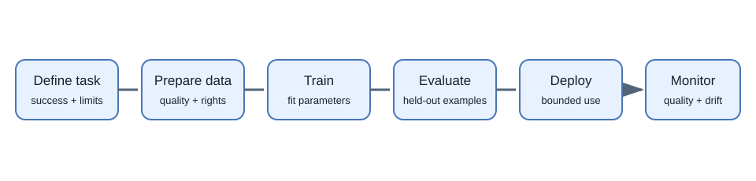
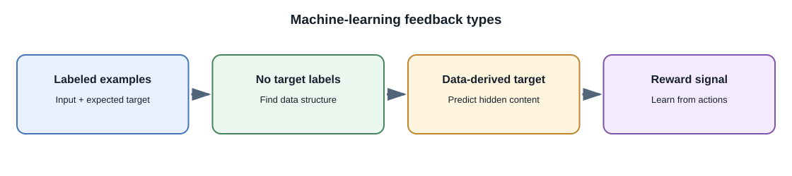

# AI and Machine-Learning Fundamentals

## Introduction

**Artificial intelligence (AI)** is the broad area of building systems that
perform tasks associated with capabilities such as perception, language,
planning, or decision-making. **Machine learning (ML)** is a family of
methods where a system learns patterns from data rather than relying only on
rules written by a programmer. **Generative AI** produces new content, such
as text, images, audio, or code.

The terms overlap, but they are not synonyms. A hand-written rule that
rejects an invalid password is software logic, not necessarily machine
learning. A spam classifier trained from labeled messages is machine
learning. A chat model that generates a reply is generative AI.

## Why does machine learning exist?

Some tasks are difficult to specify as a complete list of rules. It is
usually impractical to write a rule for every phrasing of a question, every
appearance of an object in a photo, or every pattern in a large dataset.
Learning methods estimate patterns from examples and apply them to new
inputs.

This shifts work rather than removing it: developers and data practitioners
must choose data, objectives, evaluation criteria, deployment boundaries,
and safeguards. A learned model can fail in ways a simple explicit rule
would not.

## A simple model workflow

1. **Define a task:** for example, classify a support message as billing,
   shipping, or other.
2. **Collect representative examples:** gather messages and correct labels
   with permission and appropriate privacy controls.
3. **Choose a model and objective:** select how the system should convert an
   input into a prediction and how errors are measured.
4. **Train or configure:** adjust model parameters from training examples,
   or use an existing model with a prompt or other application logic.
5. **Evaluate on held-out examples:** measure performance on data not used
   to fit the model.
6. **Deploy with safeguards:** monitor quality and allow a safe fallback or
   human review for uncertain or high-impact decisions.





For a generative model, the flow is similar but the output can have many
valid forms. Evaluation often combines automated checks, human review, and
task-specific tests.

The first five steps fit in a few lines of Python with scikit-learn. This
toy classifier learns the billing, shipping, and other categories from 12
labeled messages and is then scored on 6 messages it has never seen:

```python
# classify_messages.py: train a tiny support-message classifier and score it on held-out examples
from sklearn.feature_extraction.text import TfidfVectorizer
from sklearn.linear_model import LogisticRegression
from sklearn.model_selection import train_test_split
from sklearn.pipeline import make_pipeline

messages = [
    ("I was charged twice for my subscription", "billing"),
    ("Please refund the duplicate payment", "billing"),
    ("My invoice shows the wrong amount", "billing"),
    ("How do I update my credit card?", "billing"),
    ("Why did my plan price go up?", "billing"),
    ("Can I get a receipt for last month?", "billing"),
    ("My package has not arrived yet", "shipping"),
    ("The tracking number does not work", "shipping"),
    ("The parcel was delivered to the wrong address", "shipping"),
    ("When will my order ship?", "shipping"),
    ("The box arrived damaged", "shipping"),
    ("Can I change the delivery date?", "shipping"),
    ("How do I reset my password?", "other"),
    ("Do you have a dark mode?", "other"),
    ("I want to delete my account", "other"),
    ("The app crashes when I open settings", "other"),
    ("Can I invite my team to a project?", "other"),
    ("Where can I export my tasks?", "other"),
]
texts = [text for text, _ in messages]
labels = [label for _, label in messages]

# Hold out a third of the examples, keeping the label mix the same in both parts
X_train, X_test, y_train, y_test = train_test_split(
    texts, labels, test_size=1 / 3, stratify=labels, random_state=42
)

model = make_pipeline(TfidfVectorizer(), LogisticRegression(max_iter=1000))
model.fit(X_train, y_train)

print(f"training accuracy: {model.score(X_train, y_train):.2f}")
print(f"held-out accuracy: {model.score(X_test, y_test):.2f}")
print(model.predict(["I paid twice, please refund me"]))
```

Output from running it with scikit-learn 1.9.1:

```text
training accuracy: 1.00
held-out accuracy: 0.17
['billing']
```

The model fits its training data perfectly and still gets most held-out
messages wrong: 12 examples teach it a few words, not the categories. The
held-out score is the honest one, which is why step 5 exists. A real
classifier needs many more representative examples, or a starting point
that already understands language, such as embeddings or a prompted
language model.

## Important learning terms

| Term | Meaning |
|---|---|
| **Example** | One input and, in supervised learning, its expected target or label |
| **Feature** | Information used by a model as input; for example, structured fields or a learned representation |
| **Label/target** | Expected answer used for supervised training |
| **Parameter** | A value learned by a model during training |
| **Training** | Adjusting parameters to reduce an objective on training data |
| **Inference** | Using a trained model to produce a prediction or generated output |
| **Dataset** | A collection of examples used to train, validate, or test a system |
| **Generalization** | How well the learned system works on examples beyond its training data |
| **Hallucination** | A plausible-looking generated claim that is unsupported or incorrect |

Training a model is different from prompting it. A prompt provides input to
an already trained model during inference; it does not normally update the
model's learned parameters.

## Main learning setups

- **Supervised learning:** learn from input-output examples, such as labeled
  categories or known numeric targets.
- **Unsupervised learning:** find structure in data without a supplied
  target for every example, such as clustering similar items.
- **Self-supervised learning:** create training targets from the data itself.
  Predicting hidden or next tokens is a common way to train language models.
- **Reinforcement learning:** learn a policy from actions and reward signals
  while interacting with an environment. It is used in control and can also
  be part of model post-training.

These are broad categories. Real systems may combine several stages and
objectives.

Current language models combine several of them. Pretraining is
self-supervised next-token prediction over large text collections.
Post-training adds supervised fine-tuning on instruction-and-answer
examples, then reinforcement learning: from human preference rankings in
[InstructGPT](https://arxiv.org/abs/2203.02155) (2022), and from
automatically checkable rewards, such as whether a math answer is correct
or code passes its tests, in reasoning models such as
[DeepSeek-R1](https://arxiv.org/abs/2501.12948) (2025). See
[preference tuning and distillation](fine-tuning/preference-tuning-and-distillation.md).

## Real-world examples

- A bank may use a risk model to prioritize transactions for additional
  review. The model's score should be one controlled input to a governed
  decision process, not a reason to ignore regulations or appeal paths.
- A government service may use document classification to route a form to
  the right team. Human review can handle ambiguous cases.
- A video service may recommend content using learned user and item
  representations alongside explicit ranking rules.
- A full-stack developer may call a language model to draft a support
  response, then require a support agent to approve it.

These examples describe common application patterns. They do not claim that
every organization uses the same model or decision process. Two published
cases:

- **Gmail spam filtering.** Google wrote in February 2019 that its
  machine-learning filters help block more than 99.9 percent of spam,
  phishing, and malware, and that new TensorFlow models were blocking
  about 100 million additional spam messages every day
  ([Google Workspace blog](https://workspace.google.com/blog/product-announcements/ridding-gmail-of-100-million-more-spam-messages-with-tensorflow)).
- **Stripe Radar.** Stripe's fraud screening scores payments in real time
  with models that, as of November 2026, Stripe describes as trained on
  data from millions of businesses ([Stripe Radar](https://stripe.com/radar)).
  Businesses combine the score with their own rules and manual review,
  the "controlled input" pattern from the bank example above.

## Developer perspective

Treat a model as a probabilistic component with an input contract, output
contract, latency, cost, failure modes, and a version. Put deterministic
validation and authorization in ordinary application code. Do not let a
language model decide whether a user is authorized to access a database
record.

Test that component the way you test any other dependency: keep a fixed
set of evaluation examples and run it whenever the model, prompt, or data
changes. See [evals in CI and regression testing](evaluation-and-monitoring/evals-in-ci-and-regression-testing.md)
and [model evaluation and validation](machine-learning-foundations/model-evaluation-and-validation.md).

## Common misconceptions

- AI does not always mean a neural network or a chatbot.
- A model that performs well on training examples may still fail on new or
  changed data.
- More data is not automatically better; incorrect, unrepresentative, or
  unauthorized data can make a system worse.
- A fluent response is not evidence that it is true.
- Using an AI API is model inference, not training your own model.

## Further learning

- [Google Machine Learning: Problem Framing](https://developers.google.com/machine-learning/problem-framing)
- [Google Machine Learning: Data preparation](https://developers.google.com/machine-learning/data-prep)
- [NIST AI Risk Management Framework](https://www.nist.gov/itl/ai-risk-management-framework)
- [scikit-learn: Getting started](https://scikit-learn.org/stable/getting_started.html)
- [Tabular ML and gradient boosting](machine-learning-foundations/tabular-ml-and-gradient-boosting.md)
