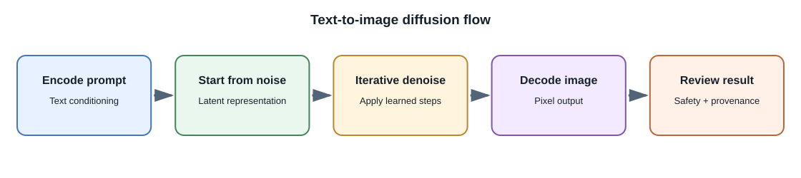
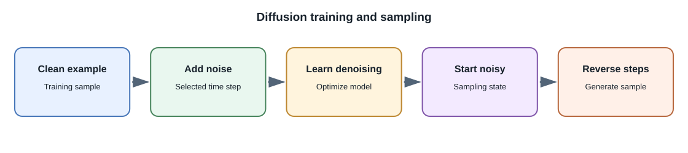

# Generative Models and Diffusion

## Introduction

A **generative model** learns patterns in data and can produce new samples
that resemble those patterns. Language models generate token sequences;
image-generation systems can generate or edit images; audio and video
systems operate on their supported media representations. Generation is
probabilistic and does not guarantee factuality, originality, or permission
to use an output.





## Families of generative models

| Family | Broad idea | Example applications |
|---|---|---|
| Autoregressive models | Predict the next element conditioned on previous elements | Text, code, image or audio token generation |
| Variational autoencoders (VAEs) | Learn a compressed latent representation and decode samples from it | Image reconstruction and latent representations |
| Generative adversarial networks (GANs) | Train a generator against a discriminator in a competitive setup | Image synthesis and domain-specific generation |
| Diffusion models | Learn to reverse a gradual noising process | Image, audio, and video generation |
| Flow-based models | Learn an invertible mapping between a simple distribution and data | Density estimation and sample generation |
| Flow matching and rectified flow | Learn a velocity field that moves noise toward data, ideally along straight paths, so fewer sampling steps are needed | Recent text-to-image models such as Stable Diffusion 3 |

This table is an orientation, not a ranking. Modern systems may combine
families or use tokenized representations of images, audio, or video.

## How diffusion generation works

During a simplified training process, a clean example is progressively
corrupted with noise. A neural network learns to estimate or remove noise
at different steps. During generation, the system starts from noise and
iteratively applies learned denoising steps to form a sample.

Text-to-image systems commonly encode a prompt, condition generation on
that representation, and decode a generated latent into an image. Some
systems use **latent diffusion**, applying denoising in a compressed latent
space rather than directly over every image pixel. This can reduce
computation, though exact designs differ.

In the DDPM formulation ([Ho et al., 2020](https://arxiv.org/abs/2006.11239)),
a noisy version of a clean example \(x_0\) at step \(t\) can be computed
in one jump, where \(\bar\alpha_t\) shrinks from about 1 toward 0 as \(t\)
grows:

\[
x_t = \sqrt{\bar\alpha_t}\,x_0 + \sqrt{1 - \bar\alpha_t}\,\epsilon,
\qquad \epsilon \sim \mathcal{N}(0, I)
\]

The network is trained to predict \(\epsilon\) from \(x_t\) and \(t\).
A few lines of NumPy show how fast the original signal disappears under
the paper's linear schedule over 1,000 steps:

```python
# diffusion_noise.py: the DDPM forward process, showing how much of a clean example survives at step t
import numpy as np

T = 1000
betas = np.linspace(1e-4, 0.02, T)  # linear noise schedule from the DDPM paper
alpha_bar = np.cumprod(1.0 - betas)  # share of the original signal's variance left after t steps

rng = np.random.default_rng(0)
x0 = rng.uniform(-1, 1, size=64 * 64)  # a toy "image": 4,096 pixel values scaled to [-1, 1]

for t in (0, 100, 250, 500, 999):
    noise = rng.normal(size=x0.shape)
    xt = np.sqrt(alpha_bar[t]) * x0 + np.sqrt(1 - alpha_bar[t]) * noise  # jump straight to step t
    corr = np.corrcoef(x0, xt)[0, 1]
    print(f"t={t:4d}  signal weight {np.sqrt(alpha_bar[t]):.3f}  correlation with x0 {corr:.3f}")

# Training shows the network (xt, t) and scores how well it predicts the noise:
#   loss = np.mean((noise - model(xt, t)) ** 2)
# Sampling starts from pure noise and removes predicted noise step by step.
```

Output from running it with NumPy 2.5:

```text
t=   0  signal weight 1.000  correlation with x0 1.000
t= 100  signal weight 0.946  correlation with x0 0.863
t= 250  signal weight 0.722  correlation with x0 0.519
t= 500  signal weight 0.279  correlation with x0 0.167
t= 999  signal weight 0.006  correlation with x0 0.008
```

By the last step almost nothing of the image is left, which is why
generation can start from pure noise. Each sampling step needs a full
network pass, so step count drives latency and cost; much of the
progress since 2020 has been about needing fewer steps.

Current image and video models have moved in two directions. Latent
diffusion ([Rombach et al., 2022](https://arxiv.org/abs/2112.10752))
made high resolutions affordable, and the denoising network itself is
increasingly a transformer over image patches instead of a convolutional
U-Net ([DiT](https://arxiv.org/abs/2212.09748)). Stable Diffusion 3
combines both trends with **rectified flow**, which "connects data and
noise in a straight line", and a transformer that "uses separate weights
for the two modalities" of image and text tokens
([Esser et al., 2024](https://arxiv.org/abs/2403.03206)).

## What controls generation?

- **Prompt or conditioning input:** describes the desired content or style.
- **Seed:** may make a particular sampling path reproducible for a given
  implementation and settings; it does not make systems identical across
  versions or hardware.
- **Guidance scale:** controls how strongly generation follows some
  conditioning mechanisms; excessive guidance can reduce quality.
- **Steps or sampler:** influence the iterative generation process and its
  latency-quality trade-off.
- **Reference inputs and masks:** support editing, inpainting, or
  image-to-image workflows where offered.

The names and effects of controls vary by model and product. Validate
results with the target task rather than assuming a setting has universal
behavior.

## Real-world applications

Creative teams may use image generation for ideation, storyboards, or
draft assets. Product teams may generate controlled illustrations or
personalized imagery. Speech and video systems can help create or
transform media. In each case, users need a clear distinction between
generated, edited, and captured content.

Two public mechanisms make that distinction checkable:

- **Content Credentials (C2PA).** The [C2PA](https://c2pa.org/)
  standard attaches signed provenance metadata to a file: which tool
  created or edited it and when. Metadata can be stripped when a file is
  re-encoded or screenshotted, so its absence proves nothing.
- **Watermarks.** Google DeepMind's
  [SynthID](https://deepmind.google/models/synthid/) "embeds digital
  watermarks directly into AI-generated images, audio, text or video",
  invisible to people but detectable by its tools. A watermark survives
  some edits that remove metadata, but detection is only possible for
  content from systems that applied it.

For TaskFlow, a generated cover image for a project board would keep its
provider, prompt reference, and creation time in the database next to the
file, and the UI would label it as generated.

## Developer perspective and safeguards

Build a media workflow that checks file type and size, scans uploads,
limits output dimensions and duration, stores provenance metadata, and
provides a human review path. Address licensing, consent, impersonation,
content moderation, and applicable disclosure requirements. Do not imply
that a generated image is a photograph or that the system can establish
who created a source image.

## Common misconceptions

- Diffusion is not simply copying a nearest training image.
- A fixed seed does not guarantee identical results in every environment.
- A generated image is not evidence that the depicted event occurred.
- A polished sample does not establish that the model is safe for every
  group or commercial use.

## Related lessons

- [Model Types and Capabilities](model-types-and-capabilities.md)
- [Speech and Multimodal AI](speech-and-multimodal-ai.md)
- [Security, Privacy, and Responsible AI](security-privacy-and-responsible-ai.md)
- [Guardrails and content moderation](security-privacy-and-responsible-ai/guardrails-and-content-moderation.md)
- [Media Formats for AI](media-formats-for-ai.md)

## Further learning

- [Hugging Face Diffusers documentation](https://huggingface.co/docs/diffusers/)
- [Stanford CS236: Deep Generative Models](https://deepgenerativemodels.github.io/)
