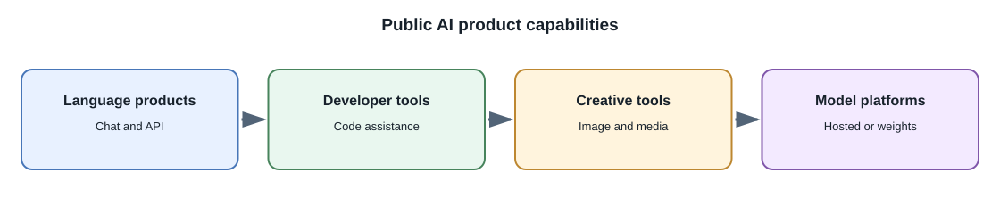
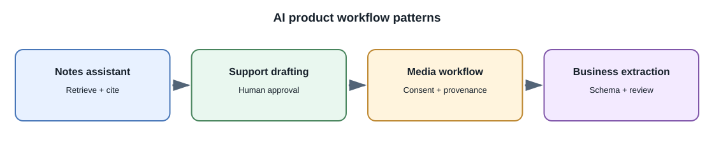

# AI in Products: Examples and Future Directions

## Introduction

AI is used in products as a capability inside a larger workflow, not usually
as a standalone model. A useful way to study examples is to separate the
**model capability** (generation, recognition, ranking, or prediction) from
the **product experience** and the **controls around it**.

Products and model capabilities change quickly. The examples below refer to
public products and documented offerings; they are illustrative, not a
complete market survey or a claim about a company's private internal
systems.

## Public product examples

| Company/product example | Public-facing AI capability | What a developer can learn |
|---|---|---|
| OpenAI ChatGPT and API | Conversational models and developer APIs | General-purpose language interfaces still require application context, safeguards, and evaluation |
| Google Gemini products and API | Text and multimodal model capabilities | A model interface can support multiple input types, subject to model-specific limits |
| Anthropic Claude products and API | Language-model assistant and developer integration | Provider APIs expose model capabilities but have their own policies, versions, and limits |
| GitHub Copilot | Coding assistance integrated into developer workflows | Useful AI is often embedded in an existing editor and review process |
| Adobe Firefly | Generative features for creative workflows | Image generation needs user controls, provenance/licensing consideration, and creative review |
| Meta Llama | Publicly available model family with license terms | Downloadable weights enable local or self-hosted experimentation, subject to the model's terms and hardware needs |

These are examples of companies offering products or models using AI. They
do not establish that a product's output is correct, suitable for every
context, or permitted for every use. Check current documentation, licensing,
privacy terms, and model availability before building on a specific service.

## Public case studies

The cases below come from the companies' own publications. Their numbers are
self-reported, and products change after launch, so read each as "what this
company built, why, and what it measured", not as a benchmark.

### Klarna: a customer-service assistant (2024)

Klarna, a payments company, launched an AI assistant powered by OpenAI to
handle customer-service chats. In its first month it held 2.3 million
conversations, two-thirds of Klarna's service chats, which Klarna equated
to the work of about 700 full-time agents. Klarna reported that resolution
time fell from 11 minutes to under 2, repeat inquiries dropped by 25%, and
the assistant worked in over 35 languages across 23 markets
([Klarna press release, February 27, 2024](https://www.klarna.com/international/press/klarna-ai-assistant-handles-two-thirds-of-customer-service-chats-in-its-first-month/)).
**Why:** faster resolution of routine customer questions at a scale human
teams alone could not match. **Lesson:** measure resolution and repeat
contacts, not only chat volume, and keep a clear route to a human for cases
the assistant should not decide.

### Duolingo: conversation practice in a learning app (2023)

Duolingo introduced Duolingo Max, a subscription tier "powered by GPT-4",
in March 2023. It adds Roleplay, where learners practise real-world
conversations with characters and then get AI feedback on their answers,
and Video Call, a conversation with an AI character who remembers past calls
([Duolingo blog, March 14, 2023](https://blog.duolingo.com/duolingo-max/)).
**Why:** Duolingo ties it to its mission of making high-quality education
available to everyone, adding conversation practice and feedback to the
app. **Lesson:** the model sits inside an existing lesson flow with a
narrow, well-defined task; it is not a general chatbot.

### GitHub Copilot: measuring developer productivity (2022)

GitHub ran a controlled experiment in which 95 professional developers
wrote an HTTP server in JavaScript, half of them with Copilot. The Copilot
group finished 55% faster on average (1 hour 11 minutes versus 2 hours 41
minutes), and 78% of it completed the task versus 70% of the control group
([GitHub research post, September 7, 2022](https://github.blog/news-insights/research/research-quantifying-github-copilots-impact-on-developer-productivity-and-happiness/)).
**Why:** GitHub wanted evidence of Copilot's effect on developer
productivity and satisfaction, beyond self-reported surveys. **Lesson:**
run a controlled comparison on a defined task before claiming a
productivity gain; one well-scoped task does not measure all of software
work.

### Uber Michelangelo: a platform for classic machine learning (2017)

Uber built Michelangelo, an internal machine-learning platform, because
teams used many different tools, could not train models larger than a
desktop allowed, and had no standard path to production. The platform
covers managing data with a shared feature store, training, evaluation,
deployment, prediction, and monitoring. One use was UberEATS estimated
delivery time, predicted with gradient-boosted decision trees from request
data, historical features such as a restaurant's recent preparation times,
and near-real-time features
([Uber engineering blog, September 5, 2017](https://www.uber.com/blog/michelangelo-machine-learning-platform/)).
**Why:** make model building repeatable across many teams. **Lesson:** much
valuable "AI" is still tabular prediction, and the platform around the
model (features, deployment, monitoring) is most of the work; see
[machine learning foundations](machine-learning-foundations.md) and
[MLOps and model lifecycle](mlops-and-model-lifecycle.md).

## Common product scenarios

### Chat assistants

A chat assistant can explain a topic, answer questions, or draft text. It
needs bounded context, clear uncertainty behavior, and a way to correct or
escalate a poor answer. For private data, retrieve only records the current
user is allowed to see.

### Notes and document assistants

A notes feature can summarize, classify, or search a user's content. RAG can
provide relevant passages and citations. The application must preserve
ownership, deletion, and source links across extracted text, embeddings, and
caches.

### Coding assistants

A coding assistant can explain code, suggest tests, or propose a change.
Generated code is untrusted: run tests, review dependencies and licenses,
inspect security-sensitive changes, and require human approval before
merging or deploying.

### Image, audio, and video workflows

Image models can help with concept art or asset variants; speech models can
transcribe or synthesize audio; video models can generate or summarize
supported clips. Products need consent, provenance, accessibility, content
moderation, storage controls, and clear expectations about synthetic output.

### Business workflow assistance

Models can extract invoice fields, route support tickets, draft a response,
or summarize an incident. Use schemas and deterministic validation for
fields; keep a human in the loop when errors can materially affect people,
money, rights, or access.

## Where to start as a full-stack developer

Pick a narrow workflow and define what a good result means. A useful first
project is a study-notes assistant:

1. Store a user's notes with ordinary application-level ownership checks.
2. Generate a summary using a hosted API or a local model.
3. Add embeddings and RAG for source-linked questions.
4. Evaluate answers against a small set of questions with known source
   passages.
5. Add usage limits, deletion behavior, and a fallback for model
   unavailability.

Do not begin with a fully autonomous agent if a simple API call or
deterministic workflow solves the problem.

## Future directions to watch

As of November 2026, likely areas of continued development include:

- **Multimodal interaction:** combining text, images, audio, and video in
  one task.
- **Smaller specialized models:** on-device and task-specific inference
  where quality, privacy, and latency justify it.
- **Longer workflows and tool use:** systems that plan and call tools, with
  stronger permission and audit boundaries. Open protocols such as MCP for
  tools and A2A for agent-to-agent work are becoming the common plumbing;
  see [MCP and Agent Integrations](mcp-and-agent-integrations.md).
- **Personal and enterprise knowledge:** retrieval over private information
  with increasingly important access-control and provenance requirements.
- **AI-assisted software development:** more generation and review in IDE,
  testing, and deployment workflows.
- **Evaluation and governance:** stronger measurement, traceability, safety
  testing, and regulation as AI affects more consequential decisions.

These are directions, not guarantees. Capabilities, costs, regulation, and
user expectations will change. Good engineering will continue to require
clear requirements, security, testing, accessible design, and human
accountability.

## Developer perspective

Follow official model and product documentation for current features and
terms. Keep AI integrations replaceable, test task quality with your own
data, and explain to users when a result is generated or uncertain.

## Further learning

- [OpenAI API documentation](https://developers.openai.com/api/docs)
- [Google Gemini API documentation](https://aistudio.google.com/docs)
- [Anthropic documentation](https://platform.claude.com/docs/en/home)
- [GitHub Copilot documentation](https://docs.github.com/en/copilot)
- [Adobe Firefly](https://www.adobe.com/products/firefly.html)
- [Meta Llama](https://www.llama.com/)
