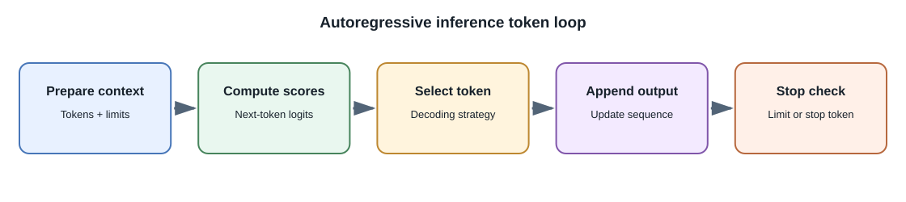
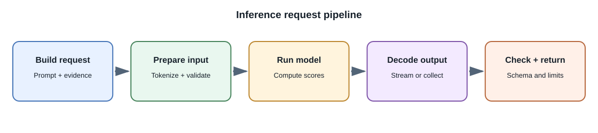

# Inference and Decoding

## Introduction

**Inference** is the process of using a trained model to produce a
prediction or generated result. For a generative language model, inference
usually means repeatedly predicting and selecting the next token until a
stop condition is reached. The model weights are normally fixed during an
ordinary request; fine-tuning or training is a separate process.



## From input to output

1. The application assembles instructions, user input, conversation
   context, and any retrieved evidence.
2. A tokenizer converts supported input into model tokens. The service
   checks the model's context limit and request constraints.
3. The model computes scores, often called **logits**, for possible next
   tokens.
4. A decoding strategy selects a token. The system appends it to the
   sequence and repeats the computation.
5. Generation ends at a stop token, requested stop sequence, output limit,
   cancellation, or provider-specific condition.
6. The application validates the final output before displaying it or
   using it in a workflow.



### Reasoning models and thinking tokens

**Reasoning models** are trained, largely with reinforcement learning, to
generate intermediate reasoning before the final answer
([DeepSeek-R1](https://arxiv.org/abs/2501.12948) describes one such
training recipe). The reasoning tokens go through the same token loop as
the visible answer, with practical consequences:

- **They cost and take time like output.** OpenAI's reasoning guide says
  reasoning tokens are "not visible via the API" but still occupy the
  context window and "are billed as output tokens"
  ([OpenAI reasoning guide](https://developers.openai.com/api/docs/guides/reasoning)).
- **They share the output limit.** In OpenAI's Responses API,
  `max_output_tokens` covers reasoning and visible output together; when
  it runs out, the response ends with status `incomplete`, possibly
  before any visible text. In Anthropic's API, thinking tokens count
  toward `max_tokens`
  ([Anthropic extended thinking](https://platform.claude.com/docs/en/build-with-claude/extended-thinking)).
- **Depth is a request setting.** As of November 2026, OpenAI uses
  `reasoning.effort` (model-dependent values from `none` to `max`);
  Anthropic's current models use `thinking: { type: "adaptive" }` with
  `output_config.effort`; fixed `budget_tokens` budgets are deprecated on
  Claude 4.6 models and rejected by newer ones; Gemini uses `thinkingConfig` with `thinkingBudget` or
  `thinkingLevel` ([Gemini thinking](https://aistudio.google.com/docs/thinking)).

[Reasoning models and thinking](prompting-and-structured-output/reasoning-models-and-thinking.md)
covers prompting these models and choosing a depth. To see what a request
actually used, log its usage breakdown:

```ts
// src/ai/reasoning-usage.ts: call a reasoning model and log how many output tokens were thinking
import OpenAI from "openai";

const client = new OpenAI(); // reads OPENAI_API_KEY from the environment
const model = process.env.REASONING_MODEL; // a reasoning model ID from the provider's model list
if (!model) throw new Error("REASONING_MODEL is not set");

const response = await client.responses.create({
  model,
  reasoning: { effort: "low" }, // less thinking: faster and cheaper, weaker on hard problems
  max_output_tokens: 4000, // covers the hidden reasoning and the visible answer
  input: "Split 'prepare the Q3 budget review' into 3 TaskFlow subtasks with due dates.",
});

console.log(response.output_text);
console.log({
  status: response.status, // "incomplete" if the limit was hit, possibly before any visible text
  outputTokens: response.usage?.output_tokens,
  reasoningTokens: response.usage?.output_tokens_details.reasoning_tokens,
});
```

Anthropic reports the same figure as
`usage.output_tokens_details.thinking_tokens`, and Gemini as
`usageMetadata.thoughtsTokenCount`. A request that "only" returns a short
answer can still bill thousands of reasoning tokens, so track this number
per feature.

## Decoding choices

| Setting or method | Purpose | Important caveat |
|---|---|---|
| Greedy selection | Choose the highest-scoring next token | Can be repetitive or overly predictable |
| Temperature | Adjust the sharpness of the score distribution before sampling | Higher temperature increases variation; it does not add knowledge |
| Top-k sampling | Sample from a limited number of high-scoring candidates | A fixed candidate count may behave differently across contexts |
| Top-p sampling | Sample from a probability-ranked set whose cumulative mass reaches a threshold | It changes diversity, not factual grounding |
| Output-token limit | Bound generated length and cost | A short limit can truncate a valid answer |
| Stop sequence | End when a configured sequence is generated | Must be chosen to avoid accidental early termination |
| Constrained decoding | Restrict output to a grammar, schema, or token set | Provider support and schema coverage vary; validate regardless |

These settings are not interchangeable. Use deterministic or constrained
generation for formats that need repeatability, and evaluate quality before
changing sampling for a user-facing task.

The sampling step itself is short. This sketch applies temperature and
top-p to four candidate tokens and samples 1,000 times with a fixed seed:

```ts
// src/ai/sample.ts: what a model server does for each token with temperature and top-p
type Candidate = { token: string; logit: number };

export function sample(cands: Candidate[], temperature: number, topP: number, rand: () => number): string {
  if (temperature === 0) {
    return cands.reduce((best, c) => (c.logit > best.logit ? c : best)).token; // greedy
  }
  const scaled = cands.map((c) => c.logit / temperature);
  const peak = Math.max(...scaled);
  const weights = scaled.map((z) => Math.exp(z - peak));
  const total = weights.reduce((a, b) => a + b, 0);
  const ranked = cands
    .map((c, i) => ({ token: c.token, p: weights[i] / total }))
    .sort((a, b) => b.p - a.p);

  // Top-p: keep the smallest set of top tokens whose probabilities add up to topP
  const kept: typeof ranked = [];
  let mass = 0;
  for (const r of ranked) {
    kept.push(r);
    mass += r.p;
    if (mass >= topP) break;
  }

  let x = rand() * mass;
  for (const r of kept) {
    x -= r.p;
    if (x <= 0) return r.token;
  }
  return kept[kept.length - 1].token;
}

// Seeded random numbers (mulberry32) so the demo is repeatable
function seeded(seed: number): () => number {
  return () => {
    seed = (seed + 0x6d2b79f5) | 0;
    let t = Math.imul(seed ^ (seed >>> 15), 1 | seed);
    t = (t + Math.imul(t ^ (t >>> 7), 61 | t)) ^ t;
    return ((t ^ (t >>> 14)) >>> 0) / 4294967296;
  };
}

// Next-token candidates after "Review the Q3 budget by"
const next: Candidate[] = [
  { token: "Friday", logit: 2.0 },
  { token: "Monday", logit: 1.0 },
  { token: "tomorrow", logit: 0.5 },
  { token: "noon", logit: -1.0 },
];

for (const [temperature, topP] of [[0, 1], [0.7, 0.9], [1.5, 1]]) {
  const rand = seeded(42);
  const counts: Record<string, number> = {};
  for (let i = 0; i < 1000; i++) {
    const t = sample(next, temperature, topP, rand);
    counts[t] = (counts[t] ?? 0) + 1;
  }
  console.log(`temperature ${temperature}, top-p ${topP}:`, JSON.stringify(counts));
}
```

Output from running it with Node.js 24:

```text
temperature 0, top-p 1: {"Friday":1000}
temperature 0.7, top-p 0.9: {"Friday":797,"Monday":203}
temperature 1.5, top-p 1: {"Monday":282,"Friday":477,"tomorrow":173,"noon":68}
```

Temperature 0 behaves like greedy selection here. At 0.7, "Friday" and
"Monday" already hold 90% of the probability, so top-p drops the other two
before sampling. At 1.5 every candidate appears, including the unlikely
"noon". Hosted APIs run this step on the server; you choose the settings.

### Speculative decoding

Generating one token per step leaves a large model's hardware underused,
because every step is a full pass for a single token. **Speculative
decoding** lets a small, fast **draft** model propose several tokens and
has the large model check all of them in one pass. The large model keeps
the longest prefix it agrees with, adds one token of its own, and the
loop continues. With the acceptance rule from the original paper, the
output distribution is exactly the large model's; the paper reports a 2x
to 3x speedup on T5-XXL "with identical outputs"
([Leviathan et al., 2023](https://arxiv.org/abs/2211.17192)). The gain
depends on how often the draft is right, so it is largest on predictable
text. Serving engines such as
[vLLM](https://docs.vllm.ai/en/latest/features/speculative_decoding/)
implement it, and hosted APIs may use similar techniques internally. See
[latency optimization](deployment-cost-and-performance/latency-optimization.md).

## Context window and KV cache

The **context window** limits the input and output tokens the model can
process in one request. System instructions, history, retrieved passages,
tool definitions, and generated tokens all use part of that budget.

During generation, transformer servers may retain intermediate
key/value (**KV**) tensors so they do not recompute the entire prefix for
each new token. This can improve generation efficiency, but KV memory grows
with active sequence length and concurrent requests. Providers may also
offer prompt caching to reduce repeated prefix work; its behavior, cost,
privacy, and cache lifetime depend on the service.

## Streaming

Streaming sends partial output as it is generated. It can improve perceived
latency, but partial text is not a completed or validated answer. A client
must handle disconnects, cancellation, retry policy, and a final completion
or error signal. Do not trigger an external action from partial generated
content.

## Developer perspective

Set explicit time, token, and concurrency limits. Record model and
decoding configuration with evaluation results. Avoid tuning parameters by
intuition alone: use representative prompts and compare task quality,
latency, and cost.

## Common misconceptions

- Temperature does not make a model more intelligent or more accurate.
- A deterministic decode can still return a wrong answer.
- Streaming changes delivery timing, not the model's level of certainty.
- Larger output limits do not make an answer better by themselves.
- Decoding is not training; the model's learned parameters are ordinarily
  unchanged by a request.

## Related lessons

- [Language Models and Tokens](language-models-and-tokens.md)
- [Prompting and Structured Output](prompting-and-structured-output.md)
- [Model Serving and Inference Infrastructure](model-serving-and-inference.md)
- [Reasoning models and thinking](prompting-and-structured-output/reasoning-models-and-thinking.md)
- [Latency optimization](deployment-cost-and-performance/latency-optimization.md)
- [Streaming responses end to end](hosted-model-apis/streaming-responses-end-to-end.md)

## Further learning

- [Hugging Face: Generation strategies](https://huggingface.co/docs/transformers/generation_strategies)
- [Hugging Face: KV cache](https://huggingface.co/docs/transformers/kv_cache)
