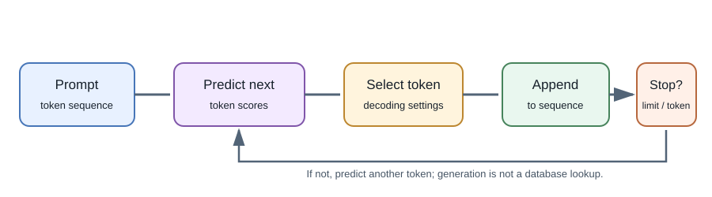
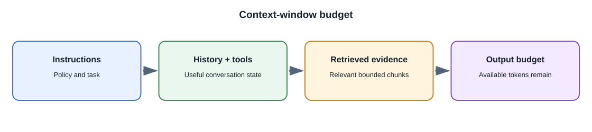

# Language Models and Tokens

## Introduction

A **language model** assigns likelihoods to sequences of tokens and can
generate a continuation from a context. A **large language model (LLM)** is
a language model with a large number of learned parameters and broad
training. "Large" is relative; it does not specify a particular capability
or quality level.

## How next-token generation works

1. The input text is tokenized into token identifiers.
2. The model processes the token sequence and returns scores for possible
   next tokens.
3. A decoding strategy selects a token, such as the highest-scoring option
   or a sampled option.
4. The selected token is appended to the context, and generation repeats.
5. Generation stops at a configured limit or model stop condition.





This next-token objective can support many downstream behaviors after
training and instruction tuning, but the model is still generating based on
learned patterns and current context. It does not inherently verify a claim
against the world.

## Tokens and context windows

A token is a model-specific unit: it can represent a word, part of a word,
punctuation, or other text. Tokenization differs by model. A context window
is the limit on the combined input and generated content the model can
process in one request. It is usually measured in tokens, not pages or
characters.

The total input may include system instructions, conversation history,
retrieved passages, tool definitions, and the user's message. Output tokens
also consume budget. Long contexts can increase cost and latency, and
relevant material can still be overlooked.

To see tokens, run a tokenizer locally. This TaskFlow helper uses
js-tiktoken with `o200k_base`, the encoding the library maps to OpenAI's
recent model names (check yours with `getEncodingNameForModel()`):

```ts
// src/ai/count-tokens.ts: estimate tokens locally with an OpenAI encoding before sending a request
import { getEncoding } from "js-tiktoken";

const enc = getEncoding("o200k_base");

const samples: Record<string, string> = {
  english: "Create a task to review the Q3 budget by Friday",
  german: "Erstelle eine Aufgabe, um das Q3-Budget bis Freitag zu prüfen",
  json: JSON.stringify({ title: "Review Q3 budget", due: "2026-11-20", priority: "high" }),
};

for (const [name, text] of Object.entries(samples)) {
  const ids = enc.encode(text);
  console.log(`${name.padEnd(8)} ${String(text.length).padStart(3)} chars ${String(ids.length).padStart(3)} tokens`);
}

// How one word splits into tokens
console.log(enc.encode("TaskFlow's").map((id) => JSON.stringify(enc.decode([id]))).join(" "));
```

Output from running it with js-tiktoken 1.0.21 on Node.js 24:

```text
english   47 chars  11 tokens
german    61 chars  15 tokens
json      65 chars  21 tokens
"Task" "Flow" "'s"
```

Even this small sample shows the pattern: English averages about four
characters per token here, the German sentence with the same meaning
needs more tokens, and JSON spends tokens on quotes, braces, and keys. The
gap between languages can be much larger; one study found the same text
can need up to 15 times more tokens in some languages than in others
([Petrov et al., 2023](https://arxiv.org/abs/2305.15425)).

Another provider's tokenizer gives different numbers for the same text,
so treat a local count as an estimate. For the exact size of a complete
request, including the system prompt and tools, ask the provider:

```ts
// src/ai/count-request.ts: ask the provider for the exact input size before sending a request
import Anthropic from "@anthropic-ai/sdk";

const client = new Anthropic(); // reads ANTHROPIC_API_KEY from the environment
const model = process.env.CHAT_MODEL; // a current model ID from the provider's model list
if (!model) throw new Error("CHAT_MODEL is not set");

const { input_tokens } = await client.messages.countTokens({
  model,
  system: "You turn TaskFlow requests into tasks.",
  messages: [{ role: "user", content: "Create a task to review the Q3 budget by Friday" }],
});

console.log({ input_tokens });
```

The equivalents are `client.responses.inputTokens.count({ model, input })`
in the OpenAI SDK, which returns `input_tokens`, and
`ai.models.countTokens({ model, contents })` in the Google Gen AI SDK,
which returns `totalTokens`. See
[Anthropic token counting](https://platform.claude.com/docs/en/build-with-claude/token-counting)
and [Gemini tokens](https://aistudio.google.com/docs/tokens).

Context windows have grown quickly. As of November 2026, Google's
documentation says "many Gemini models come with large context windows of
1 million or more tokens" and compares 1 million tokens to about 50,000
lines of code or 8 average-length English novels
([Gemini long context](https://aistudio.google.com/docs/long-context)).
A large window is a ceiling, not a target. Budget a TaskFlow knowledge
answer explicitly:

| Part of the request | Tokens |
|---|---|
| Instructions and output format | 1,200 |
| Tool definitions | 1,800 |
| Recent conversation (last 6 turns) | 3,000 |
| Retrieved chunks (8 x 400) | 3,200 |
| Reserved for the answer | 1,500 |
| **Total** | **10,700** |

Every input token adds cost and time before the first output token, so a
request that uses a small part of a large window is usually cheaper,
faster, and often more accurate than one that fills it. Models also use
long contexts unevenly: the "Lost in the Middle" study found accuracy was
often highest when the relevant passage came at the beginning or end of
the context and dropped when it sat in the middle
([Liu et al., 2023](https://arxiv.org/abs/2307.03172)).

## Sampling controls

- **Temperature:** changes how concentrated or varied token selection is
  for supported sampling methods. Lower is generally more predictable, not
  automatically more correct.
- **Top-p:** restricts sampling to a probability mass chosen by the
  parameter, where supported.
- **Maximum output tokens:** bounds generation length; it is not a
  guarantee that an answer will be complete.
- **Stop sequence:** stops output at configured tokens or strings when the
  interface supports them.

Provider parameters differ. Start with documented defaults and evaluate
changes on representative prompts rather than assuming a setting has a
universal effect. Reasoning models may restrict or ignore some of these
settings; see [inference and decoding](inference-and-decoding.md).

## Why hallucinations happen

Language models are trained to produce likely continuations under an
objective. A question may be ambiguous, outside the model's useful
knowledge, or missing context. The model can still produce fluent text.
Retrieval, constrained output, tool use, calibrated refusal behavior, and
human review can reduce specific error types, but none guarantees truth.

## Real-world example

A note-taking assistant may summarize a meeting transcript. The transcript
is part of the context, but the model can omit a detail or invent a
connection. A reliable feature links summary bullets back to source
segments and lets the user correct them.

## Full-stack developer perspective

Count the full request, not just the visible user message, when estimating
cost and context size. Stream output for user experience when supported, but
do not treat partial streamed text as a completed or validated answer.
Record model and prompt versions for debugging while avoiding sensitive
content in logs. Keep the stable part of a request (instructions, tool
definitions) at the start and unchanged between calls, because providers
can cache a repeated prefix to cut cost and latency; see
[prompt caching and batch processing](hosted-model-apis/prompt-caching-and-batch-processing.md).
For long chats, decide what history to keep, summarize, or drop; see
[conversation state and memory](building-ai-applications/conversation-state-and-memory.md).

## Important terminology

- **Tokenizer:** converts input text to tokens and generated tokens back to
  text.
- **Context window:** maximum input and output context a model can handle
  for one generation.
- **Logit:** unnormalized score the model assigns to a possible token.
- **Decoding:** method for choosing tokens from model output scores.
- **Instruction tuning:** additional training intended to make a pretrained
  model follow instructions more usefully.

## Common misconceptions

- A token is not always a whole word.
- A larger context window does not guarantee that all included details will
  be used correctly.
- Lower temperature does not make an answer factually verified.
- An LLM does not have a database-style, guaranteed lookup of every fact in
  its training data.

## Further learning

- [Hugging Face: Tokenizers](https://huggingface.co/docs/transformers/main/en/tokenizer_summary)
- [OpenAI: Tokens and tokenization](https://help.openai.com/en/articles/4936856-what-are-tokens-and-how-to-count-them)
- [Google Gemini API: Generate content](https://aistudio.google.com/docs/text-generation)
- [tiktoken (OpenAI's tokenizer library)](https://github.com/openai/tiktoken)
