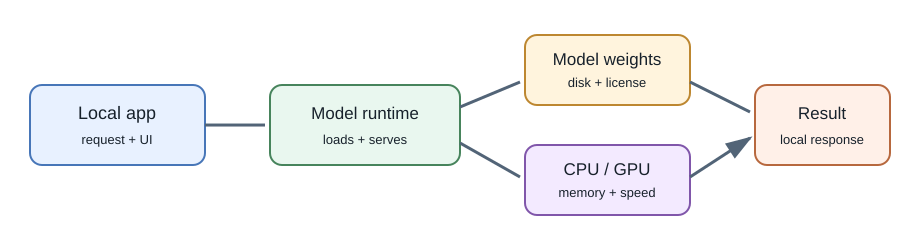
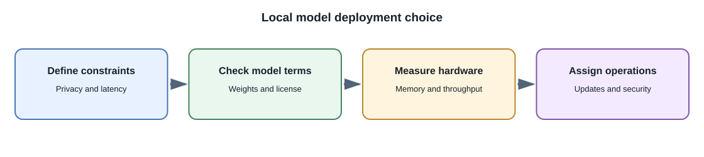

# Running Models Locally

## Introduction

**Local inference** runs a model on your own computer or on infrastructure
you control instead of sending each request to a hosted model API. It can be
useful for learning, offline experiments, privacy-sensitive workflows, or
reducing dependence on a particular hosted service.

"Free" usually means no provider charge per request. It does not mean zero
cost: hardware, electricity, disk space, setup, speed, and maintenance still
matter. Some model weights also have licenses or usage terms.

## Common ways to run a model

| Approach | What it provides | Useful when |
|---|---|---|
| Desktop model application | UI for downloading and chatting with local models | Learning and manual experiments |
| Local model runner with an HTTP endpoint | A local service an application can call | Prototyping an integration on one machine |
| Python inference libraries | Code-level model loading and inference | Experiments, model evaluation, and ML development |
| Self-hosted inference server | Model endpoint on your own machine or cloud GPU | A team needs controlled hosting or a private deployment |

Examples include Ollama and LM Studio for local experimentation, llama.cpp
for efficient inference across supported hardware, and Hugging Face
Transformers for programmatic model workflows. These tools are not
interchangeable; check supported hardware, model formats, licenses, and
security settings.

### Quick start with Ollama

Ollama downloads models from its library and serves them on
`127.0.0.1:11434` by default; the `OLLAMA_HOST` environment variable changes
the bind address ([Ollama FAQ](https://docs.ollama.com/faq)). Pick a model
from the [Ollama library](https://ollama.com/library) whose license and size
fit your task, and keep its exact name and tag in configuration:

```bash
# Record the exact name:tag you tested, for example in .env.example
export LOCAL_MODEL="<model>:<tag>"

ollama pull "$LOCAL_MODEL"        # download the weights
ollama run "$LOCAL_MODEL" "Summarize: the release moved to Friday."
ollama ls                         # downloaded models
ollama ps                         # loaded models and their memory use
ollama stop "$LOCAL_MODEL"        # unload it and free memory
```

Ollama picks its default context window from the available VRAM: as of
November 2026, 4K tokens below 24 GiB, 32K from 24 to 48 GiB, and 256K at
48 GiB or more ([context length](https://docs.ollama.com/context-length)).
Raise it server-wide with `OLLAMA_CONTEXT_LENGTH` or per request with the
`num_ctx` option when prompts include long notes; a larger window needs
more memory.

### Quick start with llama.cpp

The `llama-server` program in llama.cpp loads a GGUF model file (`-m`) or
downloads one from Hugging Face (`-hf`, which picks the `Q4_K_M`
quantization when the repository has it) and serves an OpenAI-compatible
API. Current builds listen on `127.0.0.1:9931` by default; older builds and
many tutorials use 8080, so pass `--port` explicitly:

```bash
# A GGUF repository on Hugging Face whose license fits your use
export GGUF_REPO="<user>/<model>-GGUF"

llama-server -hf "$GGUF_REPO" --host 127.0.0.1 --port 9931 -c 8192 \
  --api-key "$LLAMA_API_KEY"      # require a key even on localhost
curl -s http://127.0.0.1:9931/v1/models -H "Authorization: Bearer $LLAMA_API_KEY"
```

`-c` sets the context size. Run `llama-server --help` for the flags your
build supports; they change between releases.

### Calling a local model from the backend

Ollama, `llama-server`, and vLLM all expose OpenAI-compatible endpoints, so
the official OpenAI SDK can call them by changing only the base URL. Ollama
documents `http://localhost:11434/v1` and requires an API key value only
because the client needs one; Ollama ignores it
([OpenAI compatibility](https://docs.ollama.com/api/openai-compatibility)).

```ts
// src/ai/local-chat.ts: call a local OpenAI-compatible server from the TaskFlow API
import OpenAI from "openai";

// Ollama: http://127.0.0.1:11434/v1, llama-server: http://127.0.0.1:9931/v1, vLLM: http://127.0.0.1:8000/v1
const client = new OpenAI({
  baseURL: process.env.LOCAL_LLM_BASE_URL ?? "http://127.0.0.1:11434/v1",
  apiKey: process.env.LOCAL_LLM_API_KEY ?? "unused", // Ollama ignores it; llama-server and vLLM can require one
  timeout: 60_000, // local models can be slow on CPU: fail clearly instead of hanging
  maxRetries: 1,
});

export async function summarizeMeetingNote(note: string): Promise<string> {
  const model = process.env.LOCAL_MODEL; // a model the local server has loaded, e.g. from `ollama ls`
  if (!model) throw new Error("Set LOCAL_MODEL to a model the local server serves");

  const completion = await client.chat.completions.create({
    model,
    temperature: 0.2,
    max_tokens: 200,
    messages: [
      { role: "system", content: "Summarize the meeting note in two short sentences." },
      { role: "user", content: note },
    ],
  });
  return completion.choices[0]?.message?.content?.trim() ?? "";
}
```

Because the model name and base URL come from configuration, the same
TaskFlow code can point at Ollama on a laptop, `llama-server` in CI, or a
hosted provider in production. Compatibility is partial: check each
server's documentation for supported fields such as tools, JSON output, and
streaming before relying on them.

## Local application flow





1. Select a model whose license permits your intended use.
2. Download its weights from a trusted source and verify the source and
   published checksums where available.
3. Load it with a compatible runtime and hardware configuration.
4. Send prompts to the local process or its loopback HTTP endpoint.
5. Measure latency, memory use, output quality, and failure behavior.

For an application running on the same computer, bind development services
to loopback where possible. Do not expose a local model server to a network
without authentication and access controls.

## Hardware and model size

Inference requires model weights and working memory for intermediate
calculations and the context. Quantization stores weights with fewer bits
than the original representation and can reduce memory needs, usually with
some quality or numerical trade-off. GPU support can increase throughput,
but model format and available memory determine what fits.

A smaller quantized model may be more practical on a laptop than a larger
model, but task quality varies. Use a small test set for your task rather
than choosing only by model size or a benchmark score from another workload.

## Privacy and offline use

Local inference can keep prompts on a machine you control, but it does not
automatically guarantee privacy. The application may still log prompts,
synchronize files, expose a local network port, or load untrusted model
artifacts. Review telemetry, storage, permissions, and network behavior.

Offline operation is possible only if the runtime, weights, and application
dependencies are already available and the chosen features do not require
an external service.

## Local versus hosted inference

| Consideration | Local | Hosted API |
|---|---|---|
| Per-request provider billing | None for local-only inference | Usually usage-based or subscription-based |
| Upfront resources | Local/server hardware and operations | Provider manages inference infrastructure |
| Data path | Can remain on controlled hardware | Input is transmitted to the provider under its terms |
| Scaling | You provision and operate capacity | Provider may scale within quotas and service limits |
| Model access | Depends on available weights and license | Depends on provider's available models |
| Maintenance | Runtime, drivers, model updates, monitoring | Provider API and model lifecycle management |

There is no universal winner. Hybrid systems may route sensitive or offline
tasks locally and other tasks to an approved hosted service.

## Full-stack development

The browser should call your backend, and the backend should call the local
model server. Do not make a local inference endpoint public merely to let
the browser reach it. In production, use an authenticated service boundary,
resource limits, monitoring, and a queue if generation is too slow for
request-response work.

Exposed model servers are found and attacked. In June 2024 Wiz Research
disclosed [CVE-2024-37032 ("Probllama")](https://www.wiz.io/blog/probllama-ollama-vulnerability-cve-2024-37032),
a path-traversal flaw in Ollama's API that could lead to remote code
execution, fixed in version 0.1.34. The default Linux install listened only
on localhost, but Docker deployments listened on `0.0.0.0`, and Wiz found
over 1,000 Ollama instances exposed to the internet. Keep runtimes updated,
bind to loopback or a private network, and put authentication in front.

When one machine is no longer enough, see
[serving open models](deployment-cost-and-performance/serving-open-models.md)
and [GPU capacity and scaling](deployment-cost-and-performance/gpu-capacity-and-scaling.md);
for choosing between local and hosted models, see
[choosing models and providers](hosted-model-apis/choosing-models-and-providers.md).

## Common misconceptions

- Local models do not require a paid API key, but still consume hardware and
  operational resources.
- A model downloaded locally is not necessarily open source or unrestricted.
- Quantization can help a model fit; it does not guarantee unchanged quality.
- Running locally does not make outputs accurate or safe by itself.

## Further learning

- [Ollama documentation](https://docs.ollama.com/) and its
  [CLI reference](https://docs.ollama.com/cli)
- [LM Studio documentation](https://lmstudio.ai/docs)
- [llama.cpp](https://github.com/ggml-org/llama.cpp) and the
  [llama-server README](https://github.com/ggml-org/llama.cpp/tree/master/tools/server)
- [Hugging Face Transformers documentation](https://huggingface.co/docs/transformers/)
- [Hugging Face Hub: Model licenses](https://huggingface.co/docs/hub/repositories-licenses)
