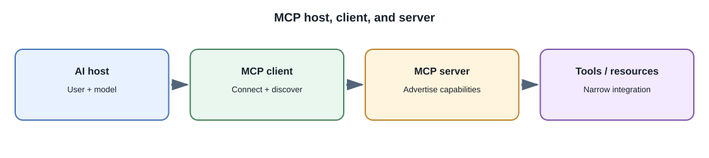
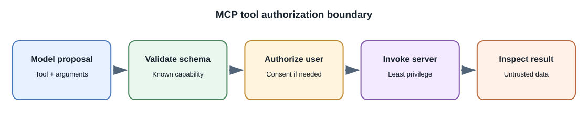

# Model Context Protocol and Agent Integrations

## Introduction

**Model Context Protocol (MCP)** is an open protocol for connecting AI
applications to external tools and context sources through a common
client-server model. An MCP server can expose capabilities such as tools,
resources, or prompts. MCP standardizes parts of the connection; it does
not make a server trustworthy or decide whether a user may perform an
action.

## Main concepts

- **Host:** the AI application that manages the user's session and model
  interaction.
- **Client:** the protocol component in the host that connects to a
  particular server.
- **Server:** a process or service that advertises capabilities.
- **Tools:** operations the model may request through the host.
- **Resources:** data the host may retrieve through the protocol.
- **Prompts:** reusable prompt templates or workflows provided by a
  server.

The exact protocol version, transports, and capability details evolve.
Consult the current MCP specification when implementing a client or server.
As of November 2026 the current revision is
[`2026-07-28`](https://modelcontextprotocol.io/specification/2026-07-28/changelog),
which replaced `2025-11-25`. Its biggest change is that MCP is now
stateless: there is no `initialize` handshake or protocol session, every
request carries its protocol version and client capabilities in `_meta`,
and servers advertise their versions and capabilities through a
`server/discover` call. The official TypeScript SDK implements this
revision in its v2 packages (`@modelcontextprotocol/server` and
`@modelcontextprotocol/client`); v1 (`@modelcontextprotocol/sdk`) speaks
`2025-11-25` and earlier.



## What can an MCP server provide?

The server advertises capabilities; the host decides which ones to expose
to the model or user.

| Capability | Direction and purpose | Example |
|---|---|---|
| Tools | The model may request an operation through the host | Search an issue tracker or create a draft |
| Resources | The host can read data exposed by a server | A document, record, or application context |
| Prompts | The server can provide a reusable prompt template | A guided code-review or research prompt |

Depending on protocol version and negotiated capabilities, client-side
features can include roots, sampling, elicitation, and tasks. In
`2026-07-28`, roots, sampling, and logging are deprecated (they still work
during a deprecation window of at least twelve months), elicitation remains,
and tasks for long-running work moved into an optional official extension.
A capability is not automatically available just because the other side
implements MCP; client and server must both support it.

## How an MCP connection is established

1. A user or administrator configures a trusted server for an MCP-capable
   host.
2. The host creates an MCP client and selects a compatible transport.
3. Client and server agree on a protocol version and capabilities. Older
   revisions used an `initialize` handshake; since `2026-07-28` the client
   can call `server/discover` and then sends its version and capabilities
   with every request.
4. The client discovers server capabilities and presents only approved
   tools, resources, or prompts to the model.
5. When the model proposes a tool call, the host applies policy and
   confirmation before invoking the server.
6. Results return through the client, are treated as untrusted data, and
   may be added to the model's context.

The protocol connection is between host/client and server. The model
typically does not open an MCP socket or directly execute a server tool.



## Standard transports and deployment choices

The current MCP specification defines two standard transports:

| Transport | How it connects | Typical use | Main security considerations |
|---|---|---|---|
| **stdio** | The host launches a local server process and exchanges newline-delimited JSON-RPC messages over standard input/output | Local tools and developer integrations | The configured command runs as a process with the host user's permissions; review its executable, arguments, working directory, and environment |
| **Streamable HTTP** | A client sends JSON-RPC messages to one HTTP endpoint; responses may be JSON or a request-scoped server-sent-event stream | Remote or shared servers | Authenticate and authorize requests, protect transport, validate origin/host behavior, and isolate tenants |

Streamable HTTP replaced the older HTTP+SSE transport in protocol
2025-03-26, and `2026-07-28` formally marks HTTP+SSE as Deprecated. The
same revision removed the `Mcp-Session-Id` header and stream resumability:
a server that needs state across calls returns its own handle as an
ordinary tool argument, and a client re-issues a request whose stream
broke. Older clients may still support HTTP+SSE for compatibility; new
integrations should follow the current specification and verify the
client/server versions. Transport and capability details can change, so
check compatibility rather than assuming every host supports every mode.

### Illustrative host configuration

Some desktop hosts use a JSON configuration shaped like this for a local
stdio server:

```json
{
  "mcpServers": {
    "project-search": {
      "command": "python",
      "args": ["server.py"],
      "env": {}
    }
  }
}
```

Remote-server configuration may instead specify a URL and authentication
settings. Configuration schemas and file locations are **host-specific**;
`mcpServers` is an example convention, not a field required by the MCP
protocol. Do not copy tokens or secrets into a checked-in config file.

Conceptually, a remote client connects to a configured MCP endpoint:

```text
MCP client -> HTTPS endpoint -> authenticated MCP server
```

The host may start the stdio process itself, or a platform may manage that
process. For remote services, follow the server's authentication and
deployment guidance. MCP authorization supports OAuth-based patterns for
HTTP transports; stdio normally relies on local process configuration and
OS permissions instead of HTTP OAuth. In `2026-07-28`, OAuth Dynamic Client
Registration is deprecated in favor of Client ID Metadata Documents.

### A minimal read-only server in TypeScript

This TaskFlow server exposes one search tool over stdio with the v2
TypeScript SDK. Zod schemas become the tool's JSON Schema, and the SDK
rejects invalid arguments before the handler runs.

```ts
// taskflow-mcp/server.ts: a read-only MCP server exposing one TaskFlow search tool over stdio
import { McpServer } from "@modelcontextprotocol/server";
import { StdioServerTransport } from "@modelcontextprotocol/server/stdio";
import * as z from "zod";

// In the real server this is a MongoDB query scoped to the user the server was configured for.
const tasks = [
  { id: "T-101", title: "Prepare release notes for 1.9", status: "open" },
  { id: "T-102", title: "Fix login rate limit", status: "done" },
  { id: "T-103", title: "Review release checklist", status: "open" },
];

const server = new McpServer({ name: "taskflow-tasks", version: "1.0.0" });

server.registerTool(
  "search_tasks",
  {
    title: "Search TaskFlow tasks",
    description: "Find tasks whose title contains the query. Read-only.",
    inputSchema: z.object({
      query: z.string().min(2).max(100),
      status: z.enum(["open", "done"]).optional(),
      limit: z.number().int().min(1).max(20).default(5),
    }),
    outputSchema: z.object({
      tasks: z.array(z.object({ id: z.string(), title: z.string(), status: z.string() })),
    }),
    annotations: { readOnlyHint: true },
  },
  async ({ query, status, limit }) => {
    const q = query.toLowerCase();
    const found = tasks
      .filter((t) => t.title.toLowerCase().includes(q) && (!status || t.status === status))
      .slice(0, limit);
    const output = { tasks: found };
    return { content: [{ type: "text", text: JSON.stringify(output) }], structuredContent: output };
  },
);

// stdout carries the protocol; log to stderr only
await server.connect(new StdioServerTransport());
console.error("taskflow-tasks MCP server ready on stdio");
```

A test client built with `@modelcontextprotocol/client` that starts this
server and calls the tool printed:

```text
tools: search_tasks readOnly=true
call: {"tasks":[{"id":"T-101","title":"Prepare release notes for 1.9","status":"open"},{"id":"T-103","title":"Review release checklist","status":"open"}]}
invalid input -> isError: true [{"type":"text","text":"Input validation error: Invalid arguments for tool search_tasks: query: Too small: expected string to have >=2 characters"}]
```

`readOnlyHint` is advice to the host, not enforcement. Write tools should
act with a TaskFlow user token from the host's authorization flow, not a
shared admin credential.

## Tool use through a host

1. The host connects to a configured server and discovers supported
   capabilities.
2. The application decides which capabilities are appropriate for the
   current user and task.
3. The model may propose a tool call with structured arguments.
4. The host validates the request, checks authorization, and obtains any
   required user confirmation.
5. The host invokes the tool and returns a bounded result to the model.
6. The application validates and presents the final answer or action.

## MCP and custom tool calling

| Choice | Advantages | Considerations |
|---|---|---|
| Provider-specific function calling | Direct integration with one model API | Tied to that provider's tool format |
| Application-defined tools | Full control over exposed operations | Each integration needs custom schemas and maintenance |
| MCP | Common protocol for capability discovery and integrations | Requires client/server lifecycle, version, security, and compatibility management |

MCP can improve interoperability; it does not replace application
authorization, business rules, audit logging, or user confirmation.

### Where A2A fits

MCP connects an agent to tools and data. The
[Agent2Agent (A2A) protocol](https://a2a-protocol.org/latest/) connects an
agent to other agents that it cannot see inside: each side keeps its
memory, tools, and logic private. A2A started at Google in 2025, is
governed under the Linux Foundation, and is at specification version 1.0
as of November 2026. An agent publishes an **Agent Card** (a JSON document,
usually at `/.well-known/agent-card.json`) with its skills, endpoint, and
authentication requirements; work happens in **tasks** with states such as
working, input required, and completed, exchanged as messages and artifacts
over JSON-RPC 2.0, gRPC, or HTTP+JSON. For TaskFlow, an MCP server exposes
task search to the assistant; A2A would matter only if TaskFlow's agent had
to hand work to another organization's agent. Patterns and trade-offs are
in
[agent protocols and interoperability](tool-calling-and-agents/agent-protocols-and-interoperability.md).

## What MCP servers and integrations are available?

The ecosystem includes local or remote servers for categories such as
files and project search, source-control and issue trackers, databases,
documentation, communications, and other business systems. Implementations
may be first-party, community-maintained, or vendor-provided. Availability,
maintenance, and trustworthiness are not implied by being listed in a
catalog or appearing in a host's UI.

Before connecting one, verify its publisher and source code where
appropriate, supported protocol version, requested permissions, data
handling, update process, and whether it transmits information to another
service. Prefer the narrowest server and access scope that satisfies the
task. A database server should expose task-specific operations rather than
unrestricted credentials or query execution when a narrower interface is
possible.

## Security checklist

- Trust only reviewed, explicitly configured servers.
- Authenticate remote connections and protect transport credentials.
- Use least privilege for each server and tool.
- Validate all arguments and outputs against schemas and business rules.
- Treat resource contents and tool results as untrusted input.
- Require confirmation for destructive, financial, or external actions.
- Record useful audit events without retaining unnecessary sensitive data.
- Set network, time, size, and call-count limits.
- Review dependencies and update protocol implementations.

Trusted servers can still be turned against you. In May 2025 Invariant
Labs showed how a prompt injection in an issue on a public GitHub
repository could make an agent connected to the GitHub MCP server read the
user's private repositories and publish their contents in a pull request
on the public one ([Invariant Labs](https://invariantlabs.ai/blog/mcp-github-vulnerability)).
The researchers stressed that this was not a bug in the server's code but a
"toxic agent flow": untrusted content, private data, and a public write
tool in one session. Their advice was the checklist above: scope each
session to the repositories it needs and monitor tool calls. Defenses are
covered in
[prompt injection and defenses](security-privacy-and-responsible-ai/prompt-injection-and-defenses.md).

## Agent design

An agent is a model-directed control loop that can select tools, inspect
results, and continue. Keep the loop bounded by allowed tools, step count,
time, token budget, and user permissions. Prefer a deterministic workflow
when the task has a known sequence. Make state, retries, and side effects
explicit and idempotent. See
[tool calling in practice](tool-calling-and-agents/tool-calling-in-practice.md)
and [agent orchestration patterns](tool-calling-and-agents/agent-orchestration-patterns.md).

## Further learning

- [Model Context Protocol documentation](https://modelcontextprotocol.io/)
- [Model Context Protocol specification](https://modelcontextprotocol.io/specification/)
- [MCP transport specification](https://modelcontextprotocol.io/specification/2026-07-28/basic/transports)
- [MCP authorization specification](https://modelcontextprotocol.io/specification/2026-07-28/basic/authorization)
- [MCP security best practices](https://modelcontextprotocol.io/specification/2026-07-28/basic/security_best_practices)
- [MCP 2026-07-28 changelog](https://modelcontextprotocol.io/specification/2026-07-28/changelog)
- [Build an MCP server](https://modelcontextprotocol.io/docs/develop/build-server)
- [MCP TypeScript SDK v2 documentation](https://ts.sdk.modelcontextprotocol.io/v2/)
- [A2A protocol specification](https://a2a-protocol.org/latest/specification/)
- [OWASP Top 10 for LLM Applications](https://genai.owasp.org/llm-top-10/)
