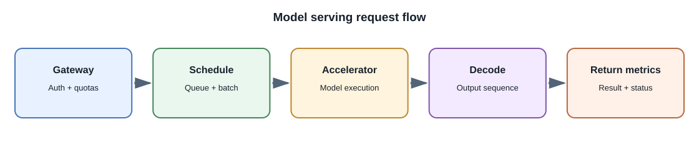
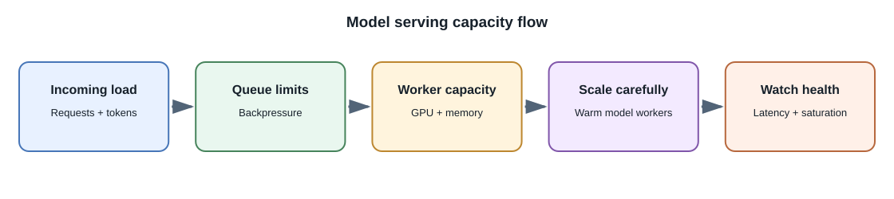

# Model Serving and Inference Infrastructure

## Introduction

**Model serving** exposes a trained model through an interface that an
application can call. A serving system loads model weights, accepts
requests, runs inference on available hardware, and returns results. It
may be a hosted provider, a managed cloud endpoint, or infrastructure
operated by your team.





## Serving choices

| Option | Team operates | Trade-offs |
|---|---|---|
| Hosted provider API | Application integration and policy controls | Fastest setup; provider terms, quotas, latency, and price apply |
| Managed cloud endpoint | Model selection, application integration, and configuration | Less infrastructure work than self-hosting; availability and hardware choices vary |
| Self-hosted inference server | Model runtime, hardware, scaling, upgrades, security, and observability | More control; high operational and capacity-planning burden |
| On-device runtime | Packaging, supported hardware, updates, and local UX | Can work offline and keep inference local; device capability and model size constrain quality and speed |

Choose by measured quality, data policy, availability, latency, throughput,
operational capability, and total cost. "Open weights" does not remove
license obligations or operational work.

## What happens inside a serving system?

1. A gateway checks authentication, quotas, request size, and model access.
2. A scheduler queues requests and may combine compatible work into a
   batch.
3. The runtime tokenizes or otherwise prepares the input, loads model
   weights, and uses CPU, GPU, or another accelerator.
4. The model produces output; a decoder or task-specific postprocessor
   formats it.
5. A response layer streams or returns the result and emits operational
   metrics.

### Example: an OpenAI-compatible server with vLLM

[vLLM](https://docs.vllm.ai/) is a widely used open-source engine for
serving open-weight models on GPUs. `vllm serve` starts an
OpenAI-compatible API (Chat Completions, Completions, Responses,
Embeddings, and more) on port 8000 by default:

```bash
# Pick a model whose license and size fit your GPU; keep the ID in configuration
export MODEL_ID="<org>/<model>"

vllm serve "$MODEL_ID" \
  --host 127.0.0.1 --port 8000 \
  --api-key "$VLLM_API_KEY" \
  --served-model-name taskflow-chat \
  --max-model-len 8192 \
  --gpu-memory-utilization 0.90

# Smoke test, then read the serving metrics
curl -s http://127.0.0.1:8000/v1/chat/completions \
  -H "Authorization: Bearer $VLLM_API_KEY" -H "Content-Type: application/json" \
  -d '{"model": "taskflow-chat", "messages": [{"role": "user", "content": "Reply with: ready"}], "max_tokens": 10}'
curl -s http://127.0.0.1:8000/metrics | grep -E "vllm:(num_requests_waiting|num_requests_running)"
```

- `--served-model-name` gives the deployment a stable alias, so TaskFlow's
  `CHAT_MODEL` setting does not change when you swap the underlying weights.
- `--max-model-len` caps prompt plus output tokens; a smaller value leaves
  more GPU memory for the KV cache and therefore for concurrent requests.
- `--gpu-memory-utilization` is the fraction of GPU memory vLLM may claim.
  Check the default for your version in the
  [`vllm serve` reference](https://docs.vllm.ai/en/latest/cli/serve/).
- `--api-key` protects only the API path prefixes such as `/v1`; endpoints
  like `/metrics` stay open, so bind to loopback or a private network and
  put the server behind your gateway.

The TaskFlow client from [running models locally](local-models.md) works
unchanged with `LOCAL_LLM_BASE_URL=http://127.0.0.1:8000/v1`.

## Performance techniques and trade-offs

- **Quantization:** represents weights or activations with lower precision
  to reduce memory or improve throughput. Quality changes must be
  evaluated; support varies by model and hardware.
- **Batching:** executes multiple requests together to use accelerators
  efficiently. Waiting to form a batch can add latency.
- **Continuous batching:** adds and removes sequences while a batch is
  running, improving utilization in some generation workloads.
- **KV caching:** retains attention state for active generation, reducing
  repeated computation while consuming memory.
- **Model parallelism:** splits a large model across devices, adding
  communication and operational complexity.
- **Autoscaling:** adds capacity when demand rises, but model loading,
  accelerator availability, and warm-up time make scaling slower than
  ordinary stateless web workers.

Optimize only after measuring queue time, time to first token, generation
speed, tail latency, memory, throughput, and cost per completed task.
vLLM, for example, exports these on `/metrics` as
`vllm:num_requests_waiting`, `vllm:time_to_first_token_seconds`,
`vllm:inter_token_latency_seconds`, `vllm:e2e_request_latency_seconds`, and
`vllm:kv_cache_usage_perc` ([metrics docs](https://docs.vllm.ai/en/latest/usage/metrics/)).
A rising waiting count with a full KV cache means you need more memory or
replicas, not a faster model.

These techniques matter in practice. When the vLLM team introduced
PagedAttention, which stores the KV cache in fixed-size blocks instead of
one contiguous buffer per request, they reported up to 24 times the
throughput of Hugging Face Transformers and up to 3.5 times that of Text
Generation Inference in their benchmarks. LMSYS, which served Vicuna and
Chatbot Arena on vLLM (30,000 requests a day on average, with peaks of
60,000), reported cutting the GPUs used for that traffic by 50%
([vLLM blog, June 2023](https://vllm.ai/blog/2023-06-20-vllm)). Treat such
"up to" numbers as a starting point and benchmark your own prompts.

## Reliability and security

Limit request and output size, protect model endpoints, isolate tenants,
patch the runtime, and monitor GPU or accelerator health. Use deadlines,
bounded queues, cancellation, and explicit overload responses. Do not allow
an internal inference endpoint to become publicly reachable without
authentication and rate controls.

## Developer perspective

Most full-stack developers should begin with a hosted API or managed
endpoint. Self-host when privacy, latency, control, economics at measured
scale, or product requirements justify the operational cost.

Keep the application side boring: one client module that reads the base
URL, API key, and model alias from configuration, sets a request timeout,
streams long answers, and records tokens and latency per request. Then the
same code can call a hosted API, a managed endpoint, or your own vLLM
fleet. The deep dives are in
[serving open models](deployment-cost-and-performance/serving-open-models.md),
[latency optimization](deployment-cost-and-performance/latency-optimization.md),
[cost optimization for LLM apps](deployment-cost-and-performance/cost-optimization-for-llm-apps.md),
and [GPU capacity and scaling](deployment-cost-and-performance/gpu-capacity-and-scaling.md).

## Further learning

- [vLLM documentation](https://docs.vllm.ai/) and the
  [`vllm serve` CLI reference](https://docs.vllm.ai/en/latest/cli/serve/)
- [SGLang](https://github.com/sgl-project/sglang)
- [Hugging Face Text Generation Inference](https://huggingface.co/docs/text-generation-inference/)
  (in maintenance mode; Hugging Face now recommends engines such as vLLM
  and SGLang, or llama.cpp and MLX locally)
- [NVIDIA Triton Inference Server](https://docs.nvidia.com/deeplearning/triton-inference-server/user-guide/docs/)
- [Efficient Memory Management for LLM Serving with PagedAttention (SOSP 2023)](https://arxiv.org/abs/2309.06180)
