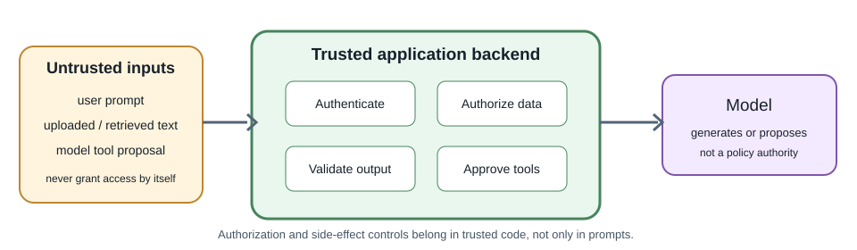
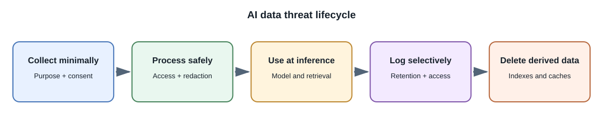

# AI Security, Privacy, and Responsible Use

## Introduction

AI security and responsible use cover risks created by model inputs,
outputs, data, tools, and deployment decisions. Existing web security still
applies: authenticate users, authorize every resource access, validate
inputs, protect secrets, and log carefully.

## Threats to consider

| Risk | Example | Important control |
|---|---|---|
| Prompt injection | A document tells the model to ignore rules or disclose secrets | Treat retrieved content as untrusted; keep permissions and actions in code |
| Sensitive-data exposure | Private prompts appear in provider logs or application telemetry | Minimize data, review provider terms, redact logs, set retention rules |
| Insecure tool use | Model requests an unauthorized database or email operation | Narrow tools, validate arguments, authorize on the server, require confirmation |
| Excessive consumption | Repeated requests create high usage costs | Authentication, quotas, rate limits, output bounds, abuse monitoring |
| Insecure output handling | Generated text is rendered as trusted HTML or SQL | Encode output, parameterize queries, validate structured results |
| Supply-chain risk | Untrusted weights or packages contain unsafe code | Use trusted sources, verify artifacts, isolate execution, review licenses |
| Data leakage between users | Retrieval or cache returns another tenant's content | Enforce ownership filters and test isolation at every layer |
| Overreliance | User acts on an incorrect generated answer | Show uncertainty and sources; use human review for consequential actions |
| Exfiltration through output | A summary contains an image URL that carries private data to another host | Remove images and links to unknown hosts; set a CSP `img-src` allowlist |

These risks line up with the
[OWASP Top 10 for LLM Applications 2026](https://genai.owasp.org/resource/owasp-genai-llm-top-10-2026/)
(published August 2026), which keeps prompt injection first and moves
excessive agency, the risk of giving models broad tools, up to third
place.

## Prompt injection is not solved by a magic prompt

Prompt injection exploits the fact that models process instructions and
content together. An instruction in a retrieved document may conflict with
application intent. Prompt wording can reduce some failures but is not a
security boundary. As of 2026, both OWASP and the UK National Cyber
Security Centre
([Prompt injection is not SQL injection](https://www.ncsc.gov.uk/blog-post/prompt-injection-is-not-sql-injection))
say that no reliable prevention exists, so defenses must limit what a
successful injection can do.

Keep secrets out of model context. Do not rely on the model to decide
whether a user may access a record. Give the model only the data and tools
needed for the current task, and make the backend enforce permissions before
retrieval and before each action.

### Direct and indirect prompt injection

- **Direct injection** comes from the user's message, such as a request to
  ignore the application's instructions or reveal protected information.
- **Indirect injection** is embedded in content the application retrieves
  or processes, such as a web page, email, note, document, or tool result.
  The user may not know that the content contains instructions aimed at the
  model.

For example, a study note might include a sentence telling an assistant to
ignore its task and disclose other users' notes. The model may interpret
that sentence as an instruction even though the note should be treated as
data. Separating instructions from quoted content can help, but does not
reliably prevent the model from following malicious text.

Use layered controls rather than expecting a prompt to block every attack:

1. Keep authentication, authorization, tenant filters, and secret handling
   in normal application code.
2. Give the model only the sources and narrow tools needed for the current
   task; do not place secrets in its context.
3. Treat retrieved pages, documents, and tool results as untrusted data,
   even when they come from a source the user selected.
4. Validate every tool name and argument on the server, check permissions
   at execution time, and require confirmation for consequential actions.
5. Check outputs before rendering or using them, and test with adversarial
   examples that attempt to change instructions or trigger unauthorized
   actions.
6. Do not let one session combine untrusted input, private data, and an
   external action (Meta's "Rule of Two"); when a feature needs all three,
   a person approves the exact action.

These controls reduce risk; they do not prove that a model is injection
proof. A system must remain safe even if the model follows hostile content.

## Privacy and data governance

Before sending data to a provider, determine what the data contains, whether
the organization may transmit it, where it is processed, how long it is
retained, and whether it may be used for training under the applicable
contract and product settings. Do not assume provider behavior from a
consumer product's terms or another API tier. Provider abuse-monitoring
logs, stored responses, files, and caches all keep copies unless settings
or agreements (such as zero data retention) say otherwise, and your own
logs, traces, and vector stores add more.

For user-facing products, explain when AI is being used, what data is
processed, and how users can correct or delete relevant data where
applicable. Minimize collection and keep data only as long as needed.

## Output safety

Treat generated content as untrusted:

- Escape text before rendering; do not insert arbitrary model output as
  executable HTML.
- Remove Markdown images and links that point to hosts you do not
  control, because loading them can send data out without a click.
- Validate structured fields against a schema and business constraints.
- Parameterize database operations.
- Do not execute generated code or shell commands automatically.
- Verify citations against source identifiers held by the application.
- Require human review before high-impact or irreversible actions.

## Responsible-use questions

For a proposed feature, ask:

1. Who benefits, and who could be harmed by an incorrect result?
2. What data was used and is the intended use permitted?
3. Can users understand, contest, or correct the result?
4. Is a deterministic or human process safer and simpler?
5. How will performance be measured across relevant groups and real usage?
6. Who owns incident response, updates, and retirement?

Requirements depend on use, jurisdiction, and impact. In the EU, the AI
Act classifies uses by risk: for example, inferring emotions of workers is
prohibited, and allocating tasks based on personal traits is high-risk,
with those high-risk rules applying from December 2027 after the 2026
Digital Omnibus. Consult qualified legal, privacy, security, and domain
experts for regulated or consequential systems.

## Full-stack developer perspective

AI features inherit the application's threat model and add new untrusted
inputs and outputs. Threat-model the data path from browser to backend,
retrieval store, provider, tools, logs, and user-visible result. The
general controls this builds on (identity and access, pipeline security,
edge protection, vulnerability management) are covered in
[DevSecOps and cloud security](../../../08-devops-and-deployment/08-devops-and-deployment/devsecops-and-cloud-security.md),
and API keys for model providers belong in
[secrets management](../../../08-devops-and-deployment/08-devops-and-deployment/environment-variables/secrets-management.md).

## Common misconceptions

- A system prompt cannot replace access control.
- Delimiters, refusal text, or an instruction to "ignore prompt injection"
  cannot guarantee that hostile content will be ignored.
- HTTPS protects data in transit but does not decide provider retention.
- A private model is not automatically unbiased, safe, or legally compliant.
- Human review is effective only when reviewers have enough context and
  authority to correct the result.

## Go deeper

- [Prompt injection and defenses](security-privacy-and-responsible-ai/prompt-injection-and-defenses.md):
  direct and indirect injection, exfiltration through images and tools,
  the Rule of Two, output filtering, and confirmation flows, with tested
  code.
- [Guardrails and content moderation](security-privacy-and-responsible-ai/guardrails-and-content-moderation.md):
  moderation APIs and classifiers, policy design, threshold tuning, and
  latency.
- [Privacy, PII, and data retention](security-privacy-and-responsible-ai/privacy-pii-and-data-retention.md):
  redaction before sending, provider retention and zero-retention options,
  logging hygiene, erasure, and data residency.
- [AI regulation and governance](security-privacy-and-responsible-ai/ai-regulation-and-governance.md):
  the EU AI Act timeline and risk tiers, NIST AI RMF, ISO/IEC 42001, and
  system cards checked in CI.

**Review:** [interview questions and answers](security-privacy-and-responsible-ai/interview-questions-and-answers.md) · [cheat sheet](security-privacy-and-responsible-ai/cheat-sheet.md)

## Further learning

- [OWASP Top 10 for LLM Applications 2026](https://genai.owasp.org/resource/owasp-genai-llm-top-10-2026/)
- [OWASP Top 10 for Agentic Applications](https://genai.owasp.org/resource/owasp-top-10-for-agentic-applications-for-2026/)
- [NCSC: Prompt injection is not SQL injection](https://www.ncsc.gov.uk/blog-post/prompt-injection-is-not-sql-injection)
- [NIST AI Risk Management Framework](https://www.nist.gov/itl/ai-risk-management-framework)
- [European Commission: AI Act](https://digital-strategy.ec.europa.eu/en/policies/regulatory-framework-ai)
- [NIST Privacy Framework](https://www.nist.gov/privacy-framework)
- [OWASP Secrets Management Cheat Sheet](https://cheatsheetseries.owasp.org/cheatsheets/Secrets_Management_Cheat_Sheet.html)
