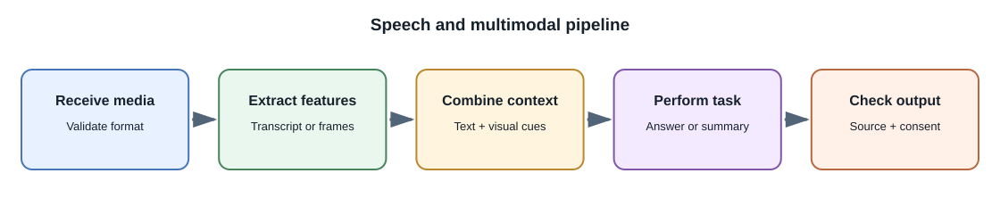
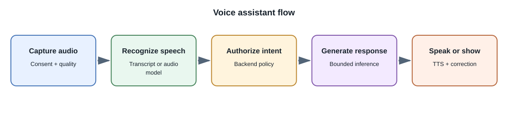

# Speech and Multimodal AI

## Introduction

**Multimodal AI** works with more than one type of input or output, such as
text, images, audio, and video. A system may use one model that accepts
several modalities or compose specialized models into a pipeline. The
supported media, languages, duration, resolution, and interaction patterns
are specific to each model.





## Speech tasks

| Task | Input | Output | Typical use |
|---|---|---|---|
| Automatic speech recognition (ASR) | Audio waveform or encoded audio | Text transcript | Captions, voice notes, searchable meetings |
| Speech translation | Audio or transcript in one language | Text or audio in another language | Accessible multilingual communication |
| Text-to-speech (TTS) | Text plus voice settings | Generated audio | Narration, accessibility, voice interfaces |
| Speaker diarization | Audio | Speaker labels and time segments | Meeting summaries and speaker-aware transcripts |
| Speech understanding | Audio, sometimes with text context | Answer, labels, or action candidates | Voice assistants and audio analysis |

Transcription can confuse similar words, names, accents, background sounds,
and overlapping speakers. Preserve timestamps or confidence information
when the workflow needs traceability, and let users correct transcripts.

Modern speech recognition gets much of its robustness from scale. OpenAI's
Whisper paper reports training on "680,000 hours of multilingual and
multitask supervision" and results competitive with fully supervised
systems "in a zero-shot transfer setting without the need for any
fine-tuning" ([Radford et al., 2022](https://arxiv.org/abs/2212.04356)).
For TaskFlow's meeting-notes summaries, that makes a general transcription
model a reasonable first step before any custom training.

### Realtime voice

A voice assistant that answers while the user is still on the line can be
built in two ways:

| Design | How it works | Trade-offs |
|---|---|---|
| Cascaded pipeline | Speech recognition, then a text model, then text-to-speech, each a separate call | Easy to inspect and swap parts; every stage adds latency, and tone of voice is lost in the transcript |
| Speech-to-speech session | One realtime model takes audio in and streams audio out over a persistent connection | Lower latency and natural interruptions; harder to log, evaluate, and constrain |

As of November 2026, OpenAI's Realtime API connects "over WebRTC in the
browser or WebSocket on the server", and the browser receives an
ephemeral client secret minted by your server instead of an API key
([OpenAI Realtime](https://developers.openai.com/api/docs/guides/realtime)).
Google's Live API uses a stateful WebSocket, takes raw 16-bit PCM at
16 kHz, returns 24 kHz audio, and recommends ephemeral tokens for client
apps ([Gemini Live API](https://aistudio.google.com/docs/live-api)).
OpenAI documents configurable automatic turn detection (deciding when the
user has finished speaking), and Google states that users "can interrupt
the model at any time". Your server still decides which tool calls a
session may make.

Audio is raw bytes, so sizing it is simple arithmetic. This helper
converts Web Audio samples to 16-bit PCM and computes the stream size:

```ts
// src/voice/pcm16.ts: turn Web Audio float samples into 16-bit PCM and size a realtime audio stream
export function floatTo16BitPCM(samples: Float32Array): Int16Array {
  const out = new Int16Array(samples.length);
  for (let i = 0; i < samples.length; i++) {
    const s = Math.max(-1, Math.min(1, samples[i])); // clip to the valid range
    out[i] = s < 0 ? s * 0x8000 : s * 0x7fff;
  }
  return out;
}

export function bytesPerSecond(sampleRate: number, channels = 1, bytesPerSample = 2): number {
  return sampleRate * channels * bytesPerSample;
}

const bps = bytesPerSecond(24_000); // 24 kHz mono, as the OpenAI Realtime API expects for PCM
const minute = bps * 60;
console.log("bytes per second:", bps);
console.log("bytes per 20 ms chunk:", (bps * 20) / 1000);
console.log("one minute raw:", (minute / 1e6).toFixed(2), "MB, as base64:", ((Math.ceil(minute / 3) * 4) / 1e6).toFixed(2), "MB");
console.log(Array.from(floatTo16BitPCM(new Float32Array([0, 0.5, -0.5, 1, -1, 1.2]))));
```

Output from running it with Node.js 24:

```text
bytes per second: 48000
bytes per 20 ms chunk: 960
one minute raw: 2.88 MB, as base64: 3.84 MB
[ 0, 16383, -16384, 32767, -32768, 32767 ]
```

Base64 over a WebSocket adds a third to the payload, and a 16 kHz input
stream needs a third less than 24 kHz, so resample before sending when
the API asks for it. Browsers usually capture at 44.1 or 48 kHz. See
[realtime voice applications](building-ai-applications/realtime-voice-applications.md)
for sessions, interruptions, and tool calls during a call.

## Images and video

Vision models can classify or describe images, extract text with OCR,
answer questions about a chart, or compare visual content. Video adds time:
systems may sample frames, process audio separately, or use a model that
accepts video directly. Frame sampling can miss brief events, and large
media can exceed request limits.

For production uploads, validate media server-side, limit size and duration,
remove or protect sensitive metadata where appropriate, and use background
jobs for long-running extraction. Keep the original media and derived
transcripts, captions, and embeddings under the same authorization and
retention policy.

## Building a multimodal workflow

1. Identify the user's task and which modalities are truly necessary.
2. Obtain consent and validate file format, size, duration, and policy.
3. Preprocess safely; record transformations such as resizing or audio
   resampling.
4. Call a model with a bounded request and clear output contract.
5. Validate the response and link it to source media, timestamps, or
   regions when possible.
6. Present uncertainty and allow correction, deletion, or human review.

## Evaluation

Text-only benchmarks are insufficient for many media tasks. Evaluate
transcription word errors and names, timestamp alignment, image-text
grounding, speaker attribution, accessibility, and performance across
conditions relevant to the product. Review privacy and consent requirements
for voice and face data.

The standard transcription metric is **word error rate**:

\[
\text{WER} = \frac{S + D + I}{N}
\]

where \(S\), \(D\), and \(I\) count substituted, deleted, and inserted
words and \(N\) is the number of words in the reference transcript. If the
reference "move the budget review to Friday at ten" (8 words) comes back
as "move the budget view to Friday ten", there is one substitution and one
deletion, so WER is 2 / 8 = 25%. Both errors would break a TaskFlow task
created from this sentence, which is why a separate check on names,
dates, and numbers matters more than the average WER suggests.

## Common misconceptions

- A multimodal model does not necessarily support every modality in both
  directions.
- A video summary can miss events between sampled frames.
- A transcript may be fluent but still misrecognize a name or number.
- Voice cloning and face synthesis require stronger consent and abuse
  controls than ordinary text generation.

## Related lessons

- [Model Types and Capabilities](model-types-and-capabilities.md)
- [Generative Models and Diffusion](generative-models-and-diffusion.md)
- [Building AI Features](building-ai-applications.md)
- [Realtime voice applications](building-ai-applications/realtime-voice-applications.md)
- [Frontend patterns for AI features](building-ai-applications/frontend-patterns-for-ai-features.md)
- [Media Formats for AI](media-formats-for-ai.md)

## Further learning

- [OpenAI Audio guide](https://developers.openai.com/api/docs/guides/audio)
- [Google Gemini API documentation](https://aistudio.google.com/docs)
- [W3C Web Accessibility Initiative](https://www.w3.org/WAI/)
