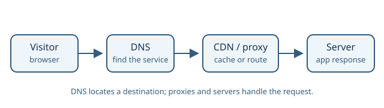

# Servers and Infrastructure

This section introduces the infrastructure that makes applications reachable
and available in production, including domains, servers, and delivery services.

## Learning objectives

- Understand how domains and DNS configuration connect users to services.
- Learn the roles of servers, Nginx, reverse proxies, and load balancers.
- Become familiar with cloud infrastructure and content delivery networks.

## Topics

- [Domains and DNS Configuration](domains-and-dns-configuration.md)
- [Servers](servers.md)
- [Nginx](nginx.md)
- [Reverse Proxy](reverse-proxy.md)
- [Load Balancing](load-balancing.md)
- [AWS](aws.md)
- [CDN](cdn.md)
