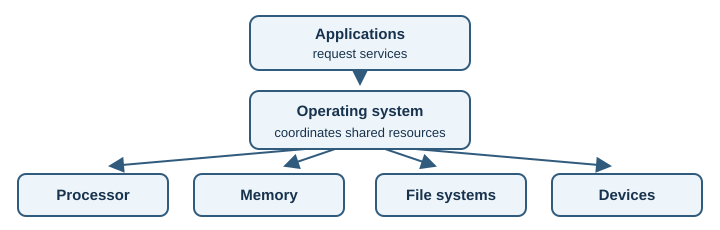

# Operating Systems and Linux

This section introduces the software that manages computer resources and the
Linux tools developers use to work with those resources.

An operating system coordinates programs, memory, files, and devices. Linux
gives developers a practical environment for observing those resources using
small command-line tools.

## Learning objectives

- Explain how operating systems coordinate programs and hardware.
- Distinguish processes, threads, and the memory they use.
- Understand files, permissions, and essential Linux concepts.

## Topics

- [Operating System Fundamentals](operating-system-fundamentals.md)
- [Processes and Threads](processes-and-threads.md)
- [Memory Management](memory-management.md)
- [File Systems](file-systems.md)
- [Linux Fundamentals](linux-fundamentals.md)

Start with [operating-system fundamentals](operating-system-fundamentals.md),
then explore [processes and threads](processes-and-threads.md),
[memory management](memory-management.md), and
[file systems](file-systems.md). The [Linux fundamentals](linux-fundamentals.md)
lesson ties these ideas to everyday diagnostic commands.
