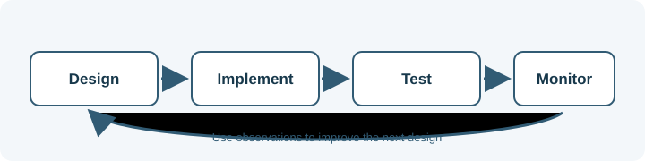

# Security and Testing

This section introduces methods for checking application behavior, protecting
systems and data, and evaluating reliability and performance.

## Learning objectives

- Build a foundation in web and API security concepts.
- Understand authentication security and the OWASP project.
- Learn testing fundamentals and performance testing concepts.
- Apply security checks throughout design, implementation, and operation.
- Use testing to produce evidence about behavior, reliability, and performance.

## Topics

- [Web Security Fundamentals](web-security-fundamentals.md)
- [OWASP](owasp.md)
- [Authentication Security](authentication-security.md)
- [API Security](api-security.md)
- [Testing Fundamentals](testing-fundamentals.md)
- [Performance Testing](performance-testing.md)
