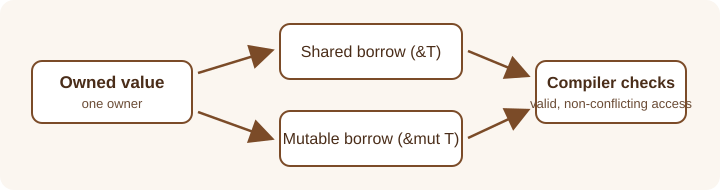

# Rust and Systems Programming

This section explores systems programming with Rust, including memory,
concurrency, operating-system interaction, and the Tauri application framework.

## Learning objectives

- Learn core Rust concepts and how ownership and borrowing work.
- Understand memory and concurrency topics in systems software.
- Explore how Rust programs interact with operating systems and Tauri.
- Practice Rust's core types and error handling through small examples.
- Understand how ownership supports safe memory use and concurrency.

## Topics

- [Rust Fundamentals](rust-fundamentals.md)
- [Ownership and Borrowing](ownership-and-borrowing.md)
- [Concurrency](concurrency.md)
- [Memory Management](memory-management.md)
- [Operating System Interaction](operating-system-interaction.md)
- [Tauri](tauri.md)
