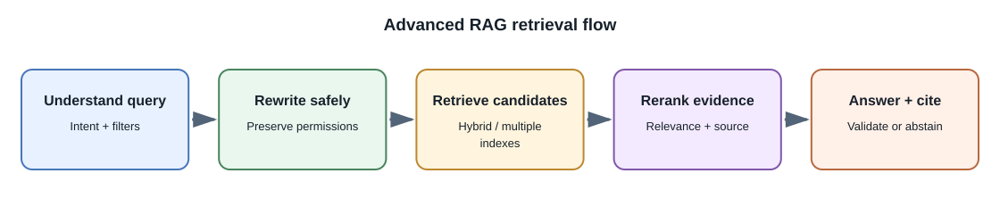
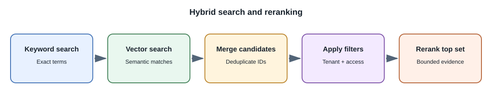

# Advanced RAG Design

## Introduction

Basic retrieval-augmented generation (RAG) retrieves text chunks and adds
them to a model request. A production system needs more: good indexing,
query understanding, permission filters, relevance ranking, citation
validation, and measurements that reveal whether failures came from
retrieval or generation.

## Improve retrieval step by step

1. **Parse the request:** identify the question, language, filters, and
   likely data source.
2. **Rewrite or expand the query:** create search terms or subquestions
   that retain the user's intent. Treat generated rewrites as suggestions,
   not authorization.
3. **Retrieve candidates:** use vector similarity, keyword search, metadata
   filters, or a hybrid combination.
4. **Rerank candidates:** use a cross-encoder or another ranking method to
   reorder a smaller candidate set by relevance.
5. **Assemble evidence:** deduplicate, keep source references, and fit
   selected passages into the context budget.
6. **Generate and validate:** answer from evidence, check citation targets,
   and abstain or ask for clarification when evidence is weak.

## Retrieval approaches

| Approach | Useful when | Limitations |
|---|---|---|
| Keyword / BM25 | Exact terms, identifiers, product codes, and rare names matter | May miss paraphrases or semantically related language |
| Dense vector search | Meaning matters more than exact wording | Can miss exact identifiers and may retrieve conceptually similar but wrong passages |
| Hybrid search | Both exact terms and paraphrase are important | Requires tuning, merging, and measuring multiple result lists |
| Metadata filtering | Tenant, date, product, or document type should constrain candidates | Incorrect metadata or filter logic can hide valid evidence or leak data |
| Reranking | Candidate retrieval is broad and relevance order needs refinement | Adds compute and latency; cannot recover a source never retrieved |
| Graph retrieval | Relationships across entities or documents matter | Graph extraction and maintenance can be expensive and imperfect |

## Advanced patterns

- **Query decomposition:** break a multi-part question into subqueries and
  combine evidence. Preserve which source supports each part.
- **Parent-child retrieval:** index small chunks for matching but return
  a larger parent section for context.
- **Contextual metadata:** add titles, section names, timestamps, or
  structured fields so chunks retain meaning outside their original file.
- **Knowledge graphs:** represent entities and relations explicitly for
  multi-hop questions. Validate extraction and graph freshness.
- **Agentic retrieval:** let a bounded controller issue another search when
  evidence is insufficient. Set a step budget and keep permissions in
  trusted application logic.

## Evaluate retrieval separately from generation

Create questions with expected source documents and user permissions.
Measure whether relevant sources appear in the candidate set, whether
reranking improves ordering, whether generated claims are supported, and
whether citations point to the exact visible source. Include adversarial
queries, no-answer cases, changed documents, and cross-tenant tests.

## Common misconceptions

- A sophisticated vector database does not guarantee relevant search.
- Reranking cannot fix a missing candidate.
- More retrieved chunks can add noise and consume useful context.
- Query rewriting must not broaden the user's data permissions.
- Citations are only useful when they resolve to the supporting source.

## Related lessons

- [Embeddings and Vector Search](embeddings-and-vector-search.md)
- [Retrieval-Augmented Generation](retrieval-augmented-generation.md)
- [Evaluation and Monitoring](evaluation-and-monitoring.md)

## Further learning

- [BEIR: Benchmarking Information Retrieval](https://github.com/beir-cellar/beir)
- [Sentence Transformers: Cross-Encoder Reranking](https://www.sbert.net/examples/cross_encoder/applications/README.html)
