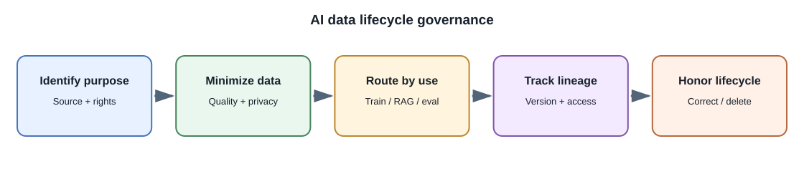
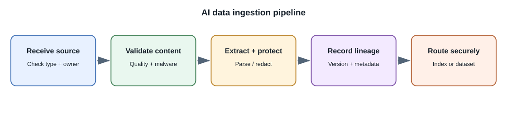

# AI Data Preparation and Governance

## Introduction

AI quality and safety depend on the data used to train, evaluate, retrieve,
or operate a system. **Data governance** defines who may collect, access,
transform, retain, and share data, and under what purpose and controls.
Data that is technically available is not automatically suitable or
permitted for an AI use.

## Distinguish data purposes

| Data purpose | How it is used | Important controls |
|---|---|---|
| Training data | Adjusts model parameters | Rights, consent, provenance, representativeness, contamination and retention |
| Fine-tuning examples | Teaches a pretrained model a narrower behavior | Quality, data minimization, split hygiene, licenses and held-out examples |
| Retrieval corpus | Supplies current evidence at inference time | Access-control metadata, freshness, source references, deletion propagation |
| Evaluation set | Measures behavior and regressions | Representativeness, leakage prevention, controlled access and versioning |
| Production telemetry | Diagnoses service quality | Minimize sensitive content, define retention, access and purpose |

Do not silently reuse user prompts as training data. Set clear product
policies, obtain required permissions, and make data use understandable.

## Prepare data carefully

1. **Establish source and purpose:** record owner, origin, permitted use,
   collection date, and deletion or expiry conditions.
2. **Validate and normalize:** check file types, encoding, duplicate
   records, malformed fields, and extraction quality.
3. **Minimize and protect:** remove unnecessary personal data; apply
   redaction, encryption, or controlled-access storage where appropriate.
4. **Label and review:** use clear labeling guidance, measure reviewer
   agreement, and resolve ambiguous examples.
5. **Split and version:** keep train, validation, and test sets separate;
   avoid near-duplicate leakage and use time-aware or user-aware splits
   when appropriate.
6. **Track lineage:** record transformations, dataset versions, and the
   model or index built from them.
7. **Honor change requests:** propagate correction, access revocation, and
   deletion to derived stores according to product and legal requirements.

## Synthetic data

Synthetic examples can expand test cases or protect some details, but they
can also reproduce bias, errors, or private information from their source
model. Label synthetic data, review quality, and do not assume generated
examples are representative or legally unrestricted.

## Data for RAG

For retrieval, preserve source IDs, headings, timestamps, tenant and
permission metadata through parsing, chunking, embedding, indexing, caching,
and citations. Deleting a source should trigger re-indexing or removal of
derived chunks according to the retention policy. Search filters must be
enforced by trusted backend code.

## Common misconceptions

- Publicly reachable data is not automatically licensed for training.
- Removing names alone does not guarantee effective anonymization.
- A large dataset can still be biased, duplicated, stale, or mislabeled.
- Synthetic data does not automatically remove privacy or quality risk.
- Evaluation data should not be repeatedly tuned against until it becomes
  part of the development feedback loop.

## Further learning

- [NIST Privacy Framework](https://www.nist.gov/privacy-framework)
- [NIST AI Risk Management Framework](https://www.nist.gov/itl/ai-risk-management-framework)
- [Google Responsible AI practices](https://ai.google/responsibility/responsible-ai-practices/)
