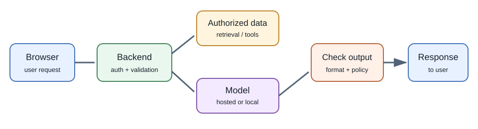
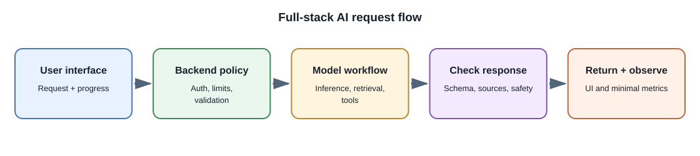

# Building AI Features in Full-Stack Applications

## Introduction

An AI feature combines a model with ordinary software: a user interface, an
API, data storage, access control, and tests. The model generates or scores
content; the application decides what the user is allowed to do and how the
result affects the product.

## Why use an application layer?

Calling a model directly from a page makes it difficult to protect
credentials, enforce access, limit cost, and keep a stable user experience.
A backend gives the product a trusted place to validate requests, assemble
context, call models, check outputs, and record application state.

## Typical architecture

1. **User interface:** gathers a request and displays progress, streamed
   output, citations, or a review action.
2. **Backend API:** authenticates the user, checks permissions, validates
   input, applies quotas, and chooses an allowed workflow.
3. **Context and tools:** fetch only records the user may access; optionally
   prepare retrieved passages or approved tool definitions.
4. **Model adapter:** sends a bounded request to an approved local or
   hosted model and handles timeouts, errors, and streaming.
5. **Output validation:** parses structured data, checks references, removes
   or encodes unsafe content, and enforces product rules.
6. **Persistence and observability:** stores permitted results and records
   model/version, latency, usage, and outcome metrics without leaking
   secrets or unnecessary personal content.

## Example application: searchable meeting notes

1. A user uploads or enters notes. The backend verifies the user owns the
   workspace and limits file size and type.
2. A background worker extracts text and optionally creates an audio
   transcript using an approved model.
3. The application stores the original note and its access-control metadata
   in the normal database.
4. A summarization task produces decisions, action items, and open
   questions. The backend validates the structure and stores the result
   linked to its source.
5. For search, the application creates embeddings and indexes chunks with
   the same workspace permissions.
6. When asked a question, retrieval returns only accessible notes. The
   model drafts a response with note titles and passages; the UI links back
   to those sources.
7. Users can correct, delete, export, or report a result. Deleting a note
   must also remove or update derived data according to the product's
   retention policy.

## Chat, assistant, and workflow patterns

| Pattern | What the model does | Application responsibility |
|---|---|---|
| Chat | Generates a response from conversation context | Bound history, enforce session ownership, handle streaming and resets |
| Notes assistant | Summarizes or searches private notes | Check document-level permissions and cite sources |
| Drafting assistant | Produces a first draft | Require human approval before sending or publishing |
| Extraction | Fills a schema from an input document | Validate values and preserve source traceability |
| Tool-using assistant | Requests an action through a tool interface | Authorize and validate every tool call; ask for confirmation for impactful actions |
| Recommendation | Scores or ranks candidates | Apply eligibility, fairness, and user-control requirements |

## Manage conversation state

Models generally do not remember a user's previous API requests unless the
application sends history or uses a provider-managed conversation feature.
Store conversation ownership and policy in your application. Send only the
history needed for the current turn, summarize or retrieve older context
carefully, and support user deletion when required.

Do not treat model memory as an authoritative user profile. Important
preferences and facts should be stored in a structured, inspectable system
with appropriate consent and correction controls.

## Streaming and long-running work

Streaming can display partial output sooner but complicates cancellation,
disconnects, and validation. Clearly mark incomplete responses and avoid
executing actions based on an unvalidated partial stream.

Long document processing, audio transcription, or batch generation may
exceed an HTTP request timeout. Use a background job, return a job
identifier, and let the client poll or subscribe to status. Make jobs
idempotent where possible and expose progress and failure states.

## Reliability and cost controls

- Set limits for input size, history, retrieved context, and output tokens.
- Apply per-user and per-workspace quotas.
- Set network deadlines and bounded retries.
- Cache only when user identity, prompt, model version, and data freshness
  are correctly represented in the cache key.
- Use a cheaper deterministic path for tasks that do not need a model.
- Provide a useful fallback when the model service is unavailable.
- Track usage and latency by feature and model without logging credentials.

## Developer perspective

Build a small, measurable vertical slice first. Keep model access behind an
application service interface so UI code is not coupled to a provider. Test
business rules with deterministic tests and model behavior with a separate
evaluation set.

## Common misconceptions

- A chat UI is not a complete AI architecture.
- The model should not be the only layer enforcing access to private data.
- A conversation does not persist automatically across stateless API calls.
- Streaming output is not necessarily complete, correct, or safe.
- Adding a vector database does not automatically make answers grounded.

## Further learning

- [OWASP Top 10 for LLM Applications](https://genai.owasp.org/llm-top-10/)
- [OpenAI API documentation](https://platform.openai.com/docs/overview)
- [Google Cloud: Generative AI architecture](https://cloud.google.com/architecture/gen-ai)
