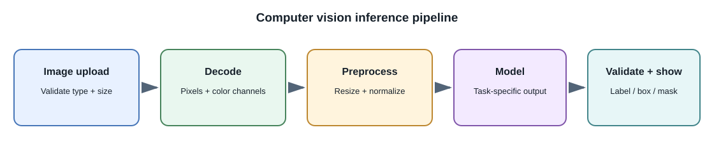
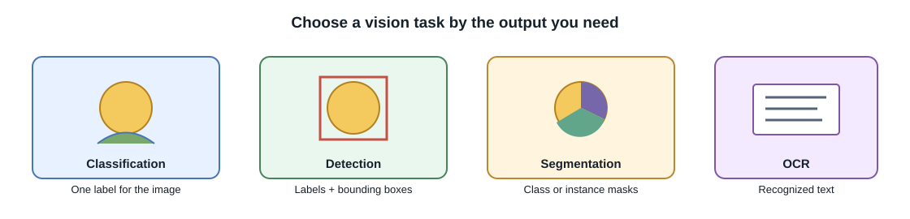
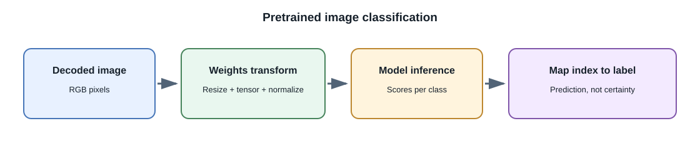

# Practical Computer Vision

## Introduction

**Computer vision** is the field of building systems that interpret images
or video. A vision model may assign a label to a whole image, locate
objects, mark regions, read text, compare images, or describe visual
content. These are related tasks, but they produce different outputs and
need different evaluation.





## Common computer-vision tasks

| Task | Model output | Example |
|---|---|---|
| Image classification | One or more labels for an image | Categorize a product photo |
| Object detection | Labels and bounding boxes | Find packages and estimate their locations |
| Semantic segmentation | A class for each pixel | Mark road, sky, or vegetation |
| Instance segmentation | A separate mask for each detected object | Separate overlapping objects |
| Keypoint estimation | Coordinates for landmarks or joints | Track a pose or object landmarks |
| OCR and document vision | Text and sometimes layout or fields | Read a scanned form |
| Image-text matching | Similarity scores for image and text pairs | Search a catalog with a text phrase |
| Image captioning / visual question answering | Text about image content | Describe a chart or answer a question about a photo |

Pick the task from the required product output. A classifier cannot return
object locations unless it was designed for detection, and an image caption
is not a verified description of every detail.

## How an image becomes model input

An image file must be decoded into pixel values. A model's preprocessing
then commonly performs some combination of:

1. Convert to the expected color representation, such as RGB.
2. Resize or crop to the dimensions expected by the model.
3. Convert pixel values to numeric tensors and apply the expected scaling
   or normalization.
4. Arrange the tensor in the layout expected by the runtime.
5. Run inference and map output indices or coordinates to labels and the
   original image.

Preprocessing must match the selected model. A different crop, color
channel order, normalization, or label map can make a correct model appear
to fail. Vision transformers commonly divide an image into patches;
convolutional networks process local neighborhoods with learned filters.
Both still require an input representation supported by the model.



For example, torchvision provides preprocessing transforms associated with
some pretrained weights. Use the transform supplied for the exact weights
rather than assuming every model expects the same image size or pixel
normalization:

```python
from PIL import Image
from torchvision.models import ResNet50_Weights, resnet50

weights = ResNet50_Weights.DEFAULT
model = resnet50(weights=weights).eval()
preprocess = weights.transforms()

image = Image.open("sample.jpg").convert("RGB")
batch = preprocess(image).unsqueeze(0)

import torch

with torch.inference_mode():
    scores = model(batch)

label_id = scores[0].argmax().item()
label = weights.meta["categories"][label_id]
print(label)
```

Install a compatible PyTorch, torchvision, and Pillow release before
running the example. Loading the default weights may download a model
artifact. Use trusted sources, check the model's license, and do not load
untrusted serialized model files. This example classifies an image; it
does not detect every object or explain the model's reasoning.

## CNNs, vision transformers, and pretrained models

**Convolutional neural networks (CNNs)** apply learned filters over local
image regions and combine their features across layers. **Vision
transformers (ViTs)** commonly divide an image into patches and process the
patch representations with transformer layers. These are broad patterns;
real architectures vary and neither family is automatically better for
every dataset, hardware target, or task.

For many practical projects, start with a pretrained model rather than
training from random initialization:

- **Feature extraction:** keep the pretrained model's learned feature
  layers fixed and train a small task-specific output layer.
- **Fine-tuning:** continue training some or all of a pretrained model on
  permitted examples for the target task.
- **From-scratch training:** initialize model parameters without a
  pretrained base. This usually needs far more representative data and
  compute, and is rarely the first choice for a product feature.

The right choice depends on dataset size and quality, similarity to the
pretraining domain, task, license, compute, and evaluation results. See
[Fine-Tuning](fine-tuning.md) for the broader workflow and
[Small-Scale Model Training](small-scale-model-training.md) for a runnable
learning example on a small image dataset.

## Evaluation and common failure modes

Use data splits that reflect real deployment. If several photos show the
same person, object, location, or video, random image-level splitting can
put near-duplicates in both training and test sets and inflate performance.
Where appropriate, split by source, subject, scene, or time.

- **Classification:** inspect per-class precision and recall, confusion
  matrices, and class imbalance, not accuracy alone.
- **Detection:** evaluate both whether an object was found and how well its
  predicted box overlaps the annotated box, often with intersection over
  union (IoU) and task-specific average-precision metrics.
- **Segmentation:** compare predicted masks with annotated masks using
  suitable overlap metrics such as IoU or Dice.
- **OCR and visual question answering:** measure text or answer correctness
  against the task's ground truth and inspect failures such as small text,
  rotation, occlusion, or ambiguous images.

Test changes in lighting, camera angle, background, image quality, and
relevant user groups. A confidence score is not a guarantee of correctness.
For sensitive or consequential applications, provide review, correction,
and escalation rather than treating a prediction as an unquestionable
decision.

## Developer perspective

Treat images as untrusted uploads: validate actual file content and size,
limit decoded dimensions to reduce decompression risks, remove metadata
when appropriate, and set retention and access rules. Keep model
preprocessing, label maps, and model versions together so results can be
reproduced. For video, consider frame sampling and timing explicitly; a
sampled model can miss events between frames.

## Common misconceptions

- Image classification does not locate objects or produce pixel masks.
- A model's label or caption is a prediction, not proof about an image.
- A vision-capable language model and a task-specific detection model may
  have different strengths and output contracts.
- More image resolution does not always improve the result; model limits,
  preprocessing, context, latency, and cost also matter.
- A high random-split score can be misleading if related images leak
  between splits.

## Further learning

- [PyTorch: Transfer learning for computer vision](https://pytorch.org/tutorials/beginner/transfer_learning_tutorial.html)
- [Torchvision: ResNet-50 weights and transforms](https://pytorch.org/vision/stable/models/generated/torchvision.models.resnet50.html)
- [Hugging Face: Image classification](https://huggingface.co/docs/transformers/tasks/image_classification)
