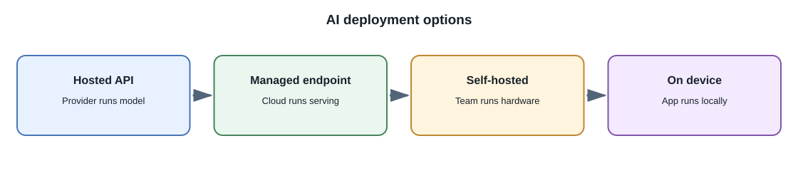
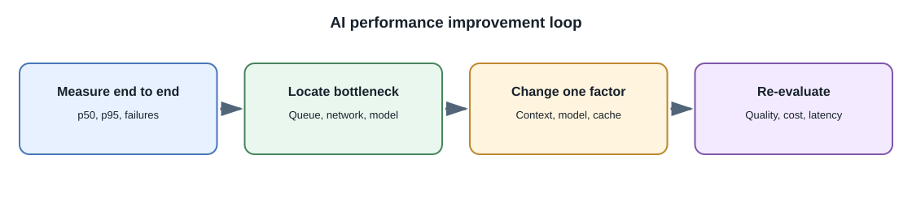

# Deploying AI Features: Cost and Performance

## Introduction

An AI feature's production behavior depends on more than model quality.
Deployment design determines response time, availability, cost, capacity,
privacy boundaries, and the user's experience when a dependency fails.

## Where inference can run

| Deployment | Operator responsibilities | Common fit |
|---|---|---|
| Hosted provider API | Credentials, quotas, timeouts, provider policy, fallback | Fast product iteration without model-serving infrastructure |
| Local workstation | Runtime, model files, hardware, local security | Learning and individual offline use |
| Self-hosted GPU service | GPU capacity, scaling, drivers, model serving, monitoring, upgrades | Controlled workloads with suitable operations expertise |
| Hybrid | Routing, data classification, consistency, multiple failure paths | Different privacy, latency, or capability needs by task |

Choose based on measured requirements, not only a claim that one model or
hardware type is faster or cheaper.

## Latency

Interactive latency includes network connection time, provider queueing,
prompt processing, output generation, and application work. Longer prompts
and generated responses generally require more processing. Measure
percentiles such as p50, p95, and p99 rather than only the average.

Possible improvements include:

- remove irrelevant prompt history and context;
- retrieve fewer, more relevant passages;
- stream partial output when the user benefits and the workflow permits it;
- use a smaller suitable model for simpler tasks;
- run independent requests concurrently when safe;
- move long work to background jobs;
- cache only with correct user, model, prompt, and freshness boundaries.

For generated text, distinguish **time to first token** from time to
completion and tokens per second. A system can begin streaming quickly but
take a long time to finish. For retrieval, record query embedding, search,
reranking, and generation stages separately so optimization targets the
actual bottleneck.

## Cost model

Hosted costs may depend on input and output tokens, model tier, modality,
tool use, cached input, or other provider-specific units. Self-hosted costs
include accelerators, idle capacity, storage, power, engineering, and
operations.

Track cost per completed task, not just cost per model request. A workflow
that retries several times or sends huge context may be expensive even when
one individual call looks cheap.

As a simplified estimate, multiply the expected input and output token
counts by the published rates for the chosen model and account for any
provider-specific units, tiers, or caching rules. Then include retries,
failed requests, embeddings, retrieval, storage, and monitoring. Recheck
current provider pricing rather than copying a rate into application code.

## Reliability and capacity

Model providers and self-hosted servers can fail, throttle, return malformed
outputs, or exceed deadlines. Define:

- timeouts at each network boundary;
- bounded retries with backoff and jitter where safe;
- concurrency and queue limits;
- cancellation and partial-result behavior;
- fallbacks or a clear unavailable state;
- alert thresholds and a rollback plan.

Avoid unbounded queues and automatic retries for side-effecting operations.
Protect downstream systems with bulkheads and quotas so one model feature
cannot exhaust all application capacity.

Rate limits can apply to request count, token throughput, concurrent
requests, or a provider-specific quota. A queue absorbs short bursts but
does not create unlimited capacity: bound queue length, apply backpressure,
and report overload rather than allowing jobs to wait indefinitely.

## Caching

Caching model responses can reduce latency and cost for identical safe
requests, but it can also leak private results or serve stale information.
Use a key that includes all relevant input, model, prompt version, tenant,
permission scope, and data version. Do not cache personalized or sensitive
responses in a shared cache unless isolation and policy are correct.

## Full-stack example

A study application can run short note questions synchronously and submit
large audio transcription as a background job. The UI shows job status and
allows cancellation. The backend enforces per-user usage limits and stores
the result only after validation. If the provider times out, the job reports
a retryable failure rather than pretending transcription succeeded.

## Developer perspective

Before launch, test realistic load, long inputs, provider throttling, slow
responses, cancellation, and dependency outages. Budget by feature and
tenant, and make model usage visible to operations without exposing private
content.

## Common misconceptions

- A faster token-generation rate does not guarantee lower end-to-end
  latency.
- Local inference is not automatically cheaper at low utilization.
- Retrying a failed request can incur another charge or duplicate an action.
- Streaming improves perceived responsiveness but does not necessarily
  reduce total computation.

## Further learning

- [Google Cloud: Generative AI architecture](https://cloud.google.com/architecture/gen-ai)
- [OpenAI API: Rate limits](https://platform.openai.com/docs/guides/rate-limits)
- [OpenTelemetry documentation](https://opentelemetry.io/docs/)
