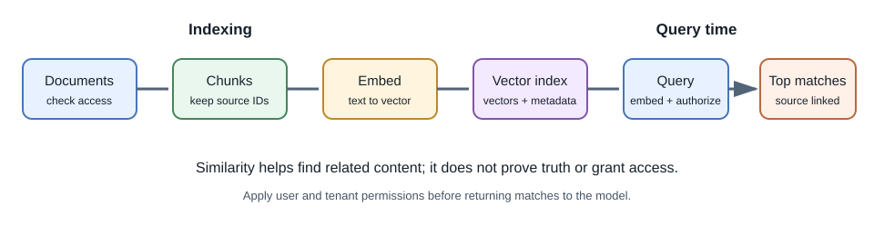

# Embeddings and Vector Search

## Introduction

An **embedding** is a numeric vector produced by a model to represent an
input, such as a sentence, document, image, or audio segment. A **vector
search** system finds vectors that are near a query vector according to a
chosen similarity measure.

Embeddings are useful for semantic retrieval: texts with related meanings
can be close even when they do not share the exact same keywords. They are
not universal representations of truth or meaning; behavior depends on the
embedding model and task.

## Why do embeddings exist?

Keyword search is effective for exact names, identifiers, and phrases, but
can miss a paraphrase. An embedding model maps input to a vector space where
some semantically related inputs may be nearby. A vector index makes it
practical to search these representations across a collection.

## Typical indexing and query flow

1. Select content the user is permitted to search.
2. Split documents into chunks that preserve enough context and useful
   boundaries.
3. Generate an embedding for each chunk and store it with the source ID,
   version, and access metadata.
4. At query time, apply the same embedding model to the user's query.
5. Search for nearby vectors, optionally combine with keyword search, and
   filter results by access, tenant, and freshness.
6. Return relevant passages to the application or a generation step.

## Similarity and approximate search

Common comparison methods include cosine similarity, dot product, and
Euclidean distance. Which one is appropriate depends on the embedding
model's training and whether vectors are normalized. Do not mix vectors
generated by different embedding models or incompatible versions in one
index without a deliberate migration.

Exact nearest-neighbor search compares against all candidate vectors and
can be expensive at scale. Approximate nearest-neighbor indexes trade some
recall for faster lookup. Tune them using representative data and measure
whether relevant items are actually found.

## Chunking and metadata

Chunk size and overlap affect retrieval. Tiny chunks may lose context; huge
chunks can dilute relevance and consume more model context. There is no
universal best size. Evaluate retrieval on questions whose expected sources
are known.

Store enough metadata to display and authorize results: document ID,
section/title, chunk location, owner/tenant, source version, and update
time. Apply authorization filters during retrieval, not only after

For example, a short API reference may work well as one chunk per endpoint
with its HTTP method and heading attached. A long policy document may need
paragraph-sized chunks that retain the section title and effective date.
Measure on questions with known evidence instead of selecting chunk size
by habit. Apply authorization filters during retrieval, not only after
generating an answer.

## Hybrid search and reranking

**Hybrid search** combines vector similarity with lexical search. It can
improve cases where exact terms such as product codes or legal names matter.
A **reranker** evaluates a smaller candidate set and reorders it for a
query. These components add cost and latency, so measure whether they
improve retrieval quality for the task.

Vector search can be implemented with a dedicated vector service or a
database extension alongside application data. A dedicated service may
offer specialized indexing and scaling; a relational database extension
can keep metadata and application records close together. Evaluate
filtering, backup, update, deletion, index rebuild, and operational needs.
The best choice depends on workload and the team's ability to operate it,
not on a product label.

## Full-stack example: personal notes

When a user asks "What did I decide about the database migration?", the
backend embeds the question and searches only the user's permitted notes.
It returns note titles, dates, and relevant excerpts. If those results feed
an LLM, include stable source identifiers so the UI can link every claim
back to the note.

## Developer perspective

Vector search is a retrieval component, not a replacement for a primary
database, access-control system, or backup strategy. Decide how updates,
deletions, model-version changes, tenant filtering, and index rebuilds work.

## Common misconceptions

- Similarity is not proof that a document answers the question.
- Vector search does not automatically provide citations or authorization.
- A vector database does not train the embedding model.
- The same text embedded by different models can produce incompatible
  vectors.

## Further learning

- [OpenAI: Embeddings guide](https://platform.openai.com/docs/guides/embeddings)
- [Sentence Transformers documentation](https://www.sbert.net/)
- [pgvector documentation](https://github.com/pgvector/pgvector)
