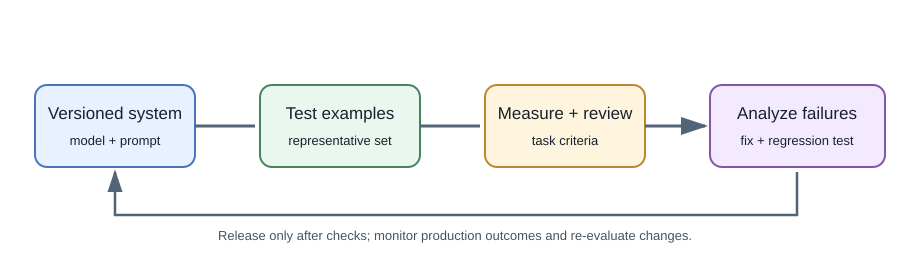
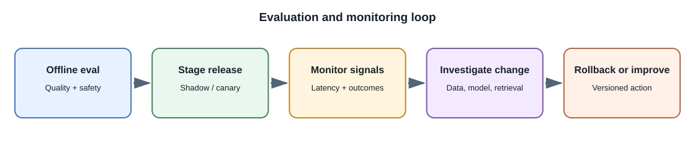

# Evaluating and Monitoring AI Systems

## Introduction

**Evaluation** measures whether an AI system performs the task it was built
for. **Monitoring** checks how the deployed system behaves over time.
Model evaluation is not one benchmark score: the application includes
prompts, retrieval, tools, backend rules, and user experience.

## Why evaluate the complete system?

A strong base model can still fail because the application retrieved the
wrong document, truncated key context, used an unclear prompt, or displayed
an unsupported answer. Evaluate components separately and test the whole
workflow.

## Build a task evaluation set

1. Define what success means in user or business terms.
2. Collect representative inputs with expected outcomes or review criteria.
3. Include edge cases, ambiguous requests, empty or malformed inputs, and
   cases where the correct answer is to refuse or ask for clarification.
4. Keep evaluation examples separate from examples used to tune prompts or
   models.
5. Document how each example is scored and who reviews disagreements.

## Useful evaluation dimensions

| Dimension | Example check |
|---|---|
| Task success | Did extraction return the required fields correctly? |
| Factual support | Is each factual claim supported by supplied sources? |
| Retrieval quality | Were the expected authorized passages retrieved? |
| Format validity | Does output conform to the required schema? |
| Safety and policy | Did the system refuse prohibited requests appropriately? |
| Robustness | What happens with typos, long input, prompt injection, or missing data? |
| Fairness and accessibility | Are error rates or usability different across relevant groups? |
| Performance | What are latency percentiles, timeouts, and completion rates? |
| Cost | What is the input/output usage and cost per completed task? |

Automated judges can help triage large output sets but can have their own
biases and failure modes. Use human review for important decisions and
validate automated scoring against people.

## Monitor production behavior

Track model and prompt versions, request volume, latency, failures, token
usage, refusal rate, output validation errors, retrieval coverage, and user
correction or escalation rates. Avoid recording secrets, sensitive prompts,
or personal data unless there is a clear approved need and retention policy.

Monitor quality with privacy-preserving samples and user feedback. A model
provider may change a model version, a document collection may become stale,
or user behavior may shift. Establish thresholds for investigation and a
rollback or fallback path.

## Regression testing

Before changing a prompt, model, retrieval strategy, or provider, run the
same evaluation set against the current and proposed versions. Compare
quality, safety, cost, and latency. A version that improves the average can
still introduce a severe regression on a critical case.

For deterministic parts, use ordinary unit and integration tests. Reserve
model-based tests for behavior that genuinely depends on model inference,
and do not make a single exact wording the only pass condition when multiple
answers can be valid.

### Evaluate retrieval and generated answers separately

For a RAG feature, retrieve a set of known questions and expected passages.
Check whether the expected source appears near the top of results before
grading the generated answer. Then check whether each important claim is
supported by a returned passage and whether the citation resolves to the
right location.

For a structured extraction task, score field-level correctness and
schema-validity separately. For a classifier, inspect the confusion matrix,
threshold behavior, and error slices relevant to the product. One overall
score can hide a serious failure on a smaller but important group.

### Human and automated graders

An automated grader can compare an answer with a rubric or reference, which
can speed iteration over many cases. It can also reward style instead of
correctness, miss subtle unsupported claims, or share biases with the
system being tested. Calibrate graders against human-reviewed samples and
use human review for high-impact decisions.

## Full-stack example

For a note assistant, evaluate whether answers cite the correct note,
whether inaccessible notes remain hidden, whether no-answer cases are
handled honestly, and whether the feature responds within an acceptable
time. Record which retrieval and model versions produced a result so a
reported failure can be investigated.

## Common misconceptions

- A public leaderboard may not predict quality on your task.
- A successful API response is not a successful user outcome.
- One human rating or one golden example is not enough to establish
  reliability.
- Monitoring every raw prompt is not required and may create privacy risk.

## Further learning

- [HELM: Holistic Evaluation of Language Models](https://crfm.stanford.edu/helm/)
- [NIST AI Risk Management Framework](https://www.nist.gov/itl/ai-risk-management-framework)
- [OpenAI: Evals guide](https://platform.openai.com/docs/guides/evals)
