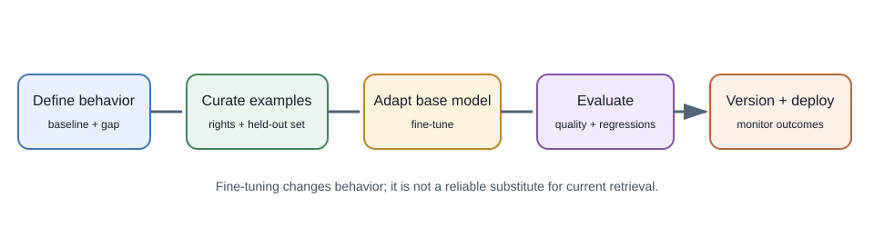
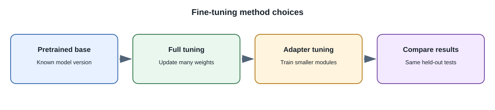

# Fine-Tuning

## Introduction

**Fine-tuning** continues training a pretrained model on a smaller,
task-specific dataset. The training updates some or all of the model's
parameters so its behavior better matches examples or a desired objective.
Many hosted providers offer managed fine-tuning for selected models; local
fine-tuning is also possible with suitable hardware and tooling.

Fine-tuning changes model behavior. It is not the same as adding documents
to a prompt or retrieving current information at request time.

## Why fine-tune?

Fine-tuning can help when a model repeatedly needs a specialized style,
format, vocabulary, or task behavior and prompting alone is not consistent
enough. It can be useful for classification, extraction, or domain-specific
response patterns when high-quality examples exist.

It is usually a poor first choice for facts that change frequently,
user-specific permissions, or a reference library that needs citations. Use
application code or retrieval for those needs.

## Fine-tuning workflow

1. Define measurable behavior that prompting and application logic do not
   adequately provide.
2. Select a base model and verify its supported fine-tuning method, license,
   and data terms.
3. Curate representative input-output examples with permission and remove
   secrets or unnecessary personal information.
4. Split training and evaluation data before tuning; prevent near-duplicate
   examples from leaking between sets.
5. Train an adapted model, often using a provider-managed service or a
   parameter-efficient method such as Low-Rank Adaptation (LoRA).
6. Compare the result against the base model and baseline prompts using the
   same held-out task set.
7. Deploy a versioned model with a rollback plan and monitor failures,
   latency, and cost.

## Data quality and evaluation

The training examples demonstrate desired behavior, so incorrect,
inconsistent, or unrepresentative samples can teach the wrong pattern.
Include diverse realistic inputs, edge cases, refusals where appropriate,
and examples of missing information. Keep a separate test set that is not
used to select the tuning configuration.

Evaluate the base and fine-tuned model on the same examples. Measure the
task outcome, regression cases, safety behavior, and operating cost. A
model can improve the preferred style while becoming worse at another
capability.

## Common tuning approaches

- **Full fine-tuning:** update many or all model parameters. This can require
  significant compute and storage.
- **Parameter-efficient fine-tuning:** update a smaller set of parameters
  or add small trainable components. LoRA is a common example.
- **Instruction fine-tuning:** train on instruction and response examples
  to improve instruction-following behavior.
- **Preference optimization:** use preference signals to change which
  outputs are favored. Methods and data requirements differ.

Provider interfaces and terminology vary. Do not assume a method available
for one model is available for another.

### Supervised fine-tuning and preference methods

**Supervised fine-tuning (SFT)** trains on examples of the desired input
and output. The examples should cover the real range of input, including
ambiguity, missing information, and valid refusal cases. If examples
contain one narrow style or only easy cases, the resulting model may
overfit that pattern.

**LoRA** adds trainable low-rank matrices to selected model layers while
leaving most base weights fixed. The resulting adapter is smaller than a
full copy of updated weights and can be combined with a compatible base
model. **QLoRA** combines quantized base weights with trainable adapters to
reduce training memory needs; it still needs compatible hardware and
careful evaluation.

**Preference optimization** uses comparisons or preference signals to
encourage favored outputs. **RLHF** commonly uses human preference data
and a reinforcement-learning stage; **DPO** is one approach that optimizes
from preference pairs without the same explicit reinforcement-learning
loop. These are training methods, not guarantees of correctness or
alignment. Data quality, reward definitions, and held-out testing still
matter.

| Method | What is updated or optimized? | Practical trade-off |
|---|---|---|
| SFT | Model behavior from example responses | Straightforward when target examples are clear; sensitive to example quality |
| LoRA / QLoRA | Small adapter parameters with a compatible base model | Lower training memory or artifact size in some setups; runtime and compatibility still matter |
| Preference optimization | Relative preference between candidate outputs | Needs reliable comparisons and checks for unintended reward behavior |
| Full fine-tuning | Broad model parameters | Flexible but resource-intensive and harder to version and serve |

## Fine-tuning versus RAG and prompting

| Approach | Changes model weights? | Best suited for |
|---|---:|---|
| Prompting | No | Instructions, examples, temporary task context |
| RAG | No | Current, private, or cited reference information |
| Fine-tuning | Yes | Repeated behavior or output patterns supported by training examples |
| Training from scratch | Yes, from initialization | Research or a genuinely unique foundation-model effort with substantial resources |

These approaches can be combined, but complexity should be justified by
evaluation results.

Fine-tune only after collecting a baseline set of failures. For example,
if a model can answer correctly when given a document but retrieves an
outdated policy, improve retrieval and freshness first. If it repeatedly
returns the wrong schema despite valid context and a tested prompt, a
behavior-focused tuning experiment may be worth comparing.

## Full-stack example

A company wants support-ticket classifications in a stable internal
taxonomy. First test an existing model with a clear prompt and constrained
label schema. If it still makes costly, repeatable errors and a curated
authorized dataset is available, fine-tuning may be worth evaluating. The
backend must still validate that the returned label is allowed and route
low-confidence or high-impact cases for review.

## Developer perspective

Treat fine-tuning as a model build and deployment pipeline. Version the
dataset, training configuration, base model, adapted model, and evaluation
results. Check data rights and retention terms before uploading examples to
a third-party training service.

## Common misconceptions

- Fine-tuning does not guarantee exact recall of the examples.
- Fine-tuning is not a reliable way to provide frequently changing
  knowledge.
- More training examples do not always improve results.
- Fine-tuning does not replace authorization, output validation, or safety
  testing.

## Further learning

- [OpenAI: Fine-tuning guide](https://platform.openai.com/docs/guides/fine-tuning)
- [Hugging Face PEFT documentation](https://huggingface.co/docs/peft/)
- [LoRA: Low-Rank Adaptation of Large Language Models](https://arxiv.org/abs/2106.09685)
