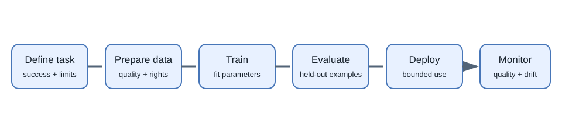
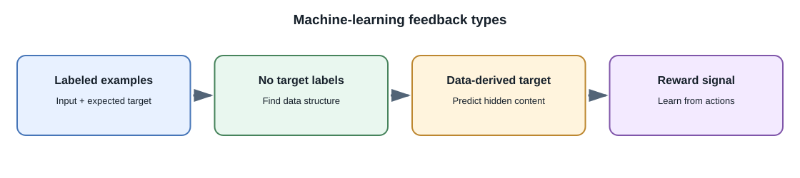

# AI and Machine-Learning Fundamentals

## Introduction

**Artificial intelligence (AI)** is the broad area of building systems that
perform tasks associated with capabilities such as perception, language,
planning, or decision-making. **Machine learning (ML)** is a family of
methods where a system learns patterns from data rather than relying only on
rules written by a programmer. **Generative AI** produces new content, such
as text, images, audio, or code.

The terms overlap, but they are not synonyms. A hand-written rule that
rejects an invalid password is software logic, not necessarily machine
learning. A spam classifier trained from labeled messages is machine
learning. A chat model that generates a reply is generative AI.

## Why does machine learning exist?

Some tasks are difficult to specify as a complete list of rules. It is
usually impractical to write a rule for every phrasing of a question, every
appearance of an object in a photo, or every pattern in a large dataset.
Learning methods estimate patterns from examples and apply them to new
inputs.

This shifts work rather than removing it: developers and data practitioners
must choose data, objectives, evaluation criteria, deployment boundaries,
and safeguards. A learned model can fail in ways a simple explicit rule
would not.

## A simple model workflow

1. **Define a task:** for example, classify a support message as billing,
   shipping, or other.
2. **Collect representative examples:** gather messages and correct labels
   with permission and appropriate privacy controls.
3. **Choose a model and objective:** select how the system should convert an
   input into a prediction and how errors are measured.
4. **Train or configure:** adjust model parameters from training examples,
   or use an existing model with a prompt or other application logic.
5. **Evaluate on held-out examples:** measure performance on data not used
   to fit the model.
6. **Deploy with safeguards:** monitor quality and allow a safe fallback or
   human review for uncertain or high-impact decisions.

For a generative model, the flow is similar but the output can have many
valid forms. Evaluation often combines automated checks, human review, and
task-specific tests.

## Important learning terms

| Term | Meaning |
|---|---|
| **Example** | One input and, in supervised learning, its expected target or label |
| **Feature** | Information used by a model as input; for example, structured fields or a learned representation |
| **Label/target** | Expected answer used for supervised training |
| **Parameter** | A value learned by a model during training |
| **Training** | Adjusting parameters to reduce an objective on training data |
| **Inference** | Using a trained model to produce a prediction or generated output |
| **Dataset** | A collection of examples used to train, validate, or test a system |
| **Generalization** | How well the learned system works on examples beyond its training data |
| **Hallucination** | A plausible-looking generated claim that is unsupported or incorrect |

Training a model is different from prompting it. A prompt provides input to
an already trained model during inference; it does not normally update the
model's learned parameters.

## Main learning setups

- **Supervised learning:** learn from input-output examples, such as labeled
  categories or known numeric targets.
- **Unsupervised learning:** find structure in data without a supplied
  target for every example, such as clustering similar items.
- **Self-supervised learning:** create training targets from the data itself.
  Predicting hidden or next tokens is a common way to train language models.
- **Reinforcement learning:** learn a policy from actions and reward signals
  while interacting with an environment. It is used in control and can also
  be part of model post-training.

These are broad categories. Real systems may combine several stages and
objectives.

## Real-world examples

- A bank may use a risk model to prioritize transactions for additional
  review. The model's score should be one controlled input to a governed
  decision process, not a reason to ignore regulations or appeal paths.
- A government service may use document classification to route a form to
  the right team. Human review can handle ambiguous cases.
- A video service may recommend content using learned user and item
  representations alongside explicit ranking rules.
- A full-stack developer may call a language model to draft a support
  response, then require a support agent to approve it.

These examples describe common application patterns. They do not claim that
every organization uses the same model or decision process.

## Developer perspective

Treat a model as a probabilistic component with an input contract, output
contract, latency, cost, failure modes, and a version. Put deterministic
validation and authorization in ordinary application code. Do not let a
language model decide whether a user is authorized to access a database
record.

## Common misconceptions

- AI does not always mean a neural network or a chatbot.
- A model that performs well on training examples may still fail on new or
  changed data.
- More data is not automatically better; incorrect, unrepresentative, or
  unauthorized data can make a system worse.
- A fluent response is not evidence that it is true.
- Using an AI API is model inference, not training your own model.

## Further learning

- [Google Machine Learning: Problem Framing](https://developers.google.com/machine-learning/problem-framing)
- [Google Machine Learning: Data preparation](https://developers.google.com/machine-learning/data-prep)
- [NIST AI Risk Management Framework](https://www.nist.gov/itl/ai-risk-management-framework)
