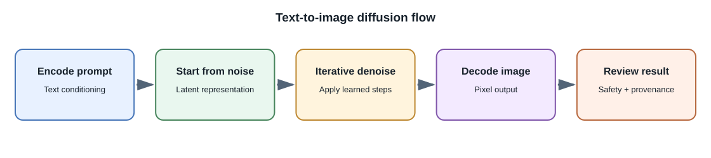
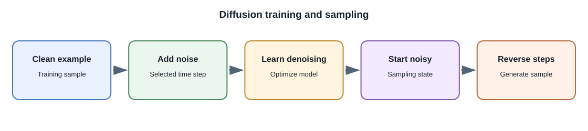

# Generative Models and Diffusion

## Introduction

A **generative model** learns patterns in data and can produce new samples
that resemble those patterns. Language models generate token sequences;
image-generation systems can generate or edit images; audio and video
systems operate on their supported media representations. Generation is
probabilistic and does not guarantee factuality, originality, or permission
to use an output.

## Families of generative models

| Family | Broad idea | Example applications |
|---|---|---|
| Autoregressive models | Predict the next element conditioned on previous elements | Text, code, image or audio token generation |
| Variational autoencoders (VAEs) | Learn a compressed latent representation and decode samples from it | Image reconstruction and latent representations |
| Generative adversarial networks (GANs) | Train a generator against a discriminator in a competitive setup | Image synthesis and domain-specific generation |
| Diffusion models | Learn to reverse a gradual noising process | Image, audio, and video generation |
| Flow-based models | Learn an invertible mapping between a simple distribution and data | Density estimation and sample generation |

This table is an orientation, not a ranking. Modern systems may combine
families or use tokenized representations of images, audio, or video.

## How diffusion generation works

During a simplified training process, a clean example is progressively
corrupted with noise. A neural network learns to estimate or remove noise
at different steps. During generation, the system starts from noise and
iteratively applies learned denoising steps to form a sample.

Text-to-image systems commonly encode a prompt, condition generation on
that representation, and decode a generated latent into an image. Some
systems use **latent diffusion**, applying denoising in a compressed latent
space rather than directly over every image pixel. This can reduce
computation, though exact designs differ.

## What controls generation?

- **Prompt or conditioning input:** describes the desired content or style.
- **Seed:** may make a particular sampling path reproducible for a given
  implementation and settings; it does not make systems identical across
  versions or hardware.
- **Guidance scale:** controls how strongly generation follows some
  conditioning mechanisms; excessive guidance can reduce quality.
- **Steps or sampler:** influence the iterative generation process and its
  latency-quality trade-off.
- **Reference inputs and masks:** support editing, inpainting, or
  image-to-image workflows where offered.

The names and effects of controls vary by model and product. Validate
results with the target task rather than assuming a setting has universal
behavior.

## Real-world applications

Creative teams may use image generation for ideation, storyboards, or
draft assets. Product teams may generate controlled illustrations or
personalized imagery. Speech and video systems can help create or
transform media. In each case, users need a clear distinction between
generated, edited, and captured content.

## Developer perspective and safeguards

Build a media workflow that checks file type and size, scans uploads,
limits output dimensions and duration, stores provenance metadata, and
provides a human review path. Address licensing, consent, impersonation,
content moderation, and applicable disclosure requirements. Do not imply
that a generated image is a photograph or that the system can establish
who created a source image.

## Common misconceptions

- Diffusion is not simply copying a nearest training image.
- A fixed seed does not guarantee identical results in every environment.
- A generated image is not evidence that the depicted event occurred.
- A polished sample does not establish that the model is safe for every
  group or commercial use.

## Related lessons

- [Model Types and Capabilities](model-types-and-capabilities.md)
- [Speech and Multimodal AI](speech-and-multimodal-ai.md)
- [Security, Privacy, and Responsible AI](security-privacy-and-responsible-ai.md)

## Further learning

- [Hugging Face Diffusers documentation](https://huggingface.co/docs/diffusers/)
- [Stanford CS236: Deep Generative Models](https://deepgenerativemodels.github.io/)
