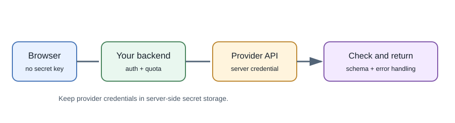
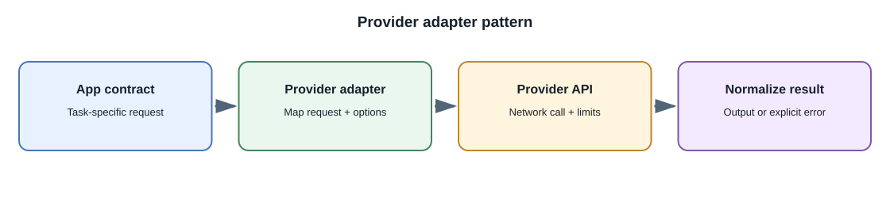

# Hosted Model APIs

## Introduction

A hosted model API lets an application send an input to a provider's
infrastructure and receive a model output. The provider operates model
inference hardware and exposes a network API; your application remains
responsible for user authentication, authorization, input validation,
product behavior, and error handling.

## Why use a hosted API?

Hosted APIs let a team test a feature without buying GPUs or operating model
servers. They can provide managed scaling, multiple model choices, streaming,
structured output, and tool-calling interfaces. In return, the application
depends on network availability, provider limits and policies, pricing, and
the provider's model lifecycle.

## Request flow





1. The browser sends the user's request to your application backend.
2. The backend verifies the user's identity and permissions, validates and
   limits the input, and selects an allowed model and prompt.
3. The backend calls the provider using a server-side credential.
4. The provider returns a result, a structured tool call, a refusal, or an
   error.
5. The backend validates the result and applies product rules before
   returning it to the browser.

Do not call a paid provider directly from a public browser application with a
long-lived secret key. Anyone can inspect browser-delivered code and reuse
the credential. Keep keys on a server or in a provider-approved secure
environment, restrict their permissions, and rotate them if exposed.

## A provider-neutral integration shape

The exact SDK differs by provider. A good application boundary hides that
difference behind an internal service:

```text
Browser -> POST /api/assistant -> authentication + validation
        -> model adapter -> provider API
        <- validated result <- model adapter
```

The backend should set limits for input size, output size, and request time.
Use a provider's official SDK or documented HTTP API, handle non-success
responses, and avoid logging secrets or unnecessary user content. Use a
queue for work that does not need to complete within an interactive request.

## Credentials and environment configuration

Keep credentials outside source control, for example in environment
configuration for local development and a secret manager in production.
Never commit `.env` files containing real keys. A `.env.example` should
contain placeholders only.

Use separate credentials for development and production where possible.
Apply least privilege, usage limits, alerts, and rotation. A key placed in a
frontend environment variable that is compiled into JavaScript is public,
regardless of its variable name.

## Provider choice and model changes

Compare providers using representative task tests, not a single demo.
Consider:

- output quality for your language and task;
- data retention, training use, residency, and contractual controls;
- price units, minimum charges, and rate limits;
- response latency, streaming, uptime, and incident reporting;
- supported modalities, structured outputs, and tool calling;
- model versioning, deprecation notice, and migration options.

Put a provider adapter behind an application interface so model names and
provider-specific request formats do not spread through the codebase. This
does not make providers interchangeable automatically; differences in
quality, safety behavior, and tools still require testing.

## Failures and retries

Plan for timeouts, rate limits, transient errors, provider outages,
malformed outputs, and refusals. Use bounded retries only where safe; a
retry can repeat a billable operation. Respect `Retry-After` when supplied
and apply backoff with jitter. For non-idempotent actions, use an application
request identifier or idempotency design.

Return a helpful failure or fallback when the provider is unavailable.
Never turn a failed model call into a success-shaped empty answer.

## Real-world example

A support dashboard can ask a hosted model to draft a response from a
sanitized ticket summary. The support agent reviews and sends it. The model
should not be given unrelated customer records, and it should not send a
response itself unless the product explicitly authorizes that workflow.

## Developer perspective

Treat model-provider access like any external dependency: secure credentials,
timeouts, quotas, observability, and versioned contracts matter. Keep
authorization and business rules in your application, not only in the
prompt.

## Common misconceptions

- An API key is not safe just because it is hidden in frontend source code.
- A provider response is untrusted input; parse and validate it.
- The model does not inherit your user's access permissions.
- Moving from one provider to another requires quality and behavior
  evaluation, not only replacing a URL.

## Further learning

- [OpenAI API documentation](https://platform.openai.com/docs/overview)
- [Google Gemini API documentation](https://ai.google.dev/gemini-api/docs)
- [Anthropic API documentation](https://docs.anthropic.com/)
- [OWASP Secrets Management Cheat Sheet](https://cheatsheetseries.owasp.org/cheatsheets/Secrets_Management_Cheat_Sheet.html)
