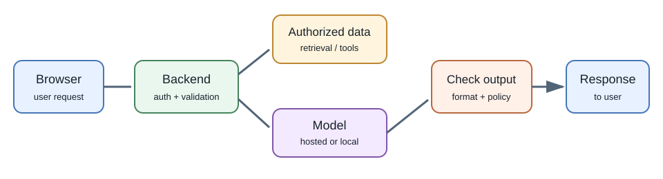
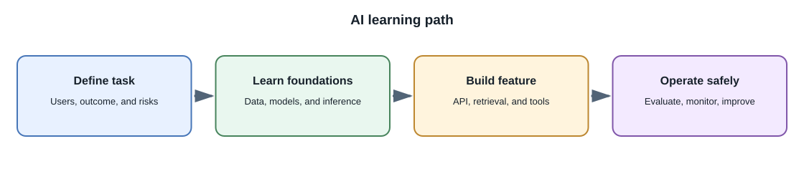
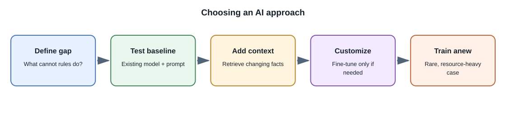

# AI and Machine Learning

Artificial intelligence is a broad field; it is not one model, one company,
or one API. This module explains how modern AI systems work, how to choose
between hosted and local models, and how to build useful features into
full-stack applications without treating model output as automatically
correct.

The learning path moves from foundations to implementation: understand
machine learning and transformers, compare model types, try a hosted API or
a local model, then build applications with prompting, retrieval, tools,
evaluation, and production safeguards. Training a large model from scratch
is included so you can understand what it requires and when it is
unnecessary.

## What this module covers

- **Foundations:** artificial intelligence, classical machine learning,
  practical mathematics, neural networks, transformers, tokens, inference,
  and language models.
- **AI inputs and formats:** computer-vision tasks, how raster and vector
  images, audio streams, video containers, codecs, frames, and timestamps
  become model inputs.
- **Model choices:** chat and reasoning models, coding models, image and
  video generation, speech, embeddings, classifiers, recommendation, and
  multimodal systems.
- **Ways to use models:** hosted model APIs, self-hosted endpoints, and local
  models for learning, privacy, or offline work.
- **Application patterns:** chat assistants, note search, structured output,
  tool calling, agents, MCP integrations, embeddings, vector search, and
  terminal or operating-system tools with explicit permission boundaries;
  task-based model routing; and controlled web-page retrieval.
- **Customization:** prompt design, retrieval, fine-tuning methods such as
  LoRA, domain-specific training approaches, and training models from
  scratch, with their different costs and purposes.
- **Production practice:** evaluation, safety, privacy, security, latency,
  cost, model serving, MLOps, monitoring, prompt-injection defenses, and
  human review.
- **Hands-on preparation:** small labs with expected outputs and focused
  project briefs that explain which skills each project practices,
  including a small-scale image-model training walkthrough.

## Core concepts checklist

Use this as a map of the essential ideas the lessons aim to teach. It is a
navigation aid, not a claim that one module can cover every research paper,
model, or provider feature.

| Area | Concepts to understand | Start here |
|---|---|---|
| Learning from data | Supervised, unsupervised, and reinforcement learning; data quality, leakage, generalization, and task metrics | [Machine Learning Foundations](machine-learning-foundations.md), [Data Preparation](ai-data-preparation-and-governance.md) |
| Model foundations | Neural networks, transformers, tokens, embeddings, pretraining, post-training, and inference | [Neural Networks and Transformers](neural-networks-and-transformers.md), [Language Models and Tokens](language-models-and-tokens.md), [Training Models](training-models.md) |
| Model choices | Chat, coding, image, audio, video, multimodal, embedding, classifier, computer-vision tasks, and local or hosted models | [Model Types and Capabilities](model-types-and-capabilities.md), [Practical Computer Vision](computer-vision.md), [Running Models Locally](local-models.md) |
| AI application patterns | Prompting, structured output, model routing, retrieval, RAG, tool calling, agents, MCP, and browser-based retrieval | [Building AI Features](building-ai-applications.md), [RAG](retrieval-augmented-generation.md), [Tool Calling and Agents](tool-calling-and-agents.md) |
| Model customization | Prompt design, continued pretraining, fine-tuning, preference methods, and training from scratch—and when not to use them | [Fine-Tuning](fine-tuning.md), [Training Models](training-models.md) |
| Trust and production | Prompt injection, authorization, privacy, evaluation, monitoring, reliability, cost, and model lifecycle | [AI Security](security-privacy-and-responsible-ai.md), [Evaluation and Monitoring](evaluation-and-monitoring.md), [MLOps](mlops-and-model-lifecycle.md) |
| Media and practice | Image, audio, and video inputs; a small image-classifier training walkthrough; small exercises and optional project steps | [Practical Computer Vision](computer-vision.md), [Small-Scale Model Training](small-scale-model-training.md), [Hands-On Labs](hands-on-labs.md) |

## Learning path

1. Start with [AI and machine-learning fundamentals](fundamentals.md), then
   learn [machine learning and deep learning](machine-learning-foundations.md),
   [mathematics for machine learning](mathematics-for-machine-learning.md),
   and [AI data preparation and governance](ai-data-preparation-and-governance.md).
2. Study [neural networks and transformers](neural-networks-and-transformers.md)
   and [language models and tokens](language-models-and-tokens.md), then
   understand [inference and decoding](inference-and-decoding.md).
3. Compare [model types and capabilities](model-types-and-capabilities.md),
   [generative models and diffusion](generative-models-and-diffusion.md),
   [practical computer vision](computer-vision.md),
   [speech and multimodal AI](speech-and-multimodal-ai.md), and
   [media formats for AI](media-formats-for-ai.md).
4. Choose how to run a model: use a [hosted model API](hosted-model-apis.md)
   or [run a model locally](local-models.md); learn about
   [model serving](model-serving-and-inference.md).
5. Learn [prompting and structured output](prompting-and-structured-output.md),
   then build [AI features in full-stack applications](building-ai-applications.md).
6. Add knowledge with [embeddings and vector search](embeddings-and-vector-search.md)
   and [RAG](retrieval-augmented-generation.md), then study
   [advanced RAG design](advanced-rag-design.md).
7. Compare [tool calling and agents](tool-calling-and-agents.md),
   [MCP integrations](mcp-and-agent-integrations.md),
   and [terminal tools and operating-system access](terminal-tools-and-os-operations.md).
   Then compare [fine-tuning](fine-tuning.md) with
   [training a model](training-models.md), and try the
   [small-scale model training walkthrough](small-scale-model-training.md).
8. Prepare for real use with [evaluation and monitoring](evaluation-and-monitoring.md),
   [security and responsible AI](security-privacy-and-responsible-ai.md),
   [MLOps](mlops-and-model-lifecycle.md), and
   [deployment, cost, and performance](deployment-cost-and-performance.md).
9. Try the [hands-on labs](hands-on-labs.md), review
   [industry examples and future directions](industry-examples-and-future.md),
   follow a [step-by-step project learning path](projects.md), and finish with
   [Interview Questions and Answers](interview-questions-and-answers.md).

## Hosted, local, fine-tuned, or trained?

| Approach | What you do | Good starting point | Main trade-off |
|---|---|---|---|
| Hosted API | Send a request to a provider's managed model | Prototype a chat, summarizer, or extraction feature | Fast to integrate, but usage, privacy, availability, and provider terms matter |
| Local inference | Run an existing model on your computer or server | Learn, experiment offline, or keep data on a controlled machine | No per-request API bill, but hardware, speed, quality, and maintenance are your responsibility |
| Fine-tuning | Further train a suitable pretrained model on examples | Teach a repeatable style, format, or narrow task behavior | Needs curated data and evaluation; it does not automatically add current facts |
| Train from scratch | Learn model parameters from a large training corpus | Research or a genuinely unique model/data requirement | Requires enormous data, compute, expertise, evaluation, and ongoing operations |

Most full-stack features should begin with a hosted or already available
model and a small measurable use case. Fine-tune only after prompts,
retrieval, and ordinary application logic have been evaluated. Training a
foundation model from scratch is not a prerequisite for building an AI
product.

## Examples of useful AI features

- Search personal notes by meaning rather than exact words.
- Draft a support reply for a human to approve.
- Summarize a long report with links back to source passages.
- Extract fields from an invoice into a validated schema.
- Help a developer explain code or generate a test draft.
- Transcribe an audio note and make it searchable.
- Create an image from a prompt where licensing and review requirements
  allow it.

These are product patterns, not guarantees of accuracy. Decide what happens
when the model is unsure, unavailable, or wrong.

## How to study this module

Work through one small application end to end. Keep the model call on the
server, use fictional or non-sensitive data, log latency and token usage
without recording secrets, and compare outputs against a small set of
expected examples. Start with the short [hands-on labs](hands-on-labs.md),
then select a project based on which skills you want to practice. Add
retrieval or tools only when a clear test shows they solve a real
limitation.

## Related sections

- [Backend Development](../03-backend-development/index.md) covers APIs,
  authentication, validation, and background jobs used by AI features.
- [Databases](../04-databases/index.md) covers persistent data and the
  relational or document stores surrounding model applications.
- [Application Architecture](../05-application-architecture/index.md)
  covers caching, queues, scaling, and system design.
- [Security and Testing](../09-security-and-testing/index.md) covers
  application security and test fundamentals.
