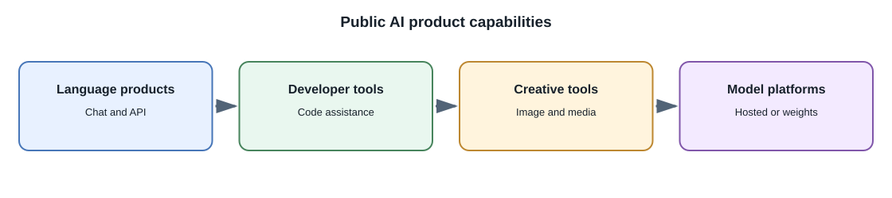
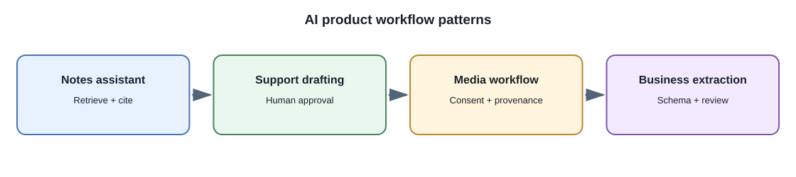

# AI in Products: Examples and Future Directions

## Introduction

AI is used in products as a capability inside a larger workflow, not usually
as a standalone model. A useful way to study examples is to separate the
**model capability** (generation, recognition, ranking, or prediction) from
the **product experience** and the **controls around it**.

Products and model capabilities change quickly. The examples below refer to
public products and documented offerings; they are illustrative, not a
complete market survey or a claim about a company's private internal
systems.

## Public product examples

| Company/product example | Public-facing AI capability | What a developer can learn |
|---|---|---|
| OpenAI ChatGPT and API | Conversational models and developer APIs | General-purpose language interfaces still require application context, safeguards, and evaluation |
| Google Gemini products and API | Text and multimodal model capabilities | A model interface can support multiple input types, subject to model-specific limits |
| Anthropic Claude products and API | Language-model assistant and developer integration | Provider APIs expose model capabilities but have their own policies, versions, and limits |
| GitHub Copilot | Coding assistance integrated into developer workflows | Useful AI is often embedded in an existing editor and review process |
| Adobe Firefly | Generative features for creative workflows | Image generation needs user controls, provenance/licensing consideration, and creative review |
| Meta Llama | Publicly available model family with license terms | Downloadable weights enable local or self-hosted experimentation, subject to the model's terms and hardware needs |

These are examples of companies offering products or models using AI. They
do not establish that a product's output is correct, suitable for every
context, or permitted for every use. Check current documentation, licensing,
privacy terms, and model availability before building on a specific service.

## Common product scenarios

### Chat assistants

A chat assistant can explain a topic, answer questions, or draft text. It
needs bounded context, clear uncertainty behavior, and a way to correct or
escalate a poor answer. For private data, retrieve only records the current
user is allowed to see.

### Notes and document assistants

A notes feature can summarize, classify, or search a user's content. RAG can
provide relevant passages and citations. The application must preserve
ownership, deletion, and source links across extracted text, embeddings, and
caches.

### Coding assistants

A coding assistant can explain code, suggest tests, or propose a change.
Generated code is untrusted: run tests, review dependencies and licenses,
inspect security-sensitive changes, and require human approval before
merging or deploying.

### Image, audio, and video workflows

Image models can help with concept art or asset variants; speech models can
transcribe or synthesize audio; video models can generate or summarize
supported clips. Products need consent, provenance, accessibility, content
moderation, storage controls, and clear expectations about synthetic output.

### Business workflow assistance

Models can extract invoice fields, route support tickets, draft a response,
or summarize an incident. Use schemas and deterministic validation for
fields; keep a human in the loop when errors can materially affect people,
money, rights, or access.

## Where to start as a full-stack developer

Pick a narrow workflow and define what a good result means. A useful first
project is a study-notes assistant:

1. Store a user's notes with ordinary application-level ownership checks.
2. Generate a summary using a hosted API or a local model.
3. Add embeddings and RAG for source-linked questions.
4. Evaluate answers against a small set of questions with known source
   passages.
5. Add usage limits, deletion behavior, and a fallback for model
   unavailability.

Do not begin with a fully autonomous agent if a simple API call or
deterministic workflow solves the problem.

## Future directions to watch

Likely areas of continued development include:

- **Multimodal interaction:** combining text, images, audio, and video in
  one task.
- **Smaller specialized models:** on-device and task-specific inference
  where quality, privacy, and latency justify it.
- **Longer workflows and tool use:** systems that plan and call tools, with
  stronger permission and audit boundaries.
- **Personal and enterprise knowledge:** retrieval over private information
  with increasingly important access-control and provenance requirements.
- **AI-assisted software development:** more generation and review in IDE,
  testing, and deployment workflows.
- **Evaluation and governance:** stronger measurement, traceability, safety
  testing, and regulation as AI affects more consequential decisions.

These are directions, not guarantees. Capabilities, costs, regulation, and
user expectations will change. Good engineering will continue to require
clear requirements, security, testing, accessible design, and human
accountability.

## Developer perspective

Follow official model and product documentation for current features and
terms. Keep AI integrations replaceable, test task quality with your own
data, and explain to users when a result is generated or uncertain.

## Further learning

- [OpenAI platform documentation](https://platform.openai.com/docs/overview)
- [Google Gemini API documentation](https://ai.google.dev/gemini-api/docs)
- [Anthropic documentation](https://docs.anthropic.com/)
- [GitHub Copilot documentation](https://docs.github.com/en/copilot)
- [Adobe Firefly](https://www.adobe.com/products/firefly.html)
- [Meta Llama](https://www.llama.com/)
