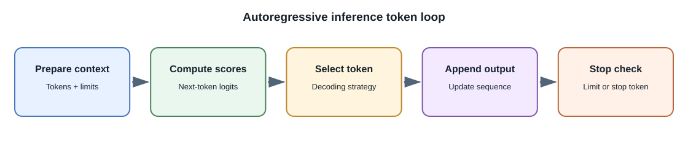
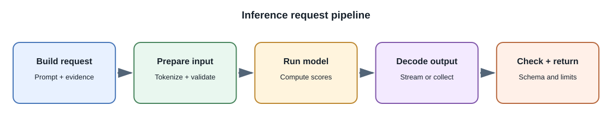

# Inference and Decoding

## Introduction

**Inference** is the process of using a trained model to produce a
prediction or generated result. For a generative language model, inference
usually means repeatedly predicting and selecting the next token until a
stop condition is reached. The model weights are normally fixed during an
ordinary request; fine-tuning or training is a separate process.

## From input to output

1. The application assembles instructions, user input, conversation
   context, and any retrieved evidence.
2. A tokenizer converts supported input into model tokens. The service
   checks the model's context limit and request constraints.
3. The model computes scores, often called **logits**, for possible next
   tokens.
4. A decoding strategy selects a token. The system appends it to the
   sequence and repeats the computation.
5. Generation ends at a stop token, requested stop sequence, output limit,
   cancellation, or provider-specific condition.
6. The application validates the final output before displaying it or
   using it in a workflow.

## Decoding choices

| Setting or method | Purpose | Important caveat |
|---|---|---|
| Greedy selection | Choose the highest-scoring next token | Can be repetitive or overly predictable |
| Temperature | Adjust the sharpness of the score distribution before sampling | Higher temperature increases variation; it does not add knowledge |
| Top-k sampling | Sample from a limited number of high-scoring candidates | A fixed candidate count may behave differently across contexts |
| Top-p sampling | Sample from a probability-ranked set whose cumulative mass reaches a threshold | It changes diversity, not factual grounding |
| Output-token limit | Bound generated length and cost | A short limit can truncate a valid answer |
| Stop sequence | End when a configured sequence is generated | Must be chosen to avoid accidental early termination |
| Constrained decoding | Restrict output to a grammar, schema, or token set | Provider support and schema coverage vary; validate regardless |

These settings are not interchangeable. Use deterministic or constrained
generation for formats that need repeatability, and evaluate quality before
changing sampling for a user-facing task.

## Context window and KV cache

The **context window** limits the input and output tokens the model can
process in one request. System instructions, history, retrieved passages,
tool definitions, and generated tokens all use part of that budget.

During generation, transformer servers may retain intermediate
key/value (**KV**) tensors so they do not recompute the entire prefix for
each new token. This can improve generation efficiency, but KV memory grows
with active sequence length and concurrent requests. Providers may also
offer prompt caching to reduce repeated prefix work; its behavior, cost,
privacy, and cache lifetime depend on the service.

## Streaming

Streaming sends partial output as it is generated. It can improve perceived
latency, but partial text is not a completed or validated answer. A client
must handle disconnects, cancellation, retry policy, and a final completion
or error signal. Do not trigger an external action from partial generated
content.

## Developer perspective

Set explicit time, token, and concurrency limits. Record model and
decoding configuration with evaluation results. Avoid tuning parameters by
intuition alone: use representative prompts and compare task quality,
latency, and cost.

## Common misconceptions

- Temperature does not make a model more intelligent or more accurate.
- A deterministic decode can still return a wrong answer.
- Streaming changes delivery timing, not the model's level of certainty.
- Larger output limits do not make an answer better by themselves.
- Decoding is not training; the model's learned parameters are ordinarily
  unchanged by a request.

## Related lessons

- [Language Models and Tokens](language-models-and-tokens.md)
- [Prompting and Structured Output](prompting-and-structured-output.md)
- [Model Serving and Inference Infrastructure](model-serving-and-inference.md)

## Further learning

- [Hugging Face: Generation strategies](https://huggingface.co/docs/transformers/generation_strategies)
- [Hugging Face: KV cache](https://huggingface.co/docs/transformers/kv_cache)
