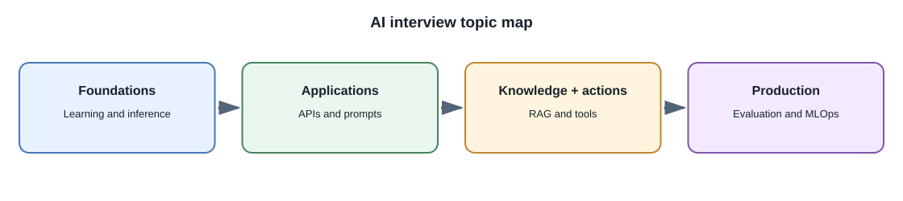
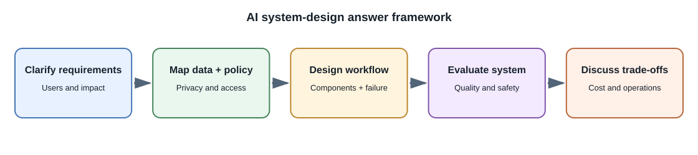

# AI and Machine Learning Interview Questions and Answers

These questions cover AI foundations, application patterns, model
customization, and production engineering. Model capabilities and provider
interfaces change, so verify version-specific details against current
documentation.

## Foundations

### 1. What is the difference between AI, machine learning, and deep learning?

AI is the broad field of systems performing tasks associated with
intelligent behavior. Machine learning is a group of methods that learn
patterns from data. Deep learning is a subset of machine learning based on
multi-layer neural networks.

### 2. What is the difference between training and inference?

Training adjusts model parameters using data and an objective. Inference
uses an already trained model to produce an output for an input. Calling a
hosted model API normally performs inference, not training.

### 3. What is a large language model?

An LLM is a language model with a large learned parameter set, commonly
trained on large text corpora and adapted for tasks such as instruction
following. "Large" does not guarantee correctness, safety, or suitability
for a specific task.

### 4. What is a transformer?

A transformer is a neural-network architecture that uses attention to
process relationships among input elements. Transformer variants are used
for text, images, audio, and multimodal tasks.

### 5. What is attention in a transformer?

Attention computes how representations at different positions should
influence one another. It is a model operation; it is not proof of human-like
understanding or a source citation.

### 6. What is a token?

A token is a model-specific unit of input or output. It may represent a
whole word, part of a word, punctuation, or another piece of data. Token
counts affect context and often cost.

### 7. What is a context window?

The context window is the amount of tokenized input and generated output a
model can process for a request. System instructions, history, tools, and
retrieved documents all consume context.

### 8. What is an embedding?

An embedding is a numeric vector generated from content. Vector search
compares these vectors to retrieve semantically related items. Similarity
does not prove correctness or authorization.

### 9. What is a hallucination?

A hallucination is plausible-looking generated content that is unsupported
or incorrect. Retrieval, validation, and review can reduce specific risks,
but no prompt guarantees truth.

## Using models in applications

### 10. How should a browser application call a hosted model?

Usually through the application's backend. The backend protects credentials,
authenticates and authorizes the user, validates input, applies quotas,
calls the provider, checks the output, and handles errors. A secret key
embedded in frontend code is exposed to users.

### 11. How would you build a chat feature?

Define authentication and conversation ownership, bound the history sent to
the model, set input and output limits, handle streaming and disconnects,
and validate responses. Store conversation state only according to the
product's privacy and retention policy.

### 12. How would you use AI to summarize personal notes?

Authorize access to the notes, send only relevant content, request a
structured summary, validate the result, and preserve links to source
sections. Provide correction and deletion workflows.

### 13. What is structured output?

Structured output asks a model to return data in a defined shape, often
using a schema-constrained provider feature. The application must still
parse and validate the result and enforce business rules.

### 14. What is CORS, and does it protect an AI API?

CORS is a browser-enforced policy controlling whether frontend JavaScript
can read a cross-origin response. It is not authentication or authorization;
the API must protect itself for every client.

### 15. Why should API keys not be placed in frontend code?

Frontend code is delivered to the user's device and can be inspected.
Exposed keys can be copied and used to incur charges or access data. Keep
secrets in a protected backend environment and rotate exposed keys.

### 16. How do you handle provider rate limits and outages?

Use timeouts, respect documented retry guidance, apply bounded backoff with
jitter, limit concurrency, and present a clear fallback or unavailable
state. Retries should not duplicate side effects or silently turn failures
into empty success responses.

## Retrieval and customization

### 17. What is RAG?

Retrieval-augmented generation retrieves relevant external information and
provides it as context to a model for a response. It can ground answers in
current or private sources, but does not guarantee the response follows
those sources.

### 18. What is the difference between RAG and fine-tuning?

RAG supplies information at inference time without changing model weights.
Fine-tuning updates a pretrained model using examples to change behavior.
Use retrieval for changing facts and citations; consider fine-tuning for
repeatable behavior after evaluating simpler approaches.

### 19. How do you evaluate a RAG system?

Measure retrieval quality separately from answer quality. Check whether
expected authorized passages are retrieved, whether answers are supported,
whether citations resolve to real sources, and whether access controls
prevent cross-user leakage.

### 20. Why is chunking important in RAG?

Chunks determine the text units embedded, retrieved, and placed in model
context. Chunks that are too small lose context; chunks that are too large
can reduce relevance and consume more context. Tune them using known
question-source examples.

### 21. What is fine-tuning?

Fine-tuning continues training a pretrained model on a task-specific dataset
to change its behavior. It needs high-quality examples and held-out
evaluation, and may cause regressions in other behaviors.

### 22. When would you train a model from scratch?

Usually only for research or a compelling unique-data or strategic
requirement. Foundation-model training needs substantial data governance,
compute, expertise, evaluation, and operations. Most product teams should
start with an existing model.

### 23. Can fine-tuning make a model know current company documents?

It is not a dependable document lookup or permission mechanism. Documents
change and need traceable retrieval, so RAG or direct application queries
are usually more suitable for current private information.

### 24. How can you run a model without a paid hosted API?

Run a model with available weights locally or on self-managed hardware using
a compatible runtime. This avoids provider per-request charges but still
uses hardware, electricity, disk, setup, and maintenance. Check model
licenses and protect the local endpoint.

## Tools, safety, and production

### 25. What is tool calling?

The model returns a structured request for an application-defined tool. The
backend must validate the tool and arguments, authorize the action, execute
it, and decide what result to return. The model's request is not itself
permission.

### 26. What is an AI agent?

An agent is commonly a model-driven loop that selects actions, observes
results, and continues toward a goal. The term is broad. Bound its steps,
time, cost, and permissions, and prefer deterministic workflows when
possible.

### 27. What is prompt injection?

Prompt injection is untrusted content that attempts to alter model behavior
or override instructions. Treat user input and retrieved documents as
untrusted; keep authorization and tool permissions in application code.

### 28. Why is a system prompt not a security boundary?

The model may follow conflicting or malicious content despite the
instruction. Security-sensitive rules must be enforced by trusted code,
permissions, and data boundaries.

### 29. How do you prevent a model from accessing another user's documents?

Authenticate the user and filter retrieval using server-derived ownership or
tenant permissions before results reach the model. Test cross-user
isolation, cache keys, logs, citations, and deletion flows.

### 30. How do you evaluate generated responses?

Use task-specific representative examples and criteria for factual support,
task completion, formatting, safety, and uncertainty. Combine automated
checks with human review, especially for consequential outcomes.

### 31. What metrics should be monitored in production?

Track latency percentiles, errors, timeouts, rate limits, output validation
failures, token usage, cost per completed task, retrieval coverage, refusals,
and user corrections or escalations. Minimize sensitive content in logs.

### 32. Why is a successful HTTP response not proof of a good AI answer?

HTTP success means the API returned according to its protocol. It does not
mean generated content is true, relevant, safe, or useful. Application
quality needs separate evaluation.

### 33. How would you reduce model latency?

Measure the full request first. Then consider reducing unnecessary context,
using a smaller adequate model, improving retrieval, streaming when
appropriate, or moving long work to background jobs. Test quality and total
cost for each change.

### 34. How would you reduce AI feature cost?

Limit input and output, avoid sending irrelevant history, use a suitable
lower-cost model for simple tasks, cache only when safe, prevent duplicate
calls, and track cost per completed task. Do not trade away required quality
or privacy without approval.

### 35. What should happen before a model can send an email or make a
purchase?

The backend should validate arguments and user permissions, show the exact
action and consequences, require confirmation where appropriate, and
execute through a narrow audited operation. The model should not perform
irreversible actions merely because it generated a tool request.

### 36. How do local and hosted models differ?

Hosted models offload serving infrastructure to a provider but introduce
network dependency, provider terms, quotas, and usage costs. Local models
offer more control over where inference runs but require hardware,
operations, and compatible model licenses. Compare both on the actual task.

### 37. What is model drift?

Drift describes changes in incoming data or in the relationship between
inputs and desired outcomes that can reduce deployed performance. Monitor
quality and re-evaluate when data, product behavior, or model versions
change.

### 38. When should a human review an AI result?

Use human review when mistakes could materially affect people, money,
rights, safety, or irreversible actions, and when the model cannot be
validated reliably. Reviewers need sufficient context and authority to
correct the output.

### 39. How do you choose between a model and deterministic code?

Use deterministic code when rules are explicit, exactness matters, and the
input space is manageable. Use a model when flexible interpretation or
generation adds measurable value. Many products combine both.

### 40. How should an AI feature respond when it does not know?

Design an explicit no-answer or clarification path. For grounded tasks,
check whether usable sources were retrieved; for other tasks, constrain
claims and offer escalation. Do not present an invented answer as success.

## Generative models and inference

### 41. What is the difference between a language model and an AI product?

A language model predicts or generates from model input. An AI product also
includes the user experience, application data, access control, retrieval,
tools, validation, monitoring, and support workflow. Product reliability
cannot be inferred from model capability alone.

### 42. What does temperature change?

Temperature rescales next-token scores before sampling in supported
decoding methods. Lower values tend to make selection more concentrated;
higher values can increase variation. It does not update model weights,
provide new facts, or verify correctness.

### 43. How does a diffusion image model generate an image?

A diffusion model is trained to estimate or remove noise from corrupted
examples. Generation begins from noise and applies learned denoising steps,
often conditioned on text or another input. The output is a generated
sample, not evidence that a depicted event occurred.

### 44. What is multimodal AI?

Multimodal AI processes or generates more than one data modality, such as
text, images, audio, or video. A product may use one multimodal model or a
pipeline of specialist models. Verify the selected model's exact supported
inputs, outputs, limits, and evaluation needs.

## Retrieval, customization, and integrations

### 45. What is the difference between vector search and a reranker?

Vector search retrieves candidates by comparing embeddings. A reranker
scores a smaller candidate set against the query to improve ordering. A
reranker cannot find a relevant source that retrieval omitted and adds
latency and cost.

### 46. What does LoRA do?

Low-Rank Adaptation adds small trainable low-rank matrices to selected
layers while most base weights remain fixed. It can reduce training
resource and artifact requirements for some setups, but still needs
compatible models, data, and held-out evaluation.

### 47. What is quantization?

Quantization represents model values at reduced numeric precision to lower
memory or improve inference efficiency in supported runtimes. It can affect
quality and speed differently across models and hardware, so test the
quantized version on the real task.

### 48. What is Model Context Protocol?

MCP is an open protocol that lets an AI host connect through clients to
servers exposing tools, resources, or prompts. It standardizes integration
interfaces; the host and application still need to authenticate, authorize,
validate, and audit operations.

## Data and production

### 49. What is data leakage in machine learning?

Data leakage occurs when training or evaluation uses information that would
not legitimately be available at prediction time, or when evaluation data
influences model selection in a way that makes the final estimate
misleading. It can produce impressive offline metrics that fail in
production.

### 50. What is MLOps?

MLOps covers repeatable data and training pipelines, experiment and model
versioning, evaluation gates, deployment, monitoring, and retirement.
Generative AI applications also need versions for prompts, tools,
embedding models, retrieval indexes, and safety policies.

### 51. How would you scale self-hosted inference?

Measure request arrival, queue time, time to first token, generation
throughput, accelerator memory, and tail latency. Then select appropriate
batching, worker capacity, model size, and scaling behavior. Bound queues
and concurrency; model-loading time and accelerator supply make autoscaling
different from scaling a small stateless API.

### 52. How do you evaluate an AI system that handles images or audio?

Create representative samples and criteria for the actual task, such as
transcription accuracy, timestamp alignment, visual grounding, schema
validity, and safety. Include varying conditions such as noise, accents,
lighting, and file quality, and use human review for ambiguous or
consequential cases.

### 53. Why does an AI application need to decode media before inference?

Image, audio, and video files are encoded representations, not necessarily
the tensors or media tokens a model consumes. The application or provider
must decode and preprocess them, while respecting format, dimensions,
duration, timestamps, and size limits.

### 54. How can an AI feature safely use terminal commands?

The model should propose a narrowly defined operation; application code
must validate it, enforce user permissions, and execute only within a
bounded environment. Avoid passing model-generated strings directly to a
shell, and use least privilege, timeouts, resource limits, and audit logs.

### 55. What is the difference between MCP stdio and Streamable HTTP?

With stdio, the host launches a local server process and exchanges protocol
messages over standard input and output. Streamable HTTP connects to a
remote HTTP endpoint and requires appropriate authentication and transport
security. Both need capability validation and host-side authorization.

### 56. Does connecting an MCP server authorize every tool it exposes?

No. A connection and capability discovery do not grant the model or user
permission to perform every operation. The host should expose only needed
capabilities, validate each request, enforce authorization, and require
confirmation for sensitive actions.

### 57. How do image classification, object detection, and segmentation differ?

Classification assigns one or more labels to an image. Detection predicts
labels with bounding boxes around objects. Segmentation predicts pixel-level
regions, either by class or by individual object. Choose the task based on
the output the application needs.

### 58. How do CNNs and vision transformers process images differently?

CNNs apply learned filters over local image regions and combine features
through layers. Vision transformers commonly divide an image into patches
and process patch representations with transformer layers. They have
different architectural biases and trade-offs; neither is best for every
dataset, task, or hardware target.

### 59. What is transfer learning in computer vision?

Transfer learning starts from a model whose weights were learned on another
dataset. Feature extraction keeps much of that model fixed and trains a
task-specific head; fine-tuning updates some or more of the pretrained
model. It can reduce data and compute needs compared with training from
scratch, but still requires compatible preprocessing, permitted data, and
held-out evaluation.

### 60. Why should image datasets sometimes be split by subject or source?

Related images can be near-duplicates. If images of the same subject,
scene, or video appear in both training and test sets, the test score may
overstate generalization. Split by the source or group that best represents
how genuinely new production examples will differ.

### 61. What does a small-scale model-training exercise teach, and what does it not teach?

It teaches data splitting, fitting, held-out evaluation, metrics, and
inference on a manageable dataset. A small classical classifier does not
reproduce the training of a deep vision model or an LLM, and its score does
not prove performance on a different real-world image distribution.

## Further learning

- [OWASP Top 10 for LLM Applications](https://genai.owasp.org/llm-top-10/)
- [NIST AI Risk Management Framework](https://www.nist.gov/itl/ai-risk-management-framework)
- [Hugging Face LLM Course](https://huggingface.co/learn/llm-course/)
- [Model Context Protocol documentation](https://modelcontextprotocol.io/)
