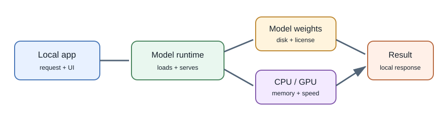
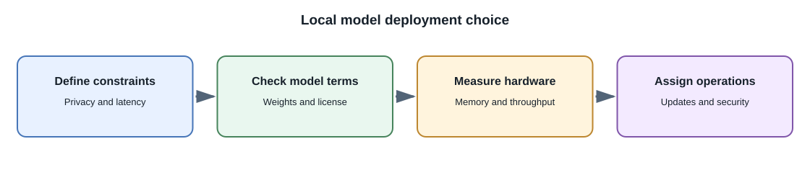

# Running Models Locally

## Introduction

**Local inference** runs a model on your own computer or on infrastructure
you control instead of sending each request to a hosted model API. It can be
useful for learning, offline experiments, privacy-sensitive workflows, or
reducing dependence on a particular hosted service.

"Free" usually means no provider charge per request. It does not mean zero
cost: hardware, electricity, disk space, setup, speed, and maintenance still
matter. Some model weights also have licenses or usage terms.

## Common ways to run a model

| Approach | What it provides | Useful when |
|---|---|---|
| Desktop model application | UI for downloading and chatting with local models | Learning and manual experiments |
| Local model runner with an HTTP endpoint | A local service an application can call | Prototyping an integration on one machine |
| Python inference libraries | Code-level model loading and inference | Experiments, model evaluation, and ML development |
| Self-hosted inference server | Model endpoint on your own machine or cloud GPU | A team needs controlled hosting or a private deployment |

Examples include Ollama and LM Studio for local experimentation, llama.cpp
for efficient inference across supported hardware, and Hugging Face
Transformers for programmatic model workflows. These tools are not
interchangeable; check supported hardware, model formats, licenses, and
security settings.

## Local application flow

1. Select a model whose license permits your intended use.
2. Download its weights from a trusted source and verify the source and
   published checksums where available.
3. Load it with a compatible runtime and hardware configuration.
4. Send prompts to the local process or its loopback HTTP endpoint.
5. Measure latency, memory use, output quality, and failure behavior.

For an application running on the same computer, bind development services
to loopback where possible. Do not expose a local model server to a network
without authentication and access controls.

## Hardware and model size

Inference requires model weights and working memory for intermediate
calculations and the context. Quantization stores weights with fewer bits
than the original representation and can reduce memory needs, usually with
some quality or numerical trade-off. GPU support can increase throughput,
but model format and available memory determine what fits.

A smaller quantized model may be more practical on a laptop than a larger
model, but task quality varies. Use a small test set for your task rather
than choosing only by model size or a benchmark score from another workload.

## Privacy and offline use

Local inference can keep prompts on a machine you control, but it does not
automatically guarantee privacy. The application may still log prompts,
synchronize files, expose a local network port, or load untrusted model
artifacts. Review telemetry, storage, permissions, and network behavior.

Offline operation is possible only if the runtime, weights, and application
dependencies are already available and the chosen features do not require
an external service.

## Local versus hosted inference

| Consideration | Local | Hosted API |
|---|---|---|
| Per-request provider billing | None for local-only inference | Usually usage-based or subscription-based |
| Upfront resources | Local/server hardware and operations | Provider manages inference infrastructure |
| Data path | Can remain on controlled hardware | Input is transmitted to the provider under its terms |
| Scaling | You provision and operate capacity | Provider may scale within quotas and service limits |
| Model access | Depends on available weights and license | Depends on provider's available models |
| Maintenance | Runtime, drivers, model updates, monitoring | Provider API and model lifecycle management |

There is no universal winner. Hybrid systems may route sensitive or offline
tasks locally and other tasks to an approved hosted service.

## Full-stack development

The browser should call your backend, and the backend should call the local
model server. Do not make a local inference endpoint public merely to let
the browser reach it. In production, use an authenticated service boundary,
resource limits, monitoring, and a queue if generation is too slow for
request-response work.

## Common misconceptions

- Local models do not require a paid API key, but still consume hardware and
  operational resources.
- A model downloaded locally is not necessarily open source or unrestricted.
- Quantization can help a model fit; it does not guarantee unchanged quality.
- Running locally does not make outputs accurate or safe by itself.

## Further learning

- [Ollama documentation](https://docs.ollama.com/)
- [LM Studio documentation](https://lmstudio.ai/docs)
- [llama.cpp](https://github.com/ggml-org/llama.cpp)
- [Hugging Face Transformers documentation](https://huggingface.co/docs/transformers/)
- [Hugging Face Hub: Model licenses](https://huggingface.co/docs/hub/repositories-licenses)
