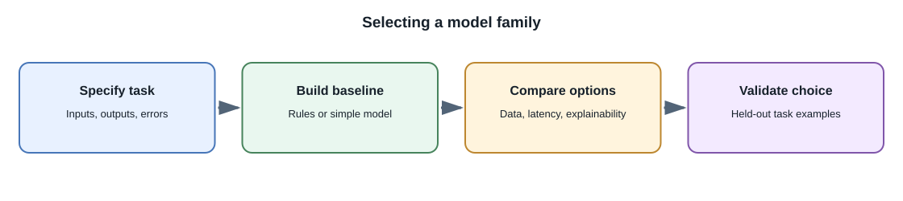
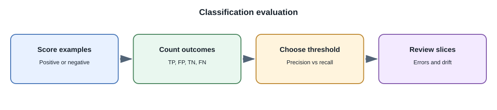

# Machine Learning and Deep Learning

## Introduction

Machine learning includes methods that learn patterns from data. **Deep
learning** is a branch of machine learning based on neural networks with
multiple learned layers. Modern language, image, speech, and multimodal
models often use deep learning, but many valuable prediction tasks use
simpler methods.

## Why are there different methods?

Different tasks have different data sizes, shapes, risks, and latency
requirements. A small decision tree can be easier to inspect for a structured
business rule. A neural network can learn useful representations from large
amounts of text or images. The most complex model is not automatically the
best system.

## A practical comparison

| Method family | Typical inputs | Example task | Strengths and limits |
|---|---|---|---|
| Rules and heuristics | Explicit conditions | Reject an expired session | Predictable and easy to explain; brittle when cases multiply |
| Linear models | Structured numeric or encoded features | Estimate churn probability | Fast and often interpretable; limited nonlinear relationships |
| Decision trees and ensembles | Structured tabular features | Rank applications for manual review | Strong on tabular data; care is needed with bias and explanations |
| Clustering | Feature vectors without labels | Group similar products | Finds structure; groups may not match useful business categories |
| Neural networks | Text, images, audio, and other representations | Transcribe speech or classify an image | Learns rich patterns; needs suitable data, compute, and evaluation |
| Foundation models | Broad pretraining across large datasets | Generate text, images, or code | Reusable across tasks; can be expensive, opaque, or unreliable for a specific task |

These descriptions are indicative, not rules. A neural network can also work
with structured data, and a foundation model is itself a trained model
family, not a guarantee of general intelligence.

For **regression**, a model predicts a numeric value such as delivery time.
For **classification**, it predicts a label or class score such as ticket
category. **Clustering** groups examples without known labels. A
**recommendation or ranking system** orders candidate items for a user or
context. A simple rule or linear model can be the right starting point when
its behavior is easier to validate than a more complex model.

## Training, validation, and test data

To estimate generalization, teams commonly separate examples into:

- **Training set:** data used to fit model parameters.
- **Validation set:** data used to compare configurations and tune
  decisions.
- **Test set:** held-back data used for a final estimate after choices are
  made.

The split must reflect how the model will be used. For time-dependent
events, a chronological split may be more realistic than random shuffling.
For user-level data, keep the same user's records from leaking across
training and test sets when that would make evaluation misleading.

**Overfitting** happens when a model fits accidental details in its training
data and performs poorly on new examples. **Underfitting** happens when the
model is too limited or insufficiently trained to capture useful patterns.
Evaluation data, regularization, and appropriate model capacity help
identify these problems.

## Metrics depend on the task

Accuracy alone can be misleading. If only 1 in 1,000 transactions is
fraudulent, a model that always predicts "not fraud" has 99.9% accuracy but
detects none of the fraud cases.

| Metric | What it summarizes | Example use |
|---|---|---|
| Precision | Of predicted positives, how many were positive? | Reduce false alerts |
| Recall | Of actual positives, how many were found? | Catch more cases needing review |
| F1 score | Harmonic balance of precision and recall | Compare a selected classification threshold |
| Mean absolute error | Average absolute numeric prediction error | Demand or delivery-time estimate |
| Calibration | Whether predicted probabilities match observed frequencies | Risk scores used for prioritization |

Choose metrics with stakeholders and examine errors by relevant groups and
conditions. The cost of a false positive and a false negative may be very
different.

For a binary classifier, a **true positive** is a positive case correctly
found; a **false positive** is an incorrect alert; a **true negative** is a
correctly rejected case; and a **false negative** is a missed positive.
Changing a score threshold trades precision against recall. In a banking
fraud-review workflow, the model can prioritize cases for a person to
inspect; it should not be treated as an infallible decision or as a
substitute for an appeal and compliance process.

## How model parameters are learned

During training, a model produces predictions in a **forward pass**. A
**loss function** compares those predictions with targets. **Backpropagation**
computes gradients describing how parameters contributed to that loss, and
an optimizer such as stochastic gradient descent uses those gradients to
update parameters. Learning rate, batch size, model capacity, data quality,
and objective all affect the result. A lower training loss alone does not
prove that a model generalizes.

## Data leakage and drift

**Data leakage** occurs when evaluation or training accidentally includes
information that would not be available at prediction time, or when
evaluation examples indirectly reveal their labels. It can make offline
scores look excellent while production performance is poor.

**Data drift** means the distribution of incoming inputs changes.
**Concept drift** means the relationship between inputs and the desired
outcome changes. A deployed model needs monitoring and a plan for
re-evaluation; it does not stay correct merely because its code has not
changed.

## Full-stack example

Suppose a support application predicts a ticket category. The API validates
the submitted text, sends safe features to the model service, stores the
prediction and model version, and routes low-confidence cases to a person.
The user interface should explain the suggestion and support correction.
The model should not be given private account data it does not need.

## Developer perspective

Start with a baseline such as a rule or simple model and define a measurable
target. Keep training and serving data pipelines explicit and versioned.
Evaluate failure cases rather than only reporting one average score.

## Common misconceptions

- Deep learning is not always more accurate than simpler methods for every
  dataset.
- A model score is not a certainty or an explanation.
- Randomly splitting data is not always a valid evaluation design.
- A high metric can result from data leakage or an unsuitable test set.

## Further learning

- [Google Machine Learning: Classification metrics](https://developers.google.com/machine-learning/crash-course/classification/accuracy-precision-recall)
- [Google Machine Learning: Generalization](https://developers.google.com/machine-learning/crash-course/overfitting/overfitting)
- [NIST AI Risk Management Framework](https://www.nist.gov/itl/ai-risk-management-framework)
