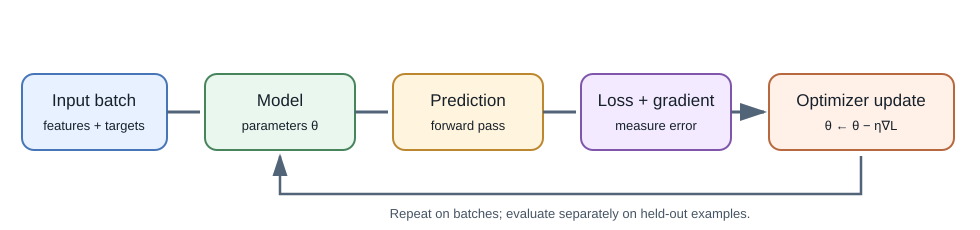
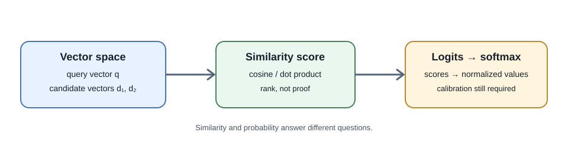

# Mathematics for Machine Learning

## Introduction

You do not need advanced mathematics to call a model API. A practical
understanding of vectors, probability, loss, and gradients helps explain
what models learn, how embeddings are compared, and why training changes
parameters.





## Scalars, vectors, and matrices

- A **scalar** is one value, such as a learning rate.
- A **vector** is an ordered list of values, such as an embedding or a row
  of numeric features.
- A **matrix** is a grid of values. A dataset with rows for examples and
  columns for features can be represented as a matrix.
- A **tensor** generalizes arrays to more dimensions, such as a batch of
  images with height, width, and color channels.

Dimensions are part of the meaning. If a batch has 32 examples and each has
10 features, its shape is commonly written `(32, 10)`. Matrix operations
require compatible dimensions; shape errors often reveal a mistaken
assumption about the data.

## Dot product and cosine similarity

For vectors \(a\) and \(b\), the dot product multiplies corresponding
entries and sums the results:

\[
a \cdot b = \sum_i a_i b_i
\]

Cosine similarity divides the dot product by the vector lengths:

\[
\operatorname{cosine}(a,b) =
\frac{a \cdot b}{\|a\|\|b\|}
\]

It emphasizes direction rather than raw magnitude. Embedding models and
indexes may use cosine similarity, dot product, or another distance; use
the metric expected by the specific embedding and index.

```python
from math import sqrt

def cosine(a, b):
    dot = sum(x * y for x, y in zip(a, b))
    norm_a = sqrt(sum(x * x for x in a))
    norm_b = sqrt(sum(y * y for y in b))
    if norm_a == 0 or norm_b == 0:
        raise ValueError("cosine similarity is undefined for a zero vector")
    return dot / (norm_a * norm_b)

print(round(cosine([1, 0], [0.8, 0.2]), 3))  # 0.970
```

High similarity means the representation is close under the chosen metric.
It does not mean that a passage is correct, authorized, or actually answers
a question.

## Probability, logits, and softmax

A model classifier may return **logits**, real-valued scores that are not
probabilities. The **softmax** function converts a vector of logits into
positive values that sum to one:

\[
\operatorname{softmax}(z_i) =
\frac{e^{z_i}}{\sum_j e^{z_j}}
\]

In practice, subtract the largest logit before exponentiation to reduce
overflow:

```python
from math import exp

def softmax(logits):
    peak = max(logits)
    values = [exp(value - peak) for value in logits]
    total = sum(values)
    return [value / total for value in values]

print([round(p, 3) for p in softmax([2.0, 1.0, 0.1])])
# [0.659, 0.242, 0.099]
```

The resulting values sum to one for this candidate set, but a value such
as `0.659` is not automatically a calibrated 65.9% chance of correctness.
Calibration must be measured against outcomes.

## Loss and cross-entropy

A **loss function** assigns a numeric penalty to model predictions during
training. For a classification task with a correct class \(y\) and
predicted probabilities \(p\), cross-entropy loss is:

\[
L = -\log(p_y)
\]

Assigning higher probability to the correct class reduces this loss.
Training usually averages or otherwise aggregates losses across examples.
The training objective is a useful signal, not a complete measure of
product quality, truthfulness, or safety.

## Gradients and gradient descent

A **gradient** describes how a small change in parameters would change a
loss. Gradient descent updates parameters in the direction that reduces
loss:

\[
\theta_{\text{new}} = \theta_{\text{old}} -
\eta \nabla_\theta L
\]

Here, \(\theta\) represents model parameters and \(\eta\) is the
**learning rate**. If the learning rate is too large, optimization can
overshoot; if too small, learning can be slow. **Backpropagation** applies
the chain rule to calculate gradients through a neural network.

For a tiny linear regression example, use the model \(y = wx + b\). The
following pseudocode-like Python sketch shows the repeated update:

```python
for x, target in examples:
    prediction = weight * x + bias
    error = prediction - target
    weight_gradient += 2 * error * x / len(examples)
    bias_gradient += 2 * error / len(examples)

weight -= learning_rate * weight_gradient
bias -= learning_rate * bias_gradient
```

This sketch omits initialization and the outer training loop; it illustrates
the update only. In deep networks, automatic differentiation libraries
calculate these gradients over many tensor operations.

## Batches, epochs, and generalization

- A **batch** is a subset of training examples used for one parameter
  update.
- An **epoch** is one pass through a training dataset.
- A **learning rate schedule** changes the update size during training.
- **Regularization** discourages some forms of overly complex fitting.
- A **validation set** helps compare choices; a **test set** should remain
  held out for a final estimate.

Training well on examples is not enough. A model must generalize to cases
that represent its actual use. See [Machine Learning and Deep Learning](machine-learning-foundations.md)
for data splits, metrics, and leakage.

## Full-stack developer perspective

For application work, these ideas explain why embeddings have dimensions,
why similarity is only a ranking signal, why classifiers need thresholds,
and why training loss is not a user-facing success metric. You usually use
a library or API for the calculations, but you should still understand what
its scores and metrics do—and do not—mean.

## Further learning

- [3Blue1Brown: Essence of Linear Algebra](https://www.3blue1brown.com/topics/linear-algebra)
- [Google Machine Learning: Gradient descent](https://developers.google.com/machine-learning/crash-course/linear-regression/gradient-descent)
- [Google Machine Learning: Classification metrics](https://developers.google.com/machine-learning/crash-course/classification/accuracy-precision-recall)
