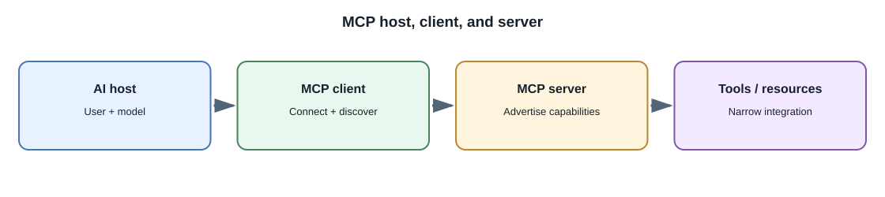
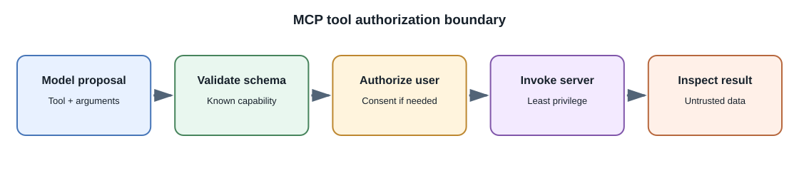

# Model Context Protocol and Agent Integrations

## Introduction

**Model Context Protocol (MCP)** is an open protocol for connecting AI
applications to external tools and context sources through a common
client-server model. An MCP server can expose capabilities such as tools,
resources, or prompts. MCP standardizes parts of the connection; it does
not make a server trustworthy or decide whether a user may perform an
action.

## Main concepts

- **Host:** the AI application that manages the user's session and model
  interaction.
- **Client:** the protocol component in the host that connects to a
  particular server.
- **Server:** a process or service that advertises capabilities.
- **Tools:** operations the model may request through the host.
- **Resources:** data the host may retrieve through the protocol.
- **Prompts:** reusable prompt templates or workflows provided by a
  server.

The exact protocol version, transports, and capability details evolve.
Consult the current MCP specification when implementing a client or server.



## What can an MCP server provide?

The server advertises capabilities; the host decides which ones to expose
to the model or user.

| Capability | Direction and purpose | Example |
|---|---|---|
| Tools | The model may request an operation through the host | Search an issue tracker or create a draft |
| Resources | The host can read data exposed by a server | A document, record, or application context |
| Prompts | The server can provide a reusable prompt template | A guided code-review or research prompt |

Depending on protocol version and negotiated capabilities, client-side
features can include roots, sampling, elicitation, and tasks. A capability
is not automatically available just because the other side implements
MCP; the client and server negotiate supported protocol features.

## How an MCP connection is established

1. A user or administrator configures a trusted server for an MCP-capable
   host.
2. The host creates an MCP client and selects a compatible transport.
3. Client and server exchange protocol/version and capability information.
4. The client discovers server capabilities and presents only approved
   tools, resources, or prompts to the model.
5. When the model proposes a tool call, the host applies policy and
   confirmation before invoking the server.
6. Results return through the client, are treated as untrusted data, and
   may be added to the model's context.

The protocol connection is between host/client and server. The model
typically does not open an MCP socket or directly execute a server tool.



## Standard transports and deployment choices

The current MCP specification defines two standard transports:

| Transport | How it connects | Typical use | Main security considerations |
|---|---|---|---|
| **stdio** | The host launches a local server process and exchanges newline-delimited JSON-RPC messages over standard input/output | Local tools and developer integrations | The configured command runs as a process with the host user's permissions; review its executable, arguments, working directory, and environment |
| **Streamable HTTP** | A client sends JSON-RPC messages to one HTTP endpoint; responses may be JSON or a request-scoped server-sent-event stream | Remote or shared servers | Authenticate and authorize requests, protect transport, validate origin/host behavior, and isolate tenants |

Streamable HTTP replaced the older HTTP+SSE transport in protocol
2025-03-26. Older clients may still support HTTP+SSE for compatibility;
new integrations should follow the current specification and verify the
client/server versions. Transport and capability details can change, so
check compatibility rather than assuming every host supports every mode.

### Illustrative host configuration

Some desktop hosts use a JSON configuration shaped like this for a local
stdio server:

```json
{
  "mcpServers": {
    "project-search": {
      "command": "python",
      "args": ["server.py"],
      "env": {}
    }
  }
}
```

Remote-server configuration may instead specify a URL and authentication
settings. Configuration schemas and file locations are **host-specific**;
`mcpServers` is an example convention, not a field required by the MCP
protocol. Do not copy tokens or secrets into a checked-in config file.

Conceptually, a remote client connects to a configured MCP endpoint:

```text
MCP client -> HTTPS endpoint -> authenticated MCP server
```

The host may start the stdio process itself, or a platform may manage that
process. For remote services, follow the server's authentication and
deployment guidance. MCP authorization supports OAuth-based patterns for
HTTP transports; stdio normally relies on local process configuration and
OS permissions instead of HTTP OAuth.

## Tool use through a host

1. The host connects to a configured server and discovers supported
   capabilities.
2. The application decides which capabilities are appropriate for the
   current user and task.
3. The model may propose a tool call with structured arguments.
4. The host validates the request, checks authorization, and obtains any
   required user confirmation.
5. The host invokes the tool and returns a bounded result to the model.
6. The application validates and presents the final answer or action.

## MCP and custom tool calling

| Choice | Advantages | Considerations |
|---|---|---|
| Provider-specific function calling | Direct integration with one model API | Tied to that provider's tool format |
| Application-defined tools | Full control over exposed operations | Each integration needs custom schemas and maintenance |
| MCP | Common protocol for capability discovery and integrations | Requires client/server lifecycle, version, security, and compatibility management |

MCP can improve interoperability; it does not replace application
authorization, business rules, audit logging, or user confirmation.

## What MCP servers and integrations are available?

The ecosystem includes local or remote servers for categories such as
files and project search, source-control and issue trackers, databases,
documentation, communications, and other business systems. Implementations
may be first-party, community-maintained, or vendor-provided. Availability,
maintenance, and trustworthiness are not implied by being listed in a
catalog or appearing in a host's UI.

Before connecting one, verify its publisher and source code where
appropriate, supported protocol version, requested permissions, data
handling, update process, and whether it transmits information to another
service. Prefer the narrowest server and access scope that satisfies the
task. A database server should expose task-specific operations rather than
unrestricted credentials or query execution when a narrower interface is
possible.

## Security checklist

- Trust only reviewed, explicitly configured servers.
- Authenticate remote connections and protect transport credentials.
- Use least privilege for each server and tool.
- Validate all arguments and outputs against schemas and business rules.
- Treat resource contents and tool results as untrusted input.
- Require confirmation for destructive, financial, or external actions.
- Record useful audit events without retaining unnecessary sensitive data.
- Set network, time, size, and call-count limits.
- Review dependencies and update protocol implementations.

## Agent design

An agent is a model-directed control loop that can select tools, inspect
results, and continue. Keep the loop bounded by allowed tools, step count,
time, token budget, and user permissions. Prefer a deterministic workflow
when the task has a known sequence. Make state, retries, and side effects
explicit and idempotent.

## Further learning

- [Model Context Protocol documentation](https://modelcontextprotocol.io/)
- [Model Context Protocol specification](https://modelcontextprotocol.io/specification/)
- [MCP transport specification](https://modelcontextprotocol.io/specification/2026-07-28/basic/transports)
- [MCP authorization specification](https://modelcontextprotocol.io/specification/2026-07-28/basic/authorization)
- [MCP security best practices](https://modelcontextprotocol.io/specification/2026-07-28/basic/security_best_practices)
- [Build an MCP server](https://modelcontextprotocol.io/docs/develop/build-server)
- [OWASP Top 10 for LLM Applications](https://genai.owasp.org/llm-top-10/)
