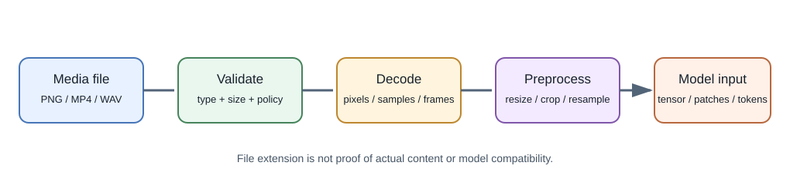
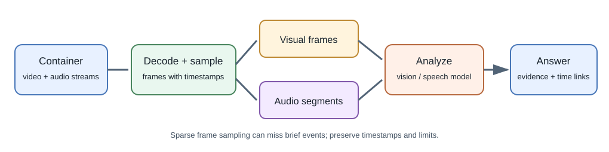

# Images, Audio, and Video Formats for AI

## Introduction

An image, audio recording, or video file is encoded data—not a model input
format by itself. An application must decode a file, interpret its
dimensions, color or timing, apply any required preprocessing, and send a
representation the selected model accepts.





## Raster and vector images

**Raster images** store a grid of pixels. Each pixel has color samples,
often represented by red, green, and blue channels (RGB), and may include
an alpha channel for transparency. Resolution is the number of pixels; a
larger image can carry detail but use more memory and model context.

**Vector graphics** describe shapes and paths mathematically, often with
text and style rules. They can scale cleanly for diagrams and icons, but
they must be rendered to pixels for many computer-vision models.

| Format | Kind and typical properties | Useful fit and caveat |
|---|---|---|
| PNG | Raster; lossless compression; transparency supported | Screenshots, diagrams, and sharp edges; can be large for photographs |
| JPEG / JPG | Raster; lossy photographic compression | Photos; repeated re-encoding can add artifacts and it does not support alpha |
| WebP | Raster; lossy and lossless options, transparency and animation supported | Web delivery; confirm target tool and model accept it |
| AVIF | Raster image format based on AV1 image coding | Efficient web images in supported pipelines; decoding support varies |
| GIF | Palette-based raster; animation supported | Simple short animations; limited color compared with modern formats |
| SVG | XML-based vector description | Logos, icons, and diagrams; sanitize untrusted SVG before serving or rendering |

PNG was developed by the PNG Development Group and is now specified by
standards organizations including W3C. JPEG is specified through the
Joint Photographic Experts Group standards process (including ISO/IEC and
ITU-T publications). SVG is maintained by the W3C SVG Working Group.
Google introduced WebP as a web image format. AVIF builds on the AV1 image
coding work from the Alliance for Open Media. These names describe
standards or organizations rather than one individual inventor.

## What an image model receives

A vision pipeline commonly decodes an image into pixel values, applies
orientation and color handling, resizes or crops it, and converts it into
numeric tensors. Some vision transformer systems split an image into
**patches**. Multimodal systems may encode patches or crops into
representations that are combined with text tokens. Exact pipelines vary
by model.

The model may resize a large image, sample several crops, or impose a
resolution limit. A small chart can become unreadable if the application
resizes it too aggressively. Strip unnecessary metadata and enforce upload
limits, but preserve task-relevant resolution.

### A small image-inspection example

Using Pillow in a Python environment, inspect dimensions and color mode
before deciding on preprocessing:

```python
from PIL import Image

with Image.open("diagram.png") as image:
    print(image.format, image.size, image.mode)
    rgb_image = image.convert("RGB")
```

This reads and converts pixels; it does not call an AI model. The Pillow
decoder must support the input format, and uploaded data should be validated
and size-limited before decoding.

## Video: container, codec, frames, and timestamps

A **container** such as MP4 or WebM packages streams and metadata. A
**codec** such as H.264, VP9, AV1, or H.265 compresses video frames; audio
may use codecs such as AAC or Opus. A filename extension alone does not
guarantee that the content uses a particular codec.

Video models may consume a video file, sampled frames, audio, or a mixture.
For frame sampling, the application chooses times or a rate; sparse
sampling can miss short events, while dense sampling costs more. Retain
timestamps so an answer can link to the relevant moment. Audio may be
transcribed separately or processed by an audio-capable model.

```powershell
# Inspect a local file's streams and codecs when FFmpeg is installed.
ffprobe -hide_banner -show_streams -show_format .\meeting.mp4
```

Review the command output before passing media to an external provider.
FFmpeg tools are optional; model providers may accept different containers,
codecs, durations, and sizes.

## Audio representation

Digital audio is a sequence of samples. **Sample rate** describes samples
per second; **bit depth** describes the precision of each sample;
**channels** describe separate streams such as left and right stereo.
Compression may be lossless (for example FLAC) or lossy (for example MP3,
AAC, or Opus). A container such as WAV can store uncompressed PCM, while
other containers can carry compressed streams.

Speech models may require a particular encoding, sample rate, channel
layout, and duration. Resampling and channel mixing must be deliberate;
they can change speech quality. Preserve timestamps and speaker segments
when the application needs a transcript users can verify.

## Web delivery versus model input

The best browser asset is not necessarily the best model input. WebP or
AVIF may reduce download size, while a provider endpoint may accept only a
different set of formats. A browser can display SVG while a vision model
expects raster pixels. Keep the delivery format and inference preprocessing
as separate decisions.

## Security and privacy

Validate actual file content, not only its extension or client-supplied
MIME type. Bound size, pixel dimensions, duration, and decompression work.
Treat metadata, embedded text, subtitles, and OCR output as untrusted.
Images and recordings can contain faces, locations, voices, or other
sensitive data; minimize processing and apply the product's consent,
retention, and access policies.

## Further learning

- [W3C PNG specification](https://www.w3.org/TR/png/)
- [W3C SVG Working Group](https://www.w3.org/groups/wg/svg/)
- [Google WebP documentation](https://developers.google.com/speed/webp)
- [Alliance for Open Media AV1](https://aomedia.org/av1-features/)
- [MDN: Image file type and format guide](https://developer.mozilla.org/en-US/docs/Web/Media/Guides/Formats/Image_types)
- [MDN: Web video codec guide](https://developer.mozilla.org/en-US/docs/Web/Media/Guides/Formats/Video_codecs)
