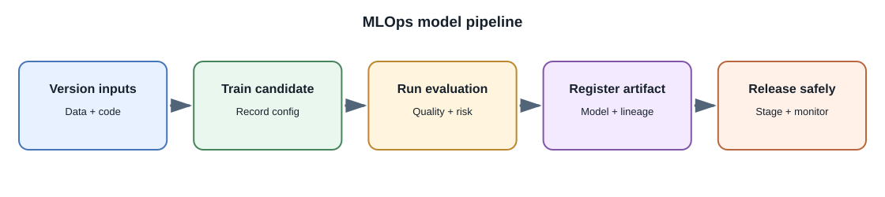
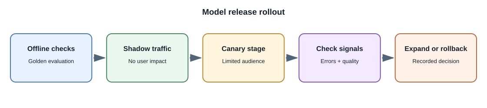

# MLOps and the Model Lifecycle

## Introduction

**MLOps** applies software delivery and operations practices to machine
learning systems. It covers reproducible data and training pipelines,
model and prompt versioning, evaluation gates, deployment, monitoring, and
retirement. For a full-stack AI feature, the lifecycle also includes
retrieval indexes, tool definitions, policy configuration, and application
code.

## Lifecycle components

1. **Data pipeline:** ingest, validate, transform, and version inputs.
2. **Experiment tracking:** record code, configuration, data, model
   parameters, metrics, and artifacts.
3. **Evaluation gate:** compare a candidate with a baseline on a held-out
   suite; test safety, latency, and cost constraints as well as quality.
4. **Model registry:** store approved artifacts and metadata with
   reproducible identifiers.
5. **Deployment:** release through staged environments, shadow testing,
   canary traffic, or a rollback plan.
6. **Monitoring:** track system health and quality signals, investigate
   drift, and re-evaluate when data or model behavior changes.
7. **Retirement:** remove unsupported versions and clean up dependent
   indexes, endpoints, and credentials.

## Version more than model weights

A reproducible AI feature may depend on:

- model provider, model identifier, and version;
- prompt and tool schemas;
- retrieval index and embedding-model version;
- data transformations and chunking configuration;
- safety policy and output validator;
- application code and evaluation set.

If one of these changes, compare system behavior before and after the
change. A provider alias that silently points to a new model can alter
quality, latency, or cost.

## Monitoring

Track service availability, latency percentiles, timeouts, rate limits,
queue depth, resource use, and cost. Where appropriate and privacy-safe,
track task completion, user corrections, citation validity, refusal and
escalation rates, and evaluation results. Log identifiers and aggregate
signals rather than sensitive prompts by default.

Model quality is harder to monitor than CPU or HTTP status. Add sampled
human review, user feedback, offline regression suites, and privacy-aware
incident investigation. A change in model output may come from input
distribution, retrieval, prompt, provider version, or code.

## Rollback and incidents

Keep a known-good version and a safe fallback. Define how to disable a
feature, revoke a key, rebuild an index, or route a task to human review.
Do not use a previous model blindly if its license, safety status, or data
dependencies differ.

## Further learning

- [Google Cloud MLOps continuous delivery and automation](https://cloud.google.com/architecture/mlops-continuous-delivery-and-automation-pipelines-in-machine-learning)
- [MLflow documentation](https://mlflow.org/docs/latest/)
- [NIST AI Risk Management Framework](https://www.nist.gov/itl/ai-risk-management-framework)
