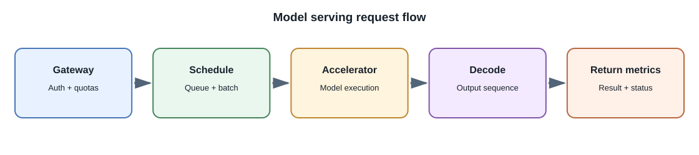
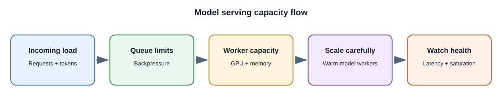

# Model Serving and Inference Infrastructure

## Introduction

**Model serving** exposes a trained model through an interface that an
application can call. A serving system loads model weights, accepts
requests, runs inference on available hardware, and returns results. It
may be a hosted provider, a managed cloud endpoint, or infrastructure
operated by your team.

## Serving choices

| Option | Team operates | Trade-offs |
|---|---|---|
| Hosted provider API | Application integration and policy controls | Fastest setup; provider terms, quotas, latency, and price apply |
| Managed cloud endpoint | Model selection, application integration, and configuration | Less infrastructure work than self-hosting; availability and hardware choices vary |
| Self-hosted inference server | Model runtime, hardware, scaling, upgrades, security, and observability | More control; high operational and capacity-planning burden |
| On-device runtime | Packaging, supported hardware, updates, and local UX | Can work offline and keep inference local; device capability and model size constrain quality and speed |

Choose by measured quality, data policy, availability, latency, throughput,
operational capability, and total cost. "Open weights" does not remove
license obligations or operational work.

## What happens inside a serving system?

1. A gateway checks authentication, quotas, request size, and model access.
2. A scheduler queues requests and may combine compatible work into a
   batch.
3. The runtime tokenizes or otherwise prepares the input, loads model
   weights, and uses CPU, GPU, or another accelerator.
4. The model produces output; a decoder or task-specific postprocessor
   formats it.
5. A response layer streams or returns the result and emits operational
   metrics.

## Performance techniques and trade-offs

- **Quantization:** represents weights or activations with lower precision
  to reduce memory or improve throughput. Quality changes must be
  evaluated; support varies by model and hardware.
- **Batching:** executes multiple requests together to use accelerators
  efficiently. Waiting to form a batch can add latency.
- **Continuous batching:** adds and removes sequences while a batch is
  running, improving utilization in some generation workloads.
- **KV caching:** retains attention state for active generation, reducing
  repeated computation while consuming memory.
- **Model parallelism:** splits a large model across devices, adding
  communication and operational complexity.
- **Autoscaling:** adds capacity when demand rises, but model loading,
  accelerator availability, and warm-up time make scaling slower than
  ordinary stateless web workers.

Optimize only after measuring queue time, time to first token, generation
speed, tail latency, memory, throughput, and cost per completed task.

## Reliability and security

Limit request and output size, protect model endpoints, isolate tenants,
patch the runtime, and monitor GPU or accelerator health. Use deadlines,
bounded queues, cancellation, and explicit overload responses. Do not allow
an internal inference endpoint to become publicly reachable without
authentication and rate controls.

## Developer perspective

Most full-stack developers should begin with a hosted API or managed
endpoint. Self-host when privacy, latency, control, economics at measured
scale, or product requirements justify the operational cost.

## Further learning

- [Hugging Face Text Generation Inference](https://huggingface.co/docs/text-generation-inference/)
- [vLLM documentation](https://docs.vllm.ai/)
- [NVIDIA Triton Inference Server](https://docs.nvidia.com/deeplearning/triton-inference-server/user-guide/docs/)
